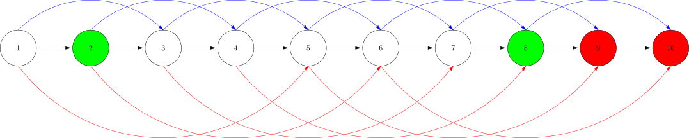

[[toc]]

## 前提说明

这一节我们将要学习倍增思想,倍增思想是一种常用的算法设计策略,特别在解决一些优化问题和数据结构中有广泛的应用.它的核心思想是通过将问题的规模在每一步骤中以某种方式加倍,从而有效地减少问题的复杂度.

它是后面相关算法,ST表,动态规划优化,线段树的基础.


## 倍增思想介绍 

倍增思想（或称为“指数增长”思想）是一种常用的算法设计策略，特别在解决一些优化问题和数据结构中有广泛的应用。它的核心思想是通过将问题的规模在每一步骤中以某种方式加倍，从而有效地减少问题的复杂度。
以下是一些倍增思想的具体应用：

1. 二分查找：在一个有序数组中，通过每次将搜索范围缩小一半（即对半分），可以在对数时间复杂度内找到目标值。
2. 动态规划中的倍增：在某些动态规划问题中，可以通过存储中间结果并逐步扩展解决方案，达到减少重复计算的目的。例如，在计算斐波那契数列时，可以通过保存之前的结果来减少计算量。
3. 图算法中的倍增：在最短路径或网络流问题中，倍增可以帮助优化计算，例如使用倍增法来提高路径查询的效率。
4. 区间查询：在某些数据结构（如树状数组或线段树）中，倍增思想被用来高效处理区间查询或更新。
5. 倍增技术在动态数组中：动态数组在需要扩展时，通常会将容量加倍，以减少频繁的内存分配操作，从而提高性能。

倍增思想的关键在于通过有效地减小问题规模或增加效率，通常可以显著降低时间复杂度，使得原本可能是指数级别或线性级别的问题能够在对数或多项式时间内解决。这种方法在编程和算法设计中非常有用，尤其是在处理大规模数据时。

## 问题引入

现有一个序列$1,2,\cdots,n$,小明处于某个位置$x$,现有一个位置$y(x<y \leqslant n)$,位置$y$右边(不包含有$y$)的所有的位置都**不可以到达**的位置,这些位置我们称为**禁止位置**

又发现每次可以向右跳转$2^i,i \in \mathbb N$,问

1. 是否存在一种方案可以跳到$y$
2. 如果存在,那么最少的跳跃次数是多少?
3. 如果存在,那么最快的跳跃方案是什么?
4. 这种最快的跳跃方案是唯一的吗?
5. 证明这种最快方案的普遍性


## 思维过程

根据"怎样解题"这本书的说法,第一步是理解题目.**没有数据是没有办法思考🤔的**.最好不要上来就进行逻辑推理.

写出一个随机数生成程序,然后随机生成一些数据,然后观察数据,然后进行推理.

```python
from random import randint
n = randint(6,10)
x = randint(1,n/2)
y = randint(x+1,n)
print(n,x,y)
```

```
10 1 5
8 2 6
9 3 7
10 1 8
```

然后发现我们应该固定$n$比较如何观察规律

```
10 1 10
10 1 9
10 1 8
10 1 7
10 1 6
10 1 5
```

发现了规律,最小跳转方案是: $\sum 2^i = y-x,i \in \mathbb N$,也就是满足$\sum 2^i = y-x$的最小的$i$的集合.对应的是就$y-x$二进制位置上的$1$


具体跳法是什么?

先跳$2^{max}$,然后跳$2^{max-1},2^{max-2} ,\cdots,2^0$,且每一次跳跃遵循的方案为:如果到达的位置超过$y$,则不跳,否则跳到该位置.

其中$max$要足够大,那么选多大合适呢?$max = \lceil \log_2(y-x) \rceil$,当然为了简化计算,这样取也可以$max = \lceil log_2^n \rceil$


<div class="iframe-container">
<a href="/canvas/binary_jump" target="_blank">新标签打开</a>
<iframe height="400" frameborder="1" src="/canvas/binary_jump"></iframe>
</div>


## 一步一步的启发式思考(证明)

你可能还会觉得上面的**观察找规律法**思维跳越了.那么我们一步一步的思考.

我们已知的:

1. 当给我们一个位置$p$,我们可以在$O(1)$内知道$p$是否是禁止位置
2. 根据位置$i$是否是禁止位置$f(i)$,$f(i)$具有二分性
3. 我们可以在$O(1)$内知道位置$i$是跳转$2^k$的位置
4. 设$jump(i,j)$表示从位置i走j步到达的位置.
5. 发现"跳跃$jump$"是**可合并的**.因为是在一条线性数据上跳转,只有一条路径,所以显示跳转这个操作$jump(i,j)$是的答案是唯一,所以等式$jump(i,x+y) = jump(jump(i,x),y)$是成立的(结合律).





$$
jump(i,x+y) = jump(jump(i,x),y)
$$

> 这是一个很有用的性质. 本质上是函数具有一唯一映射的性质.后面我们再证明这个性质具有结合律.


证明1: 是否存在一种方案可以跳到$y$

因为每一个可以选择跳跃$2^0$,所以存在一种跳跃,全部选$2^0$,一定可以从$x$到达$y$.

证明2: 如果存在一种跳跃方案,设为$(a_1,a_2,a_3,\cdots,a_x)$,其中$a_i = 2^k,k\in \mathbb N$,则交换这个方案的中的任意相邻位置,不影响方案的正确性.简单的说就是满足交换率.


TODO

证明3: 跳跃方案的任意两个元素都不相同.

根据证明2,显然,我们可以交换任意相邻的位置,不影响方案的正确性.那么把方案按$2^k$的大小从大到小排序,那么大小的相同的值,一定在一起.

且我们发现如果跳跃两次相邻且相同,设为$2^k$,那么可以合并成一次跳跃$2^{k+1}$.按这种策略,最后会形成一个方案(集合).且这个集合之中的任意两个元素都不相同.

显然这个集合的合是$y-x$的总长度.

证明4: 跳跃方案的一定含有$\lfloor log_2^{y-x} \rfloor$

根据数学知识知道,$\lfloor log_2^{y-x} \rfloor$等于$y-x$(后称为$len$)对应的二进制的只保留最高位置的$1$后得到数字.

根据证明3,任意两个跳跃$a_i,a_j$的值不一样. 显然一定不会存一个跳跃超过$\lfloor log_2^{y-x} \rfloor$,不然后总长度会超过$y-x$.

如果不存在$\lfloor log_2^{y-x} \rfloor$,那么其它的跳跃$a_i$一定都是小于它的.那么这些所有小于它的跳跃被合并成一起后一定小于$len = y -x$.(反证法+分情形讨论)

可证: 一定含有$\lfloor log_2^{y-x} \rfloor$

证明5: 这种最快的跳跃方案是唯一的.

使用数学归纳法

设$len = y -x$,一定含一个$\lfloor log_2^{y-x} \rfloor$,那么使用这个跳跃后,剩余的跳跃长度$len_1$,也一定含有$\lfloor log_2^{len_1} \rfloor$,依次类推.


## 问题2 区间最大和

> 来自算法竞赛进阶指南 0x06 倍增


给定一个长度为$N$的数列$A$,然后进行若干次询问，每次给定一个整数$T$,求出最
大的$k$,满足$\sum_{i-1}^kA[i] \leqslant T$。你的算法必须是在线的（必须即时回答每一个询问，不
能等待收到所有询问后再统一处理)，假设$0 \leqslant T \leqslant \sum_{i=1}^N A[i]$。


最简单的做法是,从位置$1$开始,枚举$k$,直到找到最大的$k$,满足$\sum_{i=1}^kA[i] \leqslant T$.这种做法的时间复杂度是$O(N)$.相当于**每次走一步**

注意这个问题与第一个问题的最大区别就是不知道具体哪里开始是不可达位置。那么这种情况下还可以使用`binary jump`快速到达最后一个可达位置吗?

我们这样思考: 设$sum(i)$表示前i个元素的和,$f(i) = sum(i) \leqslant T$,显然

1. $f(i)$具有二分性
2. 可以在$O(1)$的时间内知道$f(i)$的值
3. 可以在$O(1)$的时间内知道位置$i$的跳转$2^k$所到的位置.

综上这里可以使用倍增跳跃法(指数跳跃法),到达最右的$f(i) = 0$区域的左边,也就是最后一个$f(i) = 1$的位置.


::: colorfulbox

证明

设最后一个可达位置为 $R$.从大到小枚举 $2^i$,每次能跳就跳,终点一定是 $R$.归纳不变量见下文「最后证明」.

:::

代码TODO,课上写

完整题面与测试数据见 ROJ：[[[p: roj-3004 | 区间最大和]]]。

## 最后证明

在一条线性区间上,已知靠右的某些区域不可到达,按**倍增方案**跳跃,一定可以在$O(\log n)$的时间内到达**不可到达区域**的开始位置的左边.也就是一定可以到达可达区域的最右边.

**为什么从大到小枚举 $2^i$,能跳就跳,终点一定是最后可达?**:

- 记最后一个可达位置为 $R$,$D=R-x$.
- 第一跳一定是最大的可行跳$2^i$,也就是$D$的二进制最高位位置的1.理由:"跳$2^i$可行" $\iff x+2^i \leqslant R \iff 2^i \leqslant D$,所以最大的可行跳就是满足 $2^i \leqslant D$ 的最大 $i$,即 $D$ 的最高位.
- 跳完后就是变成了更小规模的子问题,且子问题的跳$j$一定符合$2^j < 2^i \to j <i$.理由:跳完最高位后剩余距离 $R-p = D-2^i < 2^i$,子问题里跳 $2^i$ 一定会越界.
- 换句话说,这个贪心等价于把 $R-x$ 按二进制拆分:不跳时剩余距离 $<2^{i+1}$,必定能被 $2^0,\cdots,2^i$ 凑出,低位永远补得齐.

> 前提:可达位置必须构成一个**前缀**($f$ 单调,具有二分性).若可达集合不是前缀,这个贪心不成立.

综合上面的证明(证明2的交换律,证明3的去重,证明5的唯一性),结合这里的二进制拆分,可得证.这里使用的是数学归纳法.


## 代码模板


```cpp file=./template.cpp
```

输入 `n x y`,输出从 $x$ 一步步跳到 $y$ 的过程.以 `10 1 10` 为例:

```text
1 -- 8 --> 9
9 -- 1 --> 10
final = 10 (目标 10)
```

注意第一跳直接取 $2^3=8$,把 $1$ 送到 $9$,而不是从 $2^0$ 慢慢试——这正是「从大到小枚举」的意思.

## 总结

::: colorfulbox

总结

当我们需要查询**静态区间**上的**可合并的区间信息**时,且**这个信息满足二分性**,可以用到倍增思想.

:::

适用的条件:

1. 可用于链式数据(线性数据)
2. 处理的信息是静态的(不可以边修改边查询)
3. 不需要像二分查找一样在$O(1)$时间判断点$i$是否合法,因为可以用$Sparse\ table$提前处理好信息.


TODO 具体的`binary jump`描述

TODO 说明: 当可以在$O(1)$内知道位置$i$的可达属性及位置$i$的跳转$2^k$所到的位置时,可以使用倍增跳跃法在$log(n)$时间内到达最后一个可达位置.

可以得到的信息有:

1. 可合并的区间信息,区间和,区间最值.
2. 共走了多少步


## 练习题目


- [[[p: roj-3004 | 区间最大和]]] **本章入门题.**本文「问题2」的正式题面与测试数据:求最大的 $k$ 满足前缀和不超过 $T$.做法就是本文的倍增跳跃:$f(i)=sum(i)\leqslant T$ 具有二分性,从大到小试跳 $2^i$,能跳就跳,最后停留的位置就是答案.
- luogu P4155(这个题目太难了,先不要做, DAG jump)
- acwing 109
- [[[p: luogu-P1613 | 跑路]]] **最贴近本文模板的入门题.**每秒可以跑 $2^k$ 千米($k$ 任取),而每条边只有 $1$ 千米,所以一秒恰好走完一段总长为 $2^k$ 的路径,求从 $1$ 到 $n$ 最少几秒.做法分两步:先用倍增 + Floyd 求出「哪些点对之间存在长度为 $2^k$ 的路径」($g[k][i][j] = \exists t,\ g[k-1][i][t] \land g[k-1][t][j]$),把成立的点对当成一条权为 $1$ 的新边,再在新图上跑一次最短路.和本文一样都是「把 $2^k$ 拆成两个 $2^{k-1}$ 拼起来」,区别是这里倍增的对象是**路径**而不是**位置**.
- [[[p: luogu-P3509 | [POI 2010] ZAB-Frog]]] 每块石头的一步去向 $nxt_i$ 只取决于坐标和 $i$,与跳了几次无关,所以先双指针求出全部 $nxt_i$,再用映射的快速幂处理 $m$ 次跳跃:$up[k][i]$ 表示从 $i$ 跳 $2^k$ 次到达的石头.注意这里的目标是「恰好跳 $m$ 次」,所以按 $m$ 的二进制位拆开走,而不是像本文那样找最远可达.
- [[[p: luogu-P7167 | [eJOI 2020] Fountain (Day1)]]] 每个圆盘水满后只会流向**下方第一个直径更大的**圆盘,去向唯一,于是把 $i \to nxt_i$ 建成一条链;再在链上做**点权型倍增**,用 $sum[k][i]$ 记录从 $i$ 跳 $2^k$ 步经过的容量和,询问时从大到小试跳,累加容量不超过 $V$ 就跳.和本文的跳跃模板同构,只是多带了一个权值.
- [[[p: atcoder-abc167_d | [ABC167D] Teleporter]]] 每个点出度为 1,整张图是环 + 内向树,从 $1$ 出发一定会进环.$K$ 最大 $10^{18}$,用倍增数组 $up[k][i]$ 表示从 $i$ 走 $2^k$ 步到达的点,按 $K$ 的二进制位拆开走,时间 $O(N\log K)$.和本文"把跳跃次数拆成 $2$ 的幂"完全一致,区别只是终点的位置要一次走完而不是找最远可达.
