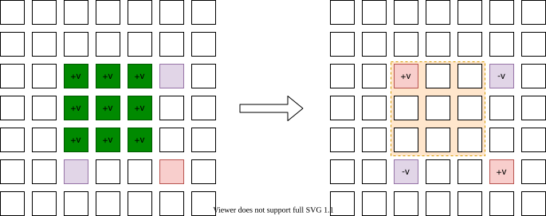

[[TOC]]

## 差分

设原数组的第$i$个元素为$a_i$,那么差分数组的第$i$个元素为$d_i = a_i- a_{i-1}$

有一组数据如下

```math
\begin{array}{r|c|c|c|c|c|c}
    
\text{下标} & 1 & 2 & 3 & 4 & 5 & 6  \\
\hline 
\text{原数组 } a[i]& 3 & 5 & 1 & 7 & 8 & 4 \\
\text{差分数组 } d[i]& 3 & 2 & -4 & 6 & 1 & -4 \\
\text{差分数组$d$前缀和 } s[i]& 3 & 5 & 1 & 7 & 8 & 4 \\
\end{array}
```

发现:对差分数组进行前缀和操作,就可以得到原数组了

```math
\begin{aligned}
S_i = \sum_{j=1}^i d_i &= d_1 +d_2 + \cdots + d_i \\
&= (a_1 - a_0)  + (a_2 - a_1) + \cdots  + (a_i - a_{i-1}) \\
&= (\bcancel{ a_1 } - a_0)  + (\bcancel{a_2} - \bcancel{a_1}) + \cdots  + (a_i - \bcancel{a_{i-1}}) \\
& = a_i - a_0 \;\;\; \text{因为$a_0 = 0$} \\
& = a_i
\end{aligned}
```


现在对原数组$a$的区间$[2,4]$上的每个数都增加$2$,得到如下

```math
\begin{array}{r|c|c|c|c|c|c}
    
\text{下标} & 1 & \color{Blue}{2}  & \color{Blue}{3} & \color{Blue}{4} & 5 & 6  \\
\hline 
\text{原数组 } a[i]& 3 & \color{Blue}{7} & \color{Blue}{3} & \color{Blue}{9} & 8 & 4 \\
\text{差分数组 } d[i]& 3 & \color{Blue}{4} & -4 & 6 & \color{Blue}{-1} & -4 \\
\text{差分数组$d$前缀和 } s[i]& 3 & \color{Blue}{7} & \color{Blue}{3} & \color{Blue}{9} & 8 & 4 \\
\end{array}
```

发现,对原数组进行区间$[2,4]$修改: 差分数组只会修改两个值，第一个值为$b_2 = b_2+2$，第二个值为$b_5 =b_5-2$,且对修改后的差分数组进行前缀后依然得到了原数组.

于是,得出结论,如果对原 数组进行区间$[l,r]$上的每个数都增加$v$,那么对应的差分数组只需要修改两位置$b_l = b_l+v$, $b_{r+1} = b_{r+1}-v$.原来需要$r-l+1$次的区间操作,现在只需要进行$2$次区间操作.也就是<mark>把区间增减转了两次的单点增减</mark>.大大节省了时间

对于,那些题目

- 多次区间修改(增减)
- 一次查询(查询原数组的值)

适合使用差分思想(把原数组转化成差分数组来操作)


## 思考与总结


**差分是前缀和的逆运算**

已知,原数组$a$就是数组$s$,两者一模一样.所以在这里我们其实是先假定数组$a$是数组$d$形成的前缀和数组,进行就想到<mark>能否通过前缀和数组$a$推导出数组$d$呢?</mark>


我们现在认为原数组$a$上每个值$a_i$都是某个数组$d$的前缀和.那么可以得到

$$
a_i = a_{i-1} + d_i \tag 1
$$

移项,进而得到

$$
d_i = a_i - a_{i-1} \tag 2
$$

通过$(2)$式,把数组$a$转化成$d$数组.也就是前缀和数组转化成差分数组

可以通过$a$得到$d$,也可以通过$d$得到$a$,他们互为逆运算

$$
a \rightleftharpoons d
$$

可以认为,$a$与$d$是同一事物的不同表现形式.


综上,可以得到如下的性质:

设$d$是原数组,$a$是$d$的前缀和,

- 在$d$的两个位置$i,j$上,同时$+v,-v$,也就是$d_i = d_i+v,d_j = d_j-v$,那么体现到$a$上,那就是区间$[i,j-1]$上的每个数都增加$v$
- 在$a$上的区间$[i,j-1]$上的每个数都增加$v$,那么体现到$d$上,那就是位置$i,j$,$+v,-v$,也就是$d_i = d_i+v,d_j = d_j-v$


## 函数思想


设$a$是一个数字组成的序列,定义函数如下:

- $f(a) = b$,把序列$a$转化成$b$,其中$b_i = \sum_1^i a_i$,也就是前缀和
- $f^{-1}(a) = b$,表示把序列$a$转化成$b$,其中$b_i = a_i - a_{i-1}$,也就是差分

显然$f$与$f^{-1}$互为逆运算,也就是

$$
\begin{gather}
f^{-1}(f(a)) = a \\
f(f^{-1}(a)) = a
\end{gather}
$$

同样可以想到$f$与$f^{-1}$是<mark>双射函数</mark>,也就是$f(a) = b$ 也就是说$ranf$与$domf$<mark>一一映射</mark>

定义函数$range(a,l,r)$，表示对序列$a$区间$[l,r]$上的每个数都增加$1$

$$
range(a_1,l,r) = a_2
$$

表示$a_1$经过区间$[l,r]$上的 每个数都增加$1$后得到$a_2$,显然$a_1 \neq a_2$,则$f^{-1}(a_1) = d_1 \neq f^{-1}(a_2) = d_2$^[因为一一映射的性质]

根据差分的性质知$d_1,d_2$只有两个点不同,且这两个点是$l,r+1$

定义函数

定义函数$add(a,l,r)$，表示对序列$a$上的两点$l,r+1$分别$+1,-1$
$$
add(a_1,l,r) = a_2
$$

则$range(a_1,l,r)$与$add(d_1,l,r)$是<mark>一一映射</mark>的.也就是每一个在序列$a+1$上的$range$操作,都等价于在序列$d_1 = f^{-1}(a_1)$上的add操作^[这里其时使用了反证法]

## 二维差分


$$
\def\arraystretch{2}
\begin{array}{|c : c : c:c|}
\hline 
11 &-9& -3&  5\\
\hline
11 &-9& -3&  5\\
\hline
11 &-9& -3&  5\\
\hline
\end{array}
$$

根据上面的思考,可以认为此时的二维矩阵上的值,都是每个二维矩阵$d$的前缀和.也就是


$$
\begin{array}{cccccc}
   \color{Blue}{\boxdot} &  \color{Blue}{\boxdot} &\color{Blue}{\boxdot} &  \color{Green}\boxdot &  \boxdot  \\
   \color{Blue}{\boxdot} &  \color{Blue}{\boxdot} &\color{Blue}{\boxdot} &  \color{Green}\boxdot &  \boxdot  \\
   \color{Blue}{\boxdot} &  \color{Blue}{\boxdot} &\color{Blue}{\boxdot} &  \color{Green}\boxdot &  \boxdot  \\
   \color{Green}{\boxdot} &  \color{Green}{\boxdot} &\color{Green}{\boxdot} &  \color{Red}{\boxdot} &  \boxdot  \\
   \boxdot & \boxdot & \boxdot & \boxdot & \boxdot &
\end{array}
$$

$$
S_{i,j} = S_{i-1,j} + S_{i,j-1} - S_{i-1,j-1} + d_{i,j}
$$

移项,得到原二维矩阵上的每个值为:

$$
d_{i,j} = S_{i,j}-S_{i-1,j}-S_{i,j-1} + S_{i-1,j-1}
$$


对$S$矩阵上的子矩阵$(x_i,y_i),(x_j,y_j)$进行$+v$操作,反应到$d$上就是

- $(x_i,y_i),(x_{j+1},y_{j+1})$上的每个数都$+v$
- $(x_{i},y_{j+1}),(x_{j+1},y_{i})$上的每个数都$-v$

小技巧: 点$d_{i,j}$的值是$S_{i,j} - S_{i-1,j} - S_{i,j-1} + S_{i-1,j-1}$,
也就是说,与以$i,j$作为左下角的四个格子的值有关.也就是说$i,j$的覆盖范围,有奇数个$+v$时才会产生影响.




题目: [[[p: luogu-3397 | 地毯]]]

## 差分与贡献

### 线性序列上的贡献模型

::: colorfulbox

引入


 有 $4$ 个数字 $a_1,a_2,a_3,a_4$，初始值依次为 $1,2,3,4$。每个数字 $a_i$ 对后面的所有位置 $[i+1,n]$，各贡献一次自己的**初始值**。

例如，$a_1$ 使位置 $2,3,4$ 的值各增加 $1$。每个位置还保留自己的初始值。

| 下标 | $a_1$ | $a_2$ | $a_3$ | $a_4$ |
| --- | --- | --- | --- | --- |
| 初始值 | $1$ | $2$ | $3$ | $4$ |

所有贡献结算完毕后，每个位置的最终值是多少？


输入：

```text
4
1 2 3 4
```

输出：

```text
1 3 6 10
```

:::


用 $a$ 保存不变的初始值，用 $b$ 保存最终值。直接做法是先令 $b_i=a_i$，再枚举每个贡献者及其影响的位置。

**暴力代码（核心片段）**

::: fold

```cpp
//自己对自己的贡献
for (int i = 1; i <= n; ++i) b[i] = a[i];
for (int i = 1; i <= n; ++i) {
    for (int j = i + 1; j <= n; ++j) {
        b[j] += a[i];
    }
}
```

:::

时间复杂度为 $O(n^2)$。慢在每个 $a_i$ 都要逐个访问它后面的所有位置，而这些后缀大量重叠。

### 两种视角：推土机与接收者

**每个数都要给后面所有位置贡献，能不能只交给紧挨着的下一个？**

先试着让位置 $1$ 只给位置 $2$ 贡献，执行 `a[2] += a[1]`。位置 $2$ 从 $2$ 变成 $2+1=3$，但位置 $3,4$ 还没有收到位置 $1$ 的贡献。

**位置 $1$ 还没完成的贡献，由谁继续送？**

由位置 $2$ 接着送。注意，此时的 `a[2]` 已经不是初始值 $2$，而是 $2+1$：**既有位置 $2$ 自己的贡献，也有位置 $1$ 交过来的贡献。**

因此，下一步执行 `a[3] += a[2]`，加过去的就是整包 $2+1$，位置 $3$ 变成 $3+(2+1)=6$。这一步同时完成了两件事：位置 $2$ 给位置 $3$ 贡献了 $2$，还替位置 $1$ 把那份 $1$ 继续传给了位置 $3$。

**那么，位置 $4$ 怎么收到前三个位置的贡献？**

继续做同一个动作：`a[4] += a[3]`。此时 `a[3]` 已经装着 $3+2+1$，所以位置 $4$ 一次就收到了前三个位置的贡献，变成 $4+(3+2+1)=10$。

把这三步连起来看。表中的数字始终表示各个位置的**初始值来源**，括号表示这一步传过去的整包贡献：

| 操作 | $a_1$ | $a_2$ | $a_3$ | $a_4$ |
| --- | --- | --- | --- | --- |
| 初始 | $1$ | $2$ | $3$ | $4$ |
| `a[2] += a[1]` | $1$ | $2+(1)=3$ | $3$ | $4$ |
| `a[3] += a[2]` | $1$ | $2+1=3$ | $3+(2+1)=6$ | $4$ |
| `a[4] += a[3]` | $1$ | $2+1=3$ | $3+2+1=6$ | $4+(3+2+1)=10$ |

[[[animate: ./contribution.animation.ts]]]

这就是这里的“推土机”：<mark>每个位置把收到的贡献，连同自己的初始值，一起传给下一个位置。</mark>“传给”表示给下一位置加上一份，当前位置的值仍然保留。

于是，不用让每个数亲自跑遍后面所有位置，只需从左向右执行：

```cpp
for (int i = 1; i < n; ++i) {
    // a[i] 已包含前面所有位置的贡献，以及自己的初始值
    // 把这一整包贡献传给下一个位置
    a[i + 1] += a[i];
}
```

这里直接修改 $a$，循环结束后，$a$ 中保存的就是最终结果；最后一个位置没有下一个位置，所以循环条件是 `i < n`。

**为什么这样传递不会漏算或重算？**

执行到位置 $i$ 时，前面各位置的初始值都已沿相邻位置传到这里，且各有一份。下一步只向位置 $i+1$ 传递一次，再加上位置 $i+1$ 原有的初始值，就又得到了各有一份的新一包贡献。如此继续，每个初始值都恰好经过它后面的每个位置一次。

整个过程只有 $n-1$ 次相邻传递，时间复杂度为 $O(n)$。从关系上看，“给后面所有位置贡献”被拆成了相邻位置之间的接力；这里还依赖从前到后只有一条传递路径。后面推广到 DAG 时，要特别留意路径不唯一的情况。

**站在接收者的位置看，答案又是什么？**

为了写清公式，下面重新用 $a$ 表示不变的初始值，用 $b$ 表示最终值。位置 $i$ 接收所有 $j<i$ 的贡献，再保留自己的初始值，因此

$$
\begin{aligned}
b_i &= a_i+\sum_{j=1}^{i-1}a_j \\
&=\sum_{j=1}^{i}a_j.
\end{aligned}
$$

这就是前缀和。这里 $a_i$ 是位置 $i$ 自己保留的值，并不是题目额外规定的一次自我贡献。

从贡献者出发，把累计值送给下一位置，是“刷表 / Push”的视角；从接收者出发，写成 $b_i=b_{i-1}+a_i$（$b_0=0$），是“填表 / Pull”的视角。两者描述的是同一个计算过程。

::: warning

贡献取的是初始值。若直接对每个后方位置执行 `b[j] += b[i]`，就会把已经收到的贡献再次发出，导致重复计算。

可以令 `b = a` 后仅执行相邻转移 `b[i + 1] += b[i]`：此时 `b[i]` 表示需要向下一位置传递的整包贡献，而不再是单个贡献者的初始值。

:::

### 从累计贡献理解差分

**前缀和负责向后传递，那差分数组里的一个数代表什么？**

把差分数组 $d$ 当作贡献源。还原时执行

$$
a_0=0,\qquad a_i=a_{i-1}+d_i,
$$

意味着 $d_i$ 从位置 $i$ 开始，对后面每个位置都贡献一次。因此，`d[l] += v` 会使整个后缀 $[l,n]$ 增加 $v$。

**如果只想影响 $[l,r]$，怎样让贡献停止？**

在 $r+1$ 放一个抵消源：`d[r + 1] -= v`。两个贡献源叠加后，各位置得到的增量为

$$
\Delta a_i=
\begin{cases}
0, & i<l, \\
v, & l\le i\le r, \\
v-v=0, & i>r.
\end{cases}
$$

于是，差分标记负责说明**贡献从哪里开始、在哪里抵消**，前缀和负责把这些标记沿相邻位置累计展开。这就是差分能够把一次区间修改变成两次单点修改的原因。

从逆运算看，固定 $a_0=0$ 后，

$$
d_i=a_i-a_{i-1}
\quad\Longleftrightarrow\quad
a_i=\sum_{j=1}^{i}d_j.
$$

这是一一对应的两种表示；加法也能保留：原数组的增量之和，对应差分标记的增量之和。因此可以先叠加所有修改的标记，最后统一还原。若使用“同构”这个词，这里指的是保持加法结构的对应，而不只是形式相似。

### 从单链推广到树

现在把一条链换成一棵以 $1$ 为根的树。规定每个节点的初始权值贡献给它的所有祖先，每个节点也保留自己的初始权值。

```text
      1
     / \
    2   3
   / \   \
  4   5   6
```

图中的边表示父子关系，**贡献沿孩子到父亲的方向传递**。例如 $4,5$ 的贡献先到 $2$，再到 $1$；$6$ 的贡献先到 $3$，再到 $1$。方向由关系决定，与节点编号的大小无关。

**父节点能否只接收孩子打包后的贡献？**

可以。设 $s_u$ 表示节点 $u$ 及其所有后代的初始权值之和。节点 $u$ 的各棵孩子子树互不相交，因此

$$
s_u=a_u+\sum_{v\in\operatorname{children}(u)}s_v.
$$

例如 $s_2=a_2+s_4+s_5$。只需先算出所有孩子的 $s_v$，再算 $s_u$，最后将 $s_u$ 传给父亲。这就是**后序遍历 / 自底向上汇总**。

每条父子边只传递一次，整棵树的汇总时间为 $O(n)$。任意后代到祖先的路径唯一，所以每份初始权值在对应祖先处恰好出现一次。

所以可以使用的方法是

1. 后续遍历
2. bfs + 倒序的队列

::: fold

后序遍历

```cpp file=./postorder.cpp
```

bfs + 倒序队列

```cpp file=./bfs_reverse.cpp
```

:::

### 多链 DAG：能到达，不代表只到达一次

如果一个节点可以把贡献传向多个后继，就得到一般的 DAG。仍然把边 $v\to u$ 定义为“贡献由 $v$ 传给 $u$”。

**怎样保证向外传递时，当前节点已经收齐贡献？**

按这个方向的**拓扑序**处理：先令 $s_u=a_u$，再对每条边 $v\to u$ 执行 `s[u] += s[v]`。拓扑序保证所有前驱都在 $u$ 之前处理。对于前面的树，孩子先于父亲的后序遍历就是一种合法顺序。

DAG 的可达关系加上自身关系后构成偏序；拓扑序给出了一个与该偏序相容的处理顺序。但是，处理顺序正确并不能消除多条路径带来的重复。

考虑菱形结构，所有箭头都沿贡献方向：

```text
4 -> 2 -> 1
 \-> 3 -> 1
```

令 $a_4=1$，其他节点初始值为 $0$。节点 $2,3$ 都收到 $1$，最终节点 $1$ 收到 $2$，因为从 $4$ 到 $1$ 有两条路径。

因此，上面的累加实际计算的是

$$
s_u=\sum_v a_v\,P(v,u),
$$

其中 $P(v,u)$ 是从 $v$ 到 $u$ 的有向路径条数，约定 $P(u,u)=1$，不可达时为 $0$。

- 若每条路径都应产生一份贡献，按拓扑序累加正确，时间为 $O(n+m)$，其中 $m$ 是边数。
- 若每个可达节点只应贡献一次，就必须去重。例如维护包含自身的可达来源集合，沿边做集合并；规模允许时可用 `bitset`，最后对集合中的节点权值求和。其代价取决于集合表示，不能再直接套用上述 $O(n+m)$ 的求和结论。

<mark>从单链推广到多链时，除了检查依赖顺序，还要检查多条路径是否重复携带了同一份贡献。</mark>树上的 LCA 可以帮助处理树路径的交汇，但不能直接用来解决一般 DAG 的可达集合去重。

### 进阶：树上差分

**树上已经知道怎样累计，能否反过来设计贡献源？**

可以。设 $d_u$ 是节点 $u$ 的标记，令自底向上汇总后的结果为

$$
c_u=d_u+\sum_{v\in\operatorname{children}(u)}c_v.
$$

也就是说，$c_u$ 是 $u$ 子树内所有标记之和。反过来，已知目标增量 $c$ 时，有

$$
d_u=c_u-\sum_{v\in\operatorname{children}(u)}c_v.
$$

这就是树上“累计”与“差分”的逆运算关系。这里将 $d$ 初始置零，$c$ 只表示修改增量，最终点权为 $a_u+c_u$。

**给节点 $x$ 到其祖先 $u$ 的整条路径加 $v$，在哪里放标记？**

在 $x$ 放 `d[x] += v`，这个贡献会一路传向根。要使它在经过 $u$ 后停止，就在 $u$ 的父节点放 `d[fa[u]] -= v`。

路径 $x\to u$ 上每个节点的子树只包含正标记，得到 $+v$；$u$ 的严格祖先同时包含正负两个标记，增量抵消；其他节点不受影响。如果 $u$ 是根，则没有需要抵消的祖先，跳过第二个标记。

**如果路径两端 $x,y$ 没有祖先关系呢？**

设 $w=\operatorname{LCA}(x,y)$ 为最近公共祖先。路径由 $x\to w$ 和 $y\to w$ 两条向上的链组成，但交汇点 $w$ 只应增加一次。于是做四处标记：

```cpp
// 点权路径加；w 已通过 LCA 查询得到
// fa[root] = 0，根没有父节点
d[x] += v;
d[y] += v;
d[w] -= v;
if (fa[w] != 0) d[fa[w]] -= v;
```

两份正标记在 $w$ 汇合，减去一份后恰好保留 $v$；在 $w$ 的父节点再减一份，使更高祖先处的总增量为 $0$。这也覆盖 $x=y$、一端是另一端祖先、$w$ 为根等情况。

全部修改标记完成后，自底向上汇总一次 $d$，就能得到每个点的总增量：

```cpp
// order 是预先得到的后序序列，保证孩子先于父亲
for (int u : order) {
    if (fa[u] != 0) d[fa[u]] += d[u];
}
for (int u = 1; u <= n; ++u) {
    b[u] = a[u] + d[u];
}
```

已知 LCA 后，每次修改只需 $O(1)$ 次标记；最后汇总为 $O(n)$。若用倍增查询 LCA，包含预处理的 $q$ 次路径修改总时间为 $O(n\log n+q\log n+n)$。这里是**先完成所有修改，再统一查询最终点权**的离线做法，并且公式针对点权路径加；边权路径加的抵消位置不同。

从序列到树，差分都在做同一件事：**沿确定方向传递贡献，在目标范围之外放抵消标记，最后统一累计还原。**

## 练习题目


- [[[p: luogu-2367 | 语文成绩]]]
- [[[p: vjudge-HDU-1556 | Color the ball]]]
- [[[p: vjudge-POJ-3263 | Tallest Cow ]]]
- [[[p: luogu-3406 | 海底高铁]]]
- [[[p: luogu-4552 | [Poetize6] IncDec Sequence]]]
- HDU 1121
- luogu 3948 
- luogu P1969 积木大赛
- P6070
- P3655
- P7404
- roj 求最少多少次把所有的元素变成一样大,平数II

+p THIS_ID
