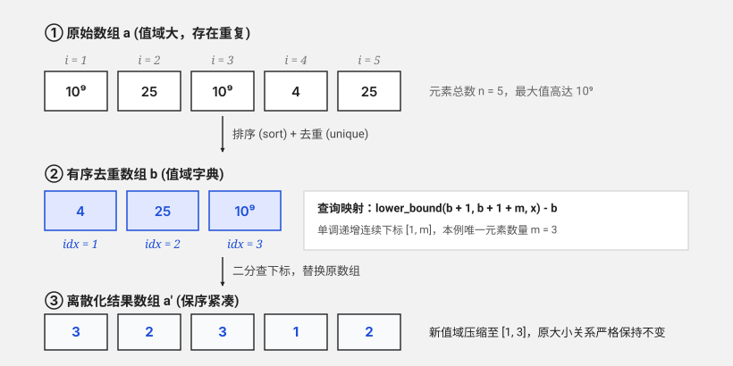

[[TOC]]

## 基本思想

有些数值很大、包含负数或非整数，但实际出现的不同数值很少。若算法只需要比较大小，可以将它们按从小到大的顺序编号。

例如 $4 < 25 < 10^9$，分别用 $1, 2, 3$ 表示。这样便能用编号作为数组下标，无须按原值开数组。树状数组、线段树统计数值出现次数时，常用这种方法。

**离散化**将 $m$ 个不同数值依次映射到 $1\sim m$，保留相等关系和大小关系，但通常不保留差值、距离及加减关系。

## 离散化步骤

以数组 $a = [10^9, 25, 10^9, 4, 25]$ 为例：

1. **原数组**：保留 $a$ 的原有顺序，复制一份到辅助数组 $b$。
2. **排序**：将 $b$ 升序排序，得到 $[4, 25, 25, 10^9, 10^9]$。
3. **去重**：移除重复值，得到 $b = [4, 25, 10^9]$，从 $1$ 开始编号为 $1,2,3$。
4. **离散化**：按原数组顺序，在 $b$ 中二分查找每个原值，用其下标替换，得到 $[3,2,3,1,2]$。

下图依次展示这四步，去重数组下方标出了下标：



这里 $n = 5$，不同数值个数 $m = 3$。排序的是辅助数组；原数组只替换数值，不改变元素位置。

## 代码实现

### 静态数组实现

下面使用静态数组，编号从 $1$ 开始。`b[1..m]` 保存去重后的原值，`a[1..n]` 被替换为编号。

```cpp file=./discrete_simple.cpp
```

`lower_bound(b + 1, b + 1 + m, x)` 返回第一个不小于 `x` 的元素位置。这里查询的原值都已收集，因此该位置就是 `x` 的编号。减去数组首地址 `b`，结果自然从 $1$ 开始。

排序耗时 $O(n\log n)$，去重耗时 $O(n)$，对 $n$ 个数逐一二分耗时 $O(n\log n)$。总时间复杂度为 $O(n\log n)$，额外空间复杂度为 $O(n)$。

### unique 实现

用 `unique` 完成去重，封装为 `discrete(a)`。函数直接将 `a` 中的原值替换为从 $1$ 开始的编号，并返回不同数值的个数 $m$。

```cpp file=./discrete_vector.cpp
```

`unique` 只合并相邻的重复元素，因此必须先排序。去重后的有效区间为 `[b.begin(), it)`，`it - b.begin()` 就是 $m$。

这里无须调用 `erase`，`b.size()` 仍是原长度。二分查找只在有效区间内进行，不能再用 `b.end()` 作为右边界。减去 `b.begin()` 得到从 $0$ 开始的位置，再加 $1$ 得到编号。

辅助数组 `b` 是函数内的局部变量；若还需要根据编号还原原值，应另行保存去重后的 `b`。

::: fold 结构体封装
先用 `push` 收集数值，再调用 `init` 排序去重。之后可查询编号，或根据编号取回原值。

```cpp file=./discrete.cpp
```

`query` 对未收集的数值返回 $0$。`get_val` 要求编号在 $1\sim m$ 内。若继续添加新数值，需要重新调用 `init`，原有编号也可能改变。
:::

## 使用细节

### 提前收集

这种做法需要提前收集参与离散化的数值，包括后续修改中可能写入的值。若有新值插入，旧值的编号可能改变，不能直接沿用已按旧编号建立的数据结构。

`lower_bound` 对未收集的值返回的是插入位置，不代表该值已有编号。若要判断数值是否存在，还需检查位置是否越界，以及该位置的值是否等于查询值；代码中的 `query` 已处理这两种情况。

### 编号与去重

本文统一从 $1$ 编号，可直接配合常见的树状数组实现。树状数组的更新循环不能从 $0$ 开始，否则 `lowbit(0) = 0`，下标无法前进。普通数组也可以使用从 $0$ 开始的编号，但应保持一致。

去重使编号连续。不去重时，`lower_bound` 仍会为相同数值返回相同位置，只是编号可能有空缺。例如有序数组 $[4, 25, 25, 10^9, 10^9]$ 中，三个不同值的编号分别为 $1, 2, 4$。

### 距离与区间

$4$ 和 $25$ 的编号相邻，但原值相差 $21$。因此编号只能用于索引；计算距离或长度时，仍须使用 $b$ 中保存的原值。

::: fold 区间离散化
若要统计区间覆盖长度，可以让编号代表相邻坐标之间的基本区间。将所有端点排序去重，得到 $b_1 < b_2 < \dots < b_m$；编号 $k$ 代表 $[b_k, b_{k+1})$，真实长度为 $b_{k+1} - b_k$，共 $m-1$ 个基本区间。

设 $\operatorname{id}(x)$ 为已收集端点 $x$ 的编号。非空区间 $[L,R)$ 对应基本区间编号 $[\operatorname{id}(L), \operatorname{id}(R)-1]$。没有被覆盖的间隙也会保留。例如 $[1,3)$ 与 $[10,12)$ 之间的 $[3,10)$ 就是一个未覆盖的基本区间。

连续坐标的长度统计可采用这种半开区间表示；若判断端点是否被覆盖，仍须按题意处理开闭。统计闭区间 $[l,r]$ 内的整数点个数时，可以转换为 $[l,r+1)$，并提前收集 $r+1$，注意整数类型的范围。

另一种做法是对整数坐标补点：相邻坐标之差大于 $1$ 时，在两者之间补一个整数，如 $b_i+1$，再重新编号。它可以保留间隙的存在，但编号之差仍不代表真实长度，也不能直接作为整数点个数。
:::
