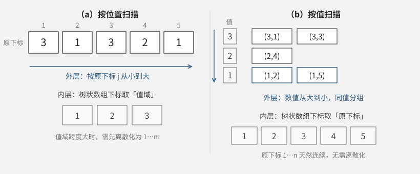

[[TOC]]

## 在线与离线

根据处理输入与回答询问的时机，算法通常分为**在线**与**离线**两类：

- **在线算法**：每读入一次操作或询问，就必须立即计算并给出结果，不能提前看到后续输入。
- **离线算法**：先完整读入所有数据与询问，统一安排处理顺序，计算完成后再按题目要求的顺序输出结果。

许多问题按输入顺序直接维护很困难，但**输入顺序并不一定是最好处理的顺序**。只要为每个元素或询问保留原始编号与对应位置，就可以按值、按右端点或按时间倒序重新排列，把原本难以同时满足的多个条件拆开处理。

::: note 前提
离线的前提是全部输入在求解前已知。若题目是交互题，或当前询问的输入参数由上一次询问的答案加密生成（强制在线），则无法直接离线。
:::

本篇用两种重排方式展开：按数值排序、按时间倒序。

## 按值重排：逆序对

以 [[[p: luogu-P1908 | 逆序对]]] 为例：给定长度为 $n$ 的序列 $a_1, a_2, \dots, a_n$，求满足 $i < j$ 且 $a_i > a_j$ 的下标对 $(i, j)$ 数量。

### 两个条件

逆序对需要同时满足位置关系 $i < j$ 与数值关系 $a_i > a_j$：

- 在 [[[rbook: bit_inversion]]] 中，外层按原序列下标 $j$ 从左到右扫描（保证 $i < j$），内层用树状数组维护值域上已有多少个数大于 $a_j$。由于值域可能很大，通常需要先做离散化。
- 换个角度，如果**外层按数值从大到小处理**，已经加入集合的元素天然满足 $a_i > a_j$；内层只需统计已加入元素中有多少个原下标满足 $i < j$，即树状数组上的前缀和。

这种做法直接以原下标 $1 \sim n$ 作为树状数组下标，**不需要离散化**。两种做法只是交换了外层与内层：



### 按值排序与重复值处理

将每个元素记为二元组 $(a_i, i)$，按数值 $a_i$ 从大到小排序。需要注意**相同数值的元素之间不构成逆序对**。

如果对相同数值不加区分地逐个“先查前缀和、再单点加 $1$”，先插入的同值元素会被后面同值元素的查询统计进去，导致答案偏大。正确的做法是**按相同数值分组处理**：

1. 对当前数值相等的一整组元素，先依次查询每个位置 $pos$ 之前已插入的元素个数 $\text{sum}(pos - 1)$，累加进答案；
2. 这一组全部查询完毕后，再依次将组内每个位置 $pos$ 加入树状数组，执行 $\text{add}(pos, 1)$。

::: note 同一思路的其他用法 icon=bulb
当题目给出多组形如“统计序列中大于（或小于）阈值 $k$ 的元素个数”的询问时，也可以把所有元素与所有询问放在一起按数值（阈值）排序，用同样的方式扫描维护。
:::

### 模拟

以序列 $a = [3, 1, 3, 2, 1]$ 为例，二元组按值从大到小分组后的执行过程如下：

| 当前值 | 组内元素（值, 原下标） | 查询 $\text{sum}(pos-1)$ | 累计答案 | 插入位置 |
| :---: | :---: | :---: | :---: | :---: |
| $3$ | $(3,1),\ (3,3)$ | $\text{sum}(0)=0,\ \text{sum}(2)=0$ | $0$ | $1,\ 3$ |
| $2$ | $(2,4)$ | $\text{sum}(3)=2$ | $2$ | $4$ |
| $1$ | $(1,2),\ (1,5)$ | $\text{sum}(1)=1,\ \text{sum}(4)=3$ | $6$ | $2,\ 5$ |

排序耗时 $O(n \log n)$，每个元素在树状数组上查询与修改各一次，总时间复杂度 $O(n \log n)$。逆序对总数最高可达 $\frac{n(n-1)}{2}$，答案需使用 `long long`。

### 代码实现

```cpp file=./inversion_sort.cpp
```

### 两种扫描的对照

| 做法 | 外层扫描顺序 | 树状数组维护对象 | 是否需要离散化 |
| --- | --- | --- | --- |
| 按位置扫描（[[[rbook: bit_inversion]]]） | 原下标 $1 \to n$ | 值域出现次数 | 是 |
| 按值扫描（本篇） | 数值从大到小，同值分组 | 原下标出现次数 | 否 |

离散化只是将大值域映射为连续排名，并不改变操作与元素的处理顺序；按值重排改变了外层扫描维度，从而省去了值域映射。

## 倒序处理

另一类常见的离线技巧是按时间倒序处理。当正向操作涉及集合扩张、结构变化或难以撤销的修改时，从最终状态倒着往前推，往往能把动态结构变成静态结构。

倒序处理并不是要一步步还原历史状态，而是利用时间先后关系：只要在某个询问或节点被结算的时刻，保证它之后的所有有效修改都已经生效，就能直接读出正确结果；结算完成后，更早发生的修改即使继续累加在数据结构上，也不会再影响已经记录下来的答案。

## 按时间倒序：生长的树

以 [[[p: codeforces-1891F | A Growing Tree]]] 为例：初始时树上只有根节点 $1$，点权为 $0$。接下来依次执行 $q$ 次操作（$q \le 5 \times 10^5$）：

- `1 v`：在当前树中新建一个编号为 $\text{sz} + 1$ 的节点，作为节点 $v$ 的子节点，初始点权为 $0$；
- `2 v x`：将当前节点 $v$ 的整棵子树内所有节点的点权加上 $x$。

要求输出所有操作结束后每个节点的最终点权。

### 题意与困难

如果按时间正序处理，每次新建节点都会改变整棵树的形态与子树的 DFS 序区间，无法直接用静态区间数据结构维护。

用一个小例子看时间先后的影响：

1. 给根 $1$ 的子树加 $5$；
2. 在根 $1$ 下新建节点 $2$；
3. 给根 $1$ 的子树加 $3$。

最终节点 $1$ 的点权为 $8$，而节点 $2$ 在第一步之后才出现，只能吃到第 3 步的 $+3$，最终点权为 $3$。如果一上来就把所有节点建进树里再正序执行，第 1 步的 $+5$ 会错误地加到尚未出生的节点 $2$ 上。

### 提前建树与 DFS 序

因为所有操作都已给出，可以先读入全部 $q$ 条操作，提前确定整棵树的最终形态：

1. 维护当前最大节点编号 $n$（初始为 $1$），遇到 `1 v` 就连边 $(v, n+1)$，并把该操作改记为“新建节点 $n+1$”；
2. 全部操作读完后，最终树的边已经完全确定。从根节点 $1$ 做一次 DFS（见 [[[rbook: dfs_order]]]），记录每个节点 $u$ 的进入时间戳 $\text{dfn}[u]$ 与子树大小 $\text{sz}[u]$。

这样，最终树中任意节点 $u$ 的整棵子树对应固定区间 $[\text{dfn}[u],\ \text{dfn}[u] + \text{sz}[u] - 1]$。

### 倒序统计

建好最终树并求出 DFS 序后，树状数组初始全为 $0$（使用 [[[rbook: bit_range_add_point_query]]] 维护区间加、单点查询）。从第 $q$ 条操作倒序遍历到第 $1$ 条：

- 若当前是修改操作 `2 v x`：对区间 $[\text{dfn}[v],\ \text{dfn}[v] + \text{sz}[v] - 1]$ 加上 $x$；
- 若当前是新建操作（创建节点 $u$）：立刻查询单点 $\text{dfn}[u]$ 的值，记为 $\text{ans}[u]$；
- 扫描完成后，节点 $1$ 从初始就存在，单点查询 $\text{dfn}[1]$ 记为 $\text{ans}[1]$。

按前面三步例子倒序走一遍：

1. 倒序读到第 3 步（根 $1$ 子树 $+3$）：区间 $[1, 2]$ 加 $3$；
2. 倒序读到第 2 步（新建节点 $2$）：查询 $\text{dfn}[2]$，得到 $\text{ans}[2] = 3$；
3. 倒序读到第 1 步（根 $1$ 子树 $+5$）：区间 $[1, 2]$ 加 $5$；
4. 扫描结束，查询 $\text{dfn}[1]$，得到 $\text{ans}[1] = 8$。

### 正确性

提前在最终树上做区间加不会出错，可以从空间与时间两方面看：

- 空间上：任何在 `2 v x` 发生前就已经出生的后代节点，在最终树中也一定位于 $v$ 的子树内；尚未出生的节点虽然也在区间 $[\text{dfn}[v],\ \text{dfn}[v] + \text{sz}[v] - 1]$ 中，但它们的创建操作排在更前面（倒序时更晚被扫描到）。
- 时间上：当倒序扫描到节点 $u$ 的创建操作时，树状数组上恰好累加了 $u$ 出生之后的所有祖先子树加操作，此时记录的 $\text{ans}[u]$ 完全准确；之后继续往前扫描到 $u$ 出生前的修改时，即使数值再次加到 $\text{dfn}[u]$ 上，也不会回过头修改已经存好的 $\text{ans}[u]$。

建树与 DFS 耗时 $O(q)$，每次操作在树状数组上耗时 $O(\log q)$，单组测试数据总时间复杂度 $O(q \log q)$。

### 代码实现

```cpp file=./growing_tree.cpp
```

::: warn
实现多组测试数据时，需按实际节点数 $n$ 清空邻接表与树状数组，避免使用全局 `memset` 导致超时；点权累加可能超过 `int` 范围，需使用 `long long`。此外 $q \le 5 \times 10^5$ 时链状树递归较深，若在本机测试遇到栈空间不足，需调大运行栈或改为显式栈遍历。
:::

## 使用条件

判断是否能用离线重排简化问题时，可以检查以下三点：

1. **输入完整可见**：全部修改与询问都能在输出第一个答案前读入，不存在强制在线依赖。
2. **结果可还原**：每个元素或询问携带原始编号或原下标，重排计算后能写回对应位置。
3. **有效集合明确**：确定新的处理顺序后，能够清楚界定“哪些元素或修改在当前时刻已经生效”，并借助树状数组、线段树等结构高效维护。

当问题同时带有多个变化维度（如区间左右端点与修改时间）时，离线思想还会进一步延伸出莫队算法、CDQ 分治与整体二分等方法。

## 参考

- [Codeforces Round 907 Div.2 F: A Growing Tree](https://codeforces.com/problemset/problem/1891/F)
