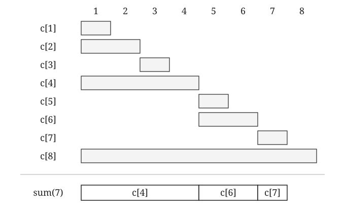

[[TOC]]

## 动态区间和

给定数组 $a_1,a_2,\ldots,a_n$，交替执行两种操作：

- 单点加：将 $a_p$ 增加 $v$。
- 区间求和：查询 $a_l+\cdots+a_r$。

[[[rbook: presum]]] 可以在 $O(1)$ 时间内查询区间和，但修改 $a_p$ 后，所有包含它的前缀都要改变，一次修改最坏需要 $O(n)$。

树状数组（Binary Indexed Tree，BIT，也称 Fenwick Tree）保留一些特定区间的和，使修改和查询都只需 $O(\log n)$。它保存的是区间信息，不需要显式建立树节点和指针。

## 管辖区间

定义 `lowbit(i)` 为正整数 $i$ 的二进制表示中，最低位的 $1$ 所对应的值：

```cpp
int lowbit(int x) {
    return x & -x;
}
```

例如 $12=(1100)_2$，所以 $\operatorname{lowbit}(12)=4$。在补码表示中，取负数相当于按位取反再加一，最低位的 $1$ 及其后的 $0$ 保持原样，更高位与原数相反；按位与后就只剩这个 $1$。

约定下标从 $1$ 开始，令：

$$
c[i]=\sum_{j=i-\operatorname{lowbit}(i)+1}^{i}a_j.
$$

也就是说，$c[i]$ 管辖**以 $i$ 结尾、长度为 $\operatorname{lowbit}(i)$** 的区间。

| $i$ | 二进制 | $\operatorname{lowbit}(i)$ | 管辖区间 |
| --- | --- | --- | --- |
| 3 | 0011 | 1 | $[3,3]$ |
| 6 | 0110 | 2 | $[5,6]$ |
| 8 | 1000 | 8 | $[1,8]$ |
| 12 | 1100 | 4 | $[9,12]$ |

下面画出 $n=8$ 时的全部管辖区间。横向长度与覆盖的元素数一致。



`c[i]` 通常不是原数组前缀和；只有 $i$ 是 $2$ 的幂时，它才恰好覆盖 $[1,i]$。

## 前缀查询

设 `sum(x)` 返回 $a_1+\cdots+a_x$。先取最右侧的块 $c[x]$，剩余前缀的右端点恰好为：

$$
x-\operatorname{lowbit}(x).
$$

继续取块，直到右端点变为 $0$：

```cpp
long long sum(int x) {
    long long res = 0;
    for (int i = x; i > 0; i -= lowbit(i)) {
        res += c[i];
    }
    return res;
}
```

例如查询 $[1,7]$：

$$
[1,7]=[1,4]\cup[5,6]\cup[7,7],\qquad
\operatorname{sum}(7)=c[7]+c[6]+c[4].
$$

每次取走的是当前前缀的一个完整后缀，下一次恰好接着处理左侧剩余部分。因此这些块互不重叠，也没有遗漏。

每次执行 `i -= lowbit(i)`，会清掉二进制最低位的一个 $1$，所以查询至多进行 $O(\log n)$ 次。

区间和仍由两个前缀相减：

$$
\operatorname{range\_sum}(l,r)=\operatorname{sum}(r)-\operatorname{sum}(l-1).
$$

这里 `sum(0)=0`，因此 $l=1$ 不需要特殊处理。

## 单点修改

执行 $a_p\mathrel{+}=v$ 时，所有覆盖 $p$ 的块都要增加 $v$。从 $c[p]$ 开始，下一个需要修改的块为：

$$
p+\operatorname{lowbit}(p).
$$

```cpp
void add(int p, long long v) {
    for (int i = p; i <= n; i += lowbit(i)) {
        c[i] += v;
    }
}
```

例如 $n=8$，修改位置 $5$ 时，更新路径为：

$$
5\to6\to8,
$$

对应区间 $[5,5]$、$[5,6]$、$[1,8]$，恰好是全部覆盖位置 $5$ 的块。

### 更新路径

这些区间的长度是 $2$ 的幂，并按该长度对齐：同样大小的块不相交，不同大小的块若相交，就存在包含关系。因此，覆盖同一个位置的块组成一条包含链。

设当前下标为 $i$，$\operatorname{lowbit}(i)=2^k$。执行 $i+2^k$ 会使最低位的 $1$ 向高位进位，得到更长的块，并且包含当前块。

为什么不会跳过中间的块？对 $1\le t<2^k$，有 $\operatorname{lowbit}(i+t)=\operatorname{lowbit}(t)\le t$，所以下标 $i+t$ 对应区间的左端点至少为 $i+1$，无法包含当前块。故 $i+\operatorname{lowbit}(i)$ 正是下一个更大的包含块。

从 $p$ 沿这条链向上走，就会修改全部且仅有覆盖 $p$ 的块。每次进位后 `lowbit` 至少翻倍，所以更新也只需 $O(\log n)$ 次。

## 代码实现

下面使用 [[[p: luogu-P3374 | P3374 树状数组 1]]] 的格式：先输入 $n,m$ 和初始数组，再输入 $m$ 次操作。

- `1 p v`：将 $a_p$ 增加 $v$。
- `2 l r`：查询闭区间 $[l,r]$ 的和。

```cpp file=./fenwick.cpp
```

全局数组 `c` 初始为零。逐个调用 `add(i, a[i])`，使每个块收到其管辖区间内所有元素的贡献，初始化耗时 $O(n\log n)$。单次修改、查询均为 $O(\log n)$，总时间为 $O((n+m)\log n)$；有效存储为 $O(n)$，模板按 `maxn` 预留容量。

### 示例

```text
输入：
5 4
2 -1 3 4 5
2 2 4
1 3 -5
2 1 3
2 3 3

输出：
6
-1
-2
```

第一次查询为 $-1+3+4=6$。修改后数组为 $[2,-1,-2,4,5]$。负数和负增量均可正常处理。

## 边界与接口

- **修改下标必须为正。** `lowbit(0)=0`，调用 `add(0,v)` 会陷入死循环。
- **加法不等于赋值。** 若要令 $a_p=v$，应先求出旧值，再执行 `add(p, v - old)`；也可以另存原数组维护旧值。
- **和使用 `long long`。** 除答案外，中间块和也必须落在类型范围内。
- **按实际长度更新。** 循环上界是 $n$，`maxn` 只决定数组容量，须满足 $n<maxn$。
- **多组数据重新初始化。** 开始新的一组前清空 `c[1..n]`。

## 练习

完成 [[[p: luogu-P3374 | P3374 树状数组 1]]] 后，手算以下两条路径：

1. `sum(13)` 会读取哪些 `c[i]`？
2. $n=16$ 时，`add(5,v)` 会修改哪些 `c[i]`？

::: fold 参考结果
查询路径为 $13\to12\to8\to0$，读取 $c[13],c[12],c[8]$，覆盖 $[13,13]$、$[9,12]$、$[1,8]$。

修改路径为 $5\to6\to8\to16$，分别覆盖 $[5,5]$、$[5,6]$、$[1,8]$、$[1,16]$。
:::

## 后续学习

| 分支 | 文章 | 主要变化 |
| --- | --- | --- |
| 区间加 | [[[rbook: bit_range_add_point_query]]] | 维护差分，恢复单点值 |
| 区间加 | [[[rbook: bit_range_add_range_query]]] | 加入下标权值，恢复区间和 |
| 计数 | [[[rbook: bit_inversion]]] | 下标改为值的排名，维护频次 |
| 最值 | [[[rbook: bit_prefix_extremum]]] | 单调修改，维护前缀最大值 |
| 最值 | [[[rbook: bit_range_extremum]]] | 尾部追加，拆分一般区间 |
| 二维 | [[[rbook: bit_2d]]] | 行列分别分块，维护矩形和 |

求和主线依次学习前两篇；其余分支可在理解基础篇后按需阅读，具体前置条件见各篇正文。
