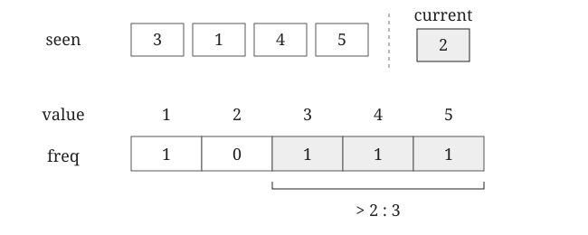

[[TOC]]

## 逆序对

给定数组 $a_1,\ldots,a_n$，满足

$$
i<j,\qquad a_i>a_j
$$

的下标对 $(i,j)$ 称为逆序对。相等的两个数不构成逆序对；数组不要求元素互不相同。

例如 $[3,1,4,5,2]$ 中有 $(3,1)$、$(3,2)$、$(4,2)$、$(5,2)$ 四组数值配对，对应四个逆序对。枚举所有下标对需要 $O(n^2)$。

## 固定右端点

从左到右扫描，处理位置 $j$ 时，前面的 $j-1$ 个数已经确定。此时只需统计：

$$
\#\{i\mid i<j,\ a_i>a_j\}.
$$

按右端点分类，每个逆序对恰好被统计一次。

困难在于：不能为了每个 $j$ 都重新扫描前面的数。需要维护“已经出现的数中，小于等于某个值的有多少个”。

## 按值统计

基础篇的树状数组按原数组位置存元素和。本篇改用**值域上的频次桶**：

$$
f[v]=\text{已扫描元素中，值为 }v\text{ 的出现次数}.
$$

树状数组维护 $f$，于是 `sum(v)` 表示已经扫描的元素中，值**小于等于 $v$** 的数量。

在处理 $a_j$、但尚未插入它时，已扫描元素共有 $j-1$ 个，因此：

$$
\text{本次新增逆序对}=(j-1)-\operatorname{sum}(a_j).
$$



对 $[3,1,4,5,2]$，逐步统计如下：

| 当前值 | 前面已有 | 前面小于等于当前值 | 前面大于当前值 | 累计答案 |
| --- | --- | --- | --- | --- |
| 3 | 0 | 0 | 0 | 0 |
| 1 | 1 | 0 | 1 | 1 |
| 4 | 2 | 2 | 0 | 1 |
| 5 | 3 | 3 | 0 | 1 |
| 2 | 4 | 1 | 3 | 4 |

每次查询后再执行 `add(a[j],1)`，将当前元素加入频次桶，供后续位置使用。

## 离散化

值可能很大、为零或为负数，不能直接拿原值作为树状数组下标。

逆序对只关心大小关系，因此可以进行 [[[rbook: discrete]]]：复制原数组，排序去重，将每个值映射到其排名 $1\ldots m$。

例如：

$$
[100,-7,100,20]\longrightarrow[3,1,3,2].
$$

相等值映射到同一排名，严格大小关系保持不变，所以逆序对数量不变。**只排序副本**，扫描时仍按原数组顺序，否则会丢失 $i<j$ 这一条件。

离散化后，公式为：

```cpp
int rank = int(lower_bound(b + 1, b + m + 1, a[j]) - b);
answer += (j - 1LL) - sum(rank);
add(rank, 1);
```

此处树状数组长度是不同值的数量 $m$，不是原值的最大值。

### 重复值

对数组 $[2,2,1]$，第二个 $2$ 到来时，前面的一个 $2$ 会被 `sum(rank)` 包含，不会被误计为更大的数。最后的 $1$ 与前面的两个 $2$ 各构成一个逆序对，答案为 $2$。

若从右向左扫描，则应查询 `sum(rank-1)`，统计右侧严格小于当前值的数量。两种方向都可行，但不等号和查询边界必须对应。

## 正确性

处理第 $j$ 项之前，树状数组恰好保存 $a_1,\ldots,a_{j-1}$ 的频次。这在初始为空时成立，每轮末尾插入当前元素后继续成立。

`sum(rank)` 统计这些元素中小于等于 $a_j$ 的数量，从 $j-1$ 中减去它，恰好得到严格大于 $a_j$ 的数量。每个逆序对由其唯一的右端点负责，因此没有遗漏和重复。

## 代码实现

格式与 [[[p: luogu-P1908 | P1908 逆序对]]] 一致：输入 $n$ 和数组，输出逆序对总数。代码的离散化也允许负数与重复值。

```cpp file=./inversion.cpp
```

排序、二分排名和树状数组操作的总时间为 $O(n\log n)$。原数组、副本和频次树共需 $O(n)$ 有效空间，模板按 `maxn` 预留容量。

频次和不超过 $n$，可用 `int`；答案最多为 $n(n-1)/2$，必须用 `long long`。例如 $n=500000$ 的严格递减数组有 $124999750000$ 个逆序对。

### 示例

```text
输入：
5
3 1 4 5 2

输出：
4
```

## 练习

完成 [[[p: luogu-P1908 | P1908 逆序对]]]，再分别检查：

- $[1,2,3,4]$：答案为 $0$。
- $[4,3,2,1]$：答案为 $6$。
- $[2,2,2]$：答案为 $0$。
- $[2,2,1]$：答案为 $2$。

还可以把目标改成“前面严格小于当前值的数量”，写出应查询的前缀范围。

::: fold 参考结果
处理当前值之前查询 `sum(rank-1)`。查询 `sum(rank)` 会额外计入相等值。
:::
