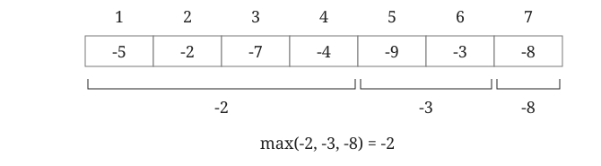

[[TOC]]

## 问题模型

本篇保留 [[[rbook: bit]]] 的管辖区间，把块内运算由求和改为取最大值，严格支持：

- `chmax(p,v)`：执行 $a_p\leftarrow\max(a_p,v)$。
- `prefix_max(r)`：查询 $\max(a_1,\ldots,a_r)$。

`chmax` 只会让一个位置变大或保持不变，不能把它改小。这一限制决定了修改能否直接沿树状数组的更新路径进行。

## 块内最大值

令：

$$
c[i]=\max_{i-\operatorname{lowbit}(i)+1\le j\le i}a_j.
$$

查询前缀时仍沿 `i -= lowbit(i)` 取块。例如 $[1,7]$ 拆成 $[1,4]$、$[5,6]$、$[7,7]$，对三个块的最大值再取最大值即可。



修改位置 $p$ 时，仍只影响沿 `i += lowbit(i)` 枚举的覆盖块。设某块原最大值为 $M$，执行 `chmax(p,v)` 后，其最大值恰好为：

$$
\max(M,v).
$$

原有元素不会变小，所以旧最大值仍有效；新引入的候选只有 $v$。

## 修改与查询

### 单点 chmax

```cpp
void chmax(int p, long long v) {
    for (int i = p; i <= n; i += lowbit(i)) {
        c[i] = max(c[i], v);
    }
}
```

即使 $v<a_p$，这段代码也不会让任何块变小，与 `chmax` 的含义一致。

### 前缀最大值

```cpp
long long prefix_max(int r) {
    long long res = NEG_INF;
    for (int i = r; i > 0; i -= lowbit(i)) {
        res = max(res, c[i]);
    }
    return res;
}
```

初始化时，先将所有块设为负无穷，再逐个插入原数组。查询所选块互不重叠且覆盖整个前缀，取这些块最大值的最大值，就得到正确答案。

**不能默认初始化为零。** 若原数组全为负数，零会成为不属于数组的错误候选。代码使用 `long long` 的最小值作为 `NEG_INF`，这里只比较大小，不对它做加法。

## 两个限制

### 不支持任意赋值

数组为 $[5,4]$ 时，$c[2]=5$。若将第一个数赋值为 $1$，新的块最大值应为 $4$。

执行 `max(c[2],1)` 仍会得到 $5$。块只存旧最大值，没有记录删除它后应由谁接替，所以无法这样处理变小的赋值。

### 不能用前缀相减求区间最值

数组 $[5,1,4]$ 与 $[5,2,3]$ 的前缀最大值 `prefix_max(1)`、`prefix_max(3)` 都为 $5$，但区间 $[2,3]$ 的最大值分别为 $4$ 和 $3$。

这说明两个前缀最大值不足以恢复一般区间最大值。求和可通过减法消去左侧部分，最大值没有对应的消去操作。

## 代码实现

下面使用一个直接检验本篇接口的任务：

- 输入 $n,m$，接着输入初始数组。
- `1 p v`：执行 `chmax(p,v)`。
- `2 r`：查询前缀最大值，保证 $1\le r\le n$。

```cpp file=./prefix_max.cpp
```

初始化为 $O(n\log n)$，单次修改和查询均为 $O(\log n)$。有效存储为 $O(n)$，数组容量由 `maxn` 指定。

### 示例

```text
输入：
5 5
-5 -2 -7 -4 -9
2 4
1 3 6
2 3
1 5 -20
2 5

输出：
-2
6
6
```

最后一次修改不会使第 $5$ 项变小，因此数组为 $[-5,-2,6,-4,-9]$。

## 与 DP 结合

在 [[[rbook: lis]]] 中，以第 $i$ 项结尾的最长严格递增子序列满足：

$$
f_i=1+\max_{j<i,\ a_j<a_i}f_j.
$$

从左向右扫描，按值离散化。若树状数组在排名 $r$ 处记录已扫描元素的最佳 DP 值，则转移可写为：

```cpp
long long best = max(0LL, prefix_max(rank - 1)) + 1;
chmax(rank, best);
```

这里下标是值的排名，树中保存的是 DP 长度。`rank-1` 保证严格递增，`max(0LL, ...)` 表示允许没有前驱。每个排名的最优值只会增大，正好符合本篇的修改条件。

## 练习

1. 按本篇格式实现前缀最值，检查全负数、无效的较小更新和只有一个元素的情形。
2. 完成 [[[p: atcoder-dp_q | AtCoder DP Q Flowers]]]：按原顺序选择高度严格递增的花，最大化美丽值总和。按高度维护前缀最大 DP 值，将上面的长度增量 $1$ 换成当前花的美丽值。该题的[原题面](https://atcoder.jp/contests/dp/tasks/dp_q)保证美丽值为正，因此允许空前驱的值为 $0$。

维护前缀最小值时可对称地使用 `chmin`：初值为正无穷，修改只能让一个位置变小。不要只替换 `max`，却仍保留任意方向的赋值。

尾部追加并查询一般区间的情况，继续阅读 [[[rbook: bit_range_extremum]]]。
