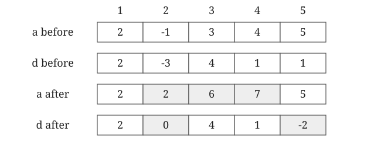

[[TOC]]

## 问题模型

给定数组 $a_1,\ldots,a_n$，交替执行：

- 区间加：将 $[l,r]$ 内每个数增加 $v$。
- 单点查询：查询当前 $a_x$。

[[[rbook: bit]]] 支持单点修改。若逐个修改区间内的元素，一次区间加最坏仍需 $O(n\log n)$。

[[[rbook: differential]]] 能把区间加变成两个边界的修改。将它交给树状数组维护，就能处理修改与查询交替出现的情况。

## 维护差分

令 $a_0=0$，定义：

$$
d_i=a_i-a_{i-1},\qquad a_x=\sum_{i=1}^{x}d_i.
$$

给 $[l,r]$ 加上 $v$ 后：

- $d_l$ 增加 $v$，因为 $a_l$ 改变而 $a_{l-1}$ 不变。
- 对 $l<i\le r$，相邻两项都增加 $v$，差值不变。
- 若 $r<n$，$d_{r+1}$ 减少 $v$，因为 $a_r$ 增加而 $a_{r+1}$ 不变。

因此，只需：

$$
d_l\mathrel{+}=v,\qquad d_{r+1}\mathrel{-}=v.
$$

第二处边界超出数组时可以忽略。

例如 $a=[2,-1,3,4,5]$，对 $[2,4]$ 加 $3$。原数组有三项改变，差分只有两项改变。



树状数组的底层对象变成 $d$，所以其节点含义为：

$$
c[i]=\sum_{j=i-\operatorname{lowbit}(i)+1}^{i}d_j.
$$

**同一个 `sum(x)` 接口，现在求的是差分前缀和，因此结果是原数组单点值 $a_x$。** 它不再表示原数组的前缀和。

## 操作实现

### 初始化

读入数组时，用相邻两项之差初始化树状数组：

```cpp
long long previous = 0;
for (int i = 1; i <= n; ++i) {
    long long value;
    cin >> value;
    add(i, value - previous);
    previous = value;
}
```

不能直接执行 `add(i, value)`，否则维护的仍是原数组。

### 区间加

```cpp
void range_add(int l, int r, long long v) {
    add(l, v);
    if (r < n) add(r + 1, -v);
}
```

第一处修改让所有 $x\ge l$ 的差分前缀和增加 $v$；第二处从 $r+1$ 开始抵消这个增量。因此只有 $l\le x\le r$ 的值改变。

### 单点查询

```cpp
long long point_query(int x) {
    return sum(x);
}
```

初始化后，树状数组保存正确的差分。每次区间加恰好修改两个差分边界，继续保持该含义；单点查询再由差分前缀和恢复 $a_x$，所以整个过程正确。

## 代码实现

输入输出采用 [[[p: luogu-P3368 | P3368 树状数组 2]]] 的格式：

- 第一行 $n,m$，第二行为初始数组。
- `1 l r v`：区间加。
- `2 x`：查询当前位置的值。

```cpp file=./range_add_point_query.cpp
```

初始化为 $O(n\log n)$，一次区间加至多进行两次单点修改，一次查询进行一次前缀查询，均为 $O(\log n)$。有效存储为 $O(n)$，定长数组按 `maxn` 预留容量。

### 示例

```text
输入：
5 5
2 -1 3 4 5
2 2
1 2 4 3
2 2
2 5
2 4

输出：
-1
2
5
7
```

修改后数组为 $[2,2,6,7,5]$。位置 $5$ 不在修改区间内，其值仍为 $5$。

## 边界

- $l=1$ 时正常修改 $d_1$，不能使用下标 $0$ 更新树状数组。
- $r=n$ 时跳过 $r+1$，不需要额外存储这一项差分。
- 区间长度为 $1$、增量为负数时，公式仍然成立。
- 原值、差分、增量和累计值均使用 `long long`，并保证中间结果在其范围内。
- `sum(r)-sum(l-1)` 现在求的是 $d_l+\cdots+d_r=a_r-a_{l-1}$，不能用来求原数组的区间和。

## 练习

完成 [[[p: luogu-P3368 | P3368 树状数组 2]]]，再检查以下操作：

初始数组为 $[1,2,3]$，先给 $[1,3]$ 加 $2$，再给 $[3,3]$ 加 $-5$。写出最终数组和差分数组。

::: fold 参考结果
最终数组为 $[3,4,0]$，差分为 $[3,1,-4]$。第一次修改只改变有效范围内的 $d_1$；第二次修改只改变有效范围内的 $d_3$。
:::

下一篇：[[[rbook: bit_range_add_range_query]]]，进一步恢复原数组的前缀和。
