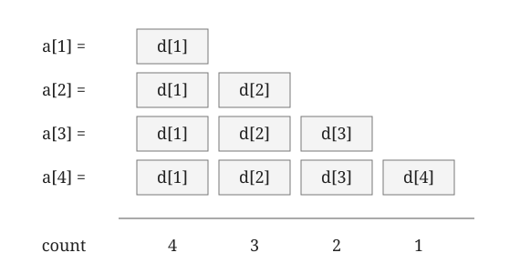

[[TOC]]

## 从单点到区间

上一篇 [[[rbook: bit_range_add_point_query]]] 用差分前缀和恢复一个位置的值：

$$
a_i=\sum_{j=1}^{i}d_j.
$$

现在要求在区间加之后，查询原数组 $[l,r]$ 的和。逐点恢复再相加，最坏需要 $O(n\log n)$。需要直接计算原数组前缀和：

$$
P(x)=\sum_{i=1}^{x}a_i.
$$

得到 $P$ 后，区间和仍是 $P(r)-P(l-1)$。

## 差分的贡献

将每个 $a_i$ 展开为差分前缀：

$$
\begin{aligned}
a_1&=d_1,\\
a_2&=d_1+d_2,\\
a_3&=d_1+d_2+d_3,\\
&\ \vdots\\
a_x&=d_1+d_2+\cdots+d_x.
\end{aligned}
$$

把这些行相加，就是 $P(x)$。从列来看，$d_j$ 出现在第 $j$ 行到第 $x$ 行，共 **$x-j+1$ 次**。



因此：

$$
\begin{aligned}
P(x)
&=\sum_{j=1}^{x}(x-j+1)d_j\\
&=(x+1)\sum_{j=1}^{x}d_j-\sum_{j=1}^{x}j\,d_j.
\end{aligned}
$$

关键是把查询位置 $x$ 与差分下标 $j$ 分开。对于一次给定的查询，$x+1$ 是常数；剩下只需要维护两种前缀和。

## 两棵树状数组

| 数组 | 维护的底层值 | 前缀查询结果 |
| --- | --- | --- |
| `c1` | $d_j$ | $\sum_{j=1}^{x}d_j$ |
| `c2` | $j\,d_j$ | $\sum_{j=1}^{x}j\,d_j$ |

这两棵树的块结构完全相同，只有加入的权值不同。

### 差分修改

对差分位置 $p$ 增加 $v$，同时执行：

```cpp
add(c1, p, v);
add(c2, p, p * v); // v 为 long long，乘法按 long long 计算
```

因为 $p$ 固定，$p\,d_p$ 的增量恰好为 $p\,v$。将这一操作封装成 `change(p,v)`。

原数组区间 $[l,r]$ 加 $v$，就对应：

```cpp
change(l, v);
if (r < n) change(r + 1, -v);
```

### 前缀与区间

```cpp
long long prefix_sum(int x) {
    return (x + 1LL) * sum(c1, x) - sum(c2, x);
}

long long range_sum(int l, int r) {
    return prefix_sum(r) - prefix_sum(l - 1);
}
```

`sum(c1,x)` 是差分前缀和，即单点值 $a_x$；`prefix_sum(x)` 才是原数组前缀和。二者需要区分。

### 手算

原数组 $[1,2,3,4,5]$，给 $[2,4]$ 加 $10$ 后：

$$
a=[1,12,13,14,5],\qquad d=[1,11,1,1,-9].
$$

查询前缀 $P(3)$，两棵树分别返回：

$$
\sum_{j=1}^{3}d_j=13,\qquad
\sum_{j=1}^{3}j\,d_j=1+22+3=26.
$$

所以 $P(3)=4\times13-26=26$，与 $1+12+13$ 相同。

## 正确性

初始化时，将每个差分 $d_j$ 及其加权值 $j\,d_j$ 分别加入两棵树。区间加只改变两个差分边界，而 `change` 同步维护两种增量，所以两棵树始终表示当前差分。

前缀查询按贡献次数恒等式恢复 $P(x)$，再由两个前缀相减得到区间和。每次修改与每次查询都保持了对应的数组含义。

## 代码实现

采用 [[[p: luogu-P3372 | P3372 线段树 1]]] 的输入输出格式。这道题的“区间加与区间求和”也可以用双树状数组实现。

- 第一行 $n,m$，第二行为初始数组。
- `1 l r v`：将闭区间 $[l,r]$ 内每个数增加 $v$。
- `2 l r`：查询该闭区间的和。

```cpp file=./range_add_range_query.cpp
```

两棵树每次只进行常数次修改或查询，所以单次操作仍为 $O(\log n)$；初始化为 $O(n\log n)$，有效存储为 $O(n)$。数组上限由 `maxn` 指定，须满足 $n<maxn$。

### 示例

```text
输入：
5 4
1 2 3 4 5
2 1 5
1 2 4 10
2 1 3
2 4 5

输出：
15
26
19
```

## 适用边界

这里的区间修改必须是**加法增量**。区间赋值、区间乘法不能直接套用这两棵树。

所有存储、增量与乘法使用 `long long`。即使最终区间和较小，$j\,d_j$ 和 $(x+1)\sum d_j$ 也可能较大，须核对中间量范围。

有的写法维护 $(j-1)d_j$，公式相应为 $x\sum d_j-\sum(j-1)d_j$。两套公式等价，但树中维护的权值必须与查询公式一致，不能混用。

## 练习

完成 [[[p: luogu-P3372 | P3372 线段树 1]]]。再设原数组全为零，对 $[2,4]$ 加 $3$，分别计算 $P(1),P(3),P(5)$，检查右边界抵消是否生效。

::: fold 参考结果
差分的非零项为 $d_2=3,d_5=-3$。因此：

$$
P(1)=0,\qquad P(3)=2\times3=6,\qquad P(5)=3\times3=9.
$$

当 $x\ge5$ 时，区间增量对前缀和的贡献保持为 $9$，不会继续增长。
:::
