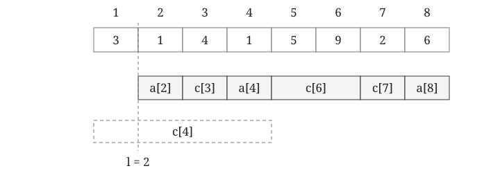

[[TOC]]

## 尾部追加模型

[[[rbook: bit_prefix_extremum]]] 只能直接查询前缀最大值。若要求一般区间的最大值，需要进一步拆分块。

本篇处理一个明确的模型：数组初始为空，每次只在尾部追加一个数，已加入的数不再修改；查询当前任意非空区间 $[l,r]$ 的最大值。

沿用旧版文章的块拆分思路，另外保存原数组：

$$
a[i]=\text{第 }i\text{ 个数},\qquad
c[i]=\max_{i-\operatorname{lowbit}(i)+1\le j\le i}a[j].
$$

保留 $a$ 的原因是：当一个完整块越过查询左边界时，必须能够单独取出它最右侧的元素。

## 区间查询

从右端点 $r$ 向左处理。设 $c[r]$ 的左端点为：

$$
left=r-\operatorname{lowbit}(r)+1.
$$

分两种情况：

- 若 $left\ge l$，整个块都在查询内，取 $c[r]$，令 $r\leftarrow r-\operatorname{lowbit}(r)$。
- 若 $left<l$，块跨过左边界，不能整体使用。只取 $a[r]$，令 $r\leftarrow r-1$。

```cpp
long long range_max(int l, int r) {
    long long res = numeric_limits<long long>::lowest();
    while (l <= r) {
        if (r - lowbit(r) + 1 >= l) {
            res = max(res, c[r]);
            r -= lowbit(r);
        } else {
            res = max(res, a[r]);
            --r;
        }
    }
    return res;
}
```

每步取走当前剩余区间的一个完整后缀，既不会越界，也不会遗漏。取走部分的最大值累积在 `res` 中；区间为空时就得到原查询的最大值。

### 拆分示例

查询 $[2,8]$，依次读取：

$$
a[8],\ c[7],\ c[6],\ a[4],\ c[3],\ a[2].
$$

它们覆盖 $[8,8]$、$[7,7]$、$[5,6]$、$[4,4]$、$[3,3]$、$[2,2]$。$c[8]$ 和 $c[4]$ 都包含位置 $1$，不能直接取用。



## 尾部追加

追加到位置 $p$ 时，旧块的右端点都小于 $p$，其管辖区间不变，只需构建新的 $c[p]$。

设 $\operatorname{lowbit}(p)=2^k$。除单点 $a[p]$ 外，下面这些已有块恰好填满剩余部分：

$$
c[p-1],\ c[p-2],\ c[p-4],\ldots,c[p-2^{k-1}].
$$

因为 $\operatorname{lowbit}(p-2^t)=2^t$，这些块的长度依次为 $1,2,4,\ldots,2^{k-1}$，互不重叠地覆盖 $[p-2^k+1,p-1]$。

例如追加到位置 $8$ 时：

$$
c[8]=\max(a[8],c[7],c[6],c[4]).
$$

据此实现：

```cpp
void append(long long v) {
    ++n;
    a[n] = c[n] = v;
    for (int step = 1; step < lowbit(n); step <<= 1) {
        c[n] = max(c[n], c[n - step]);
    }
}
```

新块只依赖已经构建好的旧块，所以可从空数组开始逐个追加。每个块都由自身元素和互不重叠的子块合并而来，始终保持正确的块最大值。

## 复杂度

一次追加合并至多 $O(\log n)$ 个块。

**上面的区间查询最坏为 $O(\log^2 n)$，不能按普通前缀查询算成 $O(\log n)$。** 当整块越界时，单点退回可能重新出现许多较短的块。

例如查询 $[2,2^k]$：先取出 $a[2^k]$，随后用 $k-1$ 个完整块退到 $2^{k-1}$；该块又越界，继续重复这一过程。总步数为：

$$
k+(k-1)+\cdots+1=\Theta(k^2).
$$

一般查询中，取完整块会清除一个二进制位；整块越界后的单点退回，则使当前可跨越的块长上限下降。块长有 $O(\log n)$ 个层级，每个层级至多清除 $O(\log n)$ 个位，因此得到上述上界。

两份数组需要 $O(n)$ 有效空间，模板按操作数量上限预留容量。若要求单次一般区间查询保证 $O(\log n)$，可以使用线段树；本篇的作用是理解树状数组块怎样拼接和拆分。

## 例题：最大数

[[[p: luogu-P1198 | P1198 最大数]]] 要求维护一个初始为空的数组：

- `A x`：将 $(x+t)\bmod D$ 追加到尾部，其中 $t$ 是最近一次查询答案，初始为 $0$。
- `Q L`：查询末尾 $L$ 个数的最大值，并更新 $t$。

查询区间为 $[n-L+1,n]$，正好符合本篇接口。由于追加值依赖先前答案，应按输入顺序处理。

```cpp file=./append_max.cpp
```

代码将负数的余数规范到 $[0,D)$，再与上次答案相加取模。树状数组内部的追加和查询本身也可以处理负数。

### 示例

```text
输入：
7 100
A 3
A 7
Q 2
A 5
Q 2
A -20
Q 1

输出：
7
12
92
```

第一次查询后 $t=7$，追加 $5$ 得到 $12$；随后 $t=12$，追加 $-20$ 得到规范化余数 $92$。

## 修改限制

这份实现只支持尾部追加，不支持修改已有位置。

旧值变小时，旧块最大值可能失效。仅重算当前块、再沿父链取更大值，无法清除父块中的旧最大值，不能据此声称支持任意赋值。

另外，最大值查询的初值应为负无穷。固定写成 $0$ 或 $-1$，只对相应值域成立，不适合作为通用模板。

## 练习

完成 [[[p: luogu-P1198 | P1198 最大数]]]，再手算数组 $[3,1,4,1,5,9,2,6]$ 的查询 $[2,8]$，核对各步读取的是 `a` 还是 `c`，答案应为 $9$。

解释：为什么在查询 $[1,8]$ 时可以直接读取 $c[8]$，而查询 $[2,8]$ 时不行？
