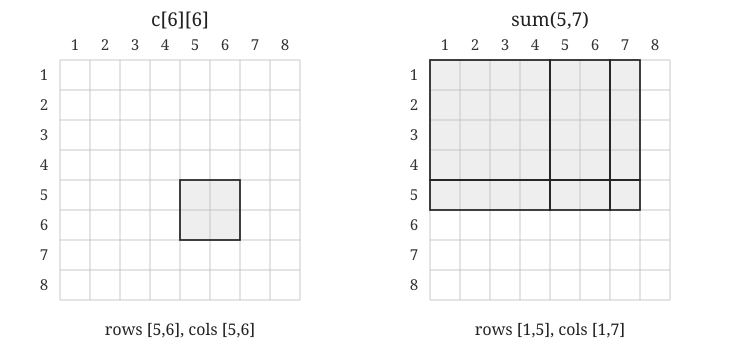

[[TOC]]

## 动态矩形和

给定 $n$ 行、$m$ 列的矩阵 $a$，支持：

- 单点加：将 $a_{x,y}$ 增加 $v$。
- 矩形求和：查询左上角 $(x_1,y_1)$、右下角 $(x_2,y_2)$ 围成的闭矩形内所有数的和。

本文统一用 $x$ 表示行、$y$ 表示列，下标从 $1$ 开始。

静态二维前缀和能快速查询矩形和，但修改一点后，许多前缀矩形都要改变。二维树状数组沿用 [[[rbook: bit]]] 的分块方式，在两个方向分别跳转。

## 管辖矩形

一维中，$c[x]$ 维护区间 $[x-\operatorname{lowbit}(x)+1,x]$。扩展到二维，令：

$$
c[x][y]=
\sum_{i=x-\operatorname{lowbit}(x)+1}^{x}
\sum_{j=y-\operatorname{lowbit}(y)+1}^{y}a_{i,j}.
$$

行方向长度为 $\operatorname{lowbit}(x)$，列方向长度为 $\operatorname{lowbit}(y)$，两段区间的笛卡尔积就是这个节点管辖的矩形。

例如 $c[6][6]$ 覆盖第 $5\sim6$ 行、第 $5\sim6$ 列，共四个格子。这里的 $c[x][y]$ 通常不是以 $(1,1)$ 开始的前缀矩形和。



## 单点修改

修改 $(x,y)$ 时，必须更新全部覆盖它的矩形块。

行方向的覆盖块由 `i += lowbit(i)` 枚举，列方向由 `j += lowbit(j)` 枚举，两层循环取所有组合：

```cpp
void add(int x, int y, long long v) {
    for (int i = x; i <= n; i += lowbit(i)) {
        for (int j = y; j <= m; j += lowbit(j)) {
            c[i][j] += v;
        }
    }
}
```

覆盖 $(x,y)$ 的矩形，恰好要求其行区间覆盖 $x$、列区间覆盖 $y$。因此上述组合枚举没有遗漏，也不会修改不包含该点的块。

列循环每次都从原来的 $y$ 开始，不能让上一次行循环结束后的列下标继续沿用。

## 前缀查询

设 $S(x,y)$ 表示第 $1\sim x$ 行、第 $1\sim y$ 列的元素和。

分别将行前缀、列前缀按一维规则拆块，再组合：

```cpp
long long sum(int x, int y) {
    long long res = 0;
    for (int i = x; i > 0; i -= lowbit(i)) {
        for (int j = y; j > 0; j -= lowbit(j)) {
            res += c[i][j];
        }
    }
    return res;
}
```

例如 $S(5,7)$ 中，行前缀拆成 $[1,4]$、$[5,5]$，列前缀拆成 $[1,4]$、$[5,6]$、$[7,7]$。二者组合产生图中的六个矩形：

$$
\begin{aligned}
S(5,7)={}&c[5][7]+c[5][6]+c[5][4]\\
        &+c[4][7]+c[4][6]+c[4][4].
\end{aligned}
$$

每个行块、列块都互不重叠且覆盖对应前缀，所以它们的组合也互不重叠，恰好覆盖整个前缀矩形。将这些块相加即可得到 $S(x,y)$。

## 矩形容斥

目标是闭矩形 $[x_1,x_2]\times[y_1,y_2]$。从大前缀中去掉上方和左侧，再加回被减去两次的左上部分：

$$
\begin{aligned}
\operatorname{rect\_sum}(x_1,y_1,x_2,y_2)
={}&S(x_2,y_2)-S(x_1-1,y_2)\\
   &-S(x_2,y_1-1)+S(x_1-1,y_1-1).
\end{aligned}
$$

左上坐标包含在查询内，因此减去的是 **前 $x_1-1$ 行、前 $y_1-1$ 列**的部分，不能直接减到 $x_1,y_1$。

当 $x_1=1$ 或 $y_1=1$ 时，部分前缀为空；`sum(0,y)`、`sum(x,0)` 自然返回 $0$。

## 代码实现

下面采用通用演示格式，初始矩阵全为零：

- 第一行 $n,m,q$：行数、列数、操作数。
- `1 x y v`：将位置 $(x,y)$ 的数增加 $v$。
- `2 x1 y1 x2 y2`：查询闭矩形和。

```cpp file=./fenwick_2d.cpp
```

若题目给出非零初始矩阵，可对每个初值调用一次 `add`，初始化为 $O(nm\log n\log m)$。

单次修改或前缀查询在两个方向各进行 $O(\log n)$、$O(\log m)$ 次跳转，因此为 $O(\log n\log m)$；矩形查询只需四次前缀查询，复杂度不变。全零矩阵的总时间为 $O(q\log n\log m)$，另有存储初始化开销。

有效存储为 $O(nm)$。代码按两个方向的容量各预留 $1005$，`long long c[maxn][maxm]` 约占 $8$ MB；提高容量前应先计算二维空间，不能照搬一维的 $5\times10^5$ 上限。

### 示例

```text
输入：
3 4 6
1 1 1 5
1 2 3 7
2 1 1 2 3
1 2 3 -4
2 2 2 3 4
2 1 1 1 1

输出：
12
3
5
```

注意矩阵不是正方形。负增量后 $(2,3)$ 的值变成 $3$，最后一次查询只包含 $(1,1)$ 一个格子。

## 边界

- 修改坐标必须满足 $1\le x\le n$、$1\le y\le m$，否则下标为零会使更新停滞。
- 查询左上、右下坐标均包含在内，容斥公式必须带两个减一。
- 本篇支持单点加；任意赋值需要先求旧值或额外保存原矩阵，再加入差值。
- 矩形加不是一次 `add(x,y,v)`，需另行引入二维差分。
- 多组数据应清空有效矩形范围；所有块和及中间结果须在 `long long` 范围内。

## 练习

[**CSES 1739：Forest Queries II**](https://cses.fi/problemset/task/1739/) 要求翻转一个格子的树木状态，并查询矩形内树木数量。

将有树记为 $1$、空格记为 $0$，即可转成本篇模型：

1. 读入初始地图时，将每个有树位置加入 $1$。
2. 另外保存当前格子状态。由空变有时加入 $1$，由有变空时加入 $-1$。
3. 矩形查询直接使用 `rect_sum`。

该题先输入正方形地图和操作数，代码读入部分需要相应调整；它的翻转操作没有额外的增量参数。题面按“行、列”给坐标，使用时保持这一顺序。

进阶可做 [[[p: luogu-P4514 | P4514 上帝造题的七分钟]]]。它要求矩形加与矩形求和，需要将差分的边界修改推广到二维的四个角，并进一步推导矩形和的加权公式。可结合 [[[rbook: bit_range_add_range_query]]] 中的贡献次数理解这一扩展。
