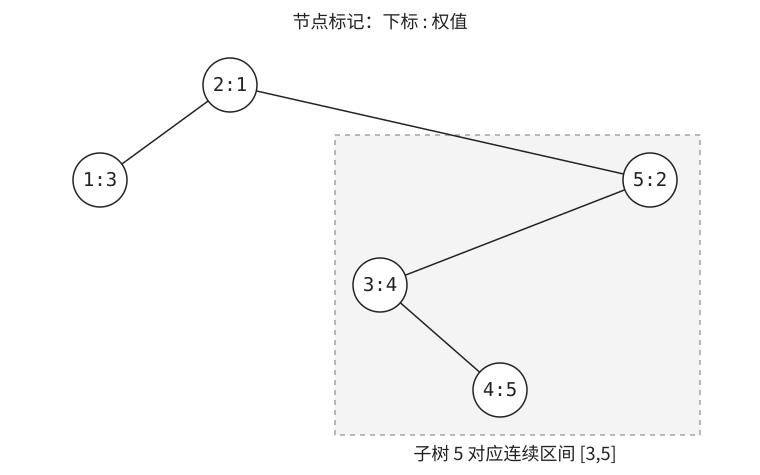
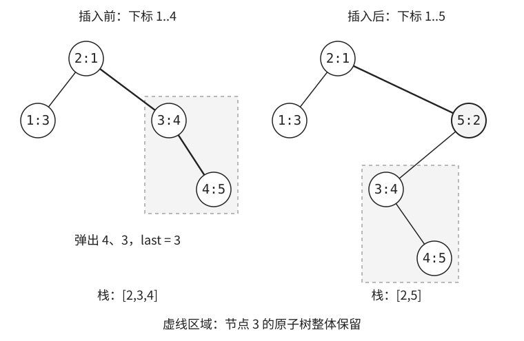
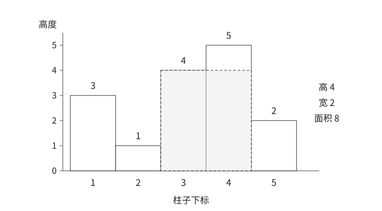

[[TOC]]

## 定义

给定数组 $a_1,a_2,\ldots,a_n$，把每个位置 $i$ 看作一个节点，权值为 $a_i$。笛卡尔树是一棵同时满足以下性质的二叉树：

- **下标有序**：左子树中所有下标小于 $i$，右子树中所有下标大于 $i$。
- **权值成堆**：父节点的权值不大于子节点的权值。

因此，中序遍历得到下标 $1,2,\ldots,n$，权值满足小根堆性质。本文都使用这种小根堆型笛卡尔树。

若权值相等，仅凭这两条性质不能确定唯一结构。本文统一按 $(a_i,i)$ 的字典序确定堆的优先级：**权值较小者优先，权值相等时较小下标优先**。

例如数组 $[3,1,4,5,2]$，得到下面的树。图中节点记为 `下标:权值`。



根是节点 $2$，其权值为整个数组的最小值 $1$。节点 $5$ 的子树包括下标 $3,4,5$，根的权值 $2$ 也是这个区间的最小值。

## 递归建树

对于区间 $[l,r]$，取其中最小值的位置 $k$ 作为根；若有多个最小值，取最左侧的一个。然后分别用 $[l,k-1]$、$[k+1,r]$ 构造左右子树。

这样的划分保持了下标顺序，根的权值也不大于两棵子树中的任意权值。反过来，任何满足约定的笛卡尔树，其根都只能是这个 $k$，左右子树也必须递归满足相同条件。因此，**固定相等值的处理规则后，笛卡尔树唯一**。

直接扫描区间寻找最小值，最坏需要 $O(n^2)$ 时间。例如数组严格递增时，每次最小值都在最左侧，扫描长度依次为 $n,n-1,\ldots,1$。

为了避免重复扫描，可以从左到右插入节点，用 [[[rbook: monotonic_stack]]] 维护正在变化的部分。

## 单调栈

已经插入 $1\sim i-1$ 时，节点 $i$ 的下标最大，中序遍历中必须排在最后。因此，只需沿当前树的最右侧路径寻找它的插入位置。

用栈保存这条路径：**栈底是根，沿右孩子依次走到栈顶**。路径上权值不下降；权值相等时，下标递增。

### 插入节点

从栈顶开始，弹出所有权值严格大于 $a_i$ 的节点，记录最后弹出的节点 `last`。

1. 若栈仍非空，把栈顶的右孩子改为 $i$。
2. 把 $i$ 的左孩子设为 `last`。
3. 把 $i$ 入栈，得到新的最右侧路径。

没有节点弹出时，`last=0`，新节点没有左孩子。若整个栈都被弹空，新节点成为根，旧树整体成为它的左子树。

### 连续弹栈

对于数组 $[3,1,4,5,2]$，插入最后一个节点 $5:2$ 前，栈内下标为 $[2,3,4]$，对应权值 $[1,4,5]$。

新权值 $2$ 比 $5,4$ 小，依次弹出节点 $4,3$。最后弹出的节点 $3$，是这部分原子树的根：



弹栈后剩下节点 $2$，于是令 `rs[2]=5`、`ls[5]=3`。节点 $3$ 原有的右孩子 $4$ 保持不变。

**弹栈只是移出维护路径，节点仍然保留在树中。** 也不能把每个弹出的节点分别设为新节点的左孩子；应把最后弹出节点所代表的整棵子树接过去。

| 插入节点 | 弹出的下标 | 插入后的栈（下标） |
|---|---|---|
| `1:3` | 无 | `[1]` |
| `2:1` | `1` | `[2]` |
| `3:4` | 无 | `[2,3]` |
| `4:5` | 无 | `[2,3,4]` |
| `5:2` | `4,3` | `[2,5]` |

### 正确性

假设插入前的树已经满足定义。被弹出的节点构成最右路径的一段，其最后弹出节点 `last` 是这部分子树的根。

新节点 $i$ 的下标大于所有已有节点，把这棵子树放到它的左侧，仍保持中序顺序。若还有未弹出的栈顶，新节点接到其右侧；否则，新节点成为根。

`last` 的权值大于 $a_i$，未弹出栈顶的权值不大于 $a_i$，所以新形成的父子关系也满足堆性质。其他父子关系没有改变。因此插入后仍是一棵合法笛卡尔树。

新树的最右侧路径恰好是保留的栈前缀再加上 $i$，栈的不变量也继续成立。

## 线性构造

主例：[[[p: luogu-P5854 | 笛卡尔树]]]。题目给定一个 $1\sim n$ 的排列，要求构造笛卡尔树，并按指定格式输出左右孩子的异或校验值。

用普通数组 `ls`、`rs` 记录左右孩子，`0` 表示不存在。核心构造集中在 `build` 中，返回根的下标。

```cpp file=./cartesian_tree.cpp
```

虽然有两层循环，但每个节点只入栈一次、出栈至多一次，全部弹栈次数不超过 $n$。因此构造时间为 $O(n)$，空间为 $O(n)$。

实现时注意：

- 弹栈条件为 `>`，使相等值中较小下标优先。若改成 `>=`，则变为较大下标优先，区间最小值位置的约定也要随之改变。
- 根在栈底 `st[1]`，栈顶只是当前最右侧节点。
- P5854 的 $n$ 可达 $10^7$，四个 `int` 数组约占 $160$ MB；处理较小数据时应按实际范围调整 `maxn`。校验值的乘法必须先转成 `long long`。

## 区间性质

### 子树对应连续区间

一棵子树的中序遍历会连续完成，不会与子树外的节点交错。由于整棵树的中序遍历是 $1\sim n$，每棵子树恰好对应某个连续下标区间 $[L_u,R_u]$。

再由堆性质，子树根 $u$ 的权值不大于所有后代权值，因而：

$$
a_u=\min_{L_u\le i\le R_u}a_i,\qquad
\operatorname{size}(u)=R_u-L_u+1.
$$

这是**中序下标区间**，不要与一般树中通过 DFS 编号得到的子树区间混淆。

### 区间最值与 LCA

任取 $l\le r$，令 $k=\operatorname{LCA}(l,r)$，则：

$$
\min_{l\le i\le r}a_i=a_k.
$$

若 $k$ 是某个端点，显然 $k\in[l,r]$；否则，$l,r$ 分属 $k$ 的左右子树，由下标有序可知 $l<k<r$。

同时，$k$ 的子树包含两个端点，其下标区间连续，所以也包含整个 $[l,r]$。由堆性质，$a_k$ 不大于区间内的任意权值；而 $k$ 本身又在区间内，因此它就是区间最小值的位置。按本文的相等值约定，它还是最左侧的最小值位置。

例如 $[4,5]$ 的 LCA 是节点 $5$，最小值为 $a_5=2$；$[3,4]$ 的 LCA 是节点 $3$，最小值为 $a_3=4$。

这把静态区间最小值查询（RMQ）转化为 LCA 查询。线性建树之后，仍需选择相应的 LCA 算法；使用 [[[rbook: jump_lca]]] 时，预处理为 $O(n\log n)$，每次查询为 $O(\log n)$，不能把建树复杂度直接当作整个查询方案的复杂度。

## 最大矩形

题目：[[[p: roj-3032 | 直方图中最大的矩形]]]。

每根柱子宽度为 $1$，高度非负。选择连续区间 $[l,r]$，其中可容纳矩形的最大高度是区间最小值，因此面积为：

$$
\left(\min_{l\le i\le r}a_i\right)(r-l+1).
$$

对高度数组建立笛卡尔树。每个节点 $u$ 的整棵子树对应连续区间，区间最小值为 $a_u$，可以得到合法面积：

$$
a_u\cdot\operatorname{size}(u).
$$

对示例数组，节点 $3$ 的子树包括下标 $3,4$，高度分别为 $4,5$，可容纳高 $4$、宽 $2$ 的矩形，面积为 $8$。



### 不漏最优解

任取区间 $[l,r]$，令 $u=\operatorname{LCA}(l,r)$。这个区间的最小值是 $a_u$，且它包含在 $u$ 的子树区间内。因此：

$$
a_u(r-l+1)\le a_u\cdot\operatorname{size}(u).
$$

右侧也是一个合法矩形的面积。也就是说，任何区间都能扩展到某棵子树的区间，保持最低高度不变，面积不会减小。所以答案恰好是：

$$
\max_u\left(a_u\cdot\operatorname{size}(u)\right).
$$

这个证明也适用于重复高度。不要因此认定每个节点的子树都是该高度能延伸到的最大范围：例如 $[2,2]$ 中，节点 $2$ 的子树只有自己，但最优宽度会由节点 $1$ 的子树覆盖。

### 代码实现

构造后，用迭代遍历记录“父亲先于孩子”的访问顺序，再倒序计算子树大小。这样即使树退化成链，也不依赖深递归。

约定 $n\le10^5$、$0\le a_i\le10^9$，多组输入，每组先输入 $n$ 再输入各柱高度，输入 $0$ 结束。时间、空间均为 $O(n)$，面积用 `long long`。

::: fold 完整代码
```cpp file=./histogram.cpp
```
:::

直接使用单调栈求边界的实现见 [pcs2：直方图中最大的矩形](https://pcs2.roj.ac.cn/problems/roj/3032/)。笛卡尔树把这类按区间最小值划分的问题，显式组织成了一棵树。
