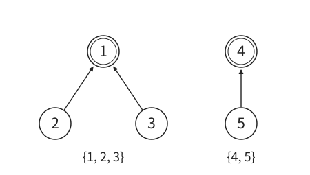
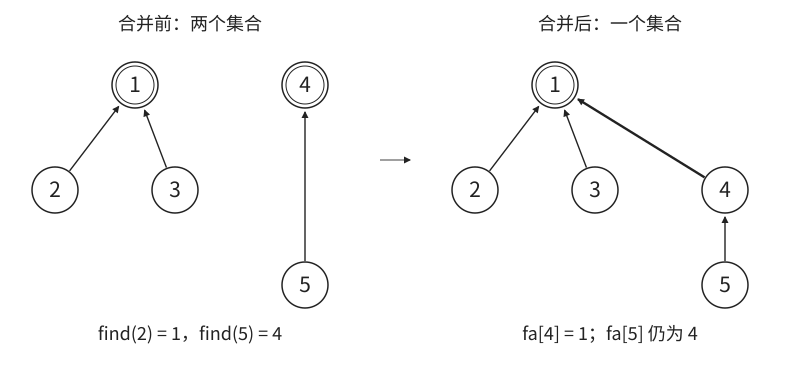
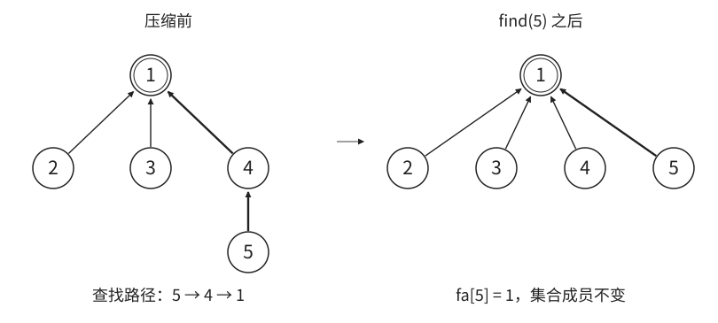

[[TOC]]

## 问题

有 $n$ 个元素，编号为 $1\sim n$，初始时各自组成一个集合。交替执行两种操作：

- **合并**：将 $x,y$ 所在的两个集合合为一个。
- **查询**：判断 $x,y$ 是否属于同一个集合。

例如，当前集合为 $\{1,2,3\}$、$\{4,5\}$。查询 $2,3$，答案为是；查询 $2,5$，答案为否。合并 $2,5$ 所在的集合后，五个元素就属于同一个集合。

若给每个元素记录集合编号，查询只需比较编号，但合并时可能要修改整个集合。并查集（Disjoint Set Union，DSU）用树表示集合，找到两个根后，只需修改一个父亲指针就能连接两棵树。

## 森林表示

用一棵有根树表示一个集合，根作为这个集合的**代表元**。多个不相交集合构成一片森林。

维护父亲数组 `fa`：

- `fa[x]` 表示 $x$ 的父亲。
- 根的父亲是自己，即 `fa[x] == x`。
- 从一个元素沿父亲指针向上走，最终到达的根，就是它所在集合的代表元。



图中双圆表示根，箭头从孩子指向父亲，省略根指向自己的箭头。对应数组为：

| 元素 $x$ | 1 | 2 | 3 | 4 | 5 |
| --- | --- | --- | --- | --- | --- |
| `fa[x]` | 1 | 1 | 1 | 4 | 4 |
| 所在集合的根 | 1 | 1 | 1 | 4 | 4 |

**同一集合的元素具有相同的根，但不一定具有相同的父亲。** 后续合并可能让树出现多层，查询时必须找根，不能直接比较 `fa[x]` 与 `fa[y]`。

## 初始化

开始时，每个元素单独成集，因此每个元素都是根：

```cpp
for (int i = 1; i <= n; ++i) {
    fa[i] = i;
}
```

初始化之后共有 $n$ 棵树。合并只会减少集合数，不会把一个集合拆开。

## 找根

定义 `find(x)` 返回 $x$ 所在集合的根。若 $x$ 不是根，就继续查找父亲的根：

```cpp
int find(int x) {
    if (fa[x] == x) return x;
    return find(fa[x]);
}
```

于是，判断两个元素是否同属一个集合，只需：

```cpp
bool same(int x, int y) {
    return find(x) == find(y);
}
```

## 合并

分别找到两个根，把一个根接到另一个根下面即可：

```cpp
bool unite(int x, int y) {
    int fx = find(x), fy = find(y);
    if (fx == fy) return false;  // 已经同属一个集合
    fa[fy] = fx;
    return true;  // 两个不同集合发生了合并
}
```

函数返回是否真正合并，便于之后统计集合数。函数名用 `unite`；`union` 是 C++ 关键字，不能用作函数名。

例如合并 $2,5$ 所在集合，先求得根 $1,4$，再令 `fa[4] = 1`：



节点 $5$ 的父亲仍然是 $4$，但它通过 $5\to4\to1$ 到达新根，因此也进入了合并后的集合。无需逐个修改原集合的所有元素。

**必须连接两个不同的根。** 若直接写 `fa[y] = x`，当 $y$ 不是根时，只会移动它的子树，可能把原集合拆开；同一棵树内任意改父亲还可能形成环。

## 路径压缩

不加优化时，连续把旧根接到新根下面，可能得到

$$
1\to2\to3\to\cdots\to n.
$$

这时一次 `find(1)` 就需要经过 $n$ 个节点。既然查询已经找到了根，就可以让沿途节点直接指向根，缩短以后的查询路径。这就是**路径压缩**。

只需给前面的递归增加一次赋值：

```cpp
int find(int x) {
    if (fa[x] == x) return x;
    fa[x] = find(fa[x]);  // 先找到根，再将 x 直接接到根上
    return fa[x];
}
```

继续上面的例子，执行 `find(5)`，先沿 $5\to4\to1$ 找到根 $1$；递归返回时，将路径上的节点都直接接到 $1$：



压缩前后，集合成员和代表元都没有改变，只改变树形。一次查询只压缩**这次经过的路径**，不会自动把整棵树变成一层。

::: fold 非递归实现
也可以走两遍：第一遍找到根，第二遍修改沿途父亲。修改前要保存旧父亲，否则无法继续沿原路径向上走。

```cpp
int find(int x) {
    int root = x;
    while (fa[root] != root) root = fa[root];

    while (x != root) {
        int next = fa[x];  // 保存旧父亲
        fa[x] = root;
        x = next;
    }
    return root;
}
```

这段代码可直接替换递归版。只有路径压缩、没有限制树高时，第一次查询仍可能很深；非递归写法可以避免递归栈过深。
:::

## 按大小合并

路径压缩在查询时缩短路径；合并时也可以主动控制树高：**把较小集合的根接到较大集合的根下面**。

增加数组 `sz`，仅在根上保存集合大小。初始化时 `sz[i] = 1`：

```cpp
bool unite(int x, int y) {
    int fx = find(x), fy = find(y);
    if (fx == fy) return false;
    if (sz[fx] < sz[fy]) swap(fx, fy);
    fa[fy] = fx;        // 小集合的根接到大集合的根
    sz[fx] += sz[fy];   // 只更新新根的集合大小
    return true;
}
```

大小相同可以任选一个根。代表元不一定是集合中编号最小的元素，也不需要固定不变。

每当一个元素因合并而增加一层深度，它所在的小集合都会并入至少同样大的集合，合并后的大小至少翻倍。大小最多增长到 $n$，所以即使不做路径压缩，树高也至多为 $O(\log n)$。路径压缩只会进一步缩短路径。

::: note 按秩合并
另一种策略是按秩合并：给根记录一个树高的上界，小秩根接到大秩根；秩相同时，新根的秩加一。路径压缩后，秩不再等于实际树高。

本篇统一采用按大小合并。它同样控制树高，还能直接回答集合大小。
:::

## 集合统计

### 集合大小

查询 $x$ 所在集合的大小，应读取：

```cpp
int size = sz[find(x)];
```

不能直接使用 `sz[x]`。例如集合 $\{4,5\}$ 并入 $\{1,2,3\}$ 后，`sz[1] = 5`，`sz[4]` 仍可能保留旧值 $2$，已经不再代表当前集合大小。

路径压缩不改变成员，因此不需要更新根的 `sz`。`sz` 表示整个集合的大小，不是压缩后各节点的子树大小。

### 集合数量

初始集合数为 $n$，每次成功合并两个不同集合，数量减一：

```cpp
int components = n;
// 每处理一次合并操作：
if (unite(x, y)) --components;
```

重复合并、合并元素自身，都不会减少集合数。也可以在全部操作后统计 `fa[i] == i` 的节点数，每个根恰好对应一个集合。

## 正确性

维护以下性质：**每个集合恰好对应一棵树，树中的元素都能沿父亲指针到达同一个根。**

初始化时，每个元素独立成树，性质成立。

合并两个不同集合时，只把一个根接到另一个根下面，不会形成环，也不会拆开旧集合。两棵树成为一棵，恰好表示两个集合的并集；大小合并为原来两者之和。

路径压缩只把沿途节点改为指向原来的根，既没有引入其他集合的成员，也没有改变任何成员的归属。因此性质始终成立，比较根就能正确判断是否同属一个集合。

## 代码

下面采用 [[[p: luogu-P3367 | P3367 并查集]]] 的输入输出格式：第一行输入 `n m`，之后是 $m$ 次操作。

- `1 x y`：合并 $x,y$ 所在集合。
- `2 x y`：同属一个集合输出 `Y`，否则输出 `N`。

```cpp file=./dsu.cpp
```

### 示例

输入：

```text
5 8
1 1 2
1 1 3
1 4 5
2 2 5
1 2 5
2 3 5
1 2 5
2 1 1
```

输出：

```text
N
Y
Y
```

前三次操作形成前文的 $\{1,2,3\}$、$\{4,5\}$。第五次操作连接根 $1,4$，第六次查询将 $5$ 直接接到根 $1$。第七次重复合并不改变集合，第八次查询元素自身，答案为 `Y`。

## 复杂度

初始化耗时 $O(n)$。同时使用路径压缩与按大小合并时，单次操作的**均摊**时间为 $O(\alpha(n))$，其中 $\alpha$ 是反阿克曼函数，在竞赛范围内增长极慢。$m$ 次操作的总时间为

$$
O(n+m\alpha(n)).
$$

均摊描述一串操作的平均代价，不表示每一次查询都只走固定几步。上述界针对两种优化一起使用的实现，详细分析不在本篇展开。空间为 $O(n)$，模板按 `maxn` 预留容量。

## 应用与边界

### 无向图连通性

把每个连通块看成集合，加入无向边 $(u,v)$ 时执行 `unite(u,v)`。两个点连通，当且仅当它们位于同一个集合。

若边全部给定，只需计算一次连通块，DFS、BFS 也可以。并查集适合边不断加入、合并与查询交替进行的场景。

在维护无向森林时，一条新边的两端若已经同属一个集合，加入它就会形成环；否则合并两个集合。这也是 [[[rbook: graph_mst]]] 中 Kruskal 算法判断能否选边的方法。

::: warn 父亲指针不是原图的边
`unite(2,5)` 可能连接根 $1,4$，但原图不一定存在边 $(1,4)$；路径压缩还会继续改变父亲指针。因此并查集保留的是连通关系，不能用这棵树恢复原图路径、距离或最短路。
:::

### 等价关系

“属于同一集合”满足自反性、对称性与传递性。题目中的关系也具备这些性质，且信息只会合并已有类别时，就可以考虑并查集。

不能仅凭“具有传递性”就使用它。有向图的可达性也具有传递性，但 $u$ 能到达 $v$ 不代表 $v$ 能到达 $u$，直接合并会丢失方向。

普通并查集也不直接维护“敌对”“相差多少”等关系。种类并查集与带权并查集需要增加表示或信息，不能把相反关系当作同类关系直接合并。

### 使用限制

- **只合并，不拆分。** 普通并查集不支持直接删边；部分离线问题可以倒序处理，把删除变为添加。
- **编号合法。** 本篇使用 $1\sim n$，模板容量支持 $n\le2\times10^5$。零下标或更大规模需要同步调整初始化与容量。
- **重新初始化。** 多组数据要重置 `fa` 与 `sz`；额外维护的集合数量也要重置。
- **重复操作。** 只有 `unite` 返回 `true` 才更新合并次数等统计，不能重复累加集合大小。

## 练习

### 手算

1. 上面样例第五次操作结束后，`fa[3]` 与 `fa[5]` 不同，为什么它们仍属于同一个集合？
2. 按大小合并时依次执行 `unite(4,5)`、`unite(1,4)`，最终代表元一定是 $1$ 吗？
3. 初始有 $5$ 个元素，依次合并 $(1,2)$、$(2,3)$、$(1,3)$、$(4,4)$，最后有几个集合？

::: fold 参考结果
1. 此时 `fa[3] = 1`，`fa[5] = 4`，但 $5\to4\to1$，二者的根都是 $1$。
2. 不一定。第一步得到以 $4$ 为根、大小为 $2$ 的集合；第二步把单独的 $1$ 接到 $4$，代表元为 $4$。
3. 只有前两次合并成功，最后有 $5-2=3$ 个集合：$\{1,2,3\}$、$\{4\}$、$\{5\}$。
:::

### 推荐题目

| 层次 | 题目 | 训练内容 |
| --- | --- | --- |
| 模板 | [[[p: luogu-P3367]]] | 交替合并与判同，先熟悉 `find`、`unite`。 |
| 建模 | [[[p: luogu-P1551]]] | 按题目规定的传递关系合并，再回答询问；输出为 `Yes/No`。 |
| 集合统计 | [CSES 1676：Road Construction](https://cses.fi/problemset/task/1676) | 每次加边后输出连通块数和最大连通块大小，只在合并成功时减少数量。 |
| 排序应用 | [[[p: luogu-P1111]]] | 按修复时间加入边，集合数首次变为 $1$ 时即全部连通；始终不能连通则输出 $-1$。 |

先掌握普通集合合并，再学习 [[[rbook: kind_disjoint_set]]]、[[[rbook: weighted_disjoint_set]]]。“食物链”“银河英雄传说”属于这些扩展，不适合作为普通并查集的直接模板练习。

## 参考

- [AtCoder Library：DSU](https://atcoder.github.io/ac-library/production/document_en/dsu.html)：接口、代表元与均摊复杂度。

