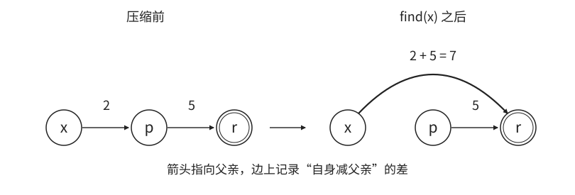
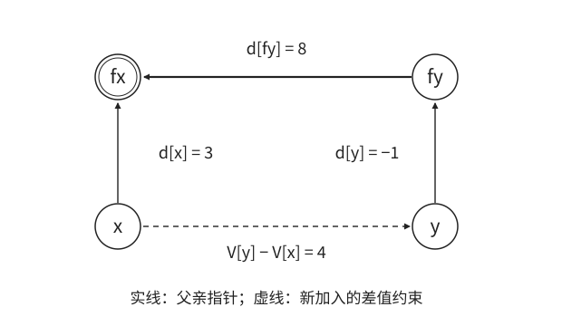
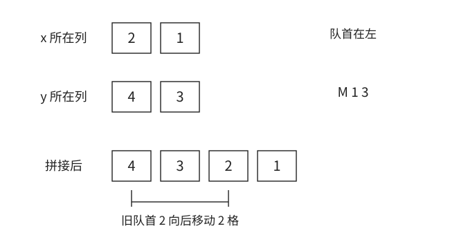

[[TOC]]

## 问题

[[[rbook: disjoint_set]]] 只能判断两个元素是否同属一个集合。现在还需要知道它们之间的**差值**。

设每个元素有一个未知数值 $V[x]$，依次加入约束

$$
V[y]-V[x]=w.
$$

例如，已知 $V[2]-V[1]=3$、$V[3]-V[2]=-1$，就能推出

$$
V[3]-V[1]=3+(-1)=2.
$$

此时再加入差值为 $2$ 的相同约束，仍然相容；若要求差值为 $5$，则产生冲突。

绝对数值没有必要确定。把同一连通块中所有数值同时加上一个常数，差值不变。带权并查集选择根作为参考点，在父亲指针上保存相对差值。

## 边权

仍用 `fa[x]` 保存父亲，新增

$$
d[x]=V[x]-V[fa[x]].
$$

根的父亲是自己，因此根的 `d` 为 $0$。初始时，每个元素单独成集：

~~~cpp
fa[i] = i;
sz[i] = 1;
d[i] = 0;
~~~

若父亲链为 $x\to p\to r$，则

$$
V[x]-V[r]
=\bigl(V[x]-V[p]\bigr)+\bigl(V[p]-V[r]\bigr).
$$

所以到根的差值等于父亲链上各段边权之和。

图中的 $2,5$ 相加得到 $7$。这里的“权”可以为负数，表示**有方向的差值**，不一定是几何距离，也不是集合大小。

## 路径压缩

普通并查集只改父亲，带权并查集还要同步修改 `d[x]` 的含义。

先保存旧父亲 $p$，递归将 $p$ 接到根 $r$。这时 `d[p]` 已经变为 $V[p]-V[r]$，再执行

$$
d[x]\gets d[x]+d[p],
$$

就得到 $V[x]-V[r]$，可以把 `fa[x]` 改为 $r$。

~~~cpp
int find(int x) {
    if (fa[x] == x) return x;
    int p = fa[x];          // 保存旧父亲
    int root = find(p);     // 先更新父亲到根的差值
    d[x] += d[p];           // 再累计 x 到根的差值
    fa[x] = root;
    return root;
}
~~~

**先累加旧父亲的权值，再改父亲。** 若先把 `fa[x]` 改为根，再读取 `d[fa[x]]`，读到的就是根的 $0$，会漏掉原父亲到根的那一段。

调用 `find(x)` 后，`d[x]` 才保证表示到当前根的差值。其他未访问节点仍可能保存到父亲的差，不能把整个数组都当成“到根距离”。

## 差值查询

先对两端执行 `find`。若根相同，根的参考值可以相消：

$$
V[y]-V[x]
=\bigl(V[y]-V[r]\bigr)-\bigl(V[x]-V[r]\bigr)
=d[y]-d[x].
$$

~~~cpp
int fx = find(x), fy = find(y);
if (fx != fy) {
    // 差值未知
} else {
    // V[y] - V[x] = d[y] - d[x]
}
~~~

根不同时，两个集合可以独立平移，它们之间的差值尚未确定。此时不能直接用 `d[y] - d[x]`，即使两个值恰好都是零。

## 合并公式

### 连接两个根

加入 $V[y]-V[x]=w$，先执行 `find(x)`、`find(y)`，得到根 $f_x,f_y$。

假设让 $f_y$ 接到 $f_x$ 下面，需要填写的是

$$
d[f_y]=V[f_y]-V[f_x].
$$

已知

$$
V[x]=V[f_x]+d[x],\qquad
V[y]=V[f_y]+d[y].
$$

代入新约束：

$$
\bigl(V[f_y]+d[y]\bigr)-\bigl(V[f_x]+d[x]\bigr)=w.
$$

移项得到

$$
\boxed{d[f_y]=w+d[x]-d[y]}.
$$

例如 `d[x]=3`、`d[y]=-1`、$w=4$，则根间差值为 $4+3-(-1)=8$。沿新树计算

$$
V[y]-V[x]=-1+8-3=4,
$$

恰好满足约束。其他节点的局部边权不用逐个修改，之后查询时再沿路径累加。

### 反向连接

按大小合并可能要求 $f_x$ 接到 $f_y$。连接方向反过来，保存的差也要取反：

$$
d[f_x]=V[f_x]-V[f_y]=d[y]-d[x]-w.
$$

因此可以先计算一个方向的 `delta`；交换两个根时，同时令 `delta = -delta`。只交换根、不改变权值符号，会把新约束反向。

### 已经同根

若两端已经同根，差值已经确定，不再连接根：

~~~cpp
if (fx == fy) return d[y] - d[x] == w;
~~~

差值相同，约束只是重复确认；差值不同，拒绝本条约束。不要改写根的权值去“修正”差值，否则会破坏之前的关系。

## 代码

本篇使用以下在线格式。第一行输入 $n,m$，接下来处理 $m$ 次操作：

- `0 x y w`：尝试加入 $V[y]-V[x]=w$；相容输出 `YES` 并接受，矛盾输出 `NO` 并拒绝。
- `1 x y`：输出 $V[y]-V[x]$；关系尚未确定则输出 `UNKNOWN`。

这里 `add_relation` 返回的是“约束是否相容”，包括相容的重复约束，不是“是否减少了一个集合”。

~~~cpp file=./weighted_dsu.cpp
~~~

输入：

~~~text
5 10
0 1 2 3
0 2 3 -1
1 1 3
0 1 3 2
0 1 3 5
1 1 3
0 4 3 7
1 4 2
1 1 5
0 5 5 1
~~~

输出：

~~~text
YES
YES
2
YES
NO
2
YES
8
UNKNOWN
NO
~~~

第五条约束被拒绝，$V[3]-V[1]$ 仍为 $2$。加入 $V[3]-V[4]=7$ 后，

$$
V[2]-V[4]
=\bigl(V[2]-V[3]\bigr)+\bigl(V[3]-V[4]\bigr)
=1+7=8.
$$

此时元素 $5$ 仍独立，无法查询它与 $1$ 的差。最后一条要求 $V[5]-V[5]=1$，与自差为零矛盾。

## 正确性与复杂度

始终维护：父亲边保存对应的数值差，树中已有约束全部成立。

初始化时，每个点独立，根的差为零。路径压缩利用差值的可加性，将多段差合成一段，保留节点到根的相对值。

合并两个集合时，它们原本可以独立平移。按推导出的根间差值连接，相当于确定两个参考系之间的偏移；集合内部的差值不变，新约束也成立。

同根时，两点间的差已经由树唯一确定。检查它是否等于 $w$，恰好判断新约束是否矛盾。拒绝约束时，除不改变关系的路径压缩外，不修改已有状态。

主模板采用路径压缩与按大小合并，初始化 $O(n)$，$m$ 次操作总时间为 $O(n+m\alpha(n))$，空间为 $O(n)$。模板支持 $n\le2\times10^5$。

## 队列拼接

### 银河英雄传说

[[[p: luogu-P1196 | 银河英雄传说]]] 中，每艘战舰初始独立成列，支持：

- `M x y`：把 $x$ 所在的整列接到 $y$ 所在列的尾部，保持两列内部顺序。
- `C x y`：若两艘战舰同列，查询它们中间的战舰数；不同列返回 $-1$。

保留“根是队首”的表示。`sz[root]` 为整列长度，`d[x]` 保存 $x$ 相对父亲的位置差；`find(x)` 后，`d[x]` 就是 $x$ 前面的战舰数。

设 $x,y$ 所在列的根为 $f_x,f_y$。拼接后，新队首仍是 $f_y$，旧队首 $f_x$ 向后移动 $y$ 列的长度，因此

~~~cpp
fa[fx] = fy;
d[fx] = sz[fy];
sz[fy] += sz[fx];
~~~

这里的根间差由队列长度决定。它是拼接操作带来的位移，不是读入一个固定的两点差值约束。

图中原来的两列为 $[2,1]$、$[4,3]$。执行 `M 1 3`，得到 $[4,3,2,1]$。令 `fa[2]=4`、`d[2]=2`；战舰 $1$ 原来距队首 $2$ 一格，之后距新队首就是 $1+2=3$ 格。

### 合并方向

主模板中的根只是任选的参考点，可以按大小选择；本例却要求根始终是队首，必须将 $f_x$ 接到 $f_y$。

**不能交换两个根后仍沿用上述赋值。** 否则可能颠倒拼接方向，或破坏“根为队首、根的差为零”的约定。

合并方向固定，树可能很深。下面的完整代码使用两遍非递归路径压缩：先求总差，再沿原路径更新各节点。它与递归版遵循同一个边权不变量，可以避免深链造成递归栈过深。

### 查询

同列且 $x\ne y$ 时，

$$
\text{中间战舰数}=\lvert d[x]-d[y]\rvert-1.
$$

位置差包含相邻两舰间的一步，中间元素数要再减一；相邻战舰的答案为 $0$。

::: fold 银河英雄传说完整代码
~~~cpp file=./galaxy.cpp
~~~

原题共有 $30000$ 艘战舰，保证每次合并的两列不同，查询中的两个编号也不同。代码中的同根保护避免重复拼接，但不改变原题接口。
:::

输入：

~~~text
8
M 1 2
M 3 4
M 1 3
C 1 4
C 2 3
C 1 5
M 5 2
C 5 3
~~~

输出：

~~~text
2
0
-1
2
~~~

本例只使用路径压缩，没有按大小合并。设战舰数为 $N$、操作数为 $m$，采用一般上界 $O((N+m)\log N)$；单次操作最坏仍可能为 $O(N)$，不能直接沿用主模板的双优化均摊界。空间为 $O(N)$。

## 模关系

[[[rbook: kind_disjoint_set]]] 用多个身份表示类别关系。也可以给类别编号，在模 $k$ 意义下维护差值：

- 两类关系：差为 $0$ 表示同类，差为 $1$ 表示异类。
- 三类循环：差为 $0,1,2$，分别表示三种相对关系，具体方向要先约定。

推导仍遵循“节点到父亲的差可以相加”，但每次运算都要按模 $k$ 处理。C++ 中负数取模可能为负，应规范为 `(v % k + k) % k`。

这说明拆点与带权是表达相对关系的两种方式。初学时可先用拆点明确对应关系，再用边权减少辅助节点。

## 易错点

- **差值方向统一。** 本篇始终规定 $d[x]=V[x]-V[fa[x]]$，输入约束为 $V[y]-V[x]=w$。采用其他约定时必须重新推导。
- **先查根，再读差。** 未访问节点的 `d` 仍可能只表示到父亲的差。
- **反向合并取反。** `swap(fx, fy)` 必须同时改变根间差值的符号。
- **负数合法。** 不能对一般差值查询取绝对值；银河英雄传说取绝对值，是因为它查询两位置之间的间隔。
- **宽类型。** 主模板的 `d`、输入权值和中间加减使用 `ll`，仍需保证累积差值不溢出。
- **检查新关系。** 同根不代表新约束一定相容，必须比较已知差值。
- **多组数据。** 重新初始化 `fa`、`sz` 和 `d`，根的初始权值为零。

## 练习

### 手算

1. 已知 $V[2]-V[1]=4$、$V[3]-V[2]=-6$，$V[3]-V[1]$ 是多少？
2. 若把 $f_y$ 接到 $f_x$ 时应记录权值 $8$，反向连接要记录多少？
3. 两个独立根的 `d` 都为零，能否推出它们的数值相同？

::: fold 参考结果
1. $-2$。差值有方向，不取绝对值。
2. $-8$。
3. 不能。各自的零只表示“相对自身的差为零”，两个参考系之间尚无联系。
:::

### 推荐题目

| 层次 | 题目 | 训练内容 |
| --- | --- | --- |
| 差值查询 | [AOJ DSL_1_B：Weighted Union Find Trees](https://judge.u-aizu.ac.jp/onlinejudge/description.jsp?id=DSL_1_B&lang=en) | 直接维护 $V[y]-V[x]$。下标从 $0$ 开始，加入约束不输出，未知差值输出 `?`；题目保证约束不矛盾。 |
| 一致性 | [AtCoder ABC087 D：People on a Line](https://atcoder.jp/contests/abc087/tasks/arc090_b) | 给出位置差，判断全部约束能否同时满足；出现任何矛盾，整体答案为否。 |
| 逐条接受 | [AtCoder ABC328 F：Good Set Query](https://atcoder.jp/contests/abc328/tasks/abc328_f) | 按顺序接受相容约束，输出被接受的编号。题目是 $X_a-X_b=d$，调用本篇接口时可传入 `(b,a,d)`，注意差值方向。 |
| 队列位移 | [[[p: luogu-P1196]]] | 用队列长度确定根间权值，区分固定拼接方向与一般按大小合并。 |

## 参考

- [Princeton：Union-Find 讲义](https://www.cs.princeton.edu/~wayne/kleinberg-tardos/pdf/UnionFind-2x2.pdf)：区分单独路径压缩与双优化的复杂度界。
