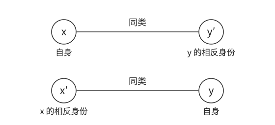
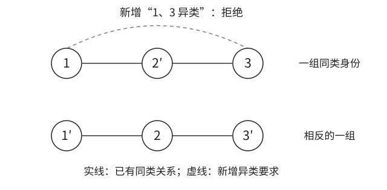
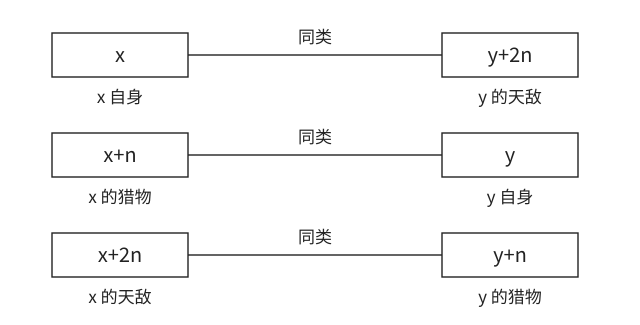

[[TOC]]

## 问题

有 $n$ 个元素，每个元素只能属于两种类别之一。依次收到两种关系：

- 同类：$x,y$ 的类别相同。
- 异类：$x,y$ 的类别相反。

每次判断新关系能否与已经接受的关系同时成立。相容就接受，矛盾就拒绝，继续处理下一条。

例如，已知 $1,2$ 异类，$2,3$ 异类，就能推出 $1,3$ 同类。此时再要求 $1,3$ 异类，便产生冲突。

[[[rbook: disjoint_set]]] 可以合并同类元素，但不能把异类元素直接合并。种类并查集通过**拆点**，把类别之间的关系转为普通并查集中的等价关系。

## 两种身份

为每个元素 $x$ 建立两个身份：

| 编号 | 含义 |
| --- | --- |
| $x$ | $x$ 自身的类别 |
| $x+n$ | 与 $x$ 相反的类别 |

记 $x'=x+n$。$x'$ 是一个辅助身份，不是另一个真实元素；再取一次相反身份就回到 $x$。

并查集中的“同属一个集合”表示：**这些身份被已有关系强制为同一类别**。它不是在预先指定哪个集合叫第一类、哪个叫第二类。

若 $x,y$ 异类，由于总共只有两类，必有

$$
x\sim y',\qquad x'\sim y.
$$

因此把 $x$ 与 $y'$ 合并，把 $x'$ 与 $y$ 合并：

每条约束都对两个身份对称处理，这样后续才能继续正确传递关系。

## 合并规则

### 同类

要求 $x,y$ 同类，就同时要求它们的相反身份同类：

~~~cpp
unite(x, y);
unite(x + n, y + n);
~~~

加入前若已有 $x\sim y'$，说明它们被要求异类，必须拒绝。

### 异类

要求 $x,y$ 异类，就进行交叉合并：

~~~cpp
unite(x, y + n);
unite(x + n, y);
~~~

加入前若已有 $x\sim y$，说明它们被要求同类，必须拒绝。

| 新约束 | 冲突条件 | 通过后执行 |
| --- | --- | --- |
| 同类 | $\operatorname{same}(x,y+n)$ | 合并 $x,y$，合并 $x+n,y+n$ |
| 异类 | $\operatorname{same}(x,y)$ | 合并 $x,y+n$，合并 $x+n,y$ |

**先检查，再合并。** 矛盾关系不应进入并查集；查询时发生路径压缩没有问题，因为它不改变已有关系。

### 未知关系

两个真实元素的根不同，不一定表示它们异类。它们可能还没有任何联系。

~~~cpp
if (same(x, y)) {
    // 已知同类
} else if (same(x, y + n)) {
    // 已知异类
} else {
    // 关系未知
}
~~~

例如刚初始化时，$1,2$ 互不相连，既不能推出同类，也不能推出异类。

## 冲突示例

先接受 $1,2$ 异类，得到

$$
1\sim2',\qquad 1'\sim2.
$$

再接受 $2,3$ 异类，得到

$$
2\sim3',\qquad 2'\sim3.
$$

传递后，两组等价身份分别是

$$
\{1,2',3\},\qquad \{1',2,3'\}.
$$

所以新关系“$1,3$ 异类”在合并前就会被拒绝。等价地说，若某个 $x$ 与 $x'$ 被迫同类，就意味着一个元素必须与自己相反，约束已经矛盾。

## 正确性

每个相容的关系连通块，都对应一对相反的身份集合。选择其中一组为第一类，另一组为第二类，就给出了这个连通块的一种合法分类。不同连通块可以独立选择，类别名称本身不影响同类、异类关系。

加入新关系时：

- 若两端关系已经确定，冲突条件会拒绝相反要求；重复的相同要求仍然合法。
- 若两端尚无联系，可以整体翻转其中一个连通块的两类，使新约束成立，再按规则连接两对身份集合。

因此，规则恰好拒绝无法满足的新关系。接受后，正反身份仍保持相反，所有同类关系由普通并查集正确传递。

## 代码

下面使用本篇的在线判定格式。第一行输入 $n,m$，接下来每行输入一条约束：

- `0 x y`：要求同类。
- `1 x y`：要求异类。

每条约束输出 `YES` 或 `NO`。`YES` 表示与之前接受的约束相容，包括重复关系；`NO` 表示拒绝当前约束。它不表示每条关系都成功合并了两个原本不同的集合。

~~~cpp file=./kind_dsu.cpp
~~~

输入：

~~~text
4 6
1 1 2
1 2 3
0 1 3
1 1 3
0 3 4
1 2 4
~~~

输出：

~~~text
YES
YES
YES
NO
YES
YES
~~~

前两条关系推出 $1,3$ 同类。第三条只是确认已有关系，第四条与它矛盾并被拒绝。第五条使 $4$ 与 $3$ 同类，因此最后一条“$2,4$ 异类”成立。

## 二分图

若所有约束都是“异类”，就得到二分图判定：

- 每个真实元素是一个点。
- 一条边要求两端颜色相反。
- 每条边用两次交叉合并表示。

沿边走一次，颜色翻转一次。偶数长度路径要求两端同色，奇数长度路径要求两端异色；奇环会要求起点与自身异色，产生冲突。

固定图也可以用 DFS、BFS 染色。种类并查集适合按顺序加入约束、随时检查冲突的场景。

## 三类关系

### 食物链

[[[p: luogu-P2024 | 食物链]]] 有三类动物，关系为 $A$ 吃 $B$、$B$ 吃 $C$、$C$ 吃 $A$。每次收到“同类”或“$x$ 吃 $y$”的说法，判断它是否与之前的真话冲突，统计假话数。

两类中，“异类的异类”必定同类；三类中不能这样推断。例如 $A$ 吃 $B$，$B$ 吃 $C$，$A,C$ 并不同类。因此两个身份不够，需要为每个元素建立三个身份：

| 编号 | 含义 |
| --- | --- |
| $x$ | $x$ 自身的类别 |
| $x+n$ | $x$ 所吃动物的类别，简称猎物 |
| $x+2n$ | 吃 $x$ 的动物的类别，简称天敌 |

三个身份依次按“吃”循环，第三个身份的猎物又回到第一个身份。它们仍是**相对身份**，不表示已经知道 $x$ 究竟是 $A,B,C$ 中的哪一类。

若 $x,y$ 同类，三个身份一一对应；若 $x$ 吃 $y$，则 $x$ 是 $y$ 的天敌，$x$ 的猎物与 $y$ 同类：

| 新关系 | 三组应合并的身份 |
| --- | --- |
| $x,y$ 同类 | $(x,y)$、$(x+n,y+n)$、$(x+2n,y+2n)$ |
| $x$ 吃 $y$ | $(x,y+2n)$、$(x+n,y)$、$(x+2n,y+n)$ |

这里 $x$ 的天敌与 $y$ 的猎物同类，来自三类循环的完整规则；不能推广为任意食物网都成立。

### 检查与合并

沿用上述身份约定：

- 声称同类时，若已有 `same(x, y+n)` 或 `same(x, y+2*n)`，则矛盾。
- 声称 $x$ 吃 $y$ 时，若已有 `same(x, y)` 或 `same(x, y+n)`，则矛盾。

可以把两种关系统一成偏移量：

~~~cpp
int shift = (op == 1 ? 0 : 2);
for (int k = 0; k < 3; ++k) {
    if (k != shift && same(x, y + k * n)) return false;
}
for (int k = 0; k < 3; ++k) {
    unite(x + k * n, y + (k + shift) % 3 * n);
}
~~~

先排除两种错误关系，再合并三组对应身份。编号越界的说法也是假话，必须在访问数组前检查；“$x$ 吃自己”会被同类检查直接拒绝。

每个关系连通块的三组身份保持循环对应。连接两个原本无关的块时，可以整体轮换其中一块的类别编号，使新关系成立；已经相连时，两端关系已经确定，核对它是否符合本次说法即可。这与二类模型中“整体翻转一个块”的论证相同。

::: fold 食物链完整代码
~~~cpp file=./food_chain.cpp
~~~

编号先用 `long long` 读取。题目允许输入超过 $n$、甚至超过有符号 `int` 范围的编号，不能先缩窄为 `int` 再检查。每条假话只计数，不写入并查集。
:::

## 复杂度与边界

拆成固定的 $k$ 种身份，每条约束只做 $O(k)$ 次查找与合并。使用路径压缩、按大小合并时，总时间为 $O(kn+km\alpha(kn))$，空间为 $O(kn)$。本篇 $k=2$ 或 $3$，可简写为 $O(n+m\alpha(n))$ 和 $O(n)$。

- 数组容量与初始化范围都要扩大到 $2n$ 或 $3n$。二类模板支持 $n\le2\times10^5$，食物链模板支持 $n\le5\times10^4$。
- 不同连通块之间的关系可能未知，不能把“根不同”当作“已知异类”。
- 辅助身份不是实际元素。若统计真实元素的分组，只枚举原来的 $1\sim n$。
- 模板中的 `sz` 统计的是拆点后的身份数，只用于按大小合并，不能直接当作真实元素人数。
- 若题目要求所有约束同时成立，任何一次冲突都应使最终答案为否，不能因后续关系被接受而恢复为是。
- 拆点依赖题目给出的类别规则。不能把现实中的敌友、食物关系自行理解为二类对立或三类循环。

## 练习

### 手算

1. 初始只有两个真实元素，根不同，能否断定它们异类？
2. 连续要求 $x,x$ 同类、$x,x$ 异类，分别是否成立？
3. 食物链中，已知 $1$ 吃 $2$、$2$ 吃 $3$，可以推出哪条关于 $1,3$ 的关系？

::: fold 参考结果
1. 不能，关系未知。
2. 同类成立，异类矛盾；拒绝后仍保留此前的合法关系。
3. $3$ 吃 $1$，不是 $1$ 吃 $3$，也不是同类。三类循环的方向不能颠倒。
:::

### 推荐题目

| 层次 | 题目 | 训练内容 |
| --- | --- | --- |
| 二类基础 | [AtCoder ABC327 D：Good Tuple Problem](https://atcoder.jp/contests/abc327/tasks/abc327_d) | 每条关系都要求异类，整体判断能否二染色。输入先给完整的 $A$ 数组，再给 $B$ 数组，需要调整读入。 |
| 排序应用 | [[[p: luogu-P1525]]] | 按怨气值降序要求两人异类；首次冲突的权值是答案，无冲突则为 $0$。 |
| 三类推广 | [[[p: luogu-P2024]]] | 明确三个相对身份，检查矛盾与非法编号，再执行三次合并。 |

关押罪犯按降序处理，是为了优先避免更大的同监狱冲突。首次在权值 $w$ 处矛盾，说明无法避开所有不小于 $w$ 的冲突；此前所有更大权值的关系可以满足，所以可以使最大冲突不超过 $w$，答案恰为 $w$。

若希望直接在边上记录类别差，而不是建立多个身份，可继续阅读 [[[rbook: weighted_disjoint_set]]]。
