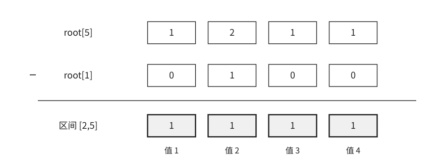

[[TOC]]

## 问题

给定不再修改的数组，多次询问 $[l,r]$ 中第 $k$ 小的数。

[[[rbook: sgt_weights]]] 可以查询整个集合的第 $k$ 小，但每个询问对应不同子数组。若为每个区间重新插入元素，开销太大。

可以借用前缀和的思想：**前缀频次相减，得到区间频次。** 再用 [[[rbook: sgt_persistent]]] 保存全部前缀版本。

## 前缀版本

先离散化全部数值，统一值域为 $[1,V]$。定义 `root[i]` 为前 $i$ 个元素的权值线段树，叶子记录每个值出现多少次。

- `root[0]` 表示空集合，用空根 $0$ 即可。
- `root[i]` 在 `root[i-1]` 上插入一个 $a_i$，通过路径复制保存新版本。

版本按**前缀长度**编号，树上的区间按**值域**划分，二者不可混淆。

## 两个根之差

对于同一值域区间 $I$：

$$
\operatorname{count}_{[l,r]}(I)
=\operatorname{count}_{[1,r]}(I)
-\operatorname{count}_{[1,l-1]}(I).
$$

两棵树使用同一离散化结果、同一区间划分，因此可以同步访问对应节点。



数组为 $[2,4,2,1,3]$。查询 $[2,5]$，从前五项的频次中减去第一项 $2$ 的一次出现，得到 $\{1,2,3,4\}$。

这里的“相减”只是在访问时计算两个计数之差，**不需要真正构造一棵差分树**。

## 第 k 小

同时从 `root[l-1]`、`root[r]` 出发，计算当前左半值域中的区间频次：

$$
s=cnt[lc[root[r]]]-cnt[lc[root[l-1]]].
$$

若 $k\le s$，两个根都进入左孩子；否则都进入右孩子，并令 $k\gets k-s$。不断缩小值域，到叶子后还原数值。

在上例中，$[1,2]$ 有两个数。查询第 $3$ 小时先进入值域 $[3,4]$，继续找其中第 $1$ 小，得到 $3$。

## 正确性

每个前缀版本由前一个版本插入一个元素得到，路径复制保证旧版本不变，所以 `root[i]` 始终准确表示前 $i$ 项的频次。

两个前缀嵌套，逐值相减后恰好留下下标 $[l,r]$ 的频次，且各项非负。于是左孩子频次之差就是当前候选集合落在左半值域中的数量。按数量选择左右分支，与普通权值线段树的第 $k$ 小查找相同，故答案正确。

任意两个历史版本未必嵌套，它们的频次差可能为负，不能都这样查第 $k$ 小；区间最大值等信息也不能通过两个前缀最大值相减得到。

## 代码

格式对应 [[[p: luogu-P3834 | 静态区间第 k 小]]]：第一行 `n m`，第二行数组，接下来 $m$ 行 `l r k`，保证 $1\le k\le r-l+1$。

```cpp file=./kth.cpp
```

输入：

```text
5 4
2 4 2 1 3
2 5 3
1 3 2
3 3 1
1 5 5
```

输出：

```text
3
2
2
4
```

重复值共享一个叶子，但出现次数分别计入排名。

## 复杂度与边界

离散化 $O(n\log n)$，建立全部前缀版本 $O(n\log V)$，单次查询 $O(\log V)$，节点数 $O(n\log V)$。$V=1$ 时插入和查询均为常数时间。

模板支持 $n\le2\times10^5$，每次插入最多创建 $19$ 个节点，预留 `20 * maxn` 个节点，三个 `int` 节点数组约 $48$ MB。空节点的孩子和计数均为零，所有前缀共享这套空子树语义。

本篇处理静态数组。修改一个原数组元素会影响它之后的所有前缀版本，不能只修改某一个根便认为其他版本已经同步。

## 练习

- [[[p: luogu-P3834 | 静态区间第 k 小]]]：检查两个根分别对应 $l-1$ 与 $r$。
- 改为查询 $[l,r]$ 中小于等于 $x$ 的元素个数。
- 增加频次加权和，求区间内最小的 $k$ 个数之和；进入右边前应先累加左半值域的全部贡献。
