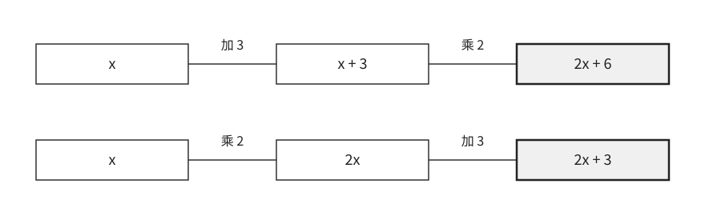

[[TOC]]

## 操作顺序

现在同时支持区间乘、区间加和区间求和，所有结果对正整数 $M$ 取模。

只分别记录“总共乘多少”和“总共加多少”，还必须规定它们的执行顺序。例如对 $x$：先加 $3$ 再乘 $2$ 得到 $2x+6$，先乘 $2$ 再加 $3$ 则得到 $2x+3$。



## 统一表示

用二元组 $(a,b)$ 表示变换

$$
f(x)=ax+b.
$$

| 操作 | 对应变换 |
| --- | --- |
| 不修改 | $(1,0)$ |
| 加 $v$ | $(1,v)$ |
| 乘 $v$ | $(v,0)$ |
| 赋值为 $v$ | $(0,v)$ |

节点保存 `mul[p]`、`inc[p]`，约定它们表示**孩子尚未执行的变换** $x\mapsto ax+b$。

## 复合公式

假设旧标记为 $f(x)=ax+b$，后来又执行 $g(x)=Ax+B$。孩子以后应先执行旧操作，再执行新操作，所以合成标记为

$$
g(f(x))=A(ax+b)+B=(Aa)x+(Ab+B).
$$

因此：

```cpp
mul[p] = mul[p] * A % mod;
inc[p] = (inc[p] * A % mod + B) % mod;
```

新的乘法不仅作用于原始元素，也作用于此前累积的加法。把第二行写成 `inc[p] += B` 会丢掉这部分影响。

区间长度为 $len$、旧和为 $S$ 时，新和为

$$
S'=AS+B\cdot len.
$$

因为对每一个元素都执行 $Ax+B$，其中 $A$ 作用于整段总和，$B$ 要计入 $len$ 次。

## 下传

下传时，把父亲的 $(a,b)$ 当作新变换，分别复合到两个孩子上，然后将父标记重置为 $(1,0)$。

父标记相对孩子已有的标记更晚发生：任何先前进入孩子的操作，都必须先下传当时的父标记。因此复合顺序仍是“孩子旧操作在前，父亲待下传操作在后”。

函数复合满足结合律，可以把一串操作压缩为一个标记；它通常不满足交换律，不能改变时间顺序。

区间查询先排除空交集并返回 $0$，完整覆盖时返回节点和；部分相交时才下传，再递归左右两个孩子，将结果相加后取模。不需要在调用前分别判断查询区间是否跨过中点。

区间修改也先排除空交集，完整覆盖时执行 `apply`，其余情况先下传、再递归左右孩子，最后上推。与查询相比，修改需要重新计算父节点的信息。

## 赋值与加法

赋值也是同一公式的特例。

- 旧标记之后赋值 $v$：取 $(A,B)=(0,v)$，新标记变为 $(0,v)$，旧操作全部失效。
- 已有赋值 $v$ 之后加 $d$：$(0,v)$ 变为 $(0,v+d)$。

因此本篇 `update` 也能支持区间赋值，只需传入 `A=0`、`B=norm(v)`；完整程序保留乘、加、查询三种输入操作。

这套公式针对区间和。若维护最大值，乘负数会交换最大值与最小值，不能照搬区间和模板。

## 代码

输入格式对应 [[[p: luogu-P3373 | 线段树 2]]]：第一行 `n q M`，第二行初始数组；`1 l r v` 表示乘，`2 l r v` 表示加，`3 l r` 表示求和。

模板容量为 $n\le 10^5$，支持 $1\le M\le 10^9+7$。初值和增量可以为负，统一归一化到 $[0,M-1]$。

```cpp file=./affine_sum.cpp
```

输入：

```text
3 7 100
1 2 3
1 1 3 2
2 1 2 3
3 1 3
1 2 3 0
2 2 3 -1
3 1 3
3 2 2
```

输出：

```text
18
3
99
```

第二次修改后数组为 $[5,7,6]$；最后在模 $100$ 下为 $[5,99,99]$，总和对 $100$ 取模为 $3$。

## 边界与复杂度

建树 $O(n)$，单次操作 $O(\log n)$，空间 $O(n)$。

乘法标记初值必须是 $1$，不能依赖全局数组的默认零值。代码用 `1 % mod` 表示单位变换，兼容 $M=1$。所有乘积使用 `long long`；上述模数上界保证两个模内数相乘不会溢出。更大模数需要另行处理乘法溢出。

## 练习

- [[[p: luogu-P3373 | 线段树 2]]]：乘加标记复合。
- 增加 `4 l r v`，表示区间赋值，用同一个 `update` 实现。
- [[[p: luogu-P1253 | 扶苏的问题]]]：赋值、加法与最大值。重新设计节点更新规则，注意其数据规模达到 $10^6$。
