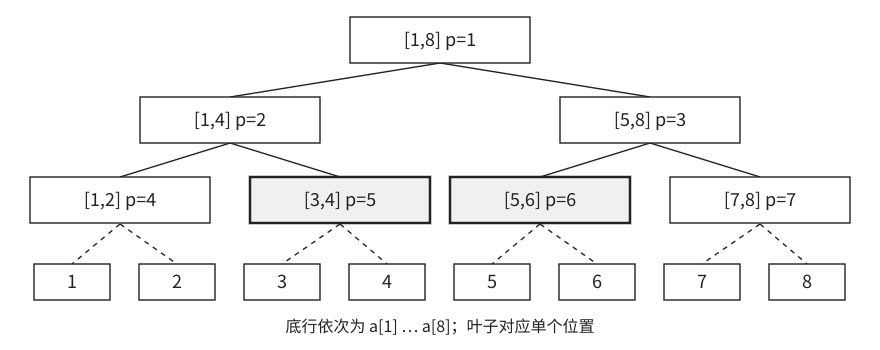

[[TOC]]

## 问题

给定数组，反复修改元素并查询区间和。

前缀和能在 $O(1)$ 时间查询，但单点修改后，后面的前缀和都可能改变。直接维护原数组则修改方便，查询需要遍历区间。线段树把区间逐层二分，预先保存各段信息，使单点修改和区间查询都能在 $O(\log n)$ 时间完成。

## 区间划分

根节点表示 $[1,n]$。对表示 $[l,r]$ 的节点，令

$$
m=\left\lfloor\frac{l+r}{2}\right\rfloor.
$$

当 $l<r$ 时，左右孩子分别表示 $[l,m]$ 与 $[m+1,r]$；当 $l=r$ 时，到达叶子，对应原数组中的一个元素。

例如查询 $[3,6]$，可以直接合并 $[3,4]$ 与 $[5,6]$ 的信息。图中加粗的两个节点恰好覆盖目标区间，既不重叠，也不遗漏。

节点编号与数组下标是两件事。若根节点编号为 $1$，编号为 $p$ 的节点，其左右孩子编号可取 $2p$、$2p+1$。编号只用于存树，区间 $[l,r]$ 决定它维护哪些元素。

## 信息合并

设节点维护的区间信息为 $S(l,r)$。若能由左右两段的信息快速得到整段信息，就可以向上合并：

$$
S(l,r)=\operatorname{merge}\bigl(S(l,m),S(m+1,r)\bigr).
$$

| 查询内容 | 节点信息 | 合并方式 |
| --- | --- | --- |
| 区间和 | 总和 | 左和 + 右和 |
| 区间最大值 | 最大值 | 左右取最大值 |
| 区间 gcd | 最大公约数 | 左右取 gcd |
| 区间平均数 | 总和、元素个数 | 分别相加，查询后相除 |

**合并应满足结合律，并保留左右顺序。** 查询与建树可能采用不同的分组方式，结合律保证结果相同。交换律不是必要条件，例如矩阵乘法也可以作为合并操作。

只存平均数，再对两个平均数取平均，并不正确。长度分别为 $1$、$3$ 的两段不能获得相同权重；应保存总和与长度。

## 操作结构

- **建树**：先得到叶子信息，再合并两个孩子。
- **单点修改**：沿根到目标叶子的路径修改，再向上重新合并。
- **区间查询**：遇到完全包含在查询范围内的节点，直接使用其信息；其余节点继续向相交的孩子递归。

查询选取的是若干完整节点，不能把所有相交节点的信息都计入，否则会重复或越界。

## 时间与空间

树高为 $O(\log n)$。一次单点修改只经过一条根到叶子的路径。

区间查询虽可能向两边递归，但每层只有至多两个区间与查询边界相交而尚未被完全覆盖；其余选中区间直接返回。因此访问的节点总数为 $O(\log n)$。

| 操作 | 复杂度 |
| --- | --- |
| 建树 | $O(n)$ |
| 单点修改 | $O(\log n)$ |
| 区间查询 | $O(\log n)$ |
| 存储空间 | $O(n)$ |

这些界限假设每个节点的信息大小、合并代价都是 $O(1)$。

树恰好有 $n$ 个叶子、$n-1$ 个内部节点，但按 $2p$、$2p+1$ 编号时，中间可能空出数组位置。设 $H=\lceil\log_2 n\rceil$，最大编号小于 $2^{H+1}\le 4n$，所以通常开 `4 * maxn` 大小的数组。树不一定是完全二叉树。

## 与树状数组比较

树状数组适合频次、区间和等操作，通常代码更短、常数更小。线段树显式保存左右子区间，更便于维护一般的可合并信息，也便于向下查找、组合懒标记。

例如单点任意赋值、区间最大值查询，线段树可以直接处理；树状数组的简单前缀最值写法则有单调修改限制。两者应按操作需求选择。

相关内容：[[[rbook: bit]]]、[[[rbook: bit_prefix_extremum]]]。

## 手动练习

1. 对 $[1,5]$ 画出区间划分，区分节点编号与原数组下标。
2. 把查询 $[2,5]$ 拆成若干完整节点区间。
3. 修改 $a_3$ 时，标出需要重新计算的节点。

接下来实现这些操作：[[[rbook: sgt_update_one]]]。

## 阅读顺序

| 内容 | 文章 |
| --- | --- |
| 基本操作 | [[[rbook: sgt_update_one]]] |
| 懒标记 | [[[rbook: sgt_update_range]]]、[[[rbook: sgt_range_assign]]]、[[[rbook: sgt_lazy_composition]]] |
| 向下查找 | [[[rbook: sgt_lower_bound]]] |
| 值域与节点组织 | [[[rbook: sgt_weights]]]、[[[rbook: sgt_dynamic]]] |
| 保存版本 | [[[rbook: sgt_persistent]]]、[[[rbook: sgt_chairman]]] |
| 进阶应用 | [[[rbook: sgt_merge]]]、[[[rbook: sgt_scanline]]] |
| 另一种实现 | [[[rbook: sgt_zkw]]] |
