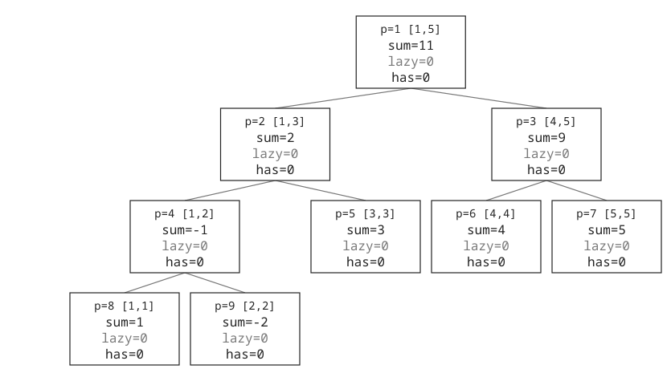
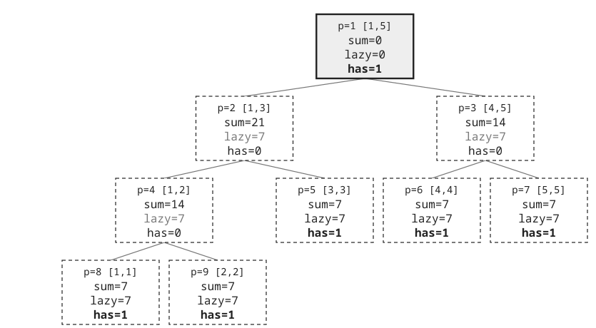
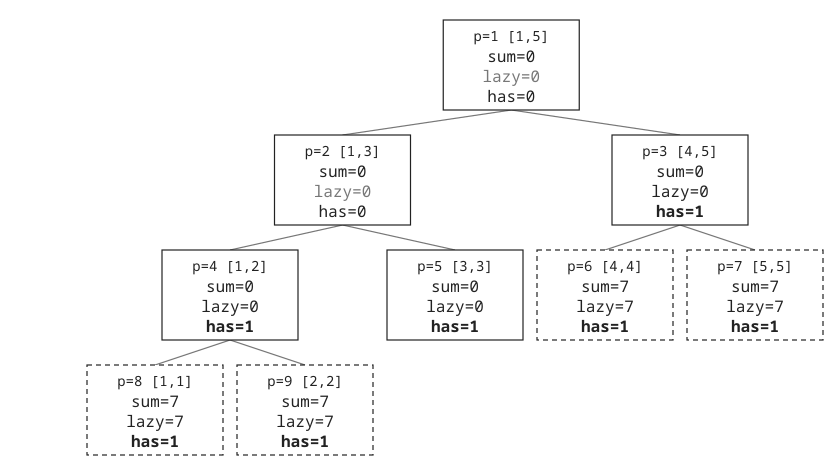

[[TOC]]

## 问题

维护长度为 $n$ 的数组，支持：

- `1 l r v`：把 $[l,r]$ 中每个元素赋为 $v$。
- `2 l r`：查询 $[l,r]$ 的元素和。

继续使用 $[1,-2,3,4,5]$，依次执行八次操作。注意，赋值是用新值替换旧值，不是给旧值增加一个数。

输入：

```text
5 8
1 -2 3 4 5
2 1 5
1 1 5 7
2 2 4
1 1 5 0
2 3 3
1 3 5 -2
2 1 5
2 4 5
```

输出：

```text
11
21
0
-6
-4
```

| 操作 | 数组或查询结果 |
| --- | --- |
| 查询 $[1,5]$ | $11$ |
| $[1,5]$ 赋为 $7$ | $[7,7,7,7,7]$ |
| 查询 $[2,4]$ | $7+7+7=21$ |
| $[1,5]$ 赋为 $0$ | $[0,0,0,0,0]$ |
| 查询 $[3,3]$ | $0$ |
| $[3,5]$ 赋为 $-2$ | $[0,0,-2,-2,-2]$ |
| 查询 $[1,5]$ | $-6$ |
| 查询 $[4,5]$ | $-4$ |

逐个执行单点赋值，一次需要 $O((r-l+1)\log n)$。本篇仍使用懒标记压缩整段修改，但标记的合并规则与 [[[rbook: sgt_update_range]]] 不同。

## 建树

树的结构、`ls/rs`、`build` 与 `pushup` 沿用前文。节点 $p$ 表示下标区间 $[l,r]$，`tr[p]` 保存区间和。

新增 `has[p]`，表示当前是否有尚未下传的赋值。初始全局数组为零，所有 `has[p]` 为 `false`。



节点编号与数组下标不同。例如节点 $2$ 表示 $[1,3]$，节点 $3$ 表示 $[4,5]$；两段长度分别为 $3$、$2$。

## 整段赋值

若当前节点被修改范围完整覆盖，整段每个数都变为 $v$，新区间和为

$$
\operatorname{sum}=v(r-l+1).
$$

赋值不依赖旧和。给整个数组赋 $7$，根的和直接从 $11$ 改为 $7\times5=35$，孩子可以暂时保留旧值。


图中每个节点显示实际存储的 `sum`、`lazy`、`has`。虚线框表示该节点尚未同步祖先的赋值，不能把它的旧值直接当作当前数组值。

## 覆盖标记

节点维护两个标记字段：

- `lazy[p]`：待下传的赋值内容。
- `has[p]`：这份赋值是否有效。

完整覆盖时，同时更新区间和与标记：

```cpp
void apply(int p, int l, int r, ll v) {
    tr[p] = v * (r - l + 1);
    lazy[p] = v;
    has[p] = true;
}
```

先赋值 $u$，再赋值 $v$，每个数最后都是 $v$。因此新标记**覆盖**旧标记，不做累加。

| 操作 | 区间和的变化 | 标记合并 |
| --- | --- | --- |
| 区间加 $v$ | `tr[p] += v * len` | `lazy[p] += v` |
| 区间赋值 $v$ | `tr[p] = v * len` | `lazy[p] = v`，`has[p] = true` |

覆盖当前节点不需要立即清空全部后代。较新的父赋值保留在当前节点，之后进入孩子时，再覆盖孩子较旧的标记。

## 赋值为零

零也是合法的赋值，不能用 `lazy[p] == 0` 判断没有标记。

例如初始数组 $[1,2]$，整段赋零后根的和为 $0$。若因 `lazy[1] == 0` 跳过下传，查询第一个元素就会错误地返回旧值 $1$。

`has` 用于区分这些状态：

| `has[p]` | `lazy[p]` | 含义 |
| --- | --- | --- |
| `false` | $0$ | 没有待下传的赋值 |
| `true` | $0$ | 有效标记：应把孩子赋为零 |
| `false` | $7$ | 旧值已无效，不能再次下传 |

图中无效的 `lazy` 使用灰字显示。是否下传只看 `has`，不看赋值是否为零。



这是样例第四次操作后的状态：此前查询已经让一些孩子保存了 $7$，而现在根的 `sum=0`、`lazy=0`、`has=1`。后代的旧值将由这份零标记覆盖。

## 下传

部分修改或部分查询需要进入孩子时，若 `has[p]` 为真，就把 `lazy[p]` 分别赋给两个孩子，然后清除父节点的 `has[p]`。

```cpp
void pushdown(int p, int l, int r) {
    if (!has[p]) return;
    int mid = (l + r) / 2;
    apply(ls(p), l, mid, lazy[p]);
    apply(rs(p), mid + 1, r, lazy[p]);
    has[p] = false;  // 父标记已传完；lazy[p] 的旧内容不再有效
}
```

孩子的区间和按各自长度重算，赋值标记也一起覆盖。父亲的和保持不变：这一步只是同步存储状态，不是再次修改数组。

父标记比孩子已有标记更新。因为此前任何进入孩子的操作，都必须先下传当时的父标记，所以不存在“孩子已经执行了更新操作，父亲却仍留着更早待下传标记”的情况。

::: note
清除 `has[p]` 后，`lazy[p]` 可以保留旧值；后续下传会先检查 `has`，不会使用这份残留值。`has=false` 并不要求 `lazy=0`。
:::

下传只同步下一层，不会一次改完全部后代。叶子没有孩子，本篇会在完整覆盖或不相交时直接返回，不对叶子继续下传。

## 区间赋值

修改与查询采用相同的交集判断结构：

1. 不相交，直接返回，不修改、不下传。
2. 完整覆盖，执行 `apply` 并返回。
3. 部分相交，先下传，再递归左右孩子。
4. 回溯时执行 `pushup`。

```cpp
void assign_range(int p, int l, int r, int L, int R, ll v) {
    if (r < L || R < l) return;  // 空交集直接返回，不修改节点
    if (L <= l && r <= R) {
        apply(p, l, r, v);
        return;
    }
    pushdown(p, l, r);
    int mid = (l + r) / 2;
    assign_range(ls(p), l, mid, L, R, v);
    assign_range(rs(p), mid + 1, r, L, R, v);
    pushup(p);
}
```

在样例的零赋值和单点查询之后，把 $[3,5]$ 赋为 $-2$，会完整覆盖节点 $5$ 的 $[3,3]$ 和节点 $3$ 的 $[4,5]$。


两段和分别改为 $-2$、$-4$，回溯后根的和为 $-6$。节点 $3$ 的有效标记改为 $-2$，其孩子仍可暂存旧值。

## 区间查询

1. 不相交，返回求和的单位元 $0$。
2. 完整覆盖，直接返回节点和。
3. 部分相交，先下传，再递归两个孩子，将结果相加。

```cpp
ll query(int p, int l, int r, int L, int R) {
    if (r < L || R < l) return 0;  // 0 是求和的单位元
    if (L <= l && r <= R) return tr[p];
    pushdown(p, l, r);
    int mid = (l + r) / 2;
    return query(ls(p), l, mid, L, R)
         + query(rs(p), mid + 1, r, L, R);
}
```

整段赋零后查询 $[3,3]$，先把根的零赋值传给节点 $2$、$3$，再把节点 $2$ 的零赋值传给节点 $4$、$5$。到达叶子 $[3,3]$ 时，返回正确的 $0$。



这时部分后代仍保存 $7$，但它们上方有有效的零标记。以后进入这些后代之前，旧值也会被覆盖，不能因数组已经全零就要求所有节点立即变为零。

查询不改变数组，也不需要重新上推。下传已经将父亲的赋值同步给孩子，使它们的区间和相加仍等于父亲原有的和。

## 演示

下面的在线动画按开头的八次操作执行，可以逐步观察、回退，核对赋值覆盖和零标记的下传。图中所有字段均为实际存储值；`has=0` 时，灰色的 `lazy` 不参与逻辑。

[[[dsa: segment_tree_range_assign]]]

下面的演示程序与正式模板使用相同的建树、赋值、查询函数，只增加节点状态输出，适合小数据手动核对。

::: fold 完整演示代码与输出
```cpp file=./range_assign_demo.cpp
```

输入使用开头的五元素样例。程序在建树和每次操作后打印整棵树。下面节选“整段赋零后”和“查询第三个元素后”：

```text
after assign [1,5] value=0
node 1 [1,5] sum=0 lazy=0 has=1
  node 2 [1,3] sum=21 lazy=7 has=0
    node 4 [1,2] sum=14 lazy=7 has=0
      node 8 [1,1] sum=7 lazy=7 has=1
      node 9 [2,2] sum=7 lazy=7 has=1
    node 5 [3,3] sum=7 lazy=7 has=1
  node 3 [4,5] sum=14 lazy=7 has=0
    node 6 [4,4] sum=7 lazy=7 has=1
    node 7 [5,5] sum=7 lazy=7 has=1
query [3,3] = 0
node 1 [1,5] sum=0 lazy=0 has=0
  node 2 [1,3] sum=0 lazy=0 has=0
    node 4 [1,2] sum=0 lazy=0 has=1
      node 8 [1,1] sum=7 lazy=7 has=1
      node 9 [2,2] sum=7 lazy=7 has=1
    node 5 [3,3] sum=0 lazy=0 has=1
  node 3 [4,5] sum=0 lazy=0 has=1
    node 6 [4,4] sum=7 lazy=7 has=1
    node 7 [5,5] sum=7 lazy=7 has=1
```

每行依次显示节点编号、区间、`sum`、`lazy`、`has`，缩进表示父子层级。打印直接读取存储值，不调用查询，因此不会为了观察而额外下传。
:::

## 正确性

递归进入节点之前，路径上的祖先赋值已经下传，因此当前节点的和包含所有应生效的修改。

完整赋值将当前和改为“赋值乘长度”，并记录后代尚未执行的统一赋值。部分修改先下传，新赋值覆盖孩子较旧的状态；递归完成后合并左右和，得到正确的父区间和。

查询在完整覆盖处使用已经补齐的节点和；部分相交时先下传再查询。取出的区间互不重叠，恰好拼成目标范围，所以结果正确。`has` 单独表示标记是否有效，保证赋值为零也遵循同一套规则。

## 代码

第一行输入 `n m`，第二行输入初始数组，接下来是 $m$ 次操作。`1 l r v` 表示区间赋值，`2 l r` 表示区间求和。

```cpp file=./range_assign.cpp
```

使用开头样例，输出应为 $11,21,0,-6,-4$。正式程序只输出查询答案，演示程序还会输出每次操作后的节点状态。

## 边界与复杂度

- 建树 $O(n)$，单次区间赋值、查询均为 $O(\log n)$，空间 $O(n)$。
- 完整覆盖处立即停止，每层至多两个部分相交的节点继续展开；空交集分支立即返回。
- 模板容量为 $n\le10^5$，区间和、赋值及长度乘积使用 `ll`，仍需保证中间结果不溢出。
- 零、负数、与原值相同的赋值均按普通赋值处理；连续赋值以后一次为准。
- $n=1$ 时，根就是叶子，不需要下传。若处理多组数据，应重置 `has` 等状态，不能沿用上一组标记。

## 练习

### 思考与变体

1. 连续整段赋为 $7$、$0$、$-3$，中间不查询。根的三个字段最后是什么？孩子必须立即改变吗？
2. 查询后看到 `has=false, lazy=7`，能否认为该区间仍有待下传的赋值？说明判据。
3. 将区间求和改为区间最大值。完整赋值时最大值直接改为 $v$，不乘长度；不相交分支返回负无穷。

### 推荐题目

| 层次 | 题目 | 训练内容 |
| --- | --- | --- |
| 基础 | [AOJ DSL_2_I：RSQ and RUQ](https://judge.u-aizu.ac.jp/onlinejudge/description.jsp?id=DSL_2_I&lang=en) | 区间赋值、区间求和，允许零和负数。初始数组全零且不单独输入；下标从 $0$ 开始，操作 $0$ 赋值、$1$ 求和，需要适配输入。 |
| 覆盖变体 | [[[p: luogu-P1558 | 色板游戏]]] | 区间染色与颜色种类查询。节点改为颜色位掩码，整段染色覆盖旧掩码，合并使用按位或；题目端点可能逆序。 |
| 多标记进阶 | [[[p: luogu-P1253 | 扶苏的问题]]] | 同时支持赋值、加法与最大值。先学 [[[rbook: sgt_lazy_composition]]]，再设计标记复合；规模达到 $10^6$，需调整容量。 |
| 树上进阶 | [[[p: luogu-P2146 | 软件包管理器]]] | 树链剖分后，用赋值 $0/1$ 与区间和统计安装状态变化；需先掌握树链剖分。 |

先完成基础赋值求和，再练习最值或染色变体。赋值与加法的组合涉及操作先后，不直接复用本篇单标记模板，继续阅读 [[[rbook: sgt_lazy_composition]]]。
