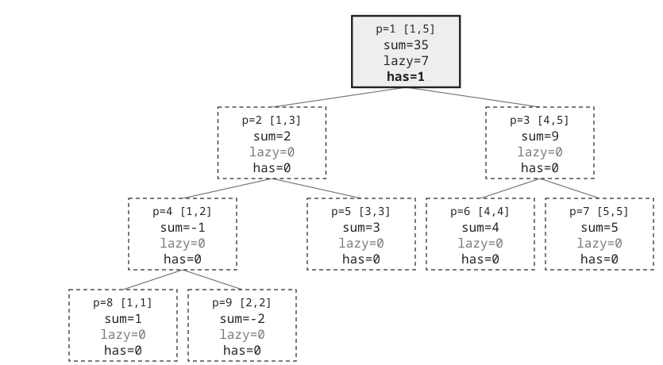

[[TOC]]

## 问题

维护数组，支持把 $[L,R]$ 的全部元素改为 $v$，并查询区间和。

区间赋值与 [[[rbook: sgt_update_range]]] 使用同一套递归结构，但标记的含义不同。给每个数加 $v$，要保留旧值；把每个数赋为 $v$，则应覆盖旧值。

## 标记含义

完整覆盖节点 $[l,r]$ 时，新区间和为

$$
\operatorname{sum}=v(r-l+1).
$$

用 `lazy[p]` 记录赋值内容，另用 `has[p]` 记录是否存在尚未下传的赋值。

```cpp
tr[p] = v * (r - l + 1);
lazy[p] = v;
has[p] = true;
```

先赋值 $u$，再赋值 $v$，最终结果只有 $v$。因此新标记覆盖旧标记，不能累加。



## 赋值为零

`lazy[p] == 0` 不能表示“没有标记”。把整段赋为零本身就是一次有效修改，后续访问孩子时，仍需把零传下去。

例如初始数组 $[1,2]$，整段赋值为 $0$ 后，根的和已经是 $0$；若因 `lazy[p] == 0` 跳过下传，再查询第一个元素就会错误地返回旧值 $1$。

独立的 `bool has[]` 能区分“没有赋值”和“待下传的赋值恰好为零”，也无需选取某个数值作为哨兵。

## 下传与覆盖

部分修改或部分查询之前，若 `has[p]` 为真，就把 `lazy[p]` 分别赋给两个孩子，并覆盖孩子原有标记，最后清除父亲的 `has[p]`。

父亲的待下传赋值比孩子已有标记更新。若此前访问过孩子，递归规则本应已经先下传父亲的旧标记，因此可以放心让这次较新的赋值覆盖孩子。

完整覆盖时直接更新节点；部分覆盖时先下传、再递归，修改结束后上推。查询不需要上推。

## 正确性

当递归进入节点时，祖先标记已经沿路径补齐。完整赋值把该节点的和直接改为 $v$ 乘长度，记录的标记准确描述其孩子尚未执行的操作。

下传后，两个孩子都表示统一赋值后的区间；若它们原本有更旧的修改，也应被这次赋值覆盖。继续递归处理局部修改，再合并左右和，便得到正确结果。

## 代码

输入 `n m`、初始数组及 $m$ 次操作。`1 l r v` 表示区间赋值，`2 l r` 表示求和。模板容量为 $n\le 10^5$，所有和与赋值乘积需在 `long long` 范围内。

```cpp file=./range_assign.cpp
```

输入：

```text
4 7
1 2 3 4
1 1 4 7
2 1 4
1 2 3 0
2 1 4
2 2 2
1 3 4 -2
2 2 4
```

输出：

```text
28
14
0
-4
```

最后数组为 $[7,0,-2,-2]$。

## 复杂度

建树 $O(n)$，单次区间赋值或查询 $O(\log n)$，空间 $O(n)$。标记将整段赋值压缩为一次常数时间操作。

## 练习

1. 在样例中增加一次“整段赋值为零，再查询中间单点”，跟踪 `has` 的变化。
2. 将查询改为区间最大值：整段赋值后最大值等于 $v$，不再乘区间长度。
3. 同时支持区间赋值和区间加，分别分析“先赋值后加”和“先加后赋值”的结果。

第三个问题需要考虑标记的复合顺序，在 [[[rbook: sgt_lazy_composition]]] 中继续讨论。
