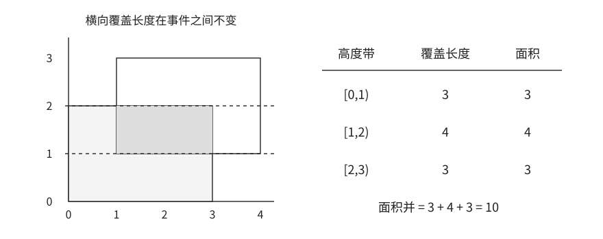

[[TOC]]

## 矩形面积并

给定若干边平行于坐标轴的矩形，求它们并集的面积。重叠部分只计算一次。

沿 $y$ 轴从下往上扫描。只有经过矩形下边、上边时，当前被覆盖的横向区间才会变化。在相邻两条事件高度之间，横向覆盖长度固定，因此可以累加

$$
\text{面积增量}=\text{横向覆盖长度}\times\text{高度差}.
$$



图中两个矩形为 $[0,3]\times[0,2]$、$[1,4]\times[1,3]$。三个高度为 $1$ 的横带，其覆盖长度依次为 $3,4,3$，总面积为 $10$。

## 事件

每个矩形生成两个事件：

- 下边 $y_1$：区间 $[x_1,x_2)$ 加入覆盖。
- 上边 $y_2$：同一区间撤销覆盖。

按高度排序。处理高度 $y$ 的事件之前，先用旧覆盖长度乘 $y-previous_y$ 累加面积，再处理该高度全部事件。

同高度事件之间没有面积，统一分组处理可以直接保证下一条横带使用更新后的覆盖状态。

## 离散化坐标段

收集所有横坐标，排序去重为 $x_1<x_2<\cdots<x_V$。线段树的叶子 $i$ 表示

$$
[x_i,x_{i+1}),
$$

长度为 $x_{i+1}-x_i$，不是 $1$。一共只有 $V-1$ 个叶子。

若原矩形左右端点的离散编号为 $L,R$，它覆盖的叶子为 $[L,R-1]$。例如端点 $[0,1,3,4]$ 中，区间 $[1,4)$ 对应第 $2$、第 $3$ 个叶子，实际长度为 $2+1=3$。

离散化保存的是端点顺序，真实长度必须从原坐标计算，不能用编号之差代替。

## 覆盖信息

每个节点维护：

- `cover[p]`：在区间分解过程中，**直接停在该节点**的完整覆盖次数。
- `len[p]`：该节点及其子树所记录覆盖的并集长度，不计祖先整段覆盖的贡献。

`cover[p]` 不是区间内所有位置的完整覆盖次数；祖先和后代都可能另外记录覆盖。

对节点所表示的叶子范围 $[l,r]$：

$$
len[p]=
\begin{cases}
x_{r+1}-x_l,&cover[p]>0,\\
0,&cover[p]=0\text{ 且 }l=r,\\
len[2p]+len[2p+1],&\text{其他情况}.
\end{cases}
$$

只要当前节点有整段覆盖，其代表的真实坐标段就全部被覆盖；否则覆盖只能来自两个孩子。

## 不下传的原因

这里的 `cover` 不按普通区间加标记下传。每个矩形的加入、撤销使用相同端点与同一棵固定划分的树，必然停在相同的完整节点上。因此每个节点直接记录的加入与撤销能够配对。

即使 `cover[p]>0`，后续作用于局部区间的事件也仍会递归更新孩子。孩子保存的局部覆盖不会被父亲覆盖掉；等父亲的整段覆盖撤销，再由孩子的 `len` 恢复剩余覆盖长度。

根没有祖先，它的 `len[1]` 因此始终是整个横轴的覆盖长度。**直接查询某个孩子的 `len`，却未计入祖先覆盖，结果未必正确。** 这套模板用于全局覆盖长度，不能仅因“只查根”就把任意懒标记模板的下传删掉。

## 正确性

对任意节点，若存在直接记录的完整覆盖，其整段均被覆盖；否则由左右两个互不相交的子段决定覆盖长度。根据叶子到根的递推，根节点给出当前活跃矩形横向区间的并集长度。

矩形上下边分别加入和撤销同一个区间，准确维护活跃集合。两个相邻事件高度之间没有矩形边，覆盖状态不变，乘高度差得到这一条横带的面积。各条横带互不相交，累加得到面积并。

## 代码

输入格式对应 [[[p: luogu-P5490 | 矩形面积并]]]：第一行为矩形数 $n$，随后每行 `x1 y1 x2 y2`。保证 $x_1<x_2$、$y_1<y_2$。

```cpp file=./area_union.cpp
```

输入：

```text
2
0 0 3 2
1 1 4 3
```

输出：

```text
10
```

## 边界与复杂度

事件与横坐标最多各 $2n$ 个，排序与全部更新共 $O(n\log n)$，空间 $O(n)$。

模板支持 $n\le10^5$，按最多 $2n-1$ 个坐标段预留线段树空间。坐标不超过 $10^9$ 时，面积并不超过 $10^{18}$，坐标、长度、面积乘积均使用 `long long`。

重叠矩形、重复矩形、边界相接都可按同一规则处理。半开区间用于避免端点归属歧义，不改变面积。

## 练习

- [[[p: luogu-P5490 | 矩形面积并]]]：检查离散化后建树范围为 $[1,V-1]$。
- 将矩形设为完全相同、完全分离、互相包含，分别手算覆盖次数与面积。
- 讨论矩形周长并：面积用“覆盖长度乘高度”，周长还需要边界变化或覆盖段数等信息，不能只替换最终的累加公式。
