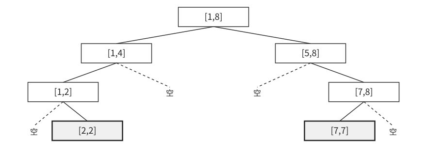

[[TOC]]

## 问题

在整数坐标 $[-10^9,10^9]$ 上维护一个初始全零的数组。支持单点加，以及查询某段坐标范围的总和。

若按整个坐标范围建立普通线段树，需要数十亿个叶子。但若修改次数很少，真正需要保存的只是被修改位置及其祖先。

## 按需建树

动态开点仍按相同规则二分区间，只在修改经过某个尚不存在的节点时分配空间。

节点编号由分配顺序决定，不能再用 $2p$、$2p+1$ 表示孩子，改用 `lc[p]`、`rc[p]` 保存左右孩子编号。编号 $0$ 表示空节点，`root` 保存根编号。



图用较小值域 $[1,8]$ 演示。修改位置 $2$、$7$ 后，只建立通向这两个叶子的路径，其他子树仍为空。

## 坐标平移

代码把输入坐标统一减去 `minx`，将 $[-10^9,10^9]$ 映射到 $[0,2\times10^9]$，查询的两个端点也做相同平移。输入输出仍使用原坐标。

内部坐标非负，统一用 `mid = (l + r) / 2` 划分区间，并用 `ll` 保存坐标及其中间和。直接对负数区间使用该公式会向零取整，例如 $[-1,0]$ 得到中点 $0$，左区间无法缩小；先平移即可避免这个问题。

## 修改与查询

单点加沿坐标所属的分支向下走。若当前节点为空，先分配节点；沿途总和增加修改量，直到叶子。

查询遇到空节点直接返回 $0$。这是因为本篇初始数组全零，空子树表示该范围从未被修改，其总和仍为零。**查询无需创建节点。**

修改增量可以为负，和也可以回到零。代码不会因此删除节点：值为零与节点不存在是两件事。

## 正确性

每次修改只会改变包含该坐标的区间。沿路径创建节点并累加增量，恰好更新所有受影响区间；未创建的子树没有接受过任何修改，仍表示全零。

查询在完整覆盖处使用已维护的总和，在空子树处使用初始总和零，其他部分递归分解。因此返回目标坐标区间内全部修改的累计值。

## 节点池

设整数值域长度为 $U$，单点修改次数为 $K$。树高不超过 $\lceil\log_2 U\rceil$，每次最多创建“树高加一”个节点，因此节点总数可用

$$
K\bigl(\lceil\log_2 U\rceil+1\bigr)
$$

估计。实际路径会共享已有祖先，通常少于这个上界。

本篇 $U=2\times10^9+1$，每次最多新建 $32$ 个节点。对 $K\le10^5$，预留约 $320$ 万个节点；两个 `int` 孩子数组加一个 `long long` 总和数组，约占 $51.2$ MB。动态开点节省的是实际节点数，并不保证任意规模都能满足内存限制。

## 代码

第一行操作数 $q\le10^5$，随后每行：

- `1 x v`：坐标 $x$ 的值加 $v$。
- `2 l r`：查询整数坐标 $[l,r]$ 的和。

所有坐标位于 $[-10^9,10^9]$，总和与增量累计需在 `long long` 范围内。

```cpp file=./dynamic_sum.cpp
```

输入：

```text
8
1 -1000000000 5
1 7 -3
2 -1000000000 0
1 1000000000 9
2 -1000000000 1000000000
2 8 999999999
1 7 3
2 7 7
```

输出：

```text
5
11
0
0
```

## 复杂度与限制

单次修改、查询为 $O(\log U)$，实际使用节点数为 $O(K\log U)$。本代码预分配节点池，占用内存由池容量决定。

本篇只处理单点加。增加区间修改时，需要另行设计懒标记和下传时的节点分配；不能把单点模板直接当成区间修改模板。

空节点的返回值也取决于初始状态和查询含义。这里返回零，是因为维护全零数组的和；如果维护集合最小值、最大值，必须重新确定空区间语义。

## 与离散化比较

已知全部操作坐标时，离散化通常占用更少空间。无法提前知道坐标、但有明确值域边界时，动态开点可以按输入顺序处理。

两者都是节点组织方式的选择。可持久化与线段树合并也常使用显式孩子编号，但它们的节点共享和修改规则各不相同。

## 练习

1. 连续查询从未修改的区间，检查 `tot` 是否保持不变。
2. 在同一个坐标反复加减，检查已有节点能否复用。
3. 将 [[[rbook: sgt_weights]]] 改为动态开点频次树，按输入顺序完成排名和第 $k$ 小查询。
