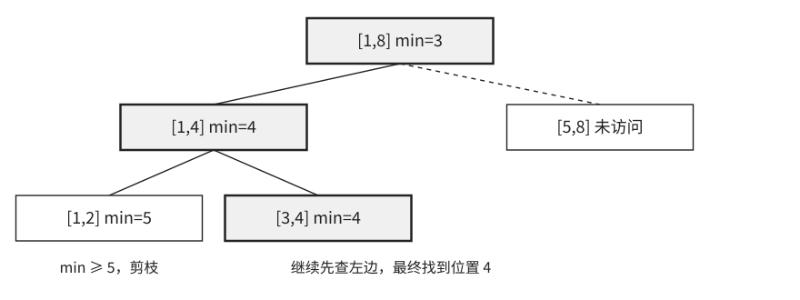

[[TOC]]

## 问题

数组可以单点赋值。每次给出 $[L,R]$ 和阈值 $x$，求该区间中第一个满足 $a_i<x$ 的位置；不存在时返回 $n+1$。

数组无序，不能直接对原数组二分。可以先二分答案位置，再用线段树查询前半段最小值，但这样一次询问需要 $O(\log^2 n)$。利用线段树本身的左右结构，可以直接向下查找。

## 剪枝条件

节点维护区间最小值 `tr[p]`。如果 `tr[p] >= x`，说明整段都没有小于 $x$ 的元素，可以直接排除。

如果 `tr[p] < x`，说明该节点范围内有候选，但还需确认候选是否位于查询区间。查找时也要排除与 $[L,R]$ 不相交的节点。



图示数组为 $[10,5,8,4,5,9,3,7]$，查询整段中第一个小于 $5$ 的位置。$[1,2]$ 的最小值为 $5$，整段排除；随后在 $[3,4]$ 中找到位置 $4$，无需再查 $[5,8]$。

## 查找顺序

1. 不相交或最小值不小于 $x$，返回无解。
2. 到达叶子，返回其下标。
3. 先查左孩子；若有解，立即返回。
4. 左边无解时，才查右孩子。

左右孩子分别对应较小、较大的下标，因此左优先保证返回最靠前的位置。

这个过程常称为“线段树上二分”。它依赖区间信息提供可靠的排除条件，而不是要求数组有序。

## 正确性与复杂度

被最小值条件剪掉的节点不可能含有合法元素；不相交节点也不属于查询范围。其余节点递归查找左右部分，不会遗漏答案。左边任何位置都早于右边，所以左边已有解时可以停止。

完整落在查询区间内的节点，若最小值小于 $x$ 就一定包含答案。找到答案之前，未能剪枝但最终无解的搜索只可能沿查询边界展开；找到候选后只沿一条向下路径继续。因此单次查找访问 $O(\log n)$ 个节点，单点赋值也为 $O(\log n)$。建树 $O(n)$，空间 $O(n)$。

## 代码

输入 `n m`、初始数组及 $m$ 次操作：

- `1 pos v`：单点赋值。
- `2 l r x`：查询首个严格小于 $x$ 的位置。

模板容量为 $n\le 2\times10^5$。

```cpp file=./sgt_find_first_lt.cpp
```

输入：

```text
7 6
10 5 8 4 5 9 3
2 1 7 5
2 5 7 5
1 4 8
2 1 6 5
2 2 5 6
2 7 7 3
```

输出：

```text
4
7
8
2
8
```

最后一次询问只有值 $3$，不满足严格小于 $3$，因此返回 $8$。

## 其他查找

- 第一个大于等于 $x$ 的位置：维护最大值，最大值小于 $x$ 时剪枝。
- 第 $k$ 个元素：维护非负频次，用左孩子总次数决定方向，见 [[[rbook: sgt_weights]]]。
- 前缀和第一次达到 $k$：元素非负时可以用左孩子总和决定方向；允许负数时，仅保存总和不够。

最后一项中，区间总和较小不代表内部没有较大的前缀，不能无条件套用频次查找。

## 值域建模

旧文还使用了另一种方法：对每个值 $v$ 保存它第一次出现的位置 $first[v]$，再求

$$
\min_{v<x}first[v].
$$

它回答的是静态数组全局的“首个小于 $x$ 的位置”。可以在离散化后的值域上维护位置最小值。若需要单点修改或限定下标区间，不能直接沿用“每个值只存第一次出现位置”的结构；本篇按下标建树更直接。

## 练习

1. 将严格小于改为小于等于，调整剪枝条件并检查相等值。
2. 改为寻找最后一个满足条件的位置，应先访问哪个孩子？
3. 给查找加入区间加操作，维护最小值与加法标记，进入孩子前先下传。
