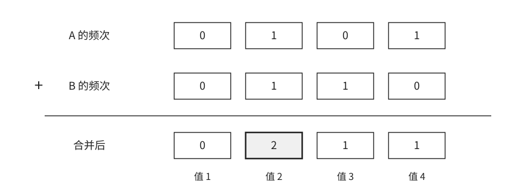

[[TOC]]

## 问题

维护多个多重集合，支持向某个集合插入一个数、合并两个集合，以及查询出现次数最多的数；次数相同时取较小值。

用 [[[rbook: sgt_weights]]] 表示每个集合，叶子保存某个值出现的次数。两个集合合并，就是在同一值域上把对应叶子的频次相加。

如果逐个取出一个集合的全部元素，再插入另一个集合，会反复访问相同路径。动态开点线段树可以直接合并对应子树。

## 对应合并

两棵树必须使用相同的值域与划分方式。递归处理当前节点 $a,b$：

1. 一个为空，直接返回另一个，整棵子树可以接过去。
2. 都是叶子，将频次相加。
3. 否则分别合并左孩子、右孩子，再上推当前信息。



图中集合 $A=\{2,4\}$、$B=\{2,3\}$，合并后值 $2$ 出现两次，其余出现一次。空子树可以整体接入，不必逐个枚举其中元素。

## 众数信息

每个节点维护：

- `mx[p]`：该值域内最大的出现次数。
- `best[p]`：达到此次数的最小数值。

上推时选择 `mx` 较大的孩子；若相等，选择左孩子，因为左半值域中的数更小。叶子合并时频次相加，答案就是该叶子对应的值。

初始集合为空，零号节点的 `mx`、`best` 均为零；空集合查询输出 $0$。本篇只插入正整数，因此不会和合法数值混淆。

## 所有权

这里采用**破坏性合并**。合并会改写被保留节点的孩子和统计信息，结果可能同时复用两棵旧树的节点。

合并后，两个旧集合不能再作为独立集合使用。程序将结果保存到 `root[a]`，并令 `root[b] = 0`。清空后的 $b$ 可以重新插入，但不得通过旧根继续修改已转移的节点。

这与 [[[rbook: sgt_persistent]]] 的只读共享不同。直接合并共享历史节点，会破坏旧版本；需要保留旧树时必须另行设计复制策略，复杂度也要重新分析。

## 正确性

空子树不贡献频次，接入另一棵子树即可。两个叶子代表同一个数，相加得到合并后的出现次数。内部节点分别合并不相交的左右值域，因此所有频次都被正确相加。

在正确的叶子频次之上，每次上推选择更高频次、再选更小数值，所以根节点保存的就是整个集合的众数。

## 总复杂度

**一次合并不一定是 $O(\log V)$。** 若两棵树都有大量重叠节点，单次可能访问许多节点。

但在不共享节点的破坏性合并中，每次处理一对非空节点，都会让第二棵树的当前节点退出有效结构，以后不再被单独合并。将这次开销计到被淘汰节点上，每个节点最多被计一次。

设全部插入一共创建 $S$ 个节点，有 $T$ 次顶层合并，则全部合并总时间为 $O(S+T)$。每个非空节点对只产生常数个递归调用，遇到空节点便停止。若插入 $K$ 次、值域长度为 $V$，有 $S=O(K\log V)$。

这个结论要求旧根不再使用，不能应用到反复合并同一对旧树的操作上。

## 代码

第一行 `n q`，表示初始为空的集合数与操作数，均不超过 $10^5$。数值范围为 $[1,10^5]$。

- `1 a x`：向集合 $a$ 插入一个 $x$。
- `2 a b`：把 $b$ 合并到 $a$，清空 $b$，保证 $a\ne b$。
- `3 a`：查询集合 $a$ 的众数；空集合输出 $0$。

```cpp file=./merge_mode.cpp
```

输入：

```text
3 10
1 1 2
1 1 4
1 2 2
1 2 3
3 1
2 1 2
3 1
3 2
1 2 1
3 2
```

输出：

```text
2
2
0
1
```

节点池预留每次插入最多 $18$ 个节点。合并本身不创建节点；已淘汰节点留在池中，不再独立引用。

## 树上应用

对原树每个顶点建立一棵颜色频次树。自底向上把孩子的频次树合并给父亲，就能得到子树颜色频次。

若需要保留每个顶点的查询答案，应在该顶点的树被继续合并之前保存数值答案，而不是依赖以后仍能使用旧根。

[[[p: luogu-P4556 | 雨天的尾巴]]] 在此基础上结合树上路径差分：每次路径颜色贡献先登记到端点、LCA 等位置，再自底向上合并。差分阶段可能出现负频次，不能直接把本篇“只插入”的众数模板原样套入，需要重新处理零值、负值与空节点语义。

## 练习

1. 把根节点信息改为集合总大小，验证合并后元素数量守恒。
2. 给定有根树与顶点颜色，输出每个子树的众数，次数相同时取较小颜色。
3. [[[p: luogu-P4556 | 雨天的尾巴]]]：补齐 LCA 与树上差分后再尝试。
