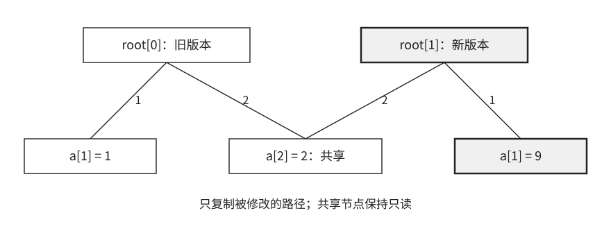

[[TOC]]

## 历史版本

普通单点修改会覆盖旧值。若之后还要查询旧状态，直接复制整个数组，每次需要 $O(n)$ 时间和空间。

线段树一次单点修改只影响一条根到叶子的路径。复制这条路径，其余子树继续共享，就能以 $O(\log n)$ 个新节点保存一个版本。这称为路径复制。

本篇实现可持久化数组：可以基于任意已有版本修改一个位置，也可以查询任意版本的单点值。

## 路径复制

对旧节点 `old`：

1. 分配新节点 `p`，复制旧节点的孩子编号与数据。
2. 只对包含修改位置的孩子递归创建新路径。
3. 未修改的一侧仍指向旧孩子。
4. 返回新节点编号，最终得到新根。



图以数组 $[1,2]$ 为例，把第一个元素改为 $9$。新旧根不同，第一个叶子不同；第二个叶子没有变化，可以共享。图中连线表示引用关系，边上的数字表示数组位置。

共享节点必须保持只读。若直接修改旧路径上的节点，所有引用它的历史版本都会受影响。

## 版本根

用 `root[v]` 记录版本 $v$ 的根。查询只需从指定根出发，不会创建节点。

本篇输入约定每次操作都生成一个版本：

- 修改操作：保存新路径的根。
- 查询操作：新版本与被查询版本完全相同，直接令 `root[i] = root[v]`。

不应在查询后复制整个树，也不能无条件继承上一个操作的版本：查询的可能是更早的任意版本。

## 正确性

初始版本由 `build` 建立，每个叶子保存正确的数组值。

假设旧版本正确。修改路径上的节点全部复制，因而旧版本不被改变；路径外的子树不包含修改位置，共享它们仍然正确。新叶子保存新值，向上返回后，新根表示的数组恰好只改变目标位置。

以后可以从任意根继续分支修改。每个版本都只访问自己的根与它引用的节点，因此不同分支互不干扰。

## 代码

格式对应 [[[p: luogu-P3919 | 可持久化数组]]]：第一行 `n m`，第二行初始数组；第 $i$ 次操作中的版本号满足 $0\le v<i$。

- `v 1 pos x`：基于版本 $v$，把 `a[pos]` 赋为 $x$，得到版本 $i$。
- `v 2 pos`：输出版本 $v$ 的 `a[pos]`，版本 $i$ 与版本 $v$ 相同。

```cpp file=./p3919.cpp
```

输入：

```text
3 7
1 2 3
0 1 2 9
0 2 2
1 2 2
2 1 1 -5
4 2 2
1 2 1
4 2 1
```

输出：

```text
2
9
2
1
-5
```

版本 $1$ 为 $[1,9,3]$，版本 $2$ 仍为 $[1,2,3]$。第四次操作基于版本 $2$，得到 $[-5,2,3]$，不会继承版本 $1$ 中的 $9$。

## 空间估计

初始树有 $2n-1$ 个节点。若有 $K$ 次修改，每次至多新建 $\lceil\log_2 n\rceil+1$ 个节点，总数不超过

$$
2n-1+K\bigl(\lceil\log_2 n\rceil+1\bigr).
$$

模板支持 $n,m\le10^6$，按最坏情况预留约 $2300$ 万个节点。每个节点用三个 `int`，节点池约 $276$ MB，另有原数组和版本根数组。内存限制较小时应按实际规模缩小容量。

叶子值使用 `int`，对应题目 $|a_i|,|x|\le10^9$。本篇只查询单点，内部节点不需要维护区间和；若增加区间和，须添加合并信息，并重新估计节点内存。

建树 $O(n)$，单次修改或查询 $O(\log n)$，实际节点用量 $O(n+K\log n)$。

## 与区间第 k 小的区别

可持久化描述的是“保存旧版本”的方法，不等于区间第 $k$ 小。

本篇的版本按操作生成，叶子表示数组位置。[[[rbook: sgt_chairman]]] 通常按数组前缀生成版本，叶子表示数值频次，还要利用两个前缀版本之差。两者共享路径复制技术，但版本含义不同。

## 练习

- [[[p: luogu-P3919 | 可持久化数组]]]：特别检查查询生成的新版本指向哪个根。
- 从同一个旧版本分别修改两个位置，验证两条版本分支互不影响。
- 给节点增加区间和，支持任意历史版本的区间求和。
