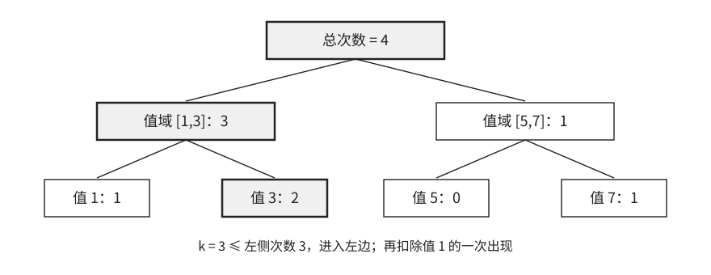

[[TOC]]

## 从下标到值域

普通线段树的叶子对应数组位置。权值线段树的叶子对应**数值**，保存这个数出现的次数；内部节点保存一段值域内的总次数。

例如多重集合 $\{1,3,3,7\}$，数值 $3$ 的叶子计数为 $2$。向集合插入一个 $3$，就是把该叶子的计数加一，沿途祖先的计数也加一。



图中左半值域有 $3$ 个数，所以第 $3$ 小一定在左边。重复元素分别计入排名，第 $2$、第 $3$ 小均为 $3$。

## 离散化

若数值很大或包含负数，可以先收集全部操作中的数值，排序去重，将其映射到 $[1,V]$。

离散化只改变编号，保留大小关系与相等关系。它不会禁止负数，也不要求原数值连续。

模板离线读入全部操作，把插入、删除及阈值询问中的数值都加入离散化数组；第 $k$ 小操作的参数是排名，不能当作数值收集。查询结束后用 `values[id]` 还原原值。

## 插入与删除

插入 $x$，使它的计数增加 $1$；删除 $x$，使计数减少 $1$。两者都只修改一条根到叶子的路径。

删除要求 $x$ 当前存在，只删除一次出现。所有计数必须非负，否则下面的第 $k$ 小查找不再成立。

## 排名与第 k 小

定义 $x$ 的排名为严格小于 $x$ 的元素个数加一：

$$
\operatorname{rank}(x)=\operatorname{count}(<x)+1.
$$

即使 $x$ 不在集合中，也可以按此定义回答。等于 $x$ 的元素不计入 `count(<x)`。

查找第 $k$ 小时，设左孩子总次数为 $s$：

- $k\le s$，进入左孩子，排名不变。
- $k>s$，进入右孩子，并令 $k\gets k-s$。

左边所有数均小于右边所有数，计数又包含重复次数，因此这个判断不会跳过目标元素。每层排除半个值域，直到叶子得到答案。

## 前驱与后继

前驱、后继使用严格比较：

| 查询 | 转为第 k 小 |
| --- | --- |
| $x$ 的前驱 | 令 $k=\operatorname{count}(<x)$，取第 $k$ 小 |
| $x$ 的后继 | 令 $k=\operatorname{count}(\le x)+1$，取第 $k$ 小 |

若前驱或后继不存在，就不能调用非法的 `kth`。本篇模板采用题目的合法性保证：删除对象存在，第 $k$ 小满足 $1\le k\le |S|$，前驱、后继询问均有解。

## 代码

输入格式对应 [[[p: luogu-P3369 | 普通平衡树]]]。第一行操作数 $q$，随后每行 `op x`：$1$ 插入、$2$ 删除、$3$ 排名、$4$ 第 $k$ 小、$5$ 前驱、$6$ 后继。初始集合为空，容量 $q\le 2\times10^5$。

```cpp file=./weight_tree.cpp
```

输入：

```text
12
1 3
1 1
1 3
1 7
3 3
4 3
5 3
6 3
2 3
4 3
3 4
4 2
```

输出：

```text
2
3
1
7
7
3
3
```

删除一个 $3$ 后，集合为 $\{1,3,7\}$，仍然保留另一个 $3$。

## 复杂度与选择

离散化 $O(q\log q)$，每次集合操作 $O(\log V)$，空间 $O(q+V)$。空频次数组已由全局初始化清零，无需显式建树。

树状数组也能维护值域频次，见 [[[rbook: bit_inversion]]]。权值线段树显式保存左右区间，便于进一步做动态开点、版本差查询和合并。

若不能提前知道数值，但能确定数值上下界，可以采用 [[[rbook: sgt_dynamic]]]，不必预先离散化。

## 练习

- [[[p: luogu-P3369 | 普通平衡树]]]：核对六种操作的严格与非严格比较。
- 将输入改为依次插入数字，每次输出中位数。
- 用频次查询求逆序对，与 [[[rbook: bit_inversion]]] 对照；相等元素不能形成逆序对。
