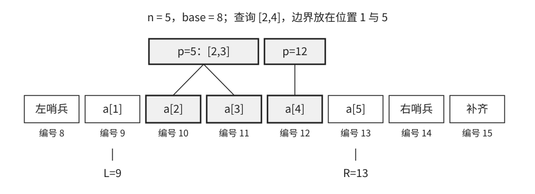

[[TOC]]

## 自底向上

前面的递归线段树从根向下查找区间。ZKW 线段树使用完整的二叉树，把所有叶子连续存放，通过循环从叶子向上修改和查询。

本篇采用带左右哨兵的开区间查询写法，只实现单点加与区间求和。它与 [[[rbook: sgt_update_one]]] 解决同一问题，区别在节点组织和访问方式。

## 叶子编号

取最小的 $2$ 的幂 `base`，使其满足 `base >= n + 2`。叶子编号为 $[base,2base-1]$。

- 原数组 $a_i$ 放在 `tr[base+i]`，$1\le i\le n$。
- `base` 对应位置 $0$，作为左哨兵。
- `base+n+1` 对应位置 $n+1$，作为右哨兵。
- 其余补齐位置设为 $0$。

建树时从 `base-1` 倒序到 $1$，依次合并两个孩子。父节点编号小于孩子，倒序遍历保证孩子已经算好。

## 单点修改

叶子编号可以直接计算，不必从根递归定位。修改 `tr[base+pos]` 后，不断令 `p /= 2`，重新计算每一个祖先。

补齐叶子不属于原数组，修改位置必须在 $[1,n]$ 内。

## 开区间查询

要求闭区间 $[l,r]$，先把两侧边界放在目标范围之外：

```cpp
int L = base + l - 1;
int R = base + r + 1;
```

此时目标元素恰好在两个边界之间。向上移动时：

- 若 `L` 是左孩子，它的右兄弟完整位于待查询范围内，计入 `tr[L+1]`。
- 若 `R` 是右孩子，它的左兄弟完整位于待查询范围内，计入 `tr[R-1]`。
- 然后两侧边界同时上移到父亲。

当两个边界的父亲相同，它们之间已无尚未计入的整棵子树，查询结束。



图中 `base=8`，查询 $[2,4]$：初始边界编号为 $9$、$13$，先取编号 $12$ 的叶子；边界上移到 $4$、$6$ 后，取编号 $5$ 的区间 $[2,3]$。两段相加得到目标区间和。

## 正确性

每层的两个边界夹住尚未处理的目标元素。选中的兄弟子树位于边界内侧，既不包含边界，也不与已选子树重叠。选完后同时上移边界，将剩余搜索范围提升一层。

到边界成为兄弟时，内部没有剩余子树，所有目标元素都被恰好计入一次。修改则重新计算目标叶子的全部祖先，保持每个节点等于两个孩子之和。

## 代码

输入与单点修改篇相同：`n m`、初始数组，以及 `1 pos v` 单点加、`2 l r` 区间求和。容量为 $n\le5\times10^5$。

```cpp file=./zkw_sum.cpp
```

输入：

```text
5 5
1 2 3 4 5
2 2 4
1 3 -5
2 2 4
2 1 5
2 3 3
```

输出：

```text
9
4
10
-2
```

## 边界与复杂度

建树 $O(n)$，单点修改与区间查询 $O(\log n)$，空间 $O(n)$。`base` 满足 $n+2\le base<2(n+2)$，数组应容纳编号到 `2*base-1`，不能仅按实际非空元素数开空间。

两个哨兵让整段、首元素和尾元素查询都使用同一套循环。区间和使用 `long long`，补齐叶子为加法单位元 $0$。

本篇将左右两侧答案累加到同一个变量，利用了加法的交换律。若维护矩阵乘积等有顺序的信息，需要分别保存左右答案：左侧从右端追加，右侧从左端插入，最后按左右顺序合并。

若改为最值，应重新设置补齐值和答案初值。区间修改还需要额外处理标记、边界下传和上推，不能直接把递归懒标记代码塞入本篇循环。

非递归实现减少了函数调用，但实际性能还取决于实现与任务。入门先掌握递归结构，熟悉区间分解后再选择这种写法。

## 练习

- [[[p: luogu-P3374 | 树状数组 1]]]：对比树状数组、递归线段树、ZKW 三种实现。
- 把长度改为 $1$、$2$、$3$、$7$、$8$，检查哨兵与补齐位置。
- 改为单点赋值、区间最小值，并用全正、全负数据检查单位元。
