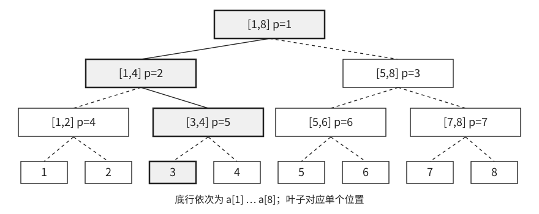

[[TOC]]

## 问题

维护长度为 $n$ 的数组，支持：

- `1 pos v`：令 $a_{pos}\gets a_{pos}+v$。
- `2 l r`：查询 $[l,r]$ 的元素和。

例如 $n=5$，初始数组为 $[1,-2,3,4,5]$，依次执行 6 次操作：

```text
输入：
5 6
1 -2 3 4 5
2 1 5
1 2 6
2 2 4
1 5 -10
2 4 5
2 3 3
```

每次查询的结果依次为：

```text
输出：
11
11
-1
3
```

第一次查询 $1-2+3+4+5=11$；执行 `1 2 6` 后数组变为 $[1,4,3,4,5]$；再执行 `1 5 -10` 后变为 $[1,4,3,4,-5]$。

本篇沿用 [[[rbook: sgt_preface]]] 的区间划分。用 `tr[p]` 保存节点 $p$ 所表示区间的和，所有下标从 $1$ 开始。

## 建树

若 $l=r$，令 `tr[p] = a[l]`；否则递归建立左右孩子，再执行：

```cpp
int ls(int p) { return p << 1; }      // 左孩子 2p
int rs(int p) { return p << 1 | 1; }  // 右孩子 2p+1

void pushup(int p) {
    tr[p] = tr[ls(p)] + tr[rs(p)];
}
```

`pushup` 的作用是由孩子的信息重新计算父亲。建树访问全部 $2n-1$ 个节点，时间为 $O(n)$，不必把每个初值逐个插入。

想看建树时每个节点如何被依次填上、`pushup` 又如何自底向上重新求和的？试试这个动画：

[[[dsa: segment_tree_build]]]

下面是一份只做建树的完整可运行程序：读入 $n$ 与数组，递归建树后按先序把每个节点的编号、区间、区间和打印出来，便于对照上面动画的每一帧。

::: fold 完整建树代码与输出
```cpp file=./build_tree_demo.cpp
```

输入：

```text
5
1 2 3 4 5
```

输出（缩进表示父子层级，每行依次是节点编号、区间、区间和）：

```text
node 1 [1,5] sum=15
  node 2 [1,3] sum=6
    node 4 [1,2] sum=3
      node 8 [1,1] sum=1
      node 9 [2,2] sum=2
    node 5 [3,3] sum=3
  node 3 [4,5] sum=9
    node 6 [4,4] sum=4
    node 7 [5,5] sum=5
```

可以看到根节点 $\texttt{tr}[1]=15$ 正是全部元素之和，每个内部节点的值都等于两个孩子之和；叶子 $\texttt{tr}[8..]$ 则是原数组的元素。
:::

## 单点修改

只有包含 `pos` 的区间会受影响。从根出发，每次根据 `pos` 与 `mid` 的关系进入一个孩子，到叶子后修改，再沿递归栈向上执行 `pushup`。



图中修改 $a_3$，受影响的区间依次是 $[3,3]$、$[3,4]$、$[1,4]$、$[1,8]$。其他节点不需要重新计算。

若操作改为单点赋值，只需把叶子处的 `tr[p] += v` 改为 `tr[p] = v`，其余递归结构不变。

## 区间查询

查询 $[L,R]$ 时，递归函数只进入与它相交的节点。

1. 若 $L\le l$ 且 $r\le R$，当前区间完全被查询范围包含，直接返回 `tr[p]`。
2. 若 $L\le mid$，递归查询左孩子。
3. 若 $R>mid$，递归查询右孩子。
4. 将得到的部分答案相加。

这里判断的是“当前区间被查询区间包含”，不要求两个区间完全相同。由于只递归相交部分，也不需要为不相交的节点继续向下搜索。

例如查询 $[3,6]$，最终取出 $[3,4]$ 与 $[5,6]$ 的和。它们互不相交，拼起来恰好等于目标区间。

## 正确性

建树时，叶子存储原数组值；内部节点合并左右两个互不相交的区间，因此 `tr[p]` 等于对应区间和。

单点修改只影响目标叶子的祖先。回溯时从下到上重新求和，使所有受影响节点恢复正确；其余节点的区间没有变化。

查询在完整覆盖处停止，其余部分分别交给左右孩子。左右区间不重叠，递归又只排除目标范围之外的部分，所以返回值不重不漏地包含 $[L,R]$ 的全部元素。

## 代码

输入第一行为 `n m`，第二行为初始数组，随后为 $m$ 次操作。模板容量为 $n\le 5\times10^5$。

```cpp file=./point_add.cpp
```

输入：

```text
5 6
1 -2 3 4 5
2 1 5
1 2 6
2 2 4
1 5 -10
2 4 5
2 3 3
```

输出：

```text
11
11
-1
3
```

修改后数组依次变为 $[1,4,3,4,5]$、$[1,4,3,4,-5]$。

## 边界与复杂度

- 建树 $O(n)$，单次修改或查询 $O(\log n)$，空间 $O(n)$。
- $n=1$ 时，根节点就是叶子。
- 区间和、修改增量、函数返回值统一使用 `long long`；总和仍需处于其表示范围内。
- 负数不影响求和。若改为区间最大值查询，空答案应初始化为负无穷，不能初始化为 $0$。

## 练习

- [[[p: luogu-P3374 | 树状数组 1]]]：本篇的操作模型，可与 [[[rbook: bit]]] 对照。
- 手动把模板改为“单点赋值、区间最大值”，检查全负数组。
- 尝试查询区间平均数，说明为什么还需要区间长度。

对整段逐个执行单点修改会增加开销。下一篇使用懒标记处理 [[[rbook: sgt_update_range]]]。
