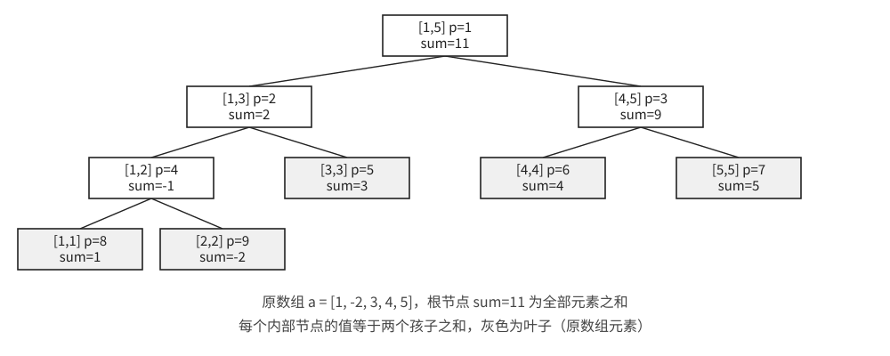

[[TOC]]

## 问题

维护长度为 $n$ 的数组，支持：

- `1 pos v`：令 $a_{pos}\gets a_{pos}+v$。
- `2 l r`：查询 $[l,r]$ 的元素和。

例如 $n=5$，初始数组为 $[1,-2,3,4,5]$，依次执行 6 次操作：

```text
5 6
1 -2 3 4 5
2 1 5
1 2 6
2 2 4
1 5 -10
2 4 5
2 3 3
```

每次查询的结果依次为：

```text
11
11
-1
3
```

第一次查询 $1-2+3+4+5=11$；执行 `1 2 6` 后数组变为 $[1,4,3,4,5]$；再执行 `1 5 -10` 后变为 $[1,4,3,4,-5]$。

本篇沿用 [[[rbook: sgt_preface]]] 的区间划分。用 `tr[p]` 保存节点 $p$ 所表示区间的和，所有下标从 $1$ 开始。

## 建树

若 $l=r$，令 `tr[p] = a[l]`；否则递归建立左右孩子，再执行：

```cpp
int ls(int p) { return p << 1; }      // 左孩子 2p
int rs(int p) { return p << 1 | 1; }  // 右孩子 2p+1

void pushup(int p) {
    tr[p] = tr[ls(p)] + tr[rs(p)];
}
```

`pushup` 的作用是由孩子的信息重新计算父亲。建树访问全部 $2n-1$ 个节点，时间为 $O(n)$，不必把每个初值逐个插入。



以上图为例，$a=[1,-2,3,4,5]$ 建完后，每个叶子对应一个数组元素，内部节点的值等于两个孩子之和，根节点 $\texttt{tr}[1]=11$ 恰为整个数组的和。节点编号与区间并不一致：编号 $8,9$ 才是数组前两个下标，而区间 $[4,5]$ 的编号是 $3$。

想看建树时每个节点如何被依次填上、`pushup` 又如何自底向上重新求和的？试试这个动画：

[[[dsa: segment_tree_build]]]

下面是一份只做建树的完整可运行程序：读入 $n$ 与数组，递归建树后按先序把每个节点的编号、区间、区间和打印出来，便于对照上面动画的每一帧。

::: fold 完整建树代码与输出
```cpp file=./build_tree_demo.cpp
```

输入：

```text
5
1 -2 3 4 5
```

输出（缩进表示父子层级，每行依次是节点编号、区间、区间和）：

```text
node 1 [1,5] sum=11
  node 2 [1,3] sum=2
    node 4 [1,2] sum=-1
      node 8 [1,1] sum=1
      node 9 [2,2] sum=-2
    node 5 [3,3] sum=3
  node 3 [4,5] sum=9
    node 6 [4,4] sum=4
    node 7 [5,5] sum=5
```

可以看到根节点 $\texttt{tr}[1]=11$ 正是全部元素之和，每个内部节点的值都等于两个孩子之和；叶子 $\texttt{tr}[8]=1$、$\texttt{tr}[9]=-2$ 则是原数组的元素。负数照常相加，不需要特殊处理。
:::

## 单点修改

只有包含 `pos` 的区间会受影响。从根出发，每次根据 `pos` 与 `mid` 的关系进入一个孩子，到叶子后修改，再沿递归栈向上执行 `pushup`。


图中修改 $a_3$，受影响的区间依次是 $[3,3]$、$[3,4]$、$[1,4]$、$[1,8]$。其他节点不需要重新计算。

若操作改为单点赋值，只需把叶子处的 `tr[p] += v` 改为 `tr[p] = v`，其余递归结构不变。

## 区间查询

查询 $[L,R]$ 时，先判断它与当前节点区间 $[l,r]$ 的关系。

1. 若 $r<L$ 或 $R<l$，两个区间不相交，返回 $0$。
2. 若 $L\le l$ 且 $r\le R$，当前区间完全被查询范围包含，返回 `tr[p]`。
3. 否则递归查询左右两个孩子，将结果相加。

不相交部分返回 $0$，不会影响求和。因此可以直接调用两个孩子，由递归函数自行判断是否相交，不必在调用前分别判断左右边界。

完整覆盖判断的是“当前区间被查询区间包含”，不要求两个区间完全相同。叶子与查询区间要么不相交，要么被完全包含，因此不需要额外的叶子终止条件。

例如查询前面五元素数组的 $[2,4]$，最终取出 $[2,2]$、$[3,3]$、$[4,4]$ 的和，其余部分返回 $0$。这些区间互不相交，恰好拼成目标区间。

## 正确性

建树时，叶子存储原数组值；内部节点合并左右两个互不相交的区间，因此 `tr[p]` 等于对应区间和。

单点修改只影响目标叶子的祖先。回溯时从下到上重新求和，使所有受影响节点恢复正确；其余节点的区间没有变化。

查询在不相交处返回 $0$，在完整覆盖处返回节点和，其余部分分别交给左右孩子。左右区间不重叠，所以返回值不重不漏地包含 $[L,R]$ 的全部元素。

## 代码

输入第一行为 `n m`，第二行为初始数组，随后为 $m$ 次操作。模板容量为 $n\le 5\times10^5$。

```cpp file=./point_add.cpp
```

输入：

```text
5 6
1 -2 3 4 5
2 1 5
1 2 6
2 2 4
1 5 -10
2 4 5
2 3 3
```

输出：

```text
11
11
-1
3
```

修改后数组依次变为 $[1,4,3,4,5]$、$[1,4,3,4,-5]$。

## 边界与复杂度

- 建树 $O(n)$，单次修改或查询 $O(\log n)$，空间 $O(n)$。
- 查询只在部分相交的节点继续展开，每层至多两个；额外调用的不相交孩子立即返回，因此仍为 $O(\log n)$。
- $n=1$ 时，根节点就是叶子。
- 区间和、修改增量、函数返回值统一使用 `long long`；总和仍需处于其表示范围内。
- 负数不影响求和。若改为区间最大值查询，不相交时应返回负无穷，不能返回 $0$。

## 练习

### 思考与变体

1. **区间最值**：将本篇模板改为“单点赋值、区间最大值”。若数组存在负数，查询时与节点不相交的分支应返回负无穷（例如 `-1e18`），不能返回 $0$。
2. **区间平均数**：若要查询区间平均数，仅维护区间和不够，还需维护区间长度（或在查询时根据端点计算），说明为什么平均数不满足直接合并性（即不能直接由左右孩子的平均数相加得出）。

### 推荐题目

按单点修改的演进方向，精选以下题目作为课后训练：

#### 1. 基础手写与结合律变体

- [[[p: luogu-P3374 | 洛谷 P3374 【模板】树状数组 1]]]：本篇的操作模型，可与 [[[rbook: bit]]] 对照。
- [[[p: luogu-P2068 | 洛谷 P2068 统计和]]]：单点加与区间求和，适合作为独立完整手写练习。
- [[[p: luogu-P1531 | 洛谷 P1531 I Hate It]]]：单点只升不降修改（`max` 赋值），区间最大值。
- [[[p: atcoder-abc185_f | AtCoder ABC 185 F Range Xor Query]]]：单点异或更新，区间异或和。

#### 2. 状态压缩与分层规则

- [[[p: codeforces-339D | Codeforces 339D Xenia and Bitwise Operations]]]：奇数层执行 OR、偶数层执行 XOR。单点修改后沿链交替向上重新计算，无需区间查询，直接读取根节点。
- [[[p: codeforces-1234D | Codeforces 1234D Distinct Characters Queries]]]：单点修改字符，区间查询不同字符数。每个节点存 $26$ 位状态掩码，`pushup` 按位或合并后统计二进制中 $1$ 的个数。
- [[[p: luogu-P4588 | 洛谷 P4588 [TJOI2018] 数学计算]]]：模数非质数无法直接除法逆元。将每次乘法看作一个位置，撤销操作转化为“单点修改回乘法单位元 $1$”，线段树维护全局乘积。

#### 3. 进阶区间信息合并（跨中缝拼装）

- [[[p: codeforces-380C | Codeforces 380C Sereja and Brackets]]]：区间最长合法括号子序列。节点维护匹配对数、未匹配左括号数与未匹配右括号数，合并时跨中点匹配 $\min(L.\text{unmatched\_l}, R.\text{unmatched\_r})$。
- [[[p: luogu-P4513 | 洛谷 P4513 小白逛公园]]]：单点修改，区间最大连续子段和（GSS 模型）。节点维护总和 `sum`、最大前缀 `pre`、最大后缀 `suf` 与区间最优 `best`。
- [[[p: luogu-P6492 | 洛谷 P6492 [COCI 2010/2011 #6] STEP]]]：单点 0/1 翻转，维护全局最长交替子串。节点维护两端字符值、最长交替前缀/后缀与段内最优。
- [[[p: luogu-P3100 | 洛谷 P3100 [USACO14JAN] Marathon G]]]：单点修改坐标，查询跳过某一点后的最短折线距离。维护区间总长与单点跳过最大收益。

#### 4. 单点维护与树上二分

- [[[p: luogu-U502676 | 洛谷 U502676 线段树上二分模版]]]：查询区间内第一个大于 $k$ 的位置。节点维护区间最大值，自顶向下判断：若当前节点最大值 $\le k$ 则整段剪枝，将二分复杂度从 $O(\log^2 n)$ 降至 $O(\log n)$。

### 训练路线建议

```text
阶段一：基础模板与代数运算变体
  P3374 / P2068（区间求和）
         │
         ▼
  ABC 185 F（区间异或）→ P1531（区间最值，处理负无穷哨兵）
         │
         ▼
阶段二：状态位运算与特殊 pushup 规则
  CF339D（按树深度分层交替合并，无区间查询）
         │
         ▼
  CF1234D（26 位掩码位或合并）→ P4588（转化为单点修改为单位元 1 维护全局积）
         │
         ▼
阶段三：跨中缝区间信息合并（GSS 结构）
  CF380C（括号匹配跨段抵消）
         │
         ▼
  P4513（最大子段和四元组）→ P6492（最长交替段拼接）→ P3100（跳跃折线差值）
         │
         ▼
阶段四：树上剪枝二分
  U502676（利用节点最值单路下降剪枝，消去外层二分 log）
```

对整段逐个执行单点修改会增加开销。下一篇使用懒标记处理 [[[rbook: sgt_update_range]]]。
