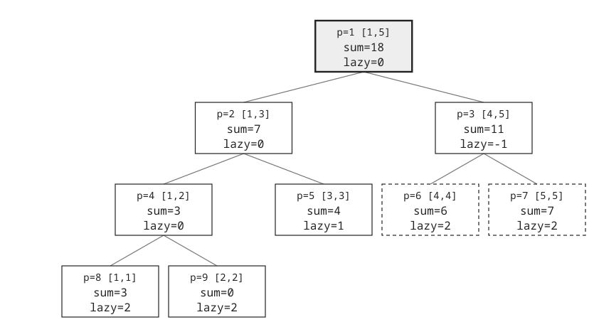
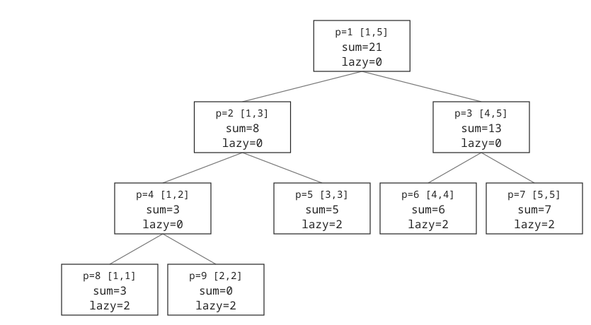

[[TOC]]

## 问题

维护长度为 $n$ 的数组，支持：

- `1 l r v`：给 $[l,r]$ 中每个元素加上 $v$。
- `2 l r`：查询 $[l,r]$ 的元素和。

继续使用单点修改篇的数组 $[1,-2,3,4,5]$，依次执行六次操作。

输入：

```text
5 6
1 -2 3 4 5
2 1 5
1 1 5 2
2 2 4
1 3 5 -1
2 1 5
2 3 3
```

输出：

```text
11
11
18
4
```

| 操作 | 数组或查询结果 |
| --- | --- |
| 查询 $[1,5]$ | $11$ |
| $[1,5]$ 加 $2$ | $[3,0,5,6,7]$ |
| 查询 $[2,4]$ | $0+5+6=11$ |
| $[3,5]$ 加 $-1$ | $[3,0,4,5,6]$ |
| 查询 $[1,5]$ | $18$ |
| 查询 $[3,3]$ | $4$ |

若对修改区间内每个元素分别调用单点加，一次需要 $O((r-l+1)\log n)$。本篇把整段修改压缩到少量节点上。

## 建树

树的结构与 [[[rbook: sgt_update_one]]] 相同。节点 $p$ 表示下标区间 $[l,r]$，左右孩子为 `ls(p)`、`rs(p)`。叶子保存原数组值，内部节点保存左右区间和。

新增的 `lazy[p]` 初始为 $0$，表示没有尚未下传的增量。


根节点表示 $[1,5]$，保存和 $11$。左孩子 $[1,3]$ 长度为 $3$，右孩子 $[4,5]$ 长度为 $2$。后续整段加时，两边增加的总和不同。

## 整段更新

若节点表示的 $[l,r]$ 完全包含在修改范围中，每个元素都加 $v$，区间和增加

$$
v(r-l+1).
$$

因此可以直接执行 `tr[p] += v * (r-l+1)`，无需继续访问叶子。例如给整个数组加 $2$，根的和立即从 $11$ 变为 $21$。


图中根已经更新，孩子仍保存旧值。虚线框表示节点尚未计入祖先的增量。此时查询整段可以直接返回 $21$；查询局部之前，则必须先补齐相关孩子的信息。

## 懒标记

用 `lazy[p]` 记录**已经计入当前节点、但尚未传给孩子的统一增量**。完整覆盖时，同时修改区间和与标记：

```cpp
void apply(int p, int l, int r, ll v) {
    tr[p] += v * (r - l + 1);
    lazy[p] += v;
}
```

连续加 $u$、再加 $v$，等价于加 $u+v$，所以标记累加，不能覆盖。标记不是“当前节点还没更新”，而是“孩子以后还要接受这次更新”。

上图中 `tr[1]=21`、`lazy[1]=2`，但两个孩子的存储和仍为 $2$、$9$。父亲与孩子之和暂时不相等，是延迟更新的结果。

::: warn
若未下传就执行 `pushup(1)`，根的和会被孩子的旧值覆盖为 $2+9=11$，丢失刚加上的 $10$。只有补齐孩子并完成部分修改后，才能重新上推。
:::

## 下传

需要进入孩子时，将父标记分别作用到两个孩子，然后清空父标记。

```cpp
void pushdown(int p, int l, int r) {
    if (lazy[p] == 0) return;
    int mid = (l + r) / 2;
    apply(ls(p), l, mid, lazy[p]);
    apply(rs(p), mid + 1, r, lazy[p]);
    lazy[p] = 0;  // 增量已交给孩子，不能再次下传
}
```

给整个数组加 $2$ 后，首次从根进入孩子时：

- 左孩子长 $3$，和增加 $2\times3=6$，从 $2$ 变为 $8$。
- 右孩子长 $2$，和增加 $2\times2=4$，从 $9$ 变为 $13$。
- 两个孩子的 `lazy` 都累加 $2$，根的 `lazy` 清零。

根的和仍为 $21$。这一步只改变增量存放在哪一层，不会再次修改数组。之后若继续进入孙子，孩子的标记也按相同规则下传。

叶子没有孩子。本篇修改、查询都会在叶子完整覆盖或不相交时返回，因此不会对叶子调用 `pushdown`。叶子上的 `lazy` 可以保留，但无需再下传。

## 区间修改

给目标范围 $[L,R]$ 加 $v$：

1. 不相交，直接返回，不修改，也不下传。
2. 完整覆盖当前节点时，执行 `apply` 并返回。
3. 部分相交时先下传，再直接递归左右两个孩子，由孩子自行判断交集。
4. 回溯时执行 `pushup`，重新计算当前区间和。

```cpp
void add(int p, int l, int r, int L, int R, ll v) {
    if (r < L || R < l) return;  // 不相交，不修改，也不下传标记
    if (L <= l && r <= R) {
        apply(p, l, r, v);  // 完整覆盖，更新本节点的和与标记，不再访问叶子
        return;
    }
    pushdown(p, l, r);  // 部分修改前必须下传，再修改孩子并上推
    int mid = (l + r) / 2;
    add(ls(p), l, mid, L, R, v);
    add(rs(p), mid + 1, r, L, R, v);
    pushup(p);
}
```

修改与查询都先处理空交集和完整覆盖，不必在调用孩子前分别判断边界。两者的区别是：修改返回后需要上推，查询只需合并返回值。

在前面的整段加与局部查询之后，给 $[3,5]$ 加 $-1$，会分别完整覆盖 $[3,3]$ 与 $[4,5]$；进入不相交的 $[1,2]$ 时直接返回。



$[4,5]$ 的和从 $13$ 变为 $11$，标记为 $-1$；两个孩子仍保存 $6$、$7$，尚未计入这次减法。回溯后，根的和为 $7+11=18$。

## 区间查询

查询沿用空交集返回 $0$ 的写法：

1. 不相交，返回 $0$。
2. 完整覆盖，返回 `tr[p]`。
3. 部分相交，先下传，再查询左右孩子并相加。

```cpp
ll query(int p, int l, int r, int L, int R) {
    if (r < L || R < l) return 0;  // 不相交，不能继续向下或下传标记
    if (L <= l && r <= R) return tr[p];  // 当前和已包含本节点的标记
    pushdown(p, l, r);
    int mid = (l + r) / 2;
    return query(ls(p), l, mid, L, R)
         + query(rs(p), mid + 1, r, L, R);
}
```

查询整段时，根已经保存正确的和，不必下传。查询 $[2,4]$ 时，需要进入更小的区间，路径上的标记才依次传给孩子。



最终取出 $[2,2]$、$[3,3]$、$[4,4]$ 的和，得到 $0+5+6=11$。查询改变了标记分布，但没有改变数组。

查询不需要再执行 `pushup`：下传时，父亲已计入的增量被分配给孩子，父亲的和本来就正确；之后的递归只读取信息。

## 演示

下面按开头的六次操作演示。每一步可以观察当前节点的编号、区间、`sum` 与 `lazy`，也可以回退核对下传前后的变化。点开在线动画：

[[[dsa: segment_tree_range_update]]]

也可以用程序打印树状态。它与正式模板使用相同的建树、修改、查询函数，仅增加状态输出，适合小数据手动核对。

::: fold 完整演示代码与输出
```cpp file=./range_add_demo.cpp
```

输入使用开头的五元素样例。程序在初始建树和每次操作后输出整棵树。下面节选“整段加 $2$ 后”和“查询 $[2,4]$ 后”两段：

```text
after add [1,5] value=2
node 1 [1,5] sum=21 lazy=2
  node 2 [1,3] sum=2 lazy=0
    node 4 [1,2] sum=-1 lazy=0
      node 8 [1,1] sum=1 lazy=0
      node 9 [2,2] sum=-2 lazy=0
    node 5 [3,3] sum=3 lazy=0
  node 3 [4,5] sum=9 lazy=0
    node 6 [4,4] sum=4 lazy=0
    node 7 [5,5] sum=5 lazy=0
query [2,4] = 11
node 1 [1,5] sum=21 lazy=0
  node 2 [1,3] sum=8 lazy=0
    node 4 [1,2] sum=3 lazy=0
      node 8 [1,1] sum=3 lazy=2
      node 9 [2,2] sum=0 lazy=2
    node 5 [3,3] sum=5 lazy=2
  node 3 [4,5] sum=13 lazy=0
    node 6 [4,4] sum=6 lazy=2
    node 7 [5,5] sum=7 lazy=2
```

每行缩进表示树的层级。这里打印的是实际存储值，不会为了打印而下传标记。第二段中根的 `lazy` 清零，孩子信息逐层补齐，但根的 `sum` 仍为 $21$。
:::

## 正确性

当递归进入某个节点前，路径上的祖先标记都已下传，因此当前节点的区间和已经包含所有应计入的修改。

完整修改按“增量乘长度”更新节点和，再记录孩子尚未接受的增量。部分修改先下传，保证孩子信息正确；递归结束后合并，得到正确的父区间和。

查询排除空交集，在完整覆盖处直接使用节点和，在部分相交处先下传再递归。被取出的区间互不相交，恰好覆盖目标范围，所以求和结果正确。

## 代码

第一行输入 `n m`，第二行输入初始数组，随后是 $m$ 次操作。`1 l r v` 表示区间加，`2 l r` 表示区间求和。格式对应 [[[p: luogu-P3372 | 线段树 1]]]。

```cpp file=./range_add.cpp
```

使用开头的样例，输出应为 $11,11,18,4$。正式程序只输出查询答案，演示程序还会输出节点状态。

## 边界与复杂度

- 建树 $O(n)$，单次区间加与区间查询均为 $O(\log n)$，空间 $O(n)$。
- 完整覆盖处立即停止，每层至多两个部分相交的节点继续展开；修改和查询额外调用的不相交孩子立即返回。
- 模板容量为 $n\le10^5$。区间和、增量和长度乘积使用 `ll`，仍需保证中间结果不溢出。
- 负数与负增量不需要特殊处理。标记可以相互抵消，为 $0$ 时无需下传。
- $n=1$ 时，修改和查询都在根节点直接完成。

## 练习

### 思考与变体

1. **标记累加性**：若先对整段加 $2$，紧接着又对整段加 $3$，根节点的 `lazy` 应是多少？为什么不需要在两次修改之间执行下传？
2. **区间最值与长度**：若把维护信息改为区间最大值，当区间加 $v$ 时，节点最大值只增加 $v$，为什么不需要乘区间长度？查询不相交分支时应返回什么哨兵？
3. **负数与抵消**：若初始值与增量均存在负数，连续加 $+5$ 与 $-5$ 后标记清零，说明为什么标记为 $0$ 时可以直接跳过下传。

### 推荐题目

按区间修改与懒标记的演进方向，精选以下题目作为课后训练：

#### 1. 基础模板与区间最值变体

- [[[p: luogu-P3372 | 洛谷 P3372 【模板】线段树 1]]]：独立实现区间加、区间求和，核对 `apply`、`pushdown`、`pushup` 的执行顺序。
- [[[p: codeforces-52C | Codeforces 52C Circular RMQ]]]：区间加、区间最小值。环形区间跨过末尾时拆成两段，注意输入每行参数个数区分操作。
- [[[p: luogu-P3130 | 洛谷 P3130 [USACO15DEC] Counting Haybale P]]]：区间加，同时查询区间和与区间最小值。体会同一个加法标记作用于求和（乘长度）与最值（不乘长度）时的行为差异。
- [[[p: luogu-P1607 | 洛谷 P1607 [USACO09FEB] Fair Shuttle G]]]：贪心按终点排序，每次在区间内载客，用区间加与区间最大值判断载客量是否超过容量上限。

#### 2. 布尔与异或翻转懒标记（非加法单标记）

- [[[p: luogu-P3870 | 洛谷 P3870 [TJOI2009] 开关]]] / [[[p: luogu-P2846 | 洛谷 P2846 [USACO08NOV] Light Switching G]]]：0/1 序列区间取反，查询区间内开着的灯数。翻转具有自逆性，懒标记使用异或合并 `lazy ^= 1`，整段和更新为 `len - sum`。
- [[[p: atcoder-abc223_f | AtCoder ABC 223 F Parenthesis Checking]]]：括号序列前缀和转化。单点交换括号相当于区间加 $\pm 2$，利用线段树维护区间和与区间前缀最小值判定括号序列合法性。

#### 3. 差分与等差数列标记

- [[[p: luogu-P1438 | 洛谷 P1438 无聊的数列]]]：区间加等差数列。利用一阶差分转化为区间加常数；或直接在线段树上打首项与公差双标记，整段结算时加上 $\text{len}\cdot f + d\cdot \frac{\text{len}(\text{len}-1)}{2}$。
- [[[p: codeforces-446C | Codeforces 446C DZY Loves Fibonacci Numbers]]]：区间加斐波那契数列。利用齐次线性递推性质，将待加数列压缩为若干常数系数的增量标记在树上下传。

#### 4. 树上区间加与带标记树上二分

- [[[p: luogu-P3178 | 洛谷 P3178 [HAOI2015] 树上操作]]]：利用树的 DFS 序将子树转化为连续区间，把子树加转化为区间加，配合树链剖分或前缀和查询。
- [[[p: luogu-U420425 | 洛谷 U420425 线段树二分 2]]]：区间加、区间和与单点赋值，并在树上二分查找前缀和达标的第一个位置；下传标记配合单路剪枝，单次操作均为 $O(\log n)$。

### 训练路线建议

```text
阶段一：基础加法与极值变体（掌握标记累加与结算）
  P3372（区间加与区间求和，核对 apply/pushdown/pushup 顺序）
         │
         ▼
  CF52C（环形拆分，区间最值只增不乘长度）→ P3130（同树维护和与最小值）
         │
         ▼
阶段二：布尔/异或翻转标记（非加法单标记代数性质）
  P3870 / P2846（区间翻转灯泡，标记异或自逆性，len - sum 结算）
         │
         ▼
  ABC 223 F（括号序列前缀和化，区间加维护前缀和最小值）
         │
         ▼
阶段三：差分转化与高阶增量标记
  P1438（等差数列区间加：拆一阶差分转区间加常数）
         │
         ▼
  CF446C（斐波那契增量标记，常系数线性递推下传）
         │
         ▼
阶段四：树上展平与带标记树上二分
  P3178（树的 DFS 序子树区间加）→ U420425（懒标记下传配合树上二分）
```

只涉及区间加与求和时，也可以与 [[[rbook: bit_range_add_range_query]]] 对照，比较两种结构如何记录同一批增量。

若操作变为“把整段改成同一个数”，标记不再累加，继续阅读 [[[rbook: sgt_range_assign]]]。乘法、加法的组合另见 [[[rbook: sgt_lazy_composition]]]。
