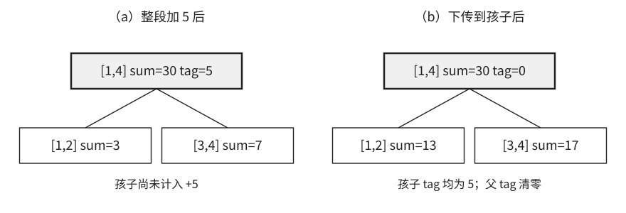

[[TOC]]

## 问题

维护数组，支持区间 $[L,R]$ 中每个数加上 $v$，以及区间求和。

逐个执行单点修改需要 $O((R-L+1)\log n)$。但一个完整节点区间中的每个数都加 $v$ 时，区间和只需增加 $v(r-l+1)$，可以直接更新，无须立即修改全部叶子。

## 懒标记

节点维护两个量：

- `tr[p]`：当前节点的区间和，已经计入直接作用于该节点的修改。
- `lazy[p]`：已经计入 `tr[p]`，但尚未传给孩子的统一增量。

完整覆盖时执行：

```cpp
tr[p] += v * (r - l + 1);
lazy[p] += v;
```

**标记表示欠孩子的更新，不是欠当前节点的更新。** 连续加 $u$、加 $v$，等价于加 $u+v$，所以标记累加。



初始数组为 $[1,2,3,4]$。整段加 $5$ 后，根的和由 $10$ 变成 $30$；两个孩子可以暂时保留旧值 $3$、$7$。

## 下传

后续操作如果完整覆盖当前节点，仍可直接使用或更新它。只有需要进入孩子时，才执行 `pushdown`：

1. 将 `lazy[p]` 分别作用到两个孩子的区间和与标记。
2. 将 `lazy[p]` 清零。

两个孩子的长度可能不同，必须按各自的 $[l,mid]$、$[mid+1,r]$ 计算增量。

::: warn
未下传时，父亲的和不一定等于两个孩子当前保存的和。此时直接 `pushup` 会丢失父亲已计入的增量。部分修改的顺序必须是：先下传，再递归，最后上推。
:::

## 修改与查询

区间修改遇到完整覆盖，直接更新节点并记录标记；否则先下传，修改相交的孩子，再 `pushup`。

区间查询遇到完整覆盖，直接返回 `tr[p]`；否则也要先下传，再查询相交的孩子。查询不改变数组，不需要重新上推：下传本身已经保持父亲的和等于两个孩子的和。

## 正确性

从根向下看，某节点保存的信息可能尚未计入祖先欠它的标记；但每次进入孩子之前，都先把当前节点的标记下传。因此**递归当前正在处理的节点，其区间和总是正确的**。

完整覆盖时按长度更新，得到正确的新区间和，并记下孩子还需接受的增量。部分覆盖时，下传先使孩子得到正确信息，递归修改后再合并得到正确父节点。查询同样只使用已补齐祖先标记的节点，所以结果正确。

## 代码

输入 `n m`、初始数组及 $m$ 次操作：`1 l r v` 表示区间加，`2 l r` 表示求和。容量 $n\le 10^5$，格式对应 [[[p: luogu-P3372 | 线段树 1]]]。

```cpp file=./range_add.cpp
```

输入：

```text
5 6
1 2 3 4 5
1 1 5 10
2 2 4
1 3 5 -2
2 1 5
2 3 3
2 5 5
```

输出：

```text
39
59
11
13
```

第一次修改只需作用于根；随后查询局部区间，才需要把根的标记向下传。

## 边界与复杂度

建树 $O(n)$，单次区间修改、查询均为 $O(\log n)$，空间 $O(n)$。完整覆盖处直接停止，只有查询或修改范围的两侧边界需要继续展开。

增量为 $0$ 时无需下传；正负增量可相互抵消。`tr`、`lazy` 与乘积均使用 `long long`，仍须保证中间运算不溢出。代码的递归在叶子完整覆盖时返回，不会继续向叶子的孩子下传。

## 练习

- [[[p: luogu-P3372 | 线段树 1]]]：区间加与区间和。
- 与 [[[rbook: bit_range_add_range_query]]] 比较：两种结构如何表达同一批区间增量？
- 把初始数组设为全负数，交替执行整段修改和单点查询，手算标记的变化。

如果操作变为“把整段改成同一个数”，标记的合并规则也必须改变，见 [[[rbook: sgt_range_assign]]]。
