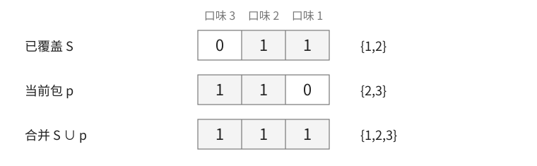
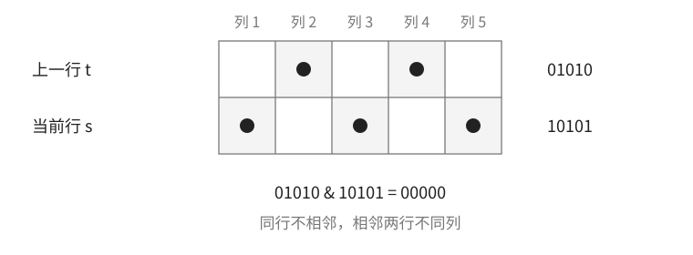
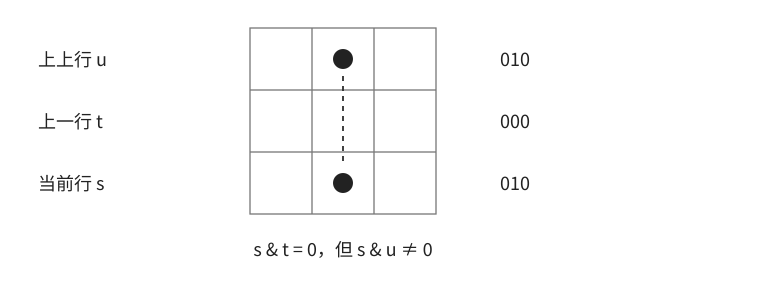

[[TOC]]

状压DP用一个整数的二进制位表示状态中的集合。它省去了显式保存集合的开销，也能通过位运算快速判断两个状态是否兼容。

对编号为 $0\sim m-1$ 的对象，第 $j$ 位为 $1$ 表示对象 $j$ 在集合中。例如 $\{0,2,3\}$ 对应二进制 `1101`。位的编号从右往左，从 $0$ 开始；详见 [[[rbook: binary-set]]]。

| 操作 | C++ 写法 |
| --- | --- |
| 判断元素 $j$ 是否存在 | `(mask & (1 << j)) != 0` |
| 加入元素 $j$ | `mask \| (1 << j)` |
| 删除元素 $j$ | `mask & ~(1 << j)` |
| 集合中的元素个数 | `__builtin_popcount((unsigned)mask)` |
| $m$ 个对象组成的全集 | `(1 << m) - 1` |

本篇使用的位数均不超过 $20$，`int` 足以保存掩码。状压DP仍需回答普通DP的核心问题：**哪些历史信息会影响后续决策？** 掩码只是一种表示方式，不保证单独一个集合就足够描述状态。

## 糖果

题目：[[[p: luogu-P8687 | 糖果]]]。

有 $N$ 包糖果、$M$ 种口味，每包给出其中的口味。求最少买几包才能尝到所有口味，无解输出 $-1$。原题 $N\le100$，$M\le20$。

枚举购买哪些包，需要考虑 $2^N$ 个选择。真正小的量是口味数 $M$：将每包含有的口味压成集合 $p_i$，相同口味出现多次也只设置一个二进制位。



定义 $f_i[S]$ 为：只从前 $i$ 包中购买，覆盖的口味集合**恰好为** $S$ 时，最少购买的包数。考虑第 $i$ 包时：

- 不买：保留 $f_{i-1}[S]$。
- 买：用 $f_{i-1}[S]+1$ 更新 $f_i[S\cup p_i]$。

买过哪些具体的包不必保留。进入第 $i+1$ 包时，两种方案若覆盖集合相同，可选的后续包也相同，购买数量较少的方案不会更差。

初值为 $f_0[0]=0$，其他状态为 $+\infty$。答案为 $f_N[2^M-1]$。例如两包分别覆盖 $\{1,2\}$、$\{2,3\}$，掩码为 `011`、`110`，购买两包后覆盖 `111`，代价为 $2$。

代码省去包数维度。因为 `nxt = mask | pack[i]` 总有 `nxt >= mask`，倒序枚举 `mask`，就不会把本包刚产生的新状态再次作为来源；`nxt == mask` 时，多买一包也不会改进原答案。

```cpp file=./candy.cpp
```

时间复杂度为 $O(N2^M)$，DP空间复杂度为 $O(2^M)$。**指数落在口味数上，而不是糖果包数上。**

完整题解：[pcs2：糖果](https://pcs2.roj.ac.cn/problems/luogu/P8687/)。

## 最短 Hamilton 路径

题目：[[[p: roj-3003 | 最短 Hamilton 路径]]]。

给定 $n\le20$ 个点的距离矩阵，从点 $0$ 出发，不重不漏地经过所有点，最后到达点 $n-1$，求最短路径长度。

只记录走过的集合不够。同样走过 $\{0,1,2\}$，最后停在 $1$ 和停在 $2$，到下一个点的距离可能不同。因此定义：

$$
f[S][u]=\text{从点 }0\text{ 出发，访问集合恰为 }S\text{，最后停在 }u\text{ 的最短距离}.
$$

状态要求 $0,u\in S$。只要集合和终点相同，剩余可走的点与下一步的代价就相同，可以只保留距离最短的历史。

初值为 $f[1][0]=0$，其他状态为 $+\infty$。从可达状态选择尚未访问的点 $v$，转移为：

$$
f[S\cup\{v\}][v]
=\min\bigl(f[S\cup\{v\}][v],\ f[S][u]+w[u][v]\bigr).
$$

任意合法路径都能去掉最后一个点，得到转移中的前驱；从前驱接上未访问的点，也不会重复访问。于是转移既不遗漏，也不引入非法路径。

加入新点后掩码严格变大，所以可以按掩码的整数值递增计算。不能从不可达状态继续加边权。答案是：

$$
f[2^n-1][n-1].
$$

固定终点时不能对最后一维取最小值，也不需要补上返回起点的距离。若改为终点不限，才取 $\min_u f[2^n-1][u]$。

时间复杂度为 $O(n^2 2^n)$，空间复杂度为 $O(n2^n)$。$n=20$ 时，完整的 `long long f[1 << 20][20]` 约占 $160\ \mathrm{MiB}$，需要结合内存限制选择存储方式，不能只检查 $2^n$ 是否可接受。

完整题解：[pcs2：最短 Hamilton 路径](https://pcs2.roj.ac.cn/problems/roj/3003/)。

## 玉米田

题目：[[[p: luogu-P1879 | 玉米田]]]。

在 $n\times m$ 的网格中种草，只能选肥沃格，且选中的格子不能上下或左右相邻。求方案数，对 $10^8$ 取模，空方案也算一种。原题 $n,m\le12$。

这里格子总数可以达到 $144$，不能压缩整张图。按行处理时，当前行只会与上一行冲突，**更早各行的具体摆法不再影响后续**，于是只压缩一行的 $m$ 个格子。

### 合法与兼容

用 $s$ 表示当前行的种植状态，$t$ 表示上一行的状态，`allow[i]` 中的 $1$ 表示第 $i$ 行的肥沃格。检查分为三项：

| 检查 | C++ 条件 | 含义 |
| --- | --- | --- |
| 行内合法 | `(s & (s << 1)) == 0` | 没有左右相邻的两个 $1$ |
| 地形允许 | `(s & allow[i]) == s` | 所有种植位置都是肥沃格 |
| 行间兼容 | `(s & t) == 0` | 同一列不能上下同时种植 |



行内合法只与掩码有关，可以预处理一次；地形限制则要逐行检查。图与代码均按最高位在左、最低位在右排列网格。

### 状态与转移

定义 $f[i][s]$ 为前 $i$ 行已种好、第 $i$ 行状态为 $s$ 的方案数。对于当前行可用的 $s$，从所有兼容的上一行状态 $t$ 累加：

$$
f[i][s]=\sum_{\substack{t\text{ 行内合法}\\s\mathbin{\&}t=0}}f[i-1][t]\pmod{10^8}.
$$

先前各行是否合法，已由上一层状态保证。每个当前方案去掉最后一行，都唯一对应一个前驱方案；反过来，兼容的两行可以接在一起，所以可以直接相加，不会重复计数。

把第 $0$ 行看作空行，令 $f[0][0]=1$，其余为 $0$。这里的 $1$ 表示“不种任何格子”这一种方案，不能初始化成 $0$。答案为 $\sum_s f[n][s]$，只取末行状态 $0$ 会漏掉末行种草的方案。

例如两行两列且全部肥沃，合法方案数为 $7$：不种 $1$ 种，种一格 $4$ 种，种两个对角格 $2$ 种。

代码按合法状态的**编号**存储，而非直接按掩码存储；第 $0$ 个合法状态就是空状态。每行开始前清空复用的数组。

```cpp file=./corn_fields.cpp
```

设单行合法状态数为 $A$，$m=12$ 时 $A=377$。预处理时间为 $O(2^m)$，DP时间为 $O(nA^2)$，滚动后的DP空间为 $O(A)$。

完整题解：[pcs2：玉米田](https://pcs2.roj.ac.cn/problems/luogu/P1879/)。

## 互不侵犯

题目：[[[p: luogu-P1896 | 互不侵犯]]]。

在 $n\times n$ 的棋盘上恰好放 $K$ 个国王，任意两王不能相互攻击。国王能攻击周围八格，原题 $n\le9$。

承接玉米田，单行仍不能有相邻的两个 $1$。相邻两行除了同列，还要检查两个斜向：

```cpp
(s & t) == 0 && ((s << 1) & t) == 0 && ((s >> 1) & t) == 0
```

上一节图中的 `01010` 与 `10101` 在玉米田中兼容，在本题中却会斜向攻击，不能同时使用。

题目要求**恰好** $K$ 个国王，还需要记录已经放了多少个。定义 $f[i][s][c]$ 为前 $i$ 行已放 $c$ 个国王、第 $i$ 行状态为 $s$ 的方案数。记 $b(s)$ 为掩码中 $1$ 的个数，则：

$$
f[i][s][c]=\sum_{t\text{ 与 }s\text{ 兼容}}f[i-1][t][c-b(s)],\qquad c\ge b(s).
$$

初值为 $f[0][0][0]=1$，其余为 $0$。答案为 $\sum_s f[n][s][K]$，而非所有数量的方案总和。$K=0$ 时，答案为 $1$；要求的数量无法摆下时，答案自然为 $0$。

例如 $3\times3$ 棋盘恰好放两个国王，有 $16$ 种合法摆法。`c` 可以区分“末行摆法相同，但此前放置数量不同”的方案，避免将它们混为一个状态。

设单行合法状态数为 $A$，按合法状态编号存储，时间复杂度为 $O(nA^2(K+1))$，滚动后的DP空间为 $O(A(K+1))$。计数使用 `long long`，本题不取模。

完整题解：[pcs2：互不侵犯](https://pcs2.roj.ac.cn/problems/luogu/P1896/)。

## 炮兵阵地

题目：[[[p: luogu-P2704 | 炮兵阵地]]]。

在 $n\times m$ 的地图上部署炮兵，山地不能放置。炮兵攻击同一行、同一列中距离为 $1$ 或 $2$ 的格子，不攻击斜向格子，求最多放多少支。原题 $n\le100$、$m\le10$。

行内状态 $s$ 必须同时满足：

```cpp
(s & (s << 1)) == 0 && (s & (s << 2)) == 0
```

地形限制为 `(s & hill[i]) == 0`，其中 `hill[i]` 的 $1$ 表示山地。保留位运算两侧的括号，避免与比较运算的优先级混淆。

纵向攻击可以跨两行，所以只保留上一行不够：即使上一行为空，当前行仍可能与上上行冲突。需要同时保留最近两行。



定义 $f[i][s][t]$ 为前 $i$ 行已部署好，第 $i$ 行状态为 $s$、第 $i-1$ 行状态为 $t$ 时的最多炮兵数。枚举第 $i-2$ 行状态 $u$，从旧状态 $f[i-1][t][u]$ 转移：

$$
f[i][s][t]=\max\bigl(f[i][s][t],\ f[i-1][t][u]+b(s)\bigr).
$$

其中 $s$ 行内合法且不压山地，旧状态可达，并满足：

$$
s\mathbin{\&}t=0,\qquad s\mathbin{\&}u=0.
$$

$t,u$ 之间的兼容性已由旧状态保证，无须重新检查。处理下一行时，将窗口从 $(t,u)$ 推进到 $(s,t)$；更早的行超出攻击距离，可以丢弃。

把第 $0,-1$ 行看作空行，初值为 $f[0][0][0]=0$，其他状态为 $-\infty$。不能将所有状态初始化成 $0$，否则会把尚未出现的行状态当作可达。滚动数组每次也要重新填为 $-\infty$，并跳过不可达的前驱。

答案为 $\max_{s,t} f[n][s][t]$。例如三行一列且全是平原，最多只能放一支：前后两行即使隔着空行，也不能同列部署。

设单行合法状态数为 $A$，$m=10$ 时 $A=60$。按合法状态编号存储，时间复杂度为 $O(nA^3)$，滚动后的DP空间为 $O(A^2)$。

完整题解：[pcs2：炮兵阵地](https://pcs2.roj.ac.cn/problems/luogu/P2704/)。
