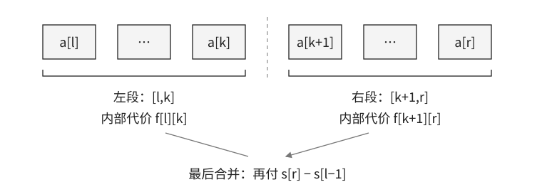
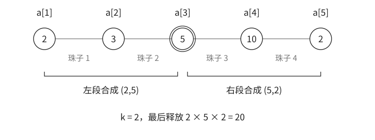
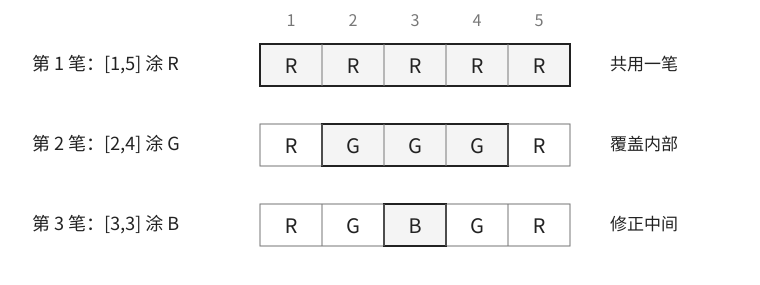

[[TOC]]

区间DP以原序列的一段连续区间 $[l,r]$ 为状态，通过更短区间的答案计算当前区间的答案。常见的决策包括分割区间、选择根节点、配对端点。

它与 [[[rbook: continuous_segment_dp]]] 的区别在于：连续段DP常维护“以当前位置结尾”的状态；本篇同时保留左右端点，研究整个区间内部如何安排。全文下标从 $1$ 开始。

## 石子合并

题目：[[[p: luogu-P1775 | 石子合并（弱化版）]]]。

一排石子，每次只能合并相邻两堆，代价为两堆石子的总质量。求合并成一堆的最小总代价。

### 最后一次合并

直接枚举每一步先合并哪两堆，会反复遇到相同的子问题。相邻合并保证：**任意时刻的一堆石子，都对应原序列的一段连续区间。**

考虑 $[l,r]$ 的最后一次合并。此时一定只剩两堆，分别来自 $[l,k]$ 和 $[k+1,r]$，其中 $l\le k<r$。



无论内部怎样合并，每段最终的质量都固定。因此，后续只需要知道每段的最小合并代价，无须保留内部操作顺序。

### 状态与转移

定义 $f[l][r]$ 为将原序列的 $[l,r]$ 合成一堆的最小代价。记 $s[i]$ 为前 $i$ 堆的质量和，则：

$$
f[l][r]=\min_{l\le k<r}\bigl(f[l][k]+f[k+1][r]+s[r]-s[l-1]\bigr).
$$

前两项是左右两段内部的合并代价，最后一项是将这两堆再合并的代价，不能省略。

任意合法方案都有一个最后分割点，左右两段的代价分别不小于对应的最优值；反过来，两段的最优方案也能接上最后一次合并。因此，枚举全部 $k$ 后取最小值，恰好得到答案。

边界为 $f[i][i]=0$：一堆石子不需要操作。非单点状态先设为 $+\infty$，答案为 $f[1][n]$。

### 计算顺序

转移依赖的两个区间都比 $[l,r]$ 短，因此按**区间长度递增**计算。不能直接把左右端点都从小到大枚举，否则所需的右半段可能尚未算出。

以 $[2,5,3,1]$ 为例：

| 长度 | 区间及其最小合并代价 |
| --- | --- |
| 1 | 所有单点均为 $0$ |
| 2 | $f[1][2]=7$，$f[2][3]=8$，$f[3][4]=4$ |
| 3 | $f[1][3]=15$，$f[2][4]=13$ |
| 4 | $f[1][4]=\min(0+13,7+4,15+0)+11=22$ |

外层枚举长度，中层枚举左端点，右端点由长度确定，内层枚举分割点。前缀和使每次区间求和为 $O(1)$。

```cpp file=./stone_merge.cpp
```

时间复杂度为 $O(n^3)$，空间复杂度为 $O(n^2)$。代码使用 `long long` 保存累计代价。

完整题解：[pcs2：石子合并（弱化版）](https://pcs2.roj.ac.cn/problems/luogu/P1775/)。非负石子质量下，最小合并代价还可以进一步使用 [[[rbook: Quadrangle_Inequality_Optimization]]]。

## 环形石子合并

题目：[[[p: luogu-P1880 | 石子合并]]]。

石子首尾相邻，要求分别求最小、最大合并代价。链上的转移仍然成立，新增的困难是环没有固定起点。

**断环成链。** 将数组复制一份，令 $a[i+n]=a[i]$。例如：

```text
下标： 1  2  3  4 │ 5  6  7  8
石子： 4  5  9  4 │ 4  5  9  4
```

任意环形合并方案的最后两堆都是原环上的连续段。在它们交界的两处中选择一处断开，此前的合并都不会跨越该处，整个方案便能在线性序列中完成。反过来，任意断开后的链上方案也都是合法的环形方案。因此，枚举断开位置不会遗漏答案。

复制后的 $[i,i+n-1]$ 表示从原来的第 $i$ 堆开始绕环一周。只需计算长度不超过 $n$ 的区间，不能让同一堆石子在一个状态中出现两次。

用 $f[l][r]$、$g[l][r]$ 分别维护最小、最大代价：

$$
\begin{aligned}
f[l][r]&=\min_{l\le k<r}\bigl(f[l][k]+f[k+1][r]\bigr)+s[r]-s[l-1],\\
g[l][r]&=\max_{l\le k<r}\bigl(g[l][k]+g[k+1][r]\bigr)+s[r]-s[l-1].
\end{aligned}
$$

两张表的单点值都为 $0$，其他状态分别以 $+\infty$、$-\infty$ 开始更新。最后分别取：

$$
\min_{1\le i\le n} f[i][i+n-1],\qquad
\max_{1\le i\le n} g[i][i+n-1].
$$

例如 $[4,5,9,4]$，固定起点为第一堆时，最小代价为 $44$；枚举全部起点后为 $43$。最大代价为 $54$。两个答案要独立取最优，不能只计算一种断开方式。

数组容量应容纳复制后的 $2n$ 个位置。时间复杂度仍为 $O(n^3)$，空间复杂度为 $O(n^2)$。

完整题解：[pcs2：环形石子合并](https://pcs2.roj.ac.cn/problems/luogu/P1880/)。

## 能量项链

题目：[[[p: luogu-P1063 | 能量项链]]]。

环上第 $i$ 颗珠子有首尾两个标记 $(a[i],a[i+1])$。两颗相邻珠子 $(x,y)$、$(y,z)$ 合并成 $(x,z)$，释放能量 $xyz$，求最大总能量。

仍然复制数组、断环成链。定义 $f[l][r]$ 为将第 $l$ 到第 $r$ 颗珠子合成一颗的最大能量。**区间表示珠子的范围，包含的边界标记却有 $r-l+2$ 个。**



不论内部按什么顺序合并，$[l,r]$ 最后生成的珠子始终为 $(a[l],a[r+1])$。若最后分割点为 $k$，左右两颗分别是：

$$
(a[l],a[k+1]),\qquad(a[k+1],a[r+1]).
$$

所以：

$$
f[l][r]=\max_{l\le k<r}\bigl(f[l][k]+f[k+1][r]+a[l]a[k+1]a[r+1]\bigr).
$$

石子合并的最后一步代价只由区间决定，这里的能量还与 $k$ 有关，不能移到 $\max$ 外面。

边界为 $f[i][i]=0$，按长度 $2\sim n$ 递推，答案为 $\max_{1\le i\le n}f[i][i+n-1]$。例如头标记为 $[2,3,5,10]$ 时，最优合并顺序为先合并原珠子 $4,1$，再依次接上 $2,3$，得到 $60+150+500=710$。

实现时，递推限制 $r<2n$。最后一个答案区间为 $[n,2n-1]$，仍需读取尾标记 $a[2n]$，应完整复制 $2n$ 个标记。乘积用 `1LL * a[l] * a[k+1] * a[r+1]` 计算，状态也使用 `long long`。

时间复杂度为 $O(n^3)$，空间复杂度为 $O(n^2)$。

完整题解：[pcs2：能量项链](https://pcs2.roj.ac.cn/problems/luogu/P1063/)。

## 加分二叉树

题目：[[[p: luogu-P1040 | 加分二叉树]]]。

给定节点分数 $a[1\ldots n]$，构造中序遍历为 $1,2,\ldots,n$ 的二叉树。非叶子树的加分为“左子树加分 $\times$ 右子树加分 $+$ 根的分数”；空树加分为 $1$，叶子加分为自身分数。求最高加分，并输出一棵最优树的前序遍历。

任意子树在中序遍历中占据连续区间。定义 $f[l][r]$ 为以 $[l,r]$ 为中序遍历的二叉树的最高加分。选择节点 $k$ 为根后，左右子树分别为 $[l,k-1]$、$[k+1,r]$：

$$
f[l][r]=\max_{l\le k\le r}\bigl(f[l][k-1]\times f[k+1][r]+a[k]\bigr),\qquad l<r.
$$

这里枚举的是**根节点**，根不属于左右子区间；石子合并枚举的是两段之间的分割位置。两者的 $k$ 范围与子区间端点不同。

节点分数为正，乘积随左右得分增大而增大，所以固定根后可以分别取左右子树的最优值。枚举全部根便覆盖所有树形。

边界必须分别处理：

$$
f[i][i-1]=1,\qquad f[i][i]=a[i].
$$

空区间需初始化 $i=1\sim n+1$。单节点不能套用一般转移，否则会得到 $1\times1+a[i]$，比题意多 $1$。递推从长度 $2$ 开始。

例如 $[5,7,1,2,10]$，选择节点 $3$ 为根，两侧最优加分都是 $12$，总分为 $12\times12+1=145$。

更新时用 `root[l][r]` 记录最优根，并令 `root[i][i]=i`。随后递归输出“根、左子树、右子树”：

```cpp
void print(int l, int r) {
    if (l > r) return;
    int k = root[l][r];
    cout << k << ' ';
    print(l, k - 1);
    print(k + 1, r);
}
```

时间复杂度为 $O(n^3)$，空间复杂度为 $O(n^2)$。原题答案可能超过有符号 `int` 的范围，使用 `long long`。

完整题解：[pcs2：加分二叉树](https://pcs2.roj.ac.cn/problems/luogu/P1040/)。

## 括号匹配

题目：[[[p: poj-2955 | Brackets]]]。

给定只含 `()`、`[]` 的字符串，求最长合法括号子序列的长度。可以删除字符，但不能改变保留字符的顺序。这里求的是子序列，不要求它在原串中连续。

定义 $f[l][r]$ 为从原串区间 $[l,r]$ 中选出的最长合法括号子序列长度。虽然选出的字符可以不连续，**子问题的可选范围仍是连续区间**。

转移包含两种构造：

- **拼接**：枚举 $l\le k<r$，用 $f[l][k]+f[k+1][r]$ 更新。
- **包裹**：若 $s[l],s[r]$ 依次为 `(`、`)` 或 `[`、`]`，还可用 $f[l+1][r-1]+2$ 更新。

边界为单字符与空区间的值均为 $0$。计算每个非单点区间时先置 $0$，再按长度递增更新，答案为 $f[1][n]$。

完整性可分三种情况理解：最优子序列没有选某个端点时，可以在该端点旁分割，将它交给值为 $0$ 的单点区间；若两个端点都选且互相配对，就由包裹转移得到；若都选却分别属于不同的合法块，则在块之间分割即可。反过来，拼接与包裹都保持合法性。

例如 `([)]` 只能保留 `()` 或 `[]`，长度为 $2$。两对括号的配对范围交叉，不能同时保留。`([])` 则可以由 `[]` 向外包裹，得到长度 $4$。只统计每种左右括号的数量不能保证正确匹配。

时间复杂度为 $O(n^3)$，空间复杂度为 $O(n^2)$。

完整题解：待补（POJ 2955，最长合法括号子序列）。

## 涂色

题目：[[[p: luogu-P4170 | 涂色]]]。

一条空白纸条，每次可以把任意连续区间涂成同一种颜色，后涂覆盖先涂。给定目标颜色串，求最少操作次数。

例如 `RGBGR` 可以分三次完成。先涂整个区间，再覆盖内部，并不需要按目标颜色的连续段逐段涂色。



定义 $f[l][r]$ 为从空白状态涂出目标子串 $s[l\ldots r]$ 的最少次数。边界为单点值 $1$、空区间值 $0$。

先让最左端单独涂一笔，得到一个可行上界：

$$
f[l][r]=1+f[l+1][r].
$$

如果右侧某个位置 $k$ 与 $l$ 同色，可以让它们共用一笔。先执行 $[k,r]$ 的涂色方案，将最后确定位置 $k$ 颜色的那一笔向左延长到 $l$；再涂中间的 $[l+1,k-1]$，修正被覆盖的位置。因此还可更新：

$$
f[l][r]=\min\bigl(f[l][r],\ f[l+1][k-1]+f[k][r]\bigr),
\qquad l<k\le r,\ s[l]=s[k].
$$

共用的那一笔已计入 $f[k][r]$，不能再加 $1$。中间区间允许覆盖为任意目标颜色，不要求它与两端同色。

这也覆盖了最优方案：考察最后涂到 $l$ 的那一笔。若它只在 $l$ 留下最终颜色，可以将它缩为单点；否则取右侧最近的、由同一笔留下最终颜色的位置 $k$。中间每个位置都需要在这笔之后重新涂色，这些后续操作不能再碰 $l,k$，于是可以独立处理 $[l+1,k-1]$，剩下的操作处理 $[k,r]$。

例如 `RGBGR` 取 $k=5$，两端的 `R` 共用一笔，中间 `GBG` 需要两笔，总代价为 $f[2][4]+f[5][5]=2+1=3$。

按长度递增计算，答案为 $f[1][n]$。时间复杂度为 $O(n^3)$，空间复杂度为 $O(n^2)$。

完整题解：[pcs2：涂色](https://pcs2.roj.ac.cn/problems/luogu/P4170/)。
