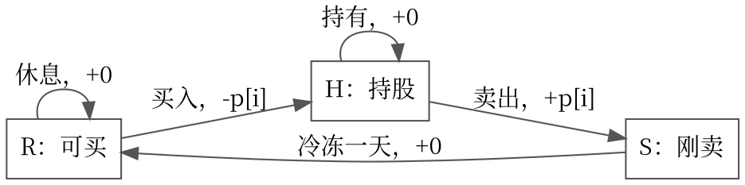

[[TOC]]

## 连续段DP进一步

在 [[[rbook: continuous_segment_dp]]] 中，我们学习了“必须以当前位置结尾”的状态。这个限制保留了连续段与扫描边界的关系，因此可以判断新元素能否接上。

先看最大连续子段和。本文数组下标从 $1$ 开始，定义 $f[i]$ 为**非空且必须以 $i$ 结尾**的最大子段和。处理 $a_i$ 时，只有两种选择：让它单独成段，或者接在上一段后面。

$$
f[i]=\max\bigl(a_i,f[i-1]+a_i\bigr).
$$

这就是 Kadane 算法。初始化 $f[1]=a_1$；非空子段的答案为 $\max_{1\le i\le n}f[i]$。若题目允许空子段，再与 $0$ 取最大值。

现在增加一条规则：**可以选择至多一个连续区间，把其中的元素都乘以 $x$。**

扫描到同一个位置，两个候选子段即使当前和相同，也可能拥有不同的未来：一个还没开始乘，另一个已经乘完。下一步能否把元素乘以 $x$，不能只看当前和。

例如 $x=-1$，下一项是 $-10$：尚未使用操作的方案可以从这里开始乘，增加 $10$；已经结束操作的方案只能增加 $-10$。把这两类方案混成一个最优值，就丢失了影响未来决策的信息。

我们需要在位置之外，再记录一个很小的身份：

> 扫描到了哪里，以及到这里为止，哪些动作仍然合法？

当这些身份只有有限几种，并能明确列出它们之间的合法转移时，就可以用**有限状态机 DP**来组织计算。

::: note 第二维的含义由题目决定
背包中的容量也是离散状态。这里强调的是第二维只有少量模式，例如“选 / 不选”“操作前 / 操作中 / 操作后”。状态机 DP 是一种建模方法，并不要求代码一定写成二维数组；有时它也能化简为一维递推。
:::

## 选与不选

### 相邻不能同时选

给定非负整数数组 $a_1,a_2,\ldots,a_n$，选择若干个元素，使选出的元素两两不相邻，求最大总和。允许一个都不选。这也是打家劫舍的基本模型。

处理完第 $i$ 个位置后，决定下一项能不能选的，是**第 $i$ 项有没有选**。

因此将方案分成两类：

| 状态 | 准确含义 | 下一项能否选择 |
|---|---|---|
| $dp[i][0]$ | 前 $i$ 项中，第 $i$ 项不选的最大总和 | 可以 |
| $dp[i][1]$ | 前 $i$ 项中，第 $i$ 项选择的最大总和 | 不可以 |

### 转移图

图中的一条边表示：从处理完第 $i-1$ 项的身份，走到处理完第 $i$ 项的身份。边上写本次决策及增加的收益。


缺少 $1\to1$，正是“相邻不能同时选”。图已经把题目的限制写清楚了。

### 转移方程

要得到“不选第 $i$ 项”的方案，上一项选或不选都可以；要得到“选择第 $i$ 项”的方案，上一项只能不选。

$$
\begin{aligned}
dp[i][0]&=\max\bigl(dp[i-1][0],dp[i-1][1]\bigr),\\
dp[i][1]&=dp[i-1][0]+a_i.
\end{aligned}
$$

初始化为 $dp[0][0]=0$、$dp[0][1]=-\infty$。前者表示还没选任何元素，收益为 $0$；后者表示尚未处理元素时，不存在“当前项已选”的方案。这里的 $-\infty$ 表示**不可达**。

答案为 $\max(dp[n][0],dp[n][1])$。它们已经覆盖前 $n$ 项的所有合法方案，不需要再枚举结尾。

以 `[2, 7, 9, 3, 1]` 为例：

| 已处理项数 $i$ | 当前值 | 不选 $dp[i][0]$ | 选择 $dp[i][1]$ |
|---|---|---|---|
| 0 | — | 0 | $-\infty$ |
| 1 | 2 | 0 | 2 |
| 2 | 7 | 2 | 7 |
| 3 | 9 | 7 | 11 |
| 4 | 3 | 11 | 10 |
| 5 | 1 | 11 | 12 |

答案为 $12$，选择的是 $2,9,1$。

### 同状态取最优

考虑处理完同一个位置、并且都“不选当前项”的两个方案。如果收益分别为 $7$ 和 $11$，它们接下来允许的选择完全一样。无论接上哪种合法的后续选择，收益为 $11$ 的方案都不会更差，所以只保留 $11$。

反过来，“选当前项”和“不选当前项”允许的下一步不同，就不能这样直接合并。

这给出了状态设计的判断依据：**同一状态中的历史，应当具有相同的后续选择；在此基础上，才可以只保留最优值。**

::: note 这道题也可以用一维 DP
如果定义 $g[i]$ 为前 $i$ 项的最大总和，按“第 $i$ 项是否选择”分类，同样可以得到 $g[i]=\max(g[i-1],g[i-2]+a_i)$，其中 $g[0]=0$、$g[1]=a_1$。这里选择二维写法，是为了把合法身份和转移边直接展示出来。不能把“一维写法一定信息不足”当作增加状态维度的理由。
:::

核心实现如下，假设数组 `a` 已经读入，且引入了 C++ 标准库：

```cpp
long long skip = 0;
long long take = -(1LL << 60);
for (long long value : a) {
    long long next_skip = max(skip, take);
    long long next_take = skip + value;
    skip = next_skip;
    take = next_take;
}
cout << max(skip, take) << '\n';
```

每次先算下一层，再覆盖上一层。时间复杂度为 $O(n)$，额外空间为 $O(1)$。

## 单向三阶段

### CF1155D：区间乘法

题目：[Codeforces 1155D · Beautiful Array](https://codeforces.com/problemset/problem/1155/D)。

给定数组 $a$ 和整数 $x$，可以进行**至多一次**操作：选择一个连续区间，将其中每个数乘以 $x$。操作后，求数组的最大连续子段和；答案子段允许为空，空子段的和为 $0$。

数据范围为 $n\le 3\cdot10^5$、$|a_i|\le10^9$、$|x|\le100$。这里“乘以 $x$”不改变元素顺序；$x=-1$ 时才是整段取相反数，不能与倒序翻转混淆。

### 贪心的反例

当 $x<0$ 时，一个自然的想法是：先找出原数组中和最小的连续子段，把它乘以 $x$，再求一次最大子段和。被乘的部分变得尽可能大，最终答案是否也就最大？

看数组 `[-5, 2, 2, -5]`，令 $x=-2$：

| 操作区间 | 操作前该区间的和 | 操作后的数组 | 最大子段和 |
|---|---|---|---|
| 整个数组 | -6，是全局最小子段和 | `[10, -4, -4, 10]` | 12 |
| 只选第一个元素 | -5 | `[10, 2, 2, -5]` | 14 |

选择全局最小子段，反而不如只操作第一个元素。原因是：把两个正数也一起乘成负数，会损失它们对答案的贡献；只把左端的 $-5$ 变为 $10$，就能与后面的两个 $2$ 连成和为 $14$ 的子段。

**操作区间自身的和最小，不代表操作后的最大子段和最大。**我们要一起考虑被乘的部分，以及它能与左右哪些普通元素组成连续子段，不能先独立决定操作区间。

### 区间简化

原问题中有两个区间：操作区间 $I$，以及最终取来计算最大子段和的区间 $J$。

枚举它们的端点代价很高。先固定一个最终答案区间 $J$，看看 $I$ 的哪些部分真的影响它。

只有交集 $I\cap J$ 会改变 $J$ 的和。两个连续区间的交集仍是连续区间，也可能为空。因此：

- 如果交集非空，可以把操作区间缩成这个交集，$J$ 的和不变。
- 如果交集为空，$J$ 的和与不操作时相同；原题允许不操作。

所以我们只需研究：**在一个候选答案子段内部，至多有一个连续部分被乘以 $x$。**这个简化依赖“至多一次”，以及区间外的变化不影响区间内的和。

沿着这个答案子段从左向右看，它只能长成：

```text
       操作前             操作中             操作后
    原值，允许为空    乘 x，使用时非空     原值，允许为空
       0 0 0           1 1 1              2 2 2
```

阶段可以停留，也可以从 $0$ 进入 $1$，从 $1$ 进入 $2$。一旦离开阶段 $1$，就不能回来，否则会出现两个分离的操作区间。

### 状态定义

定义 $dp[i][s]$ 为**非空、必须以 $i$ 结尾**，且处于阶段 $s$ 的最大子段和：

| 阶段 | 准确含义 | 当前位置的贡献 |
|---|---|---|
| 0 | 子段内还没有使用操作 | $a_i$ |
| 1 | 操作已经开始，且当前位置仍在操作区间内 | $x a_i$ |
| 2 | 操作已经结束，当前位置在操作区间之后 | $a_i$ |

特别注意：阶段 $2$ 的当前位置不属于操作区间。若操作恰好结束在 $i$，当前仍记为阶段 $1$；等下一个普通元素接上，才进入阶段 $2$。


图展示的是相邻两层之间的转移。**每走一条边，恰好处理一个新元素。**此外，子段可以从任意位置开始，因此还要单独处理“在当前位置新开子段”的情况。

### 转移方程

**阶段 0：当前位置保持原值。**可以新开子段，也可以延续尚未使用操作的子段：

$$
dp[i][0]=\max\bigl(a_i,dp[i-1][0]+a_i\bigr).
$$

**阶段 1：当前位置乘以 x。**有三种来源：从当前位置新开一个已经开始乘的子段；在此前的普通子段后开始乘；继续乘。

$$
dp[i][1]=\max\bigl(xa_i,dp[i-1][0]+xa_i,dp[i-1][1]+xa_i\bigr).
$$

**阶段 2：当前位置恢复原值。**可以刚离开操作区间，也可以继续延长操作后的普通部分：

$$
dp[i][2]=\max\bigl(dp[i-1][1]+a_i,dp[i-1][2]+a_i\bigr).
$$

为什么阶段 $2$ 没有单独的 $a_i$？因为新开的单元素子段里还没有发生操作，应该归入阶段 $0$；如果它本身被乘，则归入阶段 $1$。

同样，不需要 $0\to2$ 的边。还没使用操作的子段继续按阶段 $0$ 计算即可。

### 初值与答案

三个状态都描述非空子段，因此在尚未处理元素时：

$$
dp[0][0]=dp[0][1]=dp[0][2]=-\infty.
$$

新开子段的情况已经由方程中的 $a_i$、$xa_i$ 负责。这样，阶段 $1$ 保证至少乘过一个元素，阶段 $2$ 保证已经有一个非空操作段。

最终答案是：

$$
\max\left(0,\max_{1\le i\le n}\max_{s\in\{0,1,2\}}dp[i][s]\right).
$$

这里的三个范围各有作用：

- 对结尾 $i$ 取最大值：答案不一定在数组最后结束。
- 对三个阶段取最大值：可以不操作，也可以在操作段结束时直接结束答案子段。
- 与 $0$ 取最大值：题目允许空子段。

::: fold 变体：如果要求必须操作一次呢？
如果变体要求“答案子段内必须有一个非空操作段”，就不能接受阶段 $0$；若还要求答案非空，也不能直接用 $0$ 兜底。但如果只是要求在整个数组中操作一次，操作段可能位于答案子段之外，不能直接套用这个修改。先分清要求的是哪个区间。
:::

### 手算示例

取数组 `[4, -3, -2, 5]`，令 $x=-1$。

| $i$ | $a_i$ | 操作前 $dp[i][0]$ | 操作中 $dp[i][1]$ | 操作后 $dp[i][2]$ | 扫描至此的答案 |
|---|---|---|---|---|---|
| 1 | 4 | 4 | -4 | $-\infty$ | 4 |
| 2 | -3 | 1 | 7 | -7 | 7 |
| 3 | -2 | -1 | 9 | 5 | 9 |
| 4 | 5 | 5 | 4 | 14 | 14 |

得到 $14$ 的路线是：第一项在阶段 $0$，第二项进入阶段 $1$，第三项停留在阶段 $1$，第四项进入阶段 $2$。

对应的操作是把 `[-3, -2]` 乘以 $-1$，数组变为 `[4, 3, 2, 5]`。

在最后一行，阶段 $0$ 只有 $5$，阶段 $2$ 却有 $14$。更大的收益属于已经用完操作的方案，不能拿它去启动第二个操作段；这也是三个状态不能直接合并的原因。

### 正确性证明

一方面，任何合法答案子段，其被乘的部分至多一段，都能按顺序标记成 $0^*1^*2^*$；使用操作时，阶段 $1$ 非空。按上述转移走，就能算出这个方案的和。完全不操作的方案只经过阶段 $0$。

另一方面，转移图不允许阶段倒退，因此任意一条从新开子段开始的合法路线，都只会包含至多一段连续的阶段 $1$，对应一个合法操作。

在同一位置、同一阶段下，后续允许的阶段转移相同，后续增加的数值也相同。因此只保留当前和最大的方案，不会损失最优答案。

这分别检查了**不会漏解、不会制造非法解，以及合并历史是否安全**。

### 代码实现

每一层只依赖上一层的三个值，可以滚动保存。下面显式保留不可达标记，避免对不可达状态加权后把它误当作合法值。

```cpp
#include <bits/stdc++.h>
using namespace std;

int main() {
    ios::sync_with_stdio(false);
    cin.tie(nullptr);

    int n;
    long long x;
    cin >> n >> x;

    const long long NEG = -(1LL << 60);
    auto extend = [NEG](long long value, long long weight) {
        return value == NEG ? NEG : value + weight;
    };

    long long before = NEG, inside = NEG, after = NEG;
    long long ans = 0;
    for (int i = 1; i <= n; i++) {
        long long a;
        cin >> a;
        long long multiplied = a * x;

        long long next_before = max(a, extend(before, a));
        long long next_inside = max({multiplied,
            extend(before, multiplied), extend(inside, multiplied)});
        long long next_after = max(extend(inside, a), extend(after, a));

        before = next_before;
        inside = next_inside;
        after = next_after;
        ans = max({ans, before, inside, after});
    }

    cout << ans << '\n';
    return 0;
}
```

时间复杂度为 $O(n)$，额外空间为 $O(1)$。绝对值上界可用 $n\max(1,|x|)\max|a_i|\le3\cdot10^{16}$ 估计，因此乘法、中间状态和答案都使用 `long long`；`NEG` 也小于所有合法状态。

## 循环状态

### 股票冷冻期

设第 $i$ 天的价格为 $p_i$。允许多次交易，但同一时间最多持有一股；每天至多买入或卖出一次。卖出后的下一天不能买入，称为一天冷冻期。开始时不持有股票，收益为 $0$，求最大收益。

与一次区间操作不同，买入和卖出可以重复发生。状态图需要允许回到先前的身份。

处理完第 $i$ 天后，分成三个状态：

| 状态 | 含义 | 第 $i+1$ 天能否买入 |
|---|---|---|
| $R$：可买 | 不持股，而且今天没有卖出 | 可以 |
| $H$：持股 | 手里持有一股 | 不可以 |
| $S$：刚卖 | 今天卖出，已经不持股 | 不可以，明天须冷冻 |

这里的“可买”指**明天允许买入**。例如今天恰好是卖出后的冷冻日，整天休息后，收盘时就进入 $R$。



缺少 $S\to H$，表示不能在卖出后的下一天立即买入。

### 转移方程

令 $R_i,H_i,S_i$ 分别表示处理完第 $i$ 天、处于对应状态的最大累计收益。买入时扣除价格，卖出时增加价格；持股状态的收益可以是负数，因为买入的钱已经付出。

$$
\begin{aligned}
R_i&=\max(R_{i-1},S_{i-1}),\\
H_i&=\max(H_{i-1},R_{i-1}-p_i),\\
S_i&=H_{i-1}+p_i.
\end{aligned}
$$

初始化为 $R_0=0$、$H_0=S_0=-\infty$。最终只接受不持股状态，答案是 $\max(R_n,S_n)$，不把 $H_n$ 算作完成交易后的收益。

以价格 `[1, 2, 3, 0, 2]` 为例：

| 天数 $i$ | 价格 | 可买 $R_i$ | 持股 $H_i$ | 刚卖 $S_i$ |
|---|---|---|---|---|
| 0 | — | 0 | $-\infty$ | $-\infty$ |
| 1 | 1 | 0 | -1 | $-\infty$ |
| 2 | 2 | 0 | -1 | 1 |
| 3 | 3 | 1 | -1 | 2 |
| 4 | 0 | 2 | 1 | -1 |
| 5 | 2 | 2 | 1 | 3 |

答案为 $3$：第一天买入，第二天卖出，第三天冷冻，第四天买入，第五天卖出。

核心实现如下，假设 `prices` 已保存价格，且总收益在 `long long` 范围内：

```cpp
const long long NEG = -(1LL << 60);
long long ready = 0, hold = NEG, sold = NEG;
for (long long price : prices) {
    long long next_ready = max(ready, sold);
    long long next_hold = max(hold, ready - price);
    long long next_sold = (hold == NEG ? NEG : hold + price);
    ready = next_ready;
    hold = next_hold;
    sold = next_sold;
}
cout << max(ready, sold) << '\n';
```

同样只需 $O(n)$ 时间和 $O(1)$ 额外空间。

### 按时间分层

图上存在 $R\to H\to S\to R$ 的环，但每次转移都从第 $i-1$ 天走到第 $i$ 天。

真正计算的节点是 $(i,s)$，而不只是身份 $s$。按天展开后，所有边都指向下一层，不可能沿边回到之前的某一天，所以仍然可以按时间顺序计算。

这也解释了为什么不能在同一天反复沿图走。若先覆盖 `ready`，再用它更新 `hold`，就可能把“今天刚完成冷冻、明天才能用”的资格提前给今天使用。先保存全部下一层状态，才能保证一天只走一条边。

## 状态设计

先看限制让哪些历史产生了不同的未来。本节的三个模型可以这样对照：

| 题目中的限制 | 影响下一步的历史 | 可以尝试的身份划分 |
|---|---|---|
| 相邻元素不能同时选 | 上一项是否选择 | 选 / 不选 |
| 至多操作一个连续区间 | 操作是否开始、是否结束 | 操作前 / 操作中 / 操作后 |
| 卖出后必须冷冻一天 | 是否持股、今天是否刚卖出 | 可买 / 持股 / 刚卖 |

这些是建模线索。它们帮助我们找到应该记住什么，但不能代替对状态充分性和转移正确性的检查。

面对新题，可以按下面的顺序设计，而不是先给几个数字编号。

1. **确定一步处理什么。**是一个数组元素、一天，还是一个字符？先说清楚状态是在处理这一步之前还是之后。
2. **找影响未来的历史。**下一步是否合法，依赖上一项是否选择、操作是否结束，还是距离上次动作过去多久？
3. **给每个身份写完整含义。**“已操作”可能同时包含“正在操作”和“已经结束”，二者允许的未来不同，需要分开。
4. **列出合法边和本步贡献。**逐条核对题目限制，再按目标状态收集入边，写成 `max`、`min` 或求和。
5. **单独处理起点和终点。**哪些状态一开始可达？哪里可以新开方案？最后允许停在哪些状态？是否接受空方案？
6. **检查能否安全合并历史。**同一位置、同一身份的两条历史，是否真的拥有相同的后续选择？还有遗漏的次数、容量或约束吗？

若每层有 $k$ 个状态、$m$ 条合法转移边，逐层检查所有状态和边的时间通常为 $O(n(k+m))$。本节的 $k,m$ 都是常数，因此总时间为 $O(n)$。有限状态机本身不保证状态数少；若还要记录交易次数、剩余容量等信息，需要把它们纳入状态，再分析复杂度。

## 思考练习

### 练习一：阶段倒退

在区间乘 $x$ 的问题中，如果增加一条 $2\to1$ 的边，会算进什么非法方案？尝试数组 `[1, -10, 1, -10, 1]`，令 $x=-1$。

::: fold 参考分析
新增的边允许“乘一段，停下来，再乘一段”。上例若只把两个 $-10$ 分别取反，会得到 $23$，但它使用了两段操作。原题只能选择一个连续区间，真正的最优答案是 $21$：把中间的 `[-10, 1, -10]` 整段取反。禁止 $2\to1$ 正是保证操作段连续且至多一个。
:::

### 练习二：省略冷冻期

价格为 `[1, 2, 0, 2]`。如果把“刚卖”和“可买”合成一个不持股状态，并允许次日直接买入，会得到多少收益？合法答案又是多少？

::: fold 参考分析
错误模型会在第一天买、第二天卖、第三天买、第四天卖，得到 $3$。但第二天卖出后，第三天必须冷冻。合法最优收益为 $2$：第三天买入、第四天卖出。两个不持股身份对明天的限制不同，不能直接合并。
:::

### 练习三：冷冻两天

如果卖出后连续两天不能买入，原来的三个状态还够用吗？

::: fold 参考分析
需要区分距离卖出日还要等待多久。可以保留 $R$、$H$，并增加“今天刚卖出”的 $S$ 和“完成第一个冷冻日”的 $C$。路径为 $H\to S\to C\to R$，每条边消耗一天；到达 $R$ 后，下一天才能通过 $R\to H$ 买入。最终接受所有不持股状态，包括尚未完成冷冻的 $S,C$，因为停止交易不要求先等完冷冻期。
:::

## 推荐练习

### 选与不选及其扩展

- [[[p: leetcodecn-213 | 打家劫舍 II]]]
- [[[p: leetcodecn-740 | 删除并获得点数]]]
- [[[p: luogu-P1352 | 没有上司的舞会]]]
- [[[p: roj-1301 | 大盗阿福]]]

### 单向多阶段

- [[[p: codeforces-1373D | Maximum Sum on Even Positions]]]
- [[[p: leetcodecn-188 | 买卖股票的最佳时机 IV]]]

### 循环流转与限制

- [[[p: leetcodecn-309 | 买卖股票的最佳时机含冷冻期]]]
- [[[p: luogu-P1968 | 美元汇率]]]
- [[[p: roj-3612 | 花匠]]]
- [[[p: luogu-P2627 | 修剪草坪]]]

### 状态机进阶

- [[[p: shumeng-CSP201312D | 有趣的数]]]
- [[[p: roj-3632 | 子串]]]
- [[[p: luogu-P3193 | [HNOI2008] GT考试]]]
