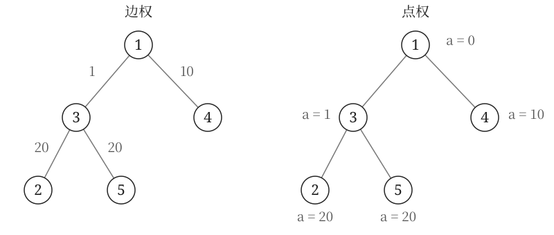

[[TOC]]

## 题意

题目：[[[p: luogu-P2015 | 二叉苹果树]]]。

一棵以 $1$ 为根的二叉树，每条边上有一定数量的苹果。要求恰好保留 $Q$ 条边，保留下来的部分必须与根连通，求最多能保留多少苹果。

原题中 $1\le Q<N\le100$，每条边上的苹果数不超过 $30000$。

不能直接挑最大的 $Q$ 个边权。保留一条深处的边，必须同时保留根到它的路径。**选择某个孩子子树中的内容，需要先接通通向这个孩子的边。**

## 边权转点权

沿用旧文的处理方法：将每条边的权值转移到它的孩子节点上。记转移后的点权为 $a_u$，根的点权为 $0$。



连通的树中，边数比点数少 $1$。因此，保留包含根的 $Q$ 条边，等价于选择**包含根的 $Q+1$ 个连通节点**。每个非根节点恰好对应一条保留的父边，点权之和就是苹果总数。

::: definition 含根连通点集
在以 $1$ 为根、点权为 $a_u$ 的树 $T=(V,E)$ 中，选出点集 $S\subseteq V$，满足：

1. 包含根节点：$1\in S$；
2. 节点数恰好为 $Q+1$：$|S|=Q+1$；
3. 点集连通：$\forall u\in S\setminus\{1\}$，其父节点也属于 $S$。

本题要求最大化所选点集的点权之和 $\sum_{u\in S} a_u$。
:::

## 状态定义

沿用“小朋友法”：想象你站在当前节点 $root$ 上，手头共有 $j$ 个节点名额（必须先分 $1$ 个给 $root$ 自己，剩余 $j-1$ 个分给各个孩子）。如果 $root$ 只向每个孩子 $v$ 问一个问题：“你的子树最多能保留多少苹果？”——这会直接卡住：孩子报上来的方案可能用了太多名额，或者各个孩子加起来超出了 $j-1$ 的限制，$root$ 根本无法按剩余名额做分配。

因此，$root$ 必须按“分配的名额数 $k$”向每个孩子 $v$ 逐一提问：

- **“如果分给你 $k$ 个名额（$k=0,1,\dots,Q+1$），在你的子树里恰好选 $k$ 个节点（$k\ge 1$ 时必须包含你且连通），最多能保留多少苹果？”**

把视角落回任意节点 $u$，就得到状态 $f[u][j]$：在 $u$ 的子树中恰好选择 $j$ 个节点，所选部分连通且包含 $u$ 时，最大的点权和。

另外规定 $f[u][0]=0$，专门表示整棵子树都不取（分到 $0$ 个名额，不要求包含 $u$）。

初始只处理 $u$ 自己：

$$
f[u][0]=0,\qquad f[u][1]=a_u.
$$

其他状态为 $-\infty$，表示当前无法选择这么多个节点。题目要求恰好选择，不能把所有状态初始化为 $0$，否则会混入数量不足的方案。

## 分配名额

如果 $u$ 的左右孩子是 $l,r$，选择 $j\ge1$ 个节点时，先给 $u$ 自己一个名额，再分配剩余的 $j-1$ 个：

$$
f[u][j]=a_u+\max_{x+y=j-1}\bigl(f[l][x]+f[r][y]\bigr).
$$

这里必须检查 $x,y$ 是否可行。某个孩子分到 $0$ 个名额，表示整个孩子子树都不取；正数名额对应的方案必须包含孩子节点。

不同孩子如何分配名额，会影响最终收益。这就是**树形背包**：不再只给每个孩子取一个最优值，而是保留各个选择数量下的最优值，再枚举数量分配。

## 逐个合并

代码不必专门存左右孩子，可以将孩子逐个合并。这种写法也适用于孩子数量不限的树。

合并孩子 $v$ 前，$f[u][a]$ 表示从 $u$ 和之前处理过的孩子中选择 $a$ 个节点的最优值。当前孩子子树中选择 $b$ 个节点，转移为：

$$
next[a+b]=\max\bigl(next[a+b],f[u][a]+f[v][b]\bigr).
$$

枚举时要求 $a\ge1$、$b\ge0$、$a+b\le Q+1$。其中 $a\ge1$ 保证 $u$ 已选；若 $b>0$，孩子 $v$ 也已选，两个连通部分通过边 $(u,v)$ 接通。

每个孩子都用一份清空后的 `next` 数组接收结果，合并完成再覆盖 $f[u]$。这使每棵孩子子树只参与一次，不会把同一份内容重复选入。

用 $sz[u]$ 记录已经合并的部分有多少节点，$sz[v]$ 记录当前孩子子树的大小，将枚举限制为：

$$
1\le a\le\min(sz[u],Q+1),\qquad
0\le b\le\min(sz[v],Q+1-a).
$$

`sz[u]` 要在合并完成后增加，不能提前把当前孩子算入旧状态的规模。

## 手算示例

图中的树包含边 $(1,3,1)$、$(1,4,10)$、$(3,2,20)$、$(3,5,20)$，每组三个数分别表示两端点和边权。以下取 $Q=2$，即恰好保留 $3$ 个节点。

| 子树根 | $f[u][0]$ | $f[u][1]$ | $f[u][2]$ | $f[u][3]$ |
| --- | --- | --- | --- | --- |
| 2 | 0 | 20 | $-\infty$ | $-\infty$ |
| 5 | 0 | 20 | $-\infty$ | $-\infty$ |
| 3 | 0 | 1 | 21 | 41 |
| 4 | 0 | 10 | $-\infty$ | $-\infty$ |
| 1 | 0 | 0 | 10 | 21 |

根选择 $3$ 个节点，剩余两个名额有两种有效分配：

- 全部分给节点 $3$ 的子树，得到 $0+21=21$。
- 两棵孩子子树各分一个，得到 $0+1+10=11$。

所以答案为 $21$，保留边 $(1,3)$ 与 $(3,2)$，也可以把后一条换成 $(3,5)$。

虽然 $f[3][3]=41$ 更大，但再加上根就需要 $4$ 个节点，超过本题名额。不能直接拿孩子子树的最大值作为答案。

## 正确性

考虑一次孩子合并。任意合法的非空选择，限制在旧部分和当前孩子子树后，分别得到大小为 $a,b$ 的方案。旧部分包含 $u$；当前孩子子树若非空，就必须包含 $v$，所以转移枚举覆盖了所有可能的拆分。

反过来，任意两个满足条件的子方案，都能通过父子边接成一个合法连通方案，数量和收益分别相加。按选择总数取最大值，就得到合并后的最优状态。

逐个合并全部孩子后，$f[u]$ 符合定义。最终根的答案为 $f[1][Q+1]$。

## 代码实现

`dfs(u, fa, value)` 中的 `value` 是父边转移到 $u$ 上的权值。对子树合并时不再额外加边权，避免重复计算。根调用时传入 $0$。

```cpp file=./binary_apple_tree.cpp
```

按每次合并枚举两个数量，可先得到时间上界 $O(nQ^2)$，空间复杂度为 $O(nQ)$。原题规模下已经足够；子树大小限制还能给出更紧的时间界，下一篇《选课》会单独分析。

苹果总数不超过 $99\times30000$，使用 `int` 即可。代码在相加前检查不可行状态。
