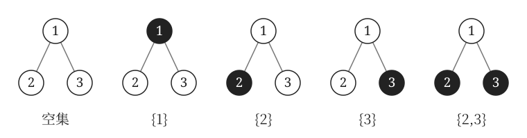

[[TOC]]

## 题意

例题：[[[p: atcoder-dp_p | Independent Set]]]。

给定一棵树，将每个节点染成白色或黑色，要求相邻节点不能同时为黑色。求合法染色方案数，对 $10^9+7$ 取模。原题中 $1\le n\le10^5$。

把黑色看作选择、白色看作不选，限制与 [[[rbook: tree_dp_party]]] 相同。区别是：舞会求最大收益，本题统计**所有合法方案**，包括所有节点都不选的方案。

## 状态定义

定义：

| 状态 | 含义 |
| --- | --- |
| $f[u][0]$ | $u$ 为白色时，$u$ 子树内的合法染色方案数 |
| $f[u][1]$ | $u$ 为黑色时，$u$ 子树内的合法染色方案数 |

状态仍需保留根的颜色，因为它决定父节点能否染黑。同一状态中的不同合法染色都要计入，不能像最优化问题那样只保留收益最大的方案。

## 加法与乘法

### 同一孩子相加

若 $u$ 为白色，孩子 $v$ 可以为白色或黑色。这两类染色互不重叠，因此孩子子树共有：

$$
f[v][0]+f[v][1]
$$

种选择。

若 $u$ 为黑色，孩子只能为白色，只有 $f[v][0]$ 种选择。

### 不同孩子相乘

确定 $u$ 的颜色后，各棵孩子子树之间没有边，染色可以任意组合。例如一棵孩子子树有 $2$ 种合法染色，另一棵有 $3$ 种，合起来是 $2\times3=6$ 种，而不是 $2+3=5$ 种。

所以，记 $C(u)$ 为孩子集合，有：

$$
\begin{aligned}
f[u][0]&=\prod_{v\in C(u)}\bigl(f[v][0]+f[v][1]\bigr),\\
f[u][1]&=\prod_{v\in C(u)}f[v][0].
\end{aligned}
$$

**加法合并同一子问题的互斥选择，乘法组合不同子问题的独立方案。** 不能把舞会公式里的每个 `max` 都换成加法，却仍然把不同孩子的贡献相加。

## 初值与答案

叶子没有孩子。固定它为白色或黑色后，都恰好有一种染色：

$$
f[u][0]=f[u][1]=1.
$$

因此在合并孩子前，两个状态都初始化为 $1$，随后逐个相乘。没有孩子时，空乘积为 $1$；若初始化为 $0$，之后无论乘什么都会变成 $0$。

根为白色与根为黑色是互斥的两类完整方案，答案为：

$$
\bigl(f[root][0]+f[root][1]\bigr)\bmod(10^9+7).
$$

注意区分：空集是一种合法方案，方案数为 $1$；不存在合法方案时，方案数才是 $0$。当 $n=1$ 时，两种颜色都合法，答案为 $2$。

## 手算示例

以下是自拟示例。节点 $1$ 连接两个叶子 $2,3$，黑色表示选择，共有下面五种方案：



| 节点 | 白色 $f[u][0]$ | 黑色 $f[u][1]$ |
| --- | --- | --- |
| 2 | 1 | 1 |
| 3 | 1 | 1 |
| 1 | $(1+1)(1+1)=4$ | $1\times1=1$ |

当根为白色时，两个叶子各有两种颜色，得到 $4$ 种；根为黑色时，两个叶子都必须为白色，得到 $1$ 种。答案为 $5$。

## 正确性

固定 $u$ 的颜色后，任意合法染色都会唯一确定每个孩子的颜色及其子树染色；反过来，任意一组允许的孩子子树染色，也唯一组成一种合法的 $u$ 子树染色。

这建立了方案与各孩子选择组合之间的一一对应。对孩子颜色分类相加、对不同孩子组合相乘，既不遗漏，也不重复。由叶子向根归纳，便能得到全树方案数。

## 代码实现

转移需要先计算孩子。递归写法可以直接放在 DFS 返回时处理，但原题有 $10^5$ 个节点，长链会产生很深的调用栈。

下面先用数组记录一个父亲先于孩子的遍历顺序，再倒序计算。这里只要求依赖顺序正确，不要求必须使用递归 DFS。

```cpp file=./counting.cpp
```

每次加法和乘法后取模。乘法用 `long long`，避免两个接近模数的数相乘时溢出 `int`。时间复杂度为 $O(n)$，空间复杂度为 $O(n)$。

::: fold 只统计最优方案
如果题目要求“最大快乐值有多少种实现方式”，就不能统计所有合法方案。需要同时记录最优值与取得该值的方案数。

比较同一孩子的候选状态时，最优值较大者保留其方案数；最优值相等时，将方案数相加。合并不同孩子时，最优值相加，方案数相乘。最优值比较应使用真实值，只有方案数取模。
:::
