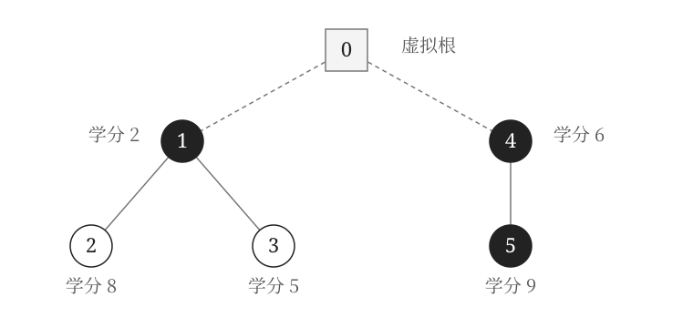

[[TOC]]

## 题意

题目：[[[p: luogu-P2014 | 选课]]]。

有 $N$ 门课程，每门课有学分，且至多有一门直接先修课。选择一门课之前，必须选完它的所有先修课。要求恰好选择 $M$ 门课，求最大学分总和。

原题中 $N,M\le300$，每门课的学分为 $1\sim20$，依赖关系无环。

从先修课向后续课连边，得到一片有根森林。一个合法选择包含某门课程时，必须包含它到所在树根的所有祖先。这与 [[[rbook: tree_dp_binary_apple_tree]]] 中“选择后代必须先接通祖先”的限制相同。

## 虚拟根

没有先修课的课程可能不止一门。新增节点 $0$，将所有没有先修课的课程接在它下面，森林就变为一棵树。

规定虚拟根的学分为 $0$，且最终方案必须包含它。真实课程恰好选 $M$ 门，就对应树中**包含虚拟根的 $M+1$ 个节点**。



图中虚线是新增关系，节点旁标学分。选择 $1,4,5$，满足依赖，真实课程数是 $3$；放入 DP 时再计入虚拟根，共 $4$ 个节点。

::: definition 树上依赖选择
在以 $0$ 为根、点权为 $s_u$（$s_0=0$）的树 $T=(V,E)$ 中，选出点集 $S\subseteq V$，满足：

1. 包含虚拟根：$0\in S$；
2. 节点数恰好为 $M+1$：$|S|=M+1$；
3. 满足先修依赖：$\forall u\in S\setminus\{0\}$，其父节点也属于 $S$。

本题要求最大化所选点集的点权之和 $\sum_{u\in S} s_u$，与 [[[rbook: tree_dp_binary_apple_tree]]] 中的“含根连通点集”完全同构。
:::

## 状态定义

沿用“小朋友法”：想象你站在当前课程 $root$ 上，手头共有 $j$ 个选课名额（$root$ 自己先占 $1$ 个，剩余 $j-1$ 个分给各门后续课）。同样地，如果只问每个孩子 $v$“你的子树最多能拿多少学分”，无法控制总名额不超过 $j-1$；因此必须按分配给孩子子树 $v$ 的名额数 $k$ 提问：

- **“如果分给你 $k$ 个名额（$k\ge 1$ 时必须选你），在你的子树里满足先修依赖、恰好选 $k$ 个节点最多能拿多少学分？”**

把视角落回任意节点 $u$，令 $K=M+1$。对于 $j\ge1$，定义 $f[u][j]$ 为：从 $u$ 的子树中恰好选择 $j$ 个节点，必须包含 $u$，并满足依赖关系时的最大学分。

另外规定 $f[u][0]=0$，表示整棵子树不选。初始化为：

$$
f[u][0]=0,\qquad f[u][1]=s_u,
$$

其余状态为 $-\infty$。这里 $s_0=0$，所以虚拟根的初值为 $f[0][1]=0$。

不能把“恰好选择 $j$ 门”写成“至多选择 $j$ 门”，却仍使用同一套初值。状态数量不足与合法的零收益，是不同的情况。

## 合并孩子

沿用上一篇的逐个合并。设旧部分已经包含 $u$ 和若干孩子子树，当前合并孩子 $v$：

$$
next[a+b]=\max\bigl(next[a+b],f[u][a]+f[v][b]\bigr).
$$

其中 $a\ge1$、$b\ge0$、$a+b\le K$。

- $a\ge1$：旧部分已经选择 $u$。
- $b=0$：当前孩子子树完全不选。
- $b>0$：孩子子树方案已经包含 $v$，因此选择 $v$ 所需的直接先修课 $u$ 也在方案内。

每次合并使用独立的 `next` 数组，合并后再覆盖旧数组。孩子之间只通过 $u$ 相连，逐个合并不会破坏依赖，也不会重复选择同一门课程。

这一问题按课程数量分配名额。更一般的“每件物品占用不同容量”的模型，见 [[[rbook: dependent_knapsack]]]。

## 手算示例

图中的课程信息如下，先修课为 $0$ 表示没有先修课：

| 课程 | 直接先修课 | 学分 |
| --- | --- | --- |
| 1 | 0 | 2 |
| 2 | 1 | 8 |
| 3 | 1 | 5 |
| 4 | 0 | 6 |
| 5 | 4 | 9 |

以 $1$ 为根的子树，选择 $0,1,2,3$ 门课的最优值分别为 $0,2,10,15$；以 $4$ 为根的子树，对应 $0,1,2$ 门课的最优值为 $0,6,15$。

现在选 $M=3$ 门真实课程。虚拟根先占一个节点名额，剩余三个分给两棵课程子树：

| 分给子树 1 | 分给子树 4 | 最大学分 |
| --- | --- | --- |
| 0 | 3 | 不可行，子树 4 只有两门课 |
| 1 | 2 | $2+15=17$ |
| 2 | 1 | $10+6=16$ |
| 3 | 0 | $15+0=15$ |

答案为 $f[0][4]=17$。如果错误地输出 $f[0][3]$，就只选了两门真实课程。

::: fold 示例输入输出
输入：

```text
5 3
0 2
1 8
1 5
0 6
4 9
```

输出：

```text
17
```
:::

## 子树大小裁剪

合并前，令 $A=sz[u]$ 为旧部分的节点数，$B=sz[v]$ 为当前孩子子树的节点数。枚举范围限制为：

$$
1\le a\le\min(A,K),\qquad 0\le b\le\min(B,K-a).
$$

不能让旧部分选择超过 $A$ 个节点，也不能让孩子子树提供超过 $B$ 个节点。合并完成后，再令 $sz[u]\gets A+B$。

若每次都扫描完整的两个 $K$ 范围，时间上界为 $O(NK^2)$。使用上述范围后，可以证明总时间为 $O(NK)$，其中 $N=n+1$，包含虚拟根。

先看一个较直观的 $O(N^2)$ 上界：忽略名额限制，一次合并的正数数量对 $(a,b)$ 至多有 $AB$ 个。把各个节点起初看作单点集合，按程序顺序合并；任意两个节点只会在其所属集合首次合并时跨集合配对一次，所以所有 $AB$ 之和为 $\binom N2$。

这给出的是**枚举次数的上界**。实际还有 $a+b\le K$、不可行状态跳过等限制，不能据此声称代码循环次数始终严格等于点对数。

::: fold 更紧的 O(NK) 时间界
只考虑 $b\ge1$，一次合并的枚举次数不超过 $\min(A,K)\min(B,K)$。定义：

$$
\Phi(s)=\begin{cases}
s^2,&s\le K,\\
2Ks-K^2,&s>K.
\end{cases}
$$

对任意正整数 $A,B$，有：

$$
\min(A,K)\min(B,K)\le\Phi(A+B)-\Phi(A)-\Phi(B).
$$

可以按是否超过 $K$ 验证：两者之和不超过 $K$ 时，右侧为 $2AB$；两者都至少为 $K$ 时为 $K^2$；一大一小时为 $2KB-B^2\ge KB$，其中 $B\le K$。最后一种情况是 $A,B<K<A+B$，右侧为 $2AB-(A+B-K)^2\ge AB$，因为 $A+B-K\le\min(A,B)$。

从 $N$ 个单点集合合并到整棵树，所有势能差相加，内部项抵消，总和为 $\Phi(N)-N\Phi(1)\le2NK$。

另外，$b=0$ 的处理、数组初始化和复制，每个节点或每次孩子合并至多花 $O(K)$，总计仍为 $O(NK)$。因此完整实现的时间复杂度为 $O(NK)$。
:::

## 正确性

每个真实课程方案加入虚拟根后，都唯一对应一个包含根的合法树上方案，且节点数增加 $1$、学分不变。

一次合并中，任意合法方案在旧部分和当前孩子子树内的选择，分别对应枚举中的 $a,b$。若孩子子树非空，其根与先修课 $u$ 都被选，依赖成立；反过来，任意两个合法子方案也都能这样合并。

按孩子数归纳，合并后保留了各个数量下的最大学分。故 $f[0][M+1]$ 恰好是选择 $M$ 门真实课程的最优值。

## 代码实现

```cpp file=./course_selection.cpp
```

时间复杂度为 $O((n+1)(M+1))$，空间复杂度相同。原题学分总和不超过 $300\times20$，使用 `int` 即可。不可行状态先检查，再进行加法。
