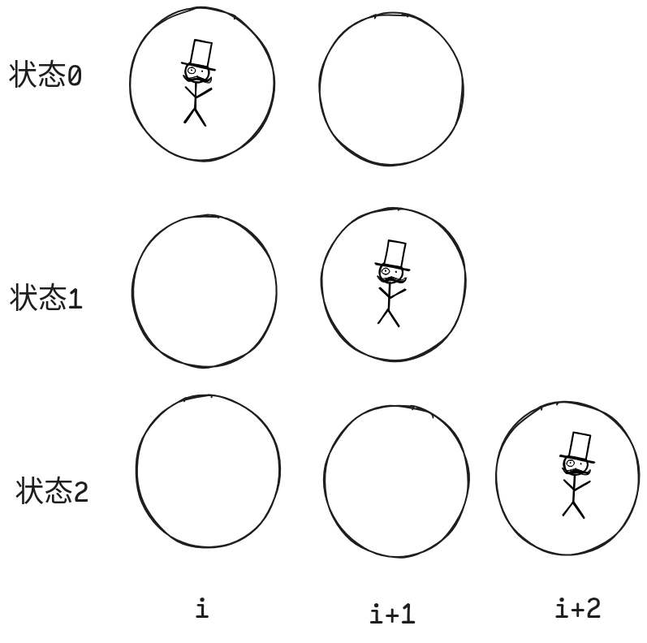
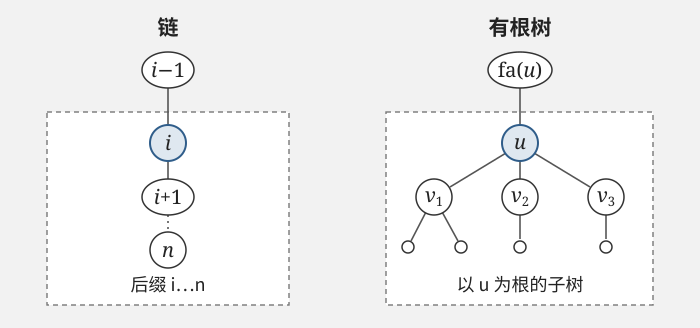
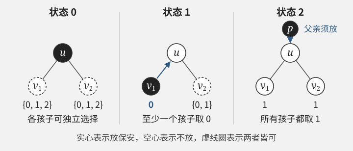

完美的适合人类阅读的解析

### 1 链上问题

根据文章: xxx, 我们可以先简化问题: 考虑一个特殊的链式树,也就是`1->2->3 ... ->n`. 退化成了一条链,但是还是一棵树.

那么就类似于文章 文章 状态机DP,也就是一个线性DP的问题


尝试可能的长度的所有的合法的方案,进行体会


长度1:

todo 补充

长度2

长度3

长度4

长度5


从右往左拼接。已知右侧后缀 `i+1..n` 在各种状态下的最小代价，把点 `i` 接到它的左边，就能求出新后缀 `i..n` 在各种状态下的最小代价。后缀 `i..n` 中，只有点 `i` 可能被左侧尚未处理的点覆盖。因此允许 `i` 暂时等待左邻居 `i-1` 覆盖，其余点都要在后缀内得到覆盖。



设 $f[i][k]$ 表示后缀 `i..n` 中，点 `i` 处于状态 `k` 时的最小代价。先看点 `i` 是否放保安。如果没放，再看右邻居 `i+1` 能否覆盖它。这样就有三种状态。

| 状态 | 点 `i` 的情况 | 右邻居 `i+1` 可取的状态 |
| --- | --- | --- |
| `0` | `i` 放保安 | `0`、`1`、`2`。如果 `i+1` 等左邻居覆盖，`i` 可以覆盖它。 |
| `1` | `i` 没放保安，由右邻居 `i+1` 覆盖 | `0`。`i+1` 必须放保安。 |
| `2` | `i` 没放保安，右邻居也没放，等左邻居 `i-1` 覆盖 | `1`。`i+1` 没放保安，须由它自己的右邻居覆盖。 |

当 $i<n$ 时，由右邻居 `i+1` 的可取状态得到转移方程。

$$
\begin{aligned}
f[i][0]&=w_i+\min\bigl(f[i+1][0],f[i+1][1],f[i+1][2]\bigr)\\
f[i][1]&=f[i+1][0]\\
f[i][2]&=f[i+1][1]
\end{aligned}
$$

从链尾 `n` 开始计算。

- $f[n][0]=w_n$。在 `n` 放保安，支付它的费用。
- $f[n][1]=+\infty$。`n` 没有右邻居，无法由右侧覆盖。
- $f[n][2]=0$。`n` 不放保安，暂时等待左侧覆盖。

点 `1` 没有左邻居，只能取状态 `0` 或 `1`，因此答案是 $\min\bigl(f[1][0],f[1][1]\bigr)$。

## 代码 对拍

### 1 暴力枚举子集

链上只有 $n$ 个点,枚举选择集合 $S$ 的所有子集,用 `for (s = S; s; s = (s-1) & S)` 做到 $O(2^n)$,再检查每个点是否被自己或左右邻居支配:

```cpp
// 暴力: 链 1-2-...-n,枚举选择集合 s,检查每个点是否被自己或左右邻居支配
#include <bits/stdc++.h>
using namespace std;

const int N = 25;
const int INF = 1 << 30;

int n;
int w[N];  // w[i]: 第 i 个点的费用

int main() {
    cin >> n;
    for (int i = 1; i <= n; i++) cin >> w[i];

    int ans = INF;
    int S = (1 << n) - 1;
    for (int s = S; s; s = (s - 1) & S) {   // 枚举 S 的所有非空子集
        bool ok = true;
        for (int i = 1; i <= n; i++) {
            bool cover = (s >> (i - 1)) & 1;                            // i 被选
            if (!cover && i > 1 && ((s >> (i - 2)) & 1)) cover = true;  // 左邻居选了
            if (!cover && i < n && ((s >> i) & 1)) cover = true;        // 右邻居选了
            if (!cover) ok = false;
        }
        if (!ok) continue;
        int sum = 0;
        for (int i = 1; i <= n; i++)
            if ((s >> (i - 1)) & 1) sum += w[i];
        ans = min(ans, sum);
    }
    cout << ans << '\n';
    return 0;
}
```

### 2 我们的 DP

```cpp
// 我们的 DP: 链上 3 状态
// f[i][0]: i 有保安
// f[i][1]: i 没有保安, i+1 有保安覆盖它
// f[i][2]: i 没有保安, i+1 也没有保安, 等 i-1 来覆盖
#include <bits/stdc++.h>
using namespace std;

const int N = 25;
const int INF = 1 << 30;

int n;
int w[N];
int f[N][3];

int main() {
    cin >> n;
    for (int i = 1; i <= n; i++) cin >> w[i];

    // 边界: 最后一个点
    f[n][0] = w[n];
    f[n][1] = INF;
    f[n][2] = 0;

    for (int i = n - 1; i >= 1; i--) {
        f[i][0] = w[i] + min(f[i + 1][0], min(f[i + 1][1], f[i + 1][2]));
        f[i][1] = f[i + 1][0];
        f[i][2] = f[i + 1][1];
    }

    // 点 1 没有左边, 不能处于状态 2
    cout << min(f[1][0], f[1][1]) << '\n';
    return 0;
}
```

### 3 随机数据生成

随机生成链长 $n\in[4,7]$ 和各点的费用。对拍脚本把测试编号传给 `gen` 作为种子，用同一个种子可以复现输入。

```cpp
// gen.cpp：链上随机数据生成器，用于对拍。
#include <bits/stdc++.h>
using namespace std;

mt19937 rng;

int rnd(int l, int r) {
    uniform_int_distribution<int> dist(l, r);
    return dist(rng);
}

int main(int argc, char** argv) {
    if (argc > 1) {
        rng.seed(stoul(argv[1]));
    } else {
        random_device rd;
        rng.seed(rd());
    }

    int n = rnd(4, 7);
    cout << n << '\n';
    for (int i = 1; i <= n; i++) {
        cout << rnd(1, 10) << " \n"[i == n];
    }
    return 0;
}
```

### 4 对拍脚本

```bash
#!/bin/bash
# 用法: ./check.sh [测试次数]
set -e
TIMES=${1:-500}

g++ -O2 -o /tmp/brute brute.cpp
g++ -O2 -o /tmp/dp    dp.cpp
g++ -O2 -o /tmp/gen   gen.cpp

for ((i = 1; i <= TIMES; i++)); do
    /tmp/gen "$i" > /tmp/in.txt
    /tmp/brute < /tmp/in.txt > /tmp/out1.txt
    /tmp/dp    < /tmp/in.txt > /tmp/out2.txt
    if ! diff -q /tmp/out1.txt /tmp/out2.txt > /dev/null; then
        echo "WA on seed=$i"
        echo "input:"; cat /tmp/in.txt
        echo "brute:"; cat /tmp/out1.txt
        echo "dp:";    cat /tmp/out2.txt
        exit 1
    fi
done
echo "all $TIMES tests passed"
```

跑 `./check.sh 500`,全部通过。


## 化链成树

树就是分叉的链,本质是一样的。

### 1 链与树的对应关系

链上从右往左处理后缀 `i..n`，树上从孩子向父亲处理子树。把链竖过来画，两边的虚线框都圈出了当前 DP 的处理范围。



| 链上 | 树上 |
| --- | --- |
| 左边 `i-1` | 父亲 `fa(u)` |
| 右边 `i+1` | 所有孩子 `v ∈ son(u)` |
| 后缀 `i..n` 的最小代价 | 以 `u` 为根的子树的最小代价 |
| 链首 `1`（没有左边） | 树根 `root`（没有父亲） |

因此最终答案和链上一样，树根 `root` 不能指望“不存在的父亲”，答案就是 $\min\bigl(f[\text{root}][0], f[\text{root}][1]\bigr)$。

### 2 状态的划分（不重不漏）

只看节点 $u$ 自己和它的子树（暂不考虑父亲），$u$ 的局面可以做一次两层二分：

1. **$u$ 自己放了保安** $\rightarrow$ 状态 `0`（不管孩子放没放，自己都已经覆盖好了）
2. **$u$ 自己没放保安**：
   - 至少有一个孩子放了保安（$u$ 已被孩子覆盖） $\rightarrow$ 状态 `1`
   - 所有孩子都没放保安（$u$ 还没被覆盖，只能等父亲 `fa(u)` 来覆盖） $\rightarrow$ 状态 `2`

设 $f[u][k]$ 表示以 $u$ 为根的子树中，$u$ 处于状态 $k$ 时的最小代价。三种状态都要求子树中除 $u$ 之外的节点已经被覆盖。

- $f[u][0]$：$u$ 自己放了保安，对孩子没有要求
- $f[u][1]$：$u$ 自己没放保安，但被至少一个孩子覆盖
- $f[u][2]$：$u$ 自己没放保安，也没有被任何孩子覆盖（等父亲覆盖）

仔细想想🤔,还有其他的可能的状态吗? 上面先按“$u$ 放/没放”分两类，再在“没放”里按“有没有孩子放”分两类，已经把所有合法局面**不重不漏**地覆盖完了；至于“$u$ 没放、孩子没放、父亲也不放”，那在加上父亲之后依然不合法，根本不需要记录。

### 3 三个状态的转移（分叉带来的唯一难点）

树上可能有多个孩子。看图中孩子下方的数字，它们表示对应孩子能取的状态。箭头表示覆盖方向。



中间一幅以 $v_1$ 放保安为例，任意一个孩子取状态 `0` 都能覆盖 $u$。

- **状态 `0`（$u$ 放了保安）**：对每个孩子都没有要求，每个孩子各自挑最优状态相加即可：
  $$f[u][0] = w_u + \sum_{v \in \text{son}(u)} \min\bigl(f[v][0], f[v][1], f[v][2]\bigr)$$

- **状态 `2`（$u$ 没放保安，且等父亲覆盖）**：$u$ 自己没保安，所以**不能让任何一个孩子指望 $u$**（孩子不能选状态 `2`）；同时孩子也不能放保安（否则 $u$ 就被覆盖了，会变成状态 `1`）。于是所有孩子都只能处于状态 `1`：
  $$f[u][2] = \sum_{v \in \text{son}(u)} f[v][1]$$

- **状态 `1`（$u$ 没放保安，被至少一个孩子覆盖）**：这是树上唯一比链上多出来的一步思考。
  - 每个孩子首先都不能选状态 `2`（因为 $u$ 自己没放保安，救不了它），所以每个孩子只能在 `{0, 1}` 里选；
  - 并且要求**至少有一个孩子选了状态 `0`**。

  先让每个孩子在状态 `0` 和 `1` 中取费用较低的一项。记孩子 $v$ 的这笔费用为 $b_v=\min(f[v][0],f[v][1])$，对应代码里的 `best`。

  指定孩子 $v$ 放保安时，把它的费用从 $b_v$ 换成 $f[v][0]$，其余孩子仍各取最小费用。每个合法方案都至少有一个孩子放保安，因此只需在所有孩子中选补差最小的一个。当 $u$ 至少有一个孩子时，

  $$
  f[u][1]
  = \underbrace{\sum_{v\in\operatorname{son}(u)} b_v}_{\text{sum}}
  + \underbrace{\min_{v\in\operatorname{son}(u)}\bigl(f[v][0]-b_v\bigr)}_{\text{min\_diff}}.
  $$

  若某个孩子满足 $f[v][0]\le f[v][1]$，它选状态 `0` 的补差就是 $0$。代码在遍历孩子时累加 `sum` 并更新 `min_diff`。

### 4 叶子节点的边界

树上的叶子节点就对应链上的最后一个点 $n$。叶子 $u$ 没有孩子：

- $f[u][0] = w_u$：自己放保安
- $f[u][1] = +\infty$：没有孩子，不可能被孩子覆盖
- $f[u][2] = 0$：没有孩子，暂时不花钱，等父亲来覆盖

叶子节点会跳过遍历孩子的循环。`sum` 保持为 `0`，`min_diff` 保持为初始值 `INF`，所以 `f[u][1]` 自动得到 `INF`。

## 树上代码与对拍

先写一份可以直接对拍的通用树上版本（输入 $n$、每个点的费用 $w_i$ 以及 $n-1$ 条无向边），再用洛谷 P2458 的输入格式给出最终 AC 代码。

### 1 树上暴力枚举子集

```cpp
// 暴力: 枚举点集 s 的所有非空子集, 检查每个点是否被自己或某个邻居覆盖
#include <bits/stdc++.h>
using namespace std;
using ll = long long;

const int N = 25;
const ll INF = 1LL << 60;

int n;
ll w[N];
vector<int> g[N];

int main() {
    cin >> n;
    for (int i = 1; i <= n; i++) cin >> w[i];
    for (int i = 1; i < n; i++) {
        int u, v;
        cin >> u >> v;
        g[u].push_back(v);
        g[v].push_back(u);
    }

    ll ans = INF;
    int S = (1 << n) - 1;
    for (int s = S; s; s = (s - 1) & S) {
        bool ok = true;
        for (int u = 1; u <= n; u++) {
            bool cover = (s >> (u - 1)) & 1;
            for (int v : g[u]) {
                if ((s >> (v - 1)) & 1) cover = true;
            }
            if (!cover) {
                ok = false;
                break;
            }
        }
        if (!ok) continue;
        ll sum = 0;
        for (int u = 1; u <= n; u++) {
            if ((s >> (u - 1)) & 1) sum += w[u];
        }
        ans = min(ans, sum);
    }
    cout << ans << '\n';
    return 0;
}
```

### 2 树上 DP

状态编号严格对应前文：

- `f[u][0]`：$u$ 有保安
- `f[u][1]`：$u$ 没保安，被至少一个孩子覆盖
- `f[u][2]`：$u$ 没保安且孩子也没保安，等父亲覆盖

计算 `f[u][2]` 时，只要有一个孩子的状态 `1` 不可行，累加结果就应保持为 `INF`。代码用 `min(INF, f[u][2] + f[v][1])` 将每次累加的结果截断到 `INF`。

```cpp
// 树上 DP: 3 状态
#include <bits/stdc++.h>
using namespace std;
using ll = long long;

const int N = 1505;
const ll INF = 1LL << 60;

int n;
ll w[N];
vector<int> g[N];
ll f[N][3];

void dfs(int u, int fa) {
    f[u][0] = w[u];
    f[u][2] = 0;
    ll sum = 0, min_diff = INF;

    for (int v : g[u]) {
        if (v == fa) continue;
        dfs(v, u);

        // 状态 0: u 有保安, 孩子 0/1/2 都行
        f[u][0] += min({f[v][0], f[v][1], f[v][2]});
        // 状态 2: u 没保安且等父亲覆盖, 孩子只能选状态 1
        f[u][2] = min(INF, f[u][2] + f[v][1]);

        // 状态 1: u 没保安, 孩子只能选 0/1, 且至少一个孩子选 0
        ll best = min(f[v][0], f[v][1]);
        sum += best;
        min_diff = min(min_diff, f[v][0] - best);
    }

    // 叶子不进循环时 sum=0, min_diff=INF, f[u][1] 自动为 INF
    f[u][1] = sum + min_diff;
}

int main() {
    ios::sync_with_stdio(false);
    cin.tie(nullptr);

    cin >> n;
    for (int i = 1; i <= n; i++) cin >> w[i];
    for (int i = 1; i < n; i++) {
        int u, v;
        cin >> u >> v;
        g[u].push_back(v);
        g[v].push_back(u);
    }

    dfs(1, 0);
    // 根没有父亲, 不能取状态 2
    cout << min(f[1][0], f[1][1]) << '\n';
    return 0;
}
```

### 3 随机树生成

对每个 $i\in[2,n]$ 随机连向 $[1,i-1]$ 中的一个点，即可均匀生成一棵合法的随机树（含 $n=1$ 的单点边界）：

```cpp
// 随机树生成
#include <bits/stdc++.h>
using namespace std;

mt19937 rng;

int rnd(int l, int r) {
    return uniform_int_distribution<int>(l, r)(rng);
}

int main(int argc, char** argv) {
    unsigned seed = (argc > 1) ? stoi(argv[1]) : random_device{}();
    rng.seed(seed);

    int n = rnd(1, 15);
    cout << n << '\n';
    for (int i = 1; i <= n; i++) {
        cout << rnd(1, 100) << " \n"[i == n];
    }
    for (int i = 2; i <= n; i++) {
        cout << rnd(1, i - 1) << ' ' << i << '\n';
    }
    return 0;
}
```

### 4 对拍脚本

```bash
#!/bin/bash
# 用法: ./check_tree.sh [测试次数]
set -e
TIMES=${1:-500}

g++ -O2 -o /tmp/tree_brute tree_brute.cpp
g++ -O2 -o /tmp/tree_dp    tree_dp.cpp
g++ -O2 -o /tmp/tree_gen   tree_gen.cpp

for ((i = 1; i <= TIMES; i++)); do
    /tmp/tree_gen $i > /tmp/in.txt
    /tmp/tree_brute < /tmp/in.txt > /tmp/out1.txt
    /tmp/tree_dp    < /tmp/in.txt > /tmp/out2.txt
    if ! diff -q /tmp/out1.txt /tmp/out2.txt > /dev/null; then
        echo "WA on seed=$i"
        echo "input:"; cat /tmp/in.txt
        echo "brute:"; cat /tmp/out1.txt
        echo "dp:";    cat /tmp/out2.txt
        exit 1
    fi
done
echo "all $TIMES tests passed"
```

实测 500 组随机树（$n\in[1,15]$）全部通过。

### 5 洛谷 P2458（保安站岗）AC 代码

P2458 给出的树是**有向的**（每个点直接给出节点编号 $u$、费用 $w_u$、孩子数量 $m$ 以及 $m$ 个孩子），但**根不一定为 `1`**，需要用 `has_parent[]` 找出唯一没有父亲的点作为 `root`：

```cpp
#include <bits/stdc++.h>
using namespace std;
using ll = long long;

const int N = 1505;
const ll INF = 1LL << 60;

int n;
ll w[N];
vector<int> g[N];
bool has_parent[N];
ll f[N][3];

void dfs(int u) {
    f[u][0] = w[u];
    f[u][2] = 0;
    ll sum = 0, min_diff = INF;

    for (int v : g[u]) {
        dfs(v);
        f[u][0] += min({f[v][0], f[v][1], f[v][2]});
        f[u][2] = min(INF, f[u][2] + f[v][1]);

        ll best = min(f[v][0], f[v][1]);
        sum += best;
        min_diff = min(min_diff, f[v][0] - best);
    }

    f[u][1] = sum + min_diff;
}

int main() {
    ios::sync_with_stdio(false);
    cin.tie(nullptr);

    cin >> n;
    for (int i = 1; i <= n; i++) {
        int u, m;
        cin >> u;
        cin >> w[u] >> m;
        while (m--) {
            int v;
            cin >> v;
            g[u].push_back(v);
            has_parent[v] = true;
        }
    }

    int root = 1;
    while (has_parent[root]) root++;

    dfs(root);
    cout << min(f[root][0], f[root][1]) << '\n';
    return 0;
}
```

