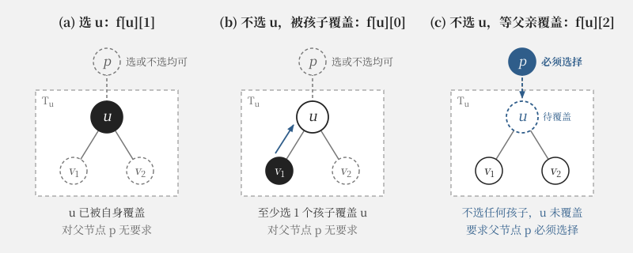
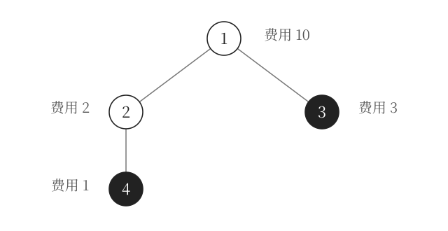

[[TOC]]

## 题意

例题：[[[p: luogu-P2458 | 保安站岗]]]。

在树的节点上安排保安。选择节点 $u$ 需要费用 $c_u$，可以看守 $u$ 及其所有相邻节点。要求每个节点都被看守，求最小总费用。

::: definition 支配集
若一个点集满足：图中每个节点要么在集合内，要么至少与集合中的一个节点相邻，则称该点集为**支配集**。形式化地，对于图 $G=(V,E)$，点集 $S\subseteq V$ 是支配集当且仅当：

$$
\forall u\in V\setminus S,\quad \exists v\in S\text{ 使得 }(u,v)\in E.
$$
:::

本题求树上的最小权支配集；若所有费用均为 $1$，就是求最少选择多少个节点。

原题中 $1\le n\le1500$、$1\le c_u\le10000$，节点从 $1$ 编号。

在 [[[rbook: tree_dp_strategic_game]]] 中要求覆盖每条边；本题要求覆盖每个点。例如链 $1-2-3-4$，只选 $1,4$ 已经覆盖全部节点，但边 $(2,3)$ 的两端都没选。两种限制不能混用。

## 三种状态

沿用“小朋友法”：想象你站在当前节点 $root$ 上，想通过向孩子 $u$ 提问来算出答案。如果只问两个问题：

1. **“你选，最少花多少钱？”** —— 此时 $u$ 已被自己覆盖，$root$ 选或不选都可以。
2. **“你不选，最少花多少钱？”** —— 这时 $root$ 会发现信息不够：在 $root - u - v$ 这条链上，如果孙子 $v$ 选了，$u$ 已被覆盖，$root$ 可以不选；如果 $v$ 没选，$u$ 就无人看守，$root$ **必须选**。

只问“选或不选”，$root$ 根本不知道自己要不要被迫选，说明这两个问题装不下所需的信息。因此必须把“$u$ 不选”拆成两个更具体的问题：

- **孩子帮你覆盖了**：$u$ 不选，但至少选了一个孩子，$u$ 已被覆盖（$root$ 选或不选均可）；
- **等着我来覆盖你**：$u$ 不选，且没有孩子被选，$u$ 尚未被覆盖（$root$ 必须选择）。

记 $T_u$ 为以 $u$ 为根的子树，把视角落回任意节点 $u$，就得到了三个状态（均要求 $T_u$ 中除 $u$ 之外的节点已经覆盖）：



图 (b) 与图 (c) 虽然都不选 $u$，但对父节点 $p$ 的约束不同，不能合并。三个状态的定义如下：

| 状态 | $u$ 的情况 | 对父节点的要求 |
| --- | --- | --- |
| $f[u][0]$ | 不选 $u$，至少一个孩子被选，$u$ 已被覆盖 | 无 |
| $f[u][1]$ | 选择 $u$ | 无 |
| $f[u][2]$ | 不选 $u$，也没有孩子被选，$u$ 尚未被覆盖 | 父节点必须选择 |

每个状态保存满足这些条件的最小费用。状态 $2$ 是允许暂时留下的一项需求，并不表示整棵树可以存在未覆盖节点。

## 转移方程

设 $C(u)$ 为 $u$ 的孩子集合。

### 选择 u

选择 $u$ 后，等待父亲覆盖的孩子可以得到覆盖，其余两种状态也合法：

$$
f[u][1]=c_u+\sum_{v\in C(u)}\min\bigl(f[v][0],f[v][1],f[v][2]\bigr).
$$

### 等待父亲

要让 $u$ 保持未被覆盖，就不能选择任何孩子；而 $u$ 自己没选，也不能接纳等待它覆盖的孩子。因此，每个孩子只能处于状态 $0$：

$$
f[u][2]=\sum_{v\in C(u)}f[v][0].
$$

### 被孩子覆盖

此时 $u$ 不选，每个孩子只能取状态 $0$ 或 $1$，并且**至少一个孩子必须取状态 $1$**。

先不管“至少一个”的限制，记：

$$
b_v=\min(f[v][0],f[v][1]),\qquad B=\sum_{v\in C(u)}b_v.
$$

如果强制孩子 $v$ 被选，需要把它的贡献从 $b_v$ 换成 $f[v][1]$，补上 $f[v][1]-b_v$。选择补差最小的孩子即可：

$$
f[u][0]=B+\min_{v\in C(u)}\bigl(f[v][1]-b_v\bigr).
$$

如果原来的最优选择已经包含某个孩子的状态 $1$，最小补差就是 $0$，不会多付费用。若状态 $0$ 与 $1$ 费用相同，也可以免费改选状态 $1$。

这个式子只保证至少选一个孩子，允许其他孩子也被选。不能改成“恰好选择一个孩子”。

若想单独练习“二选一且至少选一个”的最小补差模型，可以先做 [[[p: roj-1821 | 至少一个]]]。

## 初值与答案

对于叶子 $u$：

$$
f[u][0]=+\infty,\qquad f[u][1]=c_u,\qquad f[u][2]=0.
$$

叶子没有孩子，不能被孩子覆盖；自己选择需要支付费用；等待父亲时暂时不花钱。代码用 `INF` 表示不可行，并将不可行费用的累加截断到 `INF`，避免连续相加溢出。

根没有父亲，答案只能是：

$$
\min(f[root][0],f[root][1]).
$$

特别地，只有一个节点时，必须选择它，答案为它的费用。若把根的状态 $2$ 也取入答案，就会错误地得到 $0$。

## 手算示例

下面是自拟示例。节点外标注费用，实心节点表示选择。选择 $3,4$，总费用为 $4$：$3$ 覆盖根 $1$，$4$ 覆盖节点 $2$。



| 节点 | 被孩子覆盖 $f[u][0]$ | 自己选择 $f[u][1]$ | 等待父亲 $f[u][2]$ |
| --- | --- | --- | --- |
| 4 | $+\infty$ | 1 | 0 |
| 2 | 1 | 2 | $+\infty$ |
| 3 | $+\infty$ | 3 | 0 |
| 1 | 4 | 11 | $+\infty$ |

根不选时，孩子 $2$ 的最优费用是 $1$，孩子 $3$ 的最优费用是 $3$。后者已经被选，所以补差为 $0$，得到 $f[1][0]=1+3=4$。

## 正确性

固定 $u$ 的状态后，孩子允许的状态由覆盖关系确定。状态 $1$ 和 $2$ 中，各棵孩子子树独立取最小值即可。

状态 $0$ 中，每个合法方案都至少选择一个孩子 $v$，因此费用不少于 $B+f[v][1]-b_v$，进而不少于最小补差公式。反过来，强制补差最小的孩子选择，其余孩子各取最优状态，就能构造出达到公式值的合法方案。

从叶子向上归纳，每个状态都是其条件下的最小费用。根排除状态 $2$ 后，全树所有节点均被覆盖。

## 代码实现

P2458 每行依次给出 `节点编号 费用 孩子数 孩子列表`，已明确父子关系。只保存向孩子的边，找到没有父节点的根。

```cpp file=./dominating_set.cpp
```

每个节点只计算三个状态，每条父子边合并一次，时间复杂度为 $O(n)$，空间复杂度为 $O(n)$。原题有限费用不超过 $1500\times10000$；代码使用 `long long` 为不可行标记及累加留出空间。
