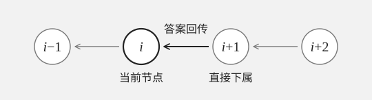
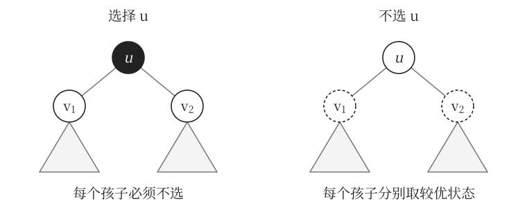
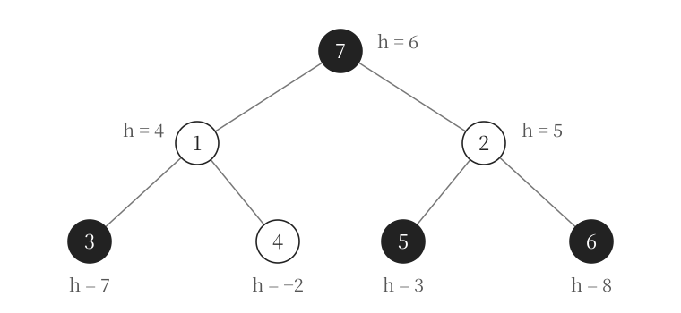

[[TOC]]

## 题意

题目：[[[p: luogu-P1352 | 没有上司的舞会]]]。

职员的上下级关系构成一棵有根树。每个职员有一个快乐值，选择若干职员参加舞会，使快乐值之和最大。**一个职员与其直接上司不能同时参加。**

将职员看作节点，上下级关系看作边，本题求的就是**树上的最大权独立集**。

::: definition 独立集
若一个点集满足：图中任意两个相邻节点都不同时在集合内，则称该点集为**独立集**。形式化地，对于树 $T=(V,E)$，点集 $S\subseteq V$ 是独立集当且仅当：

$$
\forall (u,v)\in E,\quad u\notin S\text{ 或 }v\notin S.
$$
:::

本题要求在所有独立集中选出点权之和最大的一个。

限制只发生在相邻节点之间。上司和下属的下属可以同时参加；也允许一个职员都不邀请，此时总快乐值为 $0$。

原题保证 $1\le n\le6000$、$-128\le h_u\le127$，其中 $h_u$ 表示节点 $u$ 的快乐值。

## 从链到树

枚举每个节点选或不选，共有 $2^n$ 种方案。直接比较相邻节点的快乐值也不够：一个上司的快乐值为 $6$，两个直接下属的快乐值分别为 $4,5$，选择上司就会错过总和为 $9$ 的方案。

### 链上的问题下放

先考虑每个职员至多有一个直接下属的情况。上下级关系成为一条以 $1$ 为根的链 $1-2-\dots-n$，问题也就成了 [[[rbook: dp_state_machine]]] 里的“相邻不能同时选”。这里站在上司 $i$ 的位置，考虑怎样请下属 $i+1$ 帮忙求出后缀 $i,\dots,n$ 的答案。



**把什么问题交给 $i+1$？**

用“小朋友法”，把右边整段 $i+1,\dots,n$ 交给 $i+1$。照 [状态设计: 非冲突法](../../intro/index.html#状态设计-非冲突法) 的方法，试着给这一段的方案接上同一步：让 $i$ 参加舞会。如果 $i+1$ 没参加，这一步就能接；如果 $i+1$ 参加了，这一步就会让直接上下级同时出席。只问“你那一段最多能得到多少快乐值？”，就分不清这两种情况。

边 $(i,i+1)$ 只限制这两个节点。因此，$i$ 可以让 $i+1$ 分别回答两个问题。

- 你不参加时，你那一段最多能得到多少快乐值？
- 你参加时，你那一段最多能得到多少快乐值？

**$i$ 怎样回答自己的上司？**

上司 $i-1$ 也会向 $i$ 问同样的两个问题。记 $f[i][0]$ 和 $f[i][1]$ 为 $i$ 不参加和参加时，后缀 $i,\dots,n$ 各自的最大快乐值。$i$ 不参加时，可以从 $i+1$ 的两个答案里取较大值。$i$ 参加时，只能使用 $i+1$ 不参加的答案，再加上自己的快乐值 $h_i$。对于 $i<n$，有

$$
f[i][0]=\max\bigl(f[i+1][0],f[i+1][1]\bigr),\qquad f[i][1]=h_i+f[i+1][0].
$$

问题从上司交给下属，答案从下属传回上司。链尾 $n$ 没有下属，直接回答 $0$ 和 $h_n$。随后从 $n$ 算到 $1$，在链首的两个答案中取较大值。

### 分叉后的问题下放

**如果 $u$ 有多个直接下属，两个问题怎么下放？**

链上的后缀 $i,\dots,n$ 就是以 $i$ 为根的子树。链上每个节点至多只向一个孩子提问。树发生分叉时，$u$ 向每个孩子 $v$ 问同样的两个问题，每个孩子负责以自己为根的子树。

各个孩子子树之间没有边相连。固定 $u$ 是否参加后，每个孩子都能独立决定自己用哪个答案。$u$ 参加时，汇总每个孩子不参加的答案，再加上 $h_u$。$u$ 不参加时，先在每个孩子的两个答案里取较大值，再把这些值相加。



图中的限制只针对孩子节点，不是禁止选择孩子的整棵子树。

## 状态定义

把视角落回任意节点 $u$。记 $T_u$ 为以 $u$ 为根的子树，将链上后缀的状态直接推广到子树：

| 状态 | 含义 |
| --- | --- |
| $f[u][0]$ | 在 $T_u$ 内选择节点，且不选 $u$ 时的最大快乐值之和 |
| $f[u][1]$ | 在 $T_u$ 内选择节点，且选择 $u$ 时的最大快乐值之和 |

两个状态都要求子树内部满足相邻节点不能同时选择。它们只规定 $u$ 的选择，不规定父节点的选择，也不包含子树外的快乐值。

## 转移方程

设 $C(u)$ 为 $u$ 的所有孩子组成的集合。

### 选择 u

选择 $u$ 后，每个孩子 $v$ 都不能选，只能贡献 $f[v][0]$。再加上 $u$ 自己的快乐值：

$$
f[u][1]=h_u+\sum_{v\in C(u)}f[v][0].
$$

这里的 $f[v][0]$ 仍然允许选择 $v$ 的孩子，所以不需要再单独枚举孙子。

### 不选 u

不选 $u$，每个孩子 $v$ 可以选，也可以不选。各棵子树分别取较优值：

$$
f[u][0]=\sum_{v\in C(u)}\max\bigl(f[v][0],f[v][1]\bigr).
$$

**不选父节点，不代表必须选择孩子。** 孩子不选时，可能从更深的后代中取得更大收益。

公式中的两种运算各有含义：同一棵孩子子树的两种选择取 `max`，不同孩子子树的贡献用加法合并。

### 正确性

固定 $u$ 选或不选后，上述转移恰好列出了每个孩子允许的状态。任意合法方案在孩子子树中的部分，都不会超过对应状态的最优值，所以总收益不会超过转移结果。

反过来，为每个孩子取到对应的最优方案。不同孩子子树之间没有边，它们与 $u$ 之间也满足限制，合并后就是合法方案，恰好达到转移结果。

从叶子开始归纳，每个节点的两个状态均正确，最终便能得到整棵树的最优值。

## 初值与答案

尚未合并孩子时，先令：

$$
f[u][0]=0,\qquad f[u][1]=h_u.
$$

随后逐个加入孩子子树的贡献。叶子没有孩子，这两个值就是最终结果。

即使 $h_u<0$，也不能把 $f[u][1]$ 改为 $0$，因为这个状态要求**必须选择 $u$**。不选任何节点的方案由 $f[u][0]$ 保留。全树快乐值都为负时，最终答案为 $0$。

设根为 $root$。根既可以选，也可以不选，因此答案为：

$$
\max\bigl(f[root][0],f[root][1]\bigr).
$$

不需要再对所有子树取最大值：根的子树已经包含整棵树。

## 手算示例

以下是自拟示例。根为 $7$，节点内是编号，旁边标注快乐值；实心节点表示一组最优选择。



按先孩子、后父亲的顺序计算：

| 节点 $u$ | 快乐值 $h_u$ | 不选 $f[u][0]$ | 选择 $f[u][1]$ |
| --- | --- | --- | --- |
| 3 | 7 | 0 | 7 |
| 4 | -2 | 0 | -2 |
| 5 | 3 | 0 | 3 |
| 6 | 8 | 0 | 8 |
| 1 | 4 | 7 | 4 |
| 2 | 5 | 11 | 5 |
| 7 | 6 | 18 | 24 |

例如，节点 $1$ 不选时，两个孩子分别贡献 $\max(0,7)$ 与 $\max(0,-2)$，得到 $f[1][0]=7$；选择节点 $1$ 时，两个孩子都不选，得到 $f[1][1]=4$。

根的两个状态为：

$$
\begin{aligned}
f[7][0]&=\max(7,4)+\max(11,5)=18,\\
f[7][1]&=6+7+11=24.
\end{aligned}
$$

答案为 $24$，选择节点 $7,3,5,6$。根与孙子可以同时选择，而快乐值为负的节点 $4$ 不必选择。

::: fold 示例输入输出
输入：

```text
7
4
5
7
-2
3
8
6
1 7
2 7
3 1
4 1
5 2
6 2
```

输出：

```text
24
```
:::

## 代码实现

输入的每对 `child parent` 表示后者是前者的直接上司。因此只保存从上司指向下属的边；没有上司的节点是根，编号不一定为 $1$。

在 `dfs(u)` 中先设置初值，再对每个孩子执行 `dfs(v)`，返回后合并它的两个状态。递归从根向下访问，**状态按孩子先于父亲的后序依赖计算**。

这里一次调用同时计算两个状态，每个节点只访问一次，不需要另设记忆化数组。单向存储孩子也避免了返回父节点，不需要访问标记。

```cpp file=./party.cpp
```

总快乐值不超过 $6000\times127$，原题使用 `int` 即可。每个节点初始化一次，每条父子边合并一次，时间复杂度为 $O(n)$。邻接表、状态数组与最坏深度为 $n$ 的递归栈共占 $O(n)$ 空间。

::: note 树形DP的基本步骤
以子树为子问题，记录子树根与外部有关的状态；先求孩子，再按父子限制合并。本题只需区分根选或不选。换一道题时，应重新判断父节点需要从孩子子树中知道哪些信息。
:::
