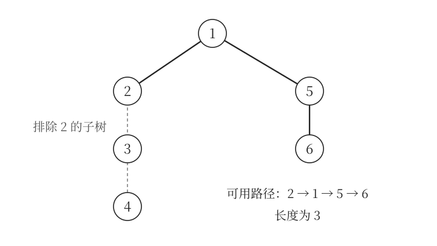

[[TOC]]

## 问题

给定一棵无向无权树，对每个节点 $u$，求它到全树节点的最远距离：

$$
ans[u]=\max_x dist(u,x).
$$

可用 [CSES · Tree Distances I](https://cses.fi/problemset/task/1132) 检验实现，节点从 $1$ 编号，$n\le2\cdot10^5$。单节点树的答案规定为 $0$。

在 [[[rbook: tree_dp_reroot_sum]]] 中，可以从总和里减去一棵子树的贡献；最大值没有这样的减法。给孩子传递信息时，需要另外解决**排除这个孩子自身贡献**的问题。

## 内外划分

先以 $1$ 为根，定义：

| 状态 | 含义 |
| --- | --- |
| $down[u]$ | $u$ 到其子树内部节点的最远距离 |
| $up[u]$ | $u$ 到子树外节点或 $u$ 自身的最远距离 |

两个状态都允许停在 $u$，距离为 $0$。因此叶子的 $down$ 为 $0$，根没有子树外节点，$up[root]=0$。

任意目标节点都在子树内或子树外，所以：

$$
ans[u]=\max(down[u],up[u]).
$$

## 向下的距离

要走向 $u$ 的子树内部，或者停在 $u$，或者先到某个孩子 $v$，再沿它的子树向下走：

$$
down[u]=\max\left(0,\max_{v\in C(u)}\bigl(down[v]+1\bigr)\right).
$$

孩子先于父亲计算即可。这里一个孩子提供的贡献是 $down[v]+1$，其中 $1$ 是边 $(u,v)$ 的长度。

## 向上的距离

对孩子 $v$，若目标位于它的子树外，第一步必须走到 $u$。到达 $u$ 后，有三种去向：

1. 停在 $u$，后续距离为 $0$。
2. 继续往 $u$ 的父亲方向走，后续距离由 $up[u]$ 提供。
3. 进入另一个孩子 $c$ 的子树，后续距离为 $down[c]+1$，要求 $c\ne v$。

因此：

$$
up[v]=1+\max\left(up[u],0,\max_{c\in C(u),\,c\ne v}\bigl(down[c]+1\bigr)\right).
$$

**不能直接使用 $1+\max(up[u],down[u])$。** 如果 $down[u]$ 来自 $v$，这会让路径走到 $u$ 后又回到 $v$ 子树，重复经过边 $(u,v)$，不再是简单路径。



图中，$down[1]=3$ 来自孩子 $2$，不能用于计算 $up[2]$。另一个孩子 $5$ 提供距离 $2$，所以 $up[2]=1+2=3$。

## 最大与次大

若对每个孩子都重新扫描其他孩子，一颗星形树就会产生 $O(n^2)$ 的时间开销。只需保存：

| 信息 | 含义 |
| --- | --- |
| $down[u]$ | 最大孩子贡献，与 $0$ 取最大值 |
| $second[u]$ | 排除一个最大贡献来源后，剩余孩子的最大贡献，与 $0$ 取最大值 |
| $from[u]$ | 提供当前最大贡献的孩子编号 |

给孩子 $v$ 传递时：

$$
other=\begin{cases}
second[u],&from[u]=v,\\
down[u],&from[u]\ne v,
\end{cases}
\qquad up[v]=1+\max(up[u],other).
$$

`second` 表示**不同孩子提供的第二份贡献**，不是严格小于最大值的下一个数值。如果两个孩子都贡献 $4$，最大与次大都应为 $4$；排除其中一个，另一个仍然可用。

代码按孩子编号记录最大值来源。遇到与最大值相等的新贡献时，仍然可以更新次大值。没有其他孩子时，次大值保留为 $0$，表示到达父节点后停下。

如果只存最大值，排除其来源后直接退回 $0$，也会出错：图中会漏掉孩子 $5$ 的贡献，把 $up[2]$ 从 $3$ 算成 $1$，进一步把 $ans[2]$ 从 $3$ 算成 $2$。

## 手算示例

沿用图中的六节点树：边为 $(1,2),(2,3),(3,4),(1,5),(5,6)$。

| 节点 | $down$ | $second$ | 最大来源 $from$ | $up$ | $ans$ |
| --- | --- | --- | --- | --- | --- |
| 1 | 3 | 2 | 2 | 0 | 3 |
| 2 | 2 | 0 | 3 | 3 | 3 |
| 3 | 1 | 0 | 4 | 4 | 4 |
| 4 | 0 | 0 | 无 | 5 | 5 |
| 5 | 1 | 0 | 6 | 4 | 4 |
| 6 | 0 | 0 | 无 | 5 | 5 |

例如，给 $5$ 传递时，节点 $1$ 的最大贡献来自另一个孩子 $2$，所以 $up[5]=1+3=4$；给 $6$ 传递时，没有兄弟子树，使用 $up[5]$，得到 $up[6]=1+4=5$。

## 正确性

第一遍按后序计算。任何向子树内部的路径，都唯一属于停在本点或进入某个孩子的情况，取最大值便得到正确的 $down$；同时保留的前两份贡献，足以回答排除任意一个孩子后的最大值。

第二遍中，孩子子树外的目标节点，按路径从父节点出发的下一方向，分为父节点自身、父亲方向和其他孩子方向。转移完整覆盖了这三类，并排除了重新进入当前孩子的非法路径，因此得到正确的 $up$。

父亲先于孩子处理，所有外部状态都能依次求出。最后将内部与外部取最大值，就是全树最远距离。

## 代码实现

与上一篇相同，先记录父亲先于孩子的顺序，倒序计算向下信息，再正序计算向上信息，避免长链递归。

```cpp file=./reroot_max.cpp
```

每个节点只扫描邻接表常数次，时间复杂度为 $O(n)$，空间复杂度为 $O(n)$。无权树的最远距离不超过 $n-1$，使用 `int` 即可。

## 非负边权

若边长非负，将孩子的贡献改为 $down[v]+\ell_{uv}$，向上转移改为：

$$
up[v]=\ell_{uv}+\max(up[u],other).
$$

最大、次大、向上距离和答案都要使用足够大的类型，通常为 `long long`。排除孩子的逻辑保持不变，仍按贡献来源区分。上述以 $0$ 为基准的写法允许路径只含一个节点；不能直接拿去求“含负边且必须经过边”的最长路径。

## 直径与中心

$ans[u]$ 也称节点 $u$ 的偏心距。所有 $ans[u]$ 的最大值是树的直径长度，最小值是半径，达到最小值的节点是树的中心。

无权树上也可以先求 [[[rbook: diameter]]] 的两个端点 $A,B$，再用 $ans[u]=\max(dist(u,A),dist(u,B))$ 求解。本篇的内外划分适用于更一般的树上信息传递，关键是明确每个方向提供什么，以及如何排除接收方自身的贡献。

树的中心最小化最远距离；[[[rbook: tree-centroid]]] 控制删除节点后各连通块的大小，二者定义不同。
