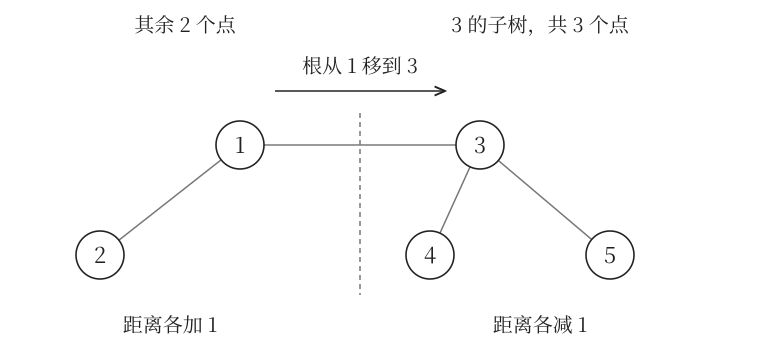

[[TOC]]

## 题意

::: definition 全树距离和
给定一棵无向无权树 $T=(V,E)$，对每个节点 $u\in V$，求它到树上所有节点的距离之和：

$$
ans[u]=\sum_{x\in V} dist(u,x).
$$
:::

其中 $dist(u,u)=0$，不影响总和。可用 [CSES · Tree Distances II](https://cses.fi/problemset/task/1133) 检验实现，节点从 $1$ 编号，$n\le2\cdot10^5$。

如果从每个节点出发，各遍历一次全树，时间复杂度为 $O(n^2)$。换根DP先求一个节点的答案，再利用相邻节点之间的变化，在线性时间内求出全部答案。

## 固定一个根

沿用“小朋友法”：先以 $1$ 为根，站在当前节点 $u$ 上，想通过向孩子 $v$ 提问来算出 $u$ 到子树内所有点的距离和。如果只问一句“你的子树里所有点到你的距离和 $down[v]$ 是多少？”——这会卡住：从 $u$ 出发走到 $v$ 子树里的每个点，都要比从 $v$ 出发多走一条边 $(u,v)$，只知道总距离和，不知道要多加多少个 $1$。因此，必须向孩子 $v$ 同时询问两个信息：

| 信息 | 含义 |
| --- | --- |
| $sz[u]$ | 固定根下，$u$ 子树中的节点数 |
| $down[u]$ | $u$ 到其子树中所有节点的距离之和 |

孩子先于父亲计算，有：

$$
\begin{aligned}
sz[u]&=1+\sum_{v\in C(u)}sz[v],\\
down[u]&=\sum_{v\in C(u)}\bigl(down[v]+sz[v]\bigr).
\end{aligned}
$$

从 $u$ 到孩子 $v$ 子树中的每个点，都比从 $v$ 出发多走一条边，所以额外加上 $sz[v]$。

根的子树就是全树，因此 $ans[1]=down[1]$。其他节点的 $down$ 只包含子树内部贡献，还不是它的全树答案。

## 沿边换根

考虑固定根下的一条父子边 $(u,v)$。从节点 $u$ 出发改成从 $v$ 出发时，删除这条边后形成的两部分决定距离的变化：

- $v$ 子树中的 $sz[v]$ 个点，距离都减少 $1$。
- 其余 $n-sz[v]$ 个点，距离都增加 $1$。



所以：

$$
\begin{aligned}
ans[v]&=ans[u]-sz[v]+(n-sz[v])\\
&=ans[u]+n-2sz[v].
\end{aligned}
$$

这里的 $sz[v]$ 始终按最初的根 $1$ 计算。我们只是改变距离的出发点，**不需要修改树的存储、父子关系或子树大小**。第二遍始终沿最初的父子方向递推。

## 计算顺序

两遍计算分别满足不同的依赖关系：

1. 孩子先于父亲：求 $sz$、$down$，得到 $ans[1]$。
2. 父亲先于孩子：利用 $ans[u]$ 和 $sz[v]$，求 $ans[v]$。

可以使用两次 DFS，也可以先记录父亲先于孩子的遍历顺序。倒序处理完成第一遍，正序处理完成第二遍。后者不依赖递归栈，适合很长的链。

## 手算示例

图中的树有边 $(1,2),(1,3),(3,4),(3,5)$。从 $1$ 出发，距离分别为 $0,1,1,2,2$，所以 $ans[1]=6$。

| 节点 $v$ | $sz[v]$ | $down[v]$ | 换根计算 | $ans[v]$ |
| --- | --- | --- | --- | --- |
| 1 | 5 | 6 | 初始根 | 6 |
| 2 | 1 | 0 | $6+5-2\times1$ | 9 |
| 3 | 3 | 2 | $6+5-2\times3$ | 5 |
| 4 | 1 | 0 | $5+5-2\times1$ | 8 |
| 5 | 1 | 0 | $5+5-2\times1$ | 8 |

从 $1$ 移到 $3$，有三个点变近、两个点变远，总和减少 $1$。从 $3$ 移到叶子 $4$，只有一个点变近、四个点变远，总和增加 $3$。

## 正确性

第一遍的子树划分互不重叠，公式将每个孩子子树的内部距离整体增加一条边，故正确求出 $sz$ 与 $down$，初始答案 $ans[1]$ 正确。

对任意父子边，边的两侧恰好划分全树所有节点，每个节点的距离变化都已计入 $n-2sz[v]$。若父节点答案正确，递推得到的孩子答案也正确。

第二遍中父亲先于孩子，每个节点都能沿从初始根到它的唯一路径得到正确答案。

## 代码实现

下面的完整程序读入 $n$ 和 $n-1$ 条无向边，按编号输出每个节点的距离和，对应 CSES Tree Distances II。

```cpp file=./reroot_sum.cpp
```

时间复杂度为 $O(n)$，空间复杂度为 $O(n)$。链的端点距离和为 $n(n-1)/2$，在本题范围内会超过 `int`，所以距离和使用 `long long`。

## 点权与边权

若节点 $x$ 有权值 $a_x$，目标改为：

$$
D[u]=\sum_x a_x\,dist(u,x).
$$

记全树点权和为 $W$，固定根下子树点权和为 $S[v]$。若边 $(u,v)$ 长度为 $\ell$，两侧点的距离分别变化 $-\ell$、$+\ell$，于是：

$$
D[v]=D[u]+\bigl(W-2S[v]\bigr)\ell.
$$

第一遍相应改为：

$$
S[u]=a_u+\sum_v S[v],\qquad
down[u]=\sum_v\bigl(down[v]+S[v]\ell_{uv}\bigr).
$$

点权控制一份距离贡献的倍数，边权控制一次移动的长度，两者作用不同。将点权和边长都设为 $1$，就回到无权公式。

::: fold 带权完整代码
下面采用通用输入格式：第一行 $n$，第二行 $n$ 个点权，之后 $n-1$ 行为 `u v 长度`。输出每个节点的加权距离和。它与具体例题的输入格式不同，使用时需要对应调整。

```cpp file=./weighted_sum.cpp
```

模板使用 `long long` 保存点权和、乘积与答案。需要按数据范围检查这些量，例如 $n\le2\cdot10^5$、点权和边长均在 $0\sim1000$ 时，答案不超过 $4\cdot10^{16}$，可以安全保存。
:::

## 应用

- [[[p: luogu-P1364 | 医院设置]]]：点权是居民人数，边长为 $1$，求所有 $D[u]$ 的最小值；输入为每个节点的人数与两个孩子编号。
- [[[p: luogu-P3478 | STA-Station]]]：所有点权、边长均为 $1$，求距离和最大的节点，输出编号。原题 $n\le10^6$，需要相应扩大数组。

无权树上，使距离和最小的节点与 [[[rbook: tree-centroid]]] 有关；换根DP则直接求出了每个候选节点的完整目标值。
