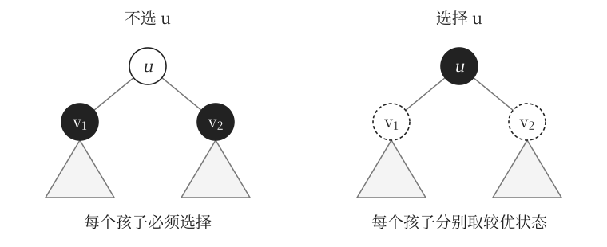
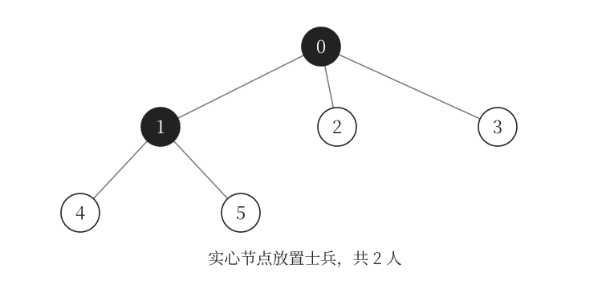

[[TOC]]

## 题意

题目：[[[p: luogu-P2016 | 战略游戏]]]。

在一棵树的节点上放置士兵。一个士兵可以监视与所在节点相连的所有边，求监视全部边所需的最少士兵数。

一条边能被监视，当且仅当至少一个端点放了士兵。因此问题等价于：**选择尽量少的节点，使每条边至少有一个端点被选中。** 这称为**最小顶点覆盖**。

注意，要求覆盖的是边。例如链 $0-1-2-3$，只在 $0,3$ 放士兵，虽然每个节点自身或相邻处都有士兵，但边 $(1,2)$ 仍未被监视。

原题保证 $1\le n\le1500$，节点编号为 $0\sim n-1$。

## 父子限制

在 [[[rbook: tree_dp_party]]] 中，一条边的两端不能同时选；本题则是两端不能同时不选。

| 父节点 $u$ | 孩子 $v$ | 边 $(u,v)$ 是否被覆盖 |
| --- | --- | --- |
| 不选 | 不选 | 否 |
| 不选 | 选择 | 是 |
| 选择 | 不选 | 是 |
| 选择 | 选择 | 是 |

因此，不选 $u$ 时，每个孩子都必须选；选择 $u$ 时，每个孩子可以选，也可以不选。**两端都选是合法的**，不能沿用舞会中“父亲选了，孩子就不能选”的限制。



确定 $u$ 的选择后，各个孩子子树之间没有边，可以分别求最优值，再把士兵数相加。

## 状态定义

任选一个节点为根，记 $T_u$ 为以 $u$ 为根的子树。

| 状态 | 含义 |
| --- | --- |
| $f[u][0]$ | 不选 $u$，覆盖 $T_u$ 内部所有边所需的最少士兵数 |
| $f[u][1]$ | 选择 $u$，覆盖 $T_u$ 内部所有边所需的最少士兵数 |

状态只要求覆盖**子树内部的边**，不负责覆盖 $u$ 与父节点之间的边。连接父节点的这条边，在父节点合并 $u$ 的状态时处理。

这一区分使叶子“不放士兵”的状态也合法：叶子子树内部没有边，需要 $0$ 名士兵；它与父节点之间的边留给上一层处理。

## 转移方程

设 $C(u)$ 为 $u$ 的所有孩子组成的集合。

### 不选 u

若不选 $u$，为了覆盖边 $(u,v)$，每个孩子 $v$ 都必须选：

$$
f[u][0]=\sum_{v\in C(u)}f[v][1].
$$

这里不能只要求“至少选一个孩子”。不同孩子对应不同的边，选择一个孩子无法覆盖 $u$ 与其他孩子之间的边。

### 选择 u

选择 $u$ 后，所有连接孩子的边都已被覆盖。每个孩子 $v$ 可以选或不选，取士兵数更少的状态；再加上 $u$ 自己的一名士兵：

$$
f[u][1]=1+\sum_{v\in C(u)}\min\bigl(f[v][0],f[v][1]\bigr).
$$

选择 $u$ 只是覆盖了与它直接相连的边，孩子子树内部的边仍然需要处理，不能直接令 $f[u][1]=1$。

### 正确性

固定 $u$ 的状态后，每条父子边允许的孩子状态已经完整列出。任意合法方案在每个孩子子树内的士兵数，都不少于对应状态的最优值，因此总人数不少于转移结果。

反过来，各个孩子子树分别取到对应的最优方案，与 $u$ 合并后，子树内部的边和连接孩子的边均被覆盖，人数恰好等于转移结果。从叶子向根归纳，所有状态均正确。

## 初值与答案

合并孩子前，初始化为：

$$
f[u][0]=0,\qquad f[u][1]=1.
$$

叶子没有孩子，这就是它的最终状态。即使叶子上不放士兵，也没有遗漏子树内部的边。

根没有父节点，两个状态都能作为完整方案，答案为：

$$
\min\bigl(f[root][0],f[root][1]\bigr).
$$

当 $n=1$ 时，树中没有边，答案为 $0$，不需要为了覆盖唯一的节点而放置士兵。

## 手算示例

以下是自拟示例，以 $0$ 为根。实心节点表示放置士兵，最优方案选择相邻的节点 $0,1$。



按先孩子、后父亲的顺序计算：

| 节点 $u$ | 不选 $f[u][0]$ | 选择 $f[u][1]$ |
| --- | --- | --- |
| 4 | 0 | 1 |
| 5 | 0 | 1 |
| 1 | 2 | 1 |
| 2 | 0 | 1 |
| 3 | 0 | 1 |
| 0 | 3 | 2 |

节点 $1$ 不选时，必须选择 $4,5$，需要 $2$ 人；选择 $1$ 时，两个叶子都可不选，只需 $1$ 人。

根的两个状态为：

$$
\begin{aligned}
f[0][0]&=1+1+1=3,\\
f[0][1]&=1+\min(2,1)+\min(0,1)+\min(0,1)=2.
\end{aligned}
$$

根已被选中，孩子 $1$ 仍然值得选择，因为它能用一名士兵覆盖下面两条边。若错误地禁止相邻节点同时选择，就只能得到至少 $3$ 人的方案。

::: fold 示例输入输出
输入：

```text
6
0 3 1 2 3
1 2 4 5
2 0
3 0
4 0
5 0
```

输出：

```text
2
```
:::

## 代码实现

洛谷 P2016 的输入先给出 $n$，随后给出 $n$ 组节点信息，每组是 `u k` 和 $k$ 个邻居编号。**每条无向边在输入中只出现一次**，读入时需要存入两个方向。

输入只描述无向边，不必把每行列出的邻居当作孩子。以 $0$ 为根进行 DFS，用参数 `fa` 跳过父节点，其余相邻节点就是当前根下的孩子。根的父节点设为 $-1$，避免与合法编号 $0$ 混淆。

```cpp file=./strategic_game.cpp
```

每个节点计算两个状态，每条边被扫描两次，时间复杂度为 $O(n)$。邻接表、状态数组和递归栈共占 $O(n)$ 空间。士兵数至多为 $n$，使用 `int` 即可。

## 与舞会对照

两题都按子树根选或不选分类，但合法状态来自各自的边约束。

| 比较项 | 没有上司的舞会 | 战略游戏 |
| --- | --- | --- |
| 边的限制 | 两端不能同时选 | 两端不能同时不选 |
| 父节点不选 | 孩子可选或不选 | 孩子必须选 |
| 父节点选择 | 孩子必须不选 | 孩子可选或不选 |
| 优化目标 | 快乐值之和最大 | 选择人数最少 |

状态名称相同，不代表转移相同。先列出一条边两端的合法组合，再写子树转移，才能避免照搬公式。

::: fold 顶点覆盖与独立集
对于任意图，一个点集是顶点覆盖，当且仅当它的补集是独立集：每条边至少有一端在覆盖集内，等价于没有一条边的两端同时落在补集中。

因此，最小顶点覆盖的大小等于 $n$ 减去最大独立集的大小。若把舞会中每个节点的快乐值都设为 $1$，就可以先求最多能选多少人，再用 $n$ 减去这个数量，得到本题答案。原舞会题的快乐值各不相同，不能直接拿其最大快乐值代入这个人数公式。
:::
