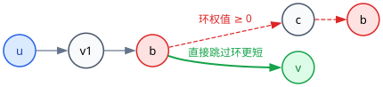

[[TOC]]

## 算法背景与核心直觉

在单源最短路问题中，当图上**存在负权边**（甚至可能包含负权环）时，基于贪心的 `[[dijkstra]]` 算法便不再适用。

Bellman-Ford 算法直接基于**动态规划与边的反复松弛**，不仅能够正确处理负权边，还能有效检测图中是否存在从源点可达的**负权环**。

---

## 核心定理与证明

### 定理1：最短路上的点数与边数界限

在一个**无负环**的图 $G$ 上，从源点 $s$ 到任意可达点 $v$ 的最短路所经过的：
1. **点数不超过 $n$**；
2. **边数不超过 $n - 1$**。

**证明（反证法）**：



假设最短路径经过了超过 $n$ 个点，由于图上总共只有 $n$ 个顶点，根据**抽屉原理（鸽巢原理）**，这条路径上必然至少有一个顶点重复出现，设该点为 $b$。

则整条路径可以表示为：
$$
s \longrightarrow \cdots \longrightarrow a \longrightarrow b \longrightarrow c \longrightarrow \cdots \longrightarrow b \longrightarrow d \longrightarrow \cdots \longrightarrow v
$$

在路径中包含了一个起点与终点皆为 $b$ 的回路（圈）。
- 因为图 $G$ 中**不存在负环**，所以该回路的权值和必为非负值（$\geqslant 0$）。
- 如果我们将这个回路直接从路径中删去，得到新路径 $s \to \cdots \to b \to d \to \cdots \to v$：
  - 新路径的权值和必 $\leqslant$ 原路径的权值和；
  - 这与“原路径是最短路径且必须包含该回路”的前提矛盾！

因此，最短路径上一定不包含任何环，即必然是一条**简单路径**。
包含 $k \leqslant n$ 个点的简单链，其所包含的边数最多为 $n - 1$ 条。证毕。

---

## 松弛操作的定义

两个点 $u, v$ 的边 $(u, v)$，若发现通过 $u$ 到达 $v$ 比当前记录的 $dis(v)$ 更优，则进行更新：

::: pseudocode
\begin{algorithm}
\begin{algorithmic}
\IF{$dis(v) > dis(u) + w(u,v)$ }
\STATE $dis(v) = dis(u)+w(u,v)$
\ENDIF
\end{algorithmic}
\end{algorithm}
:::

---

## 算法核心过程与图解

Bellman-Ford 算法的核心在于：**按轮次对图中的所有边进行整体松弛**。

[[[animate: ./bellman-ford.animation.ts]]]


### 轮次演进不变量

设源点为 $s$，初始时令 $dis(s) = 0$，其余所有点 $dis(i) = \infty$。

**核心归纳不变量**：
> 在第 $k$ 轮全局边松弛结束后，$dis(v)$ 的值至多等于“从源点 $s$ 到 $v$ 且经过边数**不超过 $k$ 条**的最短路径长度”。

- **初始（$k=0$）**：只有经过 $0$ 条边的源点自身距离为 $0$，其余不可达，不变量成立。
- **第 $1$ 轮（$k=1$）**：枚举所有边，源点的一度邻居被松弛，得到了最多经过 $1$ 条边的最短距离。
- **第 $k$ 轮**：任何最多经过 $k$ 条边的最短路径，其最后一步一定形如一条边 $(u, v)$，且前缀路径最多经过 $k-1$ 条边。由归纳假设，$dis(u)$ 在前 $k-1$ 轮已经达到最优，因此本轮松弛必然能算出不超过 $k$ 条边的最优 $dis(v)$。

### 为什么只需要 $n-1$ 轮？

根据**定理1**，在无负环的图上，任何点之间的最短路最多只包含 $n-1$ 条边。
因此，进行 **$n-1$ 轮**全边松弛之后，所有点的最终最短路都必然已经全部计算完成！

若在第 $k$（$k < n-1$）轮中没有发生任何松弛操作，说明所有距离已经收敛，可以**提前跳出循环**。

---

## 负环判定原理

如果在完成了 $n-1$ 轮松弛后，我们**再进行第 $n$ 轮松弛**：
- 如果此时仍然存在某条边 $(u, v)$ 满足 $dis(u) + w(u, v) < dis(v)$；
- 这说明存在一条能让距离更小的路径，其包含的边数**至少为 $n$ 条**；
- 边数 $\geqslant n$ 意味着该路径至少经过了 $n+1$ 个顶点，根据抽屉原理必定存在环，且绕这个环能让总距离变小——**这证明图中必然存在从源点可达的负权环**！

---

## 算法步骤总结

1. 初始化：$dis(s) = 0$，其余点 $dis = \infty$。
2. 进行至多 $n-1$ 轮循环：
   - 遍历图中的所有 $m$ 条边 $(u, v, w)$；
   - 若 $dis(u) \neq \infty$ 且 $dis(u) + w < dis(v)$，则更新 $dis(v) = dis(u) + w$；
   - 若本轮未发生任何松弛，提前退出。
3. 再遍历一次所有边：
   - 若仍能成功松弛，报告存在负环。
   - 否则输出最短路数组 $dis$。

---

## 模板代码

```cpp file=./bellman_ford.cpp
```

---

## 复杂度与对比

设点数为 $n$，边数为 $m$：
- **时间复杂度**：最坏情况下进行 $n$ 轮松弛，每轮遍历全部 $m$ 条边，时间复杂度为稳定 $O(nm)$。
- **空间复杂度**：只需要存边数组和 $dis$ 数组，空间复杂度为 $O(n + m)$。

若要对 Bellman-Ford 的每轮盲目扫描进行常数优化，只让距离变小的点去通知邻居，则演化出队列优化的版本：`[[spfa]]`。
更多负环的判定方法（点更新次数、DFS 版负环判定等），请参见章节：`[[negative_circle]]`。
