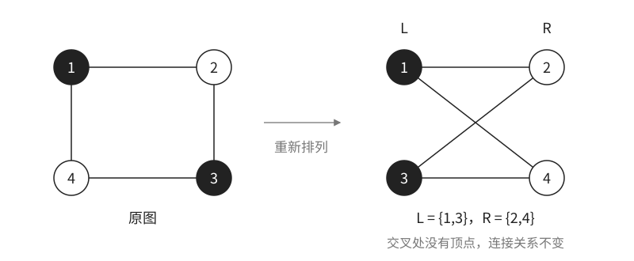
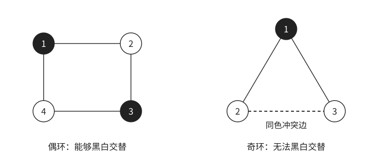

[[TOC]]

## 二分图

给定无向图 $G=(V,E)$。如果可以将全部顶点划分为两个不相交的集合 $L,R$，使每条边的两个端点分别属于两侧，这张图就称为**二分图**。

$$
L\cup R=V,\qquad L\cap R=\varnothing.
$$

两侧内部都没有边，人数不必相等，也允许某一侧为空。把 $L$ 中的点涂黑、$R$ 中的点留白，就得到等价表述：**能否用两种颜色给所有点染色，使相邻点异色？**



图中两种画法的点和边完全相同。二分图取决于连接关系，画图时点的位置、边是否交叉，都不影响判定；线段交叉处没有标记顶点，就不产生新的顶点。

## 黑白染色

从一个未染色的点开始，把它染成黑色。它的邻点必须是白色，邻点的邻点又必须是黑色。沿边不断传播，就能确定整个连通块的颜色。

起点选择黑色或白色都可以。将一个连通块的全部颜色交换，每条边仍然异色。因此，**任意指定起点颜色，不会错失原本存在的划分**；后面的染色由边强制决定，无须回溯尝试。

使用 [[[rbook: bfs]]] 实现这一传播过程。令 `color[u]` 为 $0$ 时表示未染色，$1,2$ 表示两种颜色。检查边 $(u,v)$ 时：

| 邻点情况 | 处理 |
| --- | --- |
| $v$ 未染色 | 令 `color[v] = 3 - color[u]`，再入队 |
| $v$ 已染色，且与 $u$ 异色 | 当前边合法，继续检查 |
| $v$ 已染色，且与 $u$ 同色 | 两端必须异色却被强制成同色，判定失败 |

无须单独使用 `visited` 数组，颜色同时记录了是否已经发现该点。染色应在入队前完成，保证每个点最多入队一次。

非连通图需要从每个未染色点重新开始。整张图能二染色，当且仅当每个连通块都能二染色；不同块之间没有边，可以独立决定颜色。

## 奇环

环的长度是其中的边数。长度为奇数的环称为奇环，长度为偶数的环称为偶环。

::: theorem 二分图与奇环
无向图是二分图，当且仅当它不含奇环。
:::



### 二分图不含奇环

沿环每走过一条边，颜色就改变一次。回到起点时必须恢复原色，因此经过的边数只能为偶数。若环长为奇数，最后一条边必然连接两个同色点，与二分图定义矛盾。

### 没有奇环就能二染色

对一个连通块执行前面的染色。每个点首次被发现时，记录发现它的那条边，这些边构成一棵以起点为根的搜索树。树上每经过一条边，颜色改变一次，所以颜色由树上深度的奇偶性确定。

假设检查某条边 $(u,v)$ 时发生同色冲突。$u,v$ 的深度同奇偶。令 $w$ 为根到 $u,v$ 的两条树路径上最后一个公共点，树上 $u$ 到 $v$ 的路径长度为：

$$
depth[u]+depth[v]-2depth[w].
$$

这个长度是偶数。树上这条简单路径再加上冲突边 $(u,v)$，就得到一个奇环。

这里先去掉了两条根路径的公共前缀，不能把它们不加处理地拼接并直接称为简单环。上述 $w$ 只用于证明，判定代码不需要求它。

所以，没有奇环时，染色不会发生冲突。全部染色完成后，每条边两端异色，两类颜色就构成了二分划分。

允许自环时，自环就是长度为 $1$ 的奇环，必然无法二染色。重边只会重复检查同一个异色要求，不改变结论。

## 代码实现

输入 $n,m$，接着输入 $m$ 条无向边，顶点编号为 $1\sim n$。可以二染色时输出 `Yes`，否则输出 `No`。代码按 $n\le200000$ 预留数组。

```cpp file=./bipartite.cpp
```

判定成功后，`color[u] == 1` 与 `color[u] == 2` 的点分别组成两侧。每个连通块起点都染为 $1$，不同块的相同颜色之间不会有边。

每个点最多入队一次，每条无向边按两个方向各检查一次，时间复杂度为 $O(n+m)$。邻接表占 $O(n+m)$ 空间，颜色和队列占 $O(n)$ 空间。

例如边集为 $(1,2),(2,3),(3,4),(4,1)$ 时，输出 `Yes`；再加入 $(1,3)$，就出现三角形，输出 `No`。

| 边界情况 | 结果与处理 |
| --- | --- |
| 没有边，只有孤立点 | 可以二染色，孤立点可以任意分组 |
| 某个连通块包含奇环 | 整张图都不是二分图，不能只从点 $1$ 检查一次 |
| 同一条边输入多次 | 不影响结果，无须去重 |
| 存在自环 $(u,u)$ | 检查时两端就是同一个点，立即产生同色冲突 |

## 封锁阳光大学

题目：[[[p: luogu-P1330 | 封锁阳光大学]]]。

选择一些点，使每条道路都至少有一个端点被选，同时相邻的两个点不能同时被选。求最少选择多少点，无解输出 `Impossible`。

对于任意一条边：两个端点都不选，无法封锁；两个端点都选，又会冲突。因此，要求等价于：**每条边恰好选择一个端点。**

把“选中”与“未选中”看成两种颜色，问题便转成二分图染色。若有同色冲突，就不存在合法方案。

对一个连通块，一旦决定某个点选不选，其他点便沿边被全部确定。因此，一个可以二染色的连通块只有两种选择：全部选颜色 $1$ 的点，或者全部选颜色 $2$ 的点。

BFS 时统计当前块的两类人数 $c_{i,1},c_{i,2}$，该块取较小者。不同块之间相互独立，所以：

$$
answer=\sum_i\min(c_{i,1},c_{i,2}).
$$

**先逐块取较小值，再求和。** 例如两颗三叶星，边分别为 $(1,2),(1,3),(1,4)$ 与 $(8,5),(8,6),(8,7)$。按点编号从小到大开始染色，会得到：

| 连通块 | 颜色 $1$ 的点 | 颜色 $2$ 的点 | 最少选择 |
| --- | --- | --- | --- |
| 第一块 | $\{1\}$ | $\{2,3,4\}$ | $1$ |
| 第二块 | $\{5,6,7\}$ | $\{8\}$ | $1$ |

选中两个中心 $1,8$ 即可，答案为 $2$。若把整张图的两种颜色人数分别相加，再取一次最小值，会得到 $\min(4,4)=4$，因为它错误地要求所有连通块选择同一种颜色。

孤立点所在块的两类人数为 $(1,0)$，贡献 $0$：它没有道路需要封锁，无须选择。

应用只在染色时增加人数统计，时间复杂度仍为 $O(n+m)$。

完整题解：[pcs2：封锁阳光大学](https://pcs2.roj.ac.cn/problems/luogu/P1330/)。逐条加入同类、异类约束的维护方法，可继续阅读 [[[rbook: kind_disjoint_set]]]。
