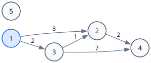
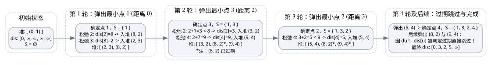
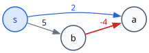

[[TOC]]

## 算法背景与核心直觉

前置算法: [[[rbook: bellman-ford]]]，以及数据结构：小根堆（优先队列）。

在单源最短路问题中，若图中**所有边权非负**（$w \geqslant 0$），我们可以利用贪心思想大幅加速求解过程。

回顾松弛操作：

::: pseudocode
\begin{algorithm}
\begin{algorithmic}
\IF{$dis(v) > dis(u) + w(u,v)$ }
\STATE $dis(v) = dis(u)+w(u,v)$
\ENDIF
\end{algorithmic}
\end{algorithm}
:::

与 SPFA 任意时刻允许多次反复入队不同，Dijkstra 算法基于一个关键洞察：
**“先发现路线，不等于确定最终答案；但当前未确定的点中距离最近的那一个，它的答案一定已经确定了。”**

### 核心贪心定理

将图中的点集划分为两个集合：
- 已确定最短路的大集合 $S$。
- 尚未最终确定最短路的点集 $V \setminus S$。

**定理1**：在所有边权非负的前提下，设当前 $V \setminus S$ 中暂定距离 $dis$ 最小的点为 $u$，则 $dis(u)$ 必然就是从源点 $s$ 到点 $u$ 的最终最短距离 $\delta(u)$。

证明：

设真正的最短路径长度为 $\delta(u)$，由于 $dis(u)$ 对应实际找到的一条走法，显然 $\delta(u) \leqslant dis(u)$。

假设存在一条更短的走法从 $s$ 到达 $u$，由于起点 $s \in S$，终点 $u \notin S$，这条路径上必然存在**第一个离开集合 $S$ 的边 $(x, y)$**（其中 $x \in S, y \notin S$）：

$$
s \longrightarrow \cdots \longrightarrow x \in S \stackrel{w(x, y)}{\longrightarrow} y \notin S \longrightarrow \cdots \longrightarrow u
$$

1. 因为 $x \in S$，点 $x$ 之前已经被选出并对它的所有出边进行了松弛，因此当前必有 $dis(y) \leqslant dis(x) + w(x, y) = \text{该路径到 } y \text{ 的前缀长度}$。
2. 因为图上**所有边权非负**（$w \geqslant 0$），从 $y$ 继续走到 $u$ 的后续路程权值和必然 $\geqslant 0$。因此：
   $$
   dis(y) \leqslant \text{该路径到 } y \text{ 的前缀长度} \leqslant \text{整条路径的长度} < dis(u)
   $$
3. 这得出 $dis(y) < dis(u)$，与“点 $u$ 是当前 $V \setminus S$ 中 $dis$ 最小的点”假设矛盾！

因此不存在比 $dis(u)$ 更短的路径，即 $dis(u) = \delta(u)$。证毕。

---

## 图解 Dijkstra 执行过程

我们以包含非负边权的图（源点为 $1$）为例，演示贪心选择与堆优化的全过程：

[[[animate: ./dijkstra.animation.ts]]]



图中边权：
- $1 \to 2$ 权值 $8$
- $1 \to 3$ 权值 $2$
- $3 \to 2$ 权值 $1$
- $2 \to 4$ 权值 $2$
- $3 \to 4$ 权值 $7$
- 点 $5$ 为孤立点（不可达）

### 过程演进流程图



### 详细步骤追踪表

| 轮次 | 堆顶弹出 `(du, u)` | 状态判断 | 加入集合 $S$ | 松弛出边及更新 | 堆内元素（小根堆） | $dis$ 数组 `[1..5]` |
| :--- | :--- | :--- | :--- | :--- | :--- | :--- |
| **初始** | - | - | - | 初始化 $dis[1]=0$，入堆 `(0, 1)` | `[(0, 1)]` | `[0, ∞, ∞, ∞, ∞]` |
| **第 1 轮** | **(0, 1)** | 有效记录 | $S = \{1\}$ | 松弛 $1\to2$：$dis[2]=8$<br>松弛 $1\to3$：$dis[3]=2$ | `[(2, 3), (8, 2)]` | `[0, 8, 2, ∞, ∞]` |
| **第 2 轮** | **(2, 3)** | 最小点为 3！ | $S = \{1, 3\}$ | 松弛 $3\to2$：$2+1=3 < 8 \Rightarrow dis[2]=3$<br>松弛 $3\to4$：$2+7=9 \Rightarrow dis[4]=9$ | `[(3, 2), (8, 2)*, (9, 4)]` | `[0, 3, 2, 9, ∞]` |
| **第 3 轮** | **(3, 2)** | 最小点为 2！ | $S = \{1, 3, 2\}$ | 松弛 $2\to4$：$3+2=5 < 9 \Rightarrow dis[4]=5$ | `[(5, 4), (8, 2)*, (9, 4)*]` | `[0, 3, 2, 5, ∞]` |
| **第 4 轮** | **(5, 4)** | 最小点为 4！ | $S = \{1, 3, 2, 4\}$ | 点 4 无出边 | `[(8, 2)*, (9, 4)*]` | `[0, 3, 2, 5, ∞]` |
| **后续** | **(8, 2), (9, 4)** | $du > dis[u]$ | **过期跳过** | 直接 `continue`，不重复扫描出边 | 空 `[]` | `[0, 3, 2, 5, ∞]` |

---

## 为什么 Dijkstra 不能处理负权边？

思考：如果图中含有负权边，上面的定理证明哪一步会被破坏？



在上面的反例中：
- 从起点 $s$ 出发，有边 $s \to a$ 权值为 $2$，$s \to b$ 权值为 $5$。
- Dijkstra 优先挑出暂定距离最小的点 $a$（$dis[a]=2$），并**立即认定 $a$ 的最短路已经确定为 $2$**。
- 但是，后面通过 $s \to b \to a$ 的总长度是 $5 + (-4) = 1$！显然 $1 < 2$。

**本质原因**：非负边权是贪心成立的基石——它保证了“沿着其他未选的点继续往前走，路径长度只增不减”。如果边权允许为负数，那么“绕到后面的点再绕回来”费用完全可能反而减小，从而推翻前面已经固化的判断。

---

## 堆优化与过期记录处理

朴素的 Dijkstra 每一轮在 $V \setminus S$ 中枚举所有点寻找最小值，时间复杂度为 $O(n^2)$。

使用小根堆（C++ `std::priority_queue<State, vector<State>, greater<State>>`）后，每次可以在 $O(\log n)$ 时间内直接取出当前最小候选点。

### 过期记录（Lazy Deletion）机制

在标准库的优先队列中，修改堆内部某个已存在元素的代价极高。因此标准做法是：
1. 每次成功松弛出更优的距离时，直接将新的 `(新距离, 目标点)` 压入堆中。
2. 堆顶弹出的元素 `(du, u)` 时，**先做过期检查**：
   ```cpp
   auto [du, u] = q.top();
   q.pop();
   if (du != dis[u]) continue; // 之前更优的记录已经处理过点 u，当前记录已过期失效
   ```
3. 只要 `du == dis[u]`，说明这是点 $u$ 最优距离的第一次有效出堆，此时确定点 $u$ 并扫描它的所有出边。

---

## 算法核心步骤

1. 初始化：$dis(s) = 0$，其余所有点 $dis(i) = \infty$。
2. 将 `(0, s)` 压入小根堆。
3. 循环直到堆为空：
   - 弹出堆顶 `(du, u)`。
   - 若 `du > dis[u]`，说明该记录已过期，直接跳过。
   - 遍历点 $u$ 的所有出边 $(u, v, w)$：
     - 若 $du + w < dis[v]$：
       - 更新 $dis[v] = du + w$。
       - 将 `(dis[v], v)` 压入堆中。

---

## 模板代码

```cpp file=./dijkstra.cpp
```

---

## 复杂度与算法对比

| 算法 | 适用图类型 | 负权边 | 判负环 | 堆优化时间复杂度 |
| :--- | :--- | :--- | :--- | :--- |
| **Dijkstra** | 有向/无向非负权图 | **不支持** | 不支持 | $O((n + m)\log m)$ |
| **[[[rbook: spfa]]]** | 任意权值图 | **支持** | **支持** | 随机图极快，最坏 $O(nm)$ |
| **[[[rbook: bellman-ford]]]** | 任意权值图 | **支持** | **支持** | 稳定 $O(nm)$ |
