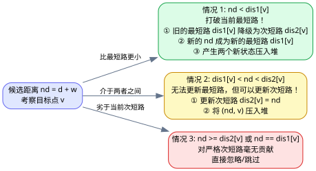
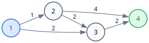

[[TOC]]

## 算法背景与问题模型

前置算法: `[[dijkstra]]`。

在经典的单源最短路问题中，我们只关心从源点 $s$ 到终点 $t$ 的最小距离。而在许多算法竞赛与工程实际中，往往需要求出**次短路径（Second Shortest Path）**。

次短路通常分为两种定义：
1. **严格次短路**：路径长度必须**严格大于**最短路径长度（即 $dis_2(t) > dis_1(t)$）。
2. **非严格次短路**：允许与最短路径长度相等（即第二条候选路径的长度，允许 $dis_2(t) \geqslant dis_1(t)$）。

本文重点讲解在非负权图上求解**严格次短路**的标准 Dijkstra 算法。

---

## 核心思维：状态拆分与动态规划转移

在普通 Dijkstra 中，每个节点 $u$ 只有一个状态：从源点到点 $u$ 的最短距离 $dis[u]$。

而在次短路问题中，**点 $u$ 的次短路可能由前驱点的最短路走过来，也可能由前驱点的次短路走过来**。
因此，我们对每个节点的状态进行**拆分**：
- $dis_1[u]$：从源点 $s$ 到点 $u$ 的**最短路径长度**；
- $dis_2[u]$：从源点 $s$ 到点 $u$ 的**严格次短路径长度**。

### 松弛操作的三种情况

当从堆中弹出一个状态 $(d, u)$，沿着边 $(u, v, w)$ 尝试松弛目标点 $v$ 时，候选的新距离为：
$$
nd = d + w
$$



此时对目标点 $v$ 进行分类讨论：

1. **情况 1：$nd < dis_1[v]$（打破最短路）**
   - 发现了比当前最短路还要短的走法！
   - 原来的最短路 $dis_1[v]$ 降级成为次短路：
     $$
     dis_2[v] \gets dis_1[v]
     $$
   - 新距离成为新的最短路：
     $$
     dis_1[v] \gets nd
     $$
   - 将 $(dis_2[v], v)$ 和 $(dis_1[v], v)$ 都压入优先队列中。

2. **情况 2：$dis_1[v] < nd < dis_2[v]$（打破次短路）**
   - 虽然无法超越最短路，但比当前的次短路更优（且严格大于最短路）！
   - 更新次短路：
     $$
     dis_2[v] \gets nd
     $$
   - 将 $(dis_2[v], v)$ 压入优先队列中。

3. **情况 3：$nd \geqslant dis_2[v]$ 或 $nd = dis_1[v]$**
   - 无法对严格次短路带来任何改进，直接忽略。

---

## 图解次短路求解过程

以下图为例（源点为 $1$，目标求到点 $4$ 的最短路与严格次短路）：



边权说明：
- $1 \to 2$ 权值 $1$
- $1 \to 3$ 权值 $2$
- $2 \to 3$ 权值 $2$
- $3 \to 4$ 权值 $2$
- $2 \to 4$ 权值 $4$

### 交互式动画演练

下面是使用优先队列求解次短路的动态模拟过程：

[[[animate: ./second_shortest.animation.ts]]]

### 状态演进步骤表

| 轮次 | 弹出状态 `(d, u)` | 状态性质 | 考察出边 | 松弛目标点与结果 |
| :--- | :--- | :--- | :--- | :--- |
| **初始** | - | - | - | $dis_1[1]=0$，其余 $\infty$。堆：`[(0, 1)]` |
| **1** | **(0, 1)** | 点 1 最短路 | $1 \to 2 (1)$, $1 \to 3 (2)$ | 更新 $dis_1[2]=1, dis_1[3]=2$ |
| **2** | **(1, 2)** | 点 2 最短路 | $2 \to 3 (2)$<br>$2 \to 4 (4)$ | $nd=1+2=3$（更新点 3 次短路 $dis_2[3]=3$）<br>$nd=1+4=5$（更新点 4 最短路 $dis_1[4]=5$） |
| **3** | **(2, 3)** | 点 3 最短路 | $3 \to 4 (2)$ | $nd=2+2=4 < dis_1[4]=5$！<br>原最短路降级：$dis_2[4]=5$<br>新最短路产生：$dis_1[4]=4$ |
| **4** | **(3, 3)** | 点 3 次短路 | $3 \to 4 (2)$ | $nd=3+2=5 == dis_2[4]$，非严格改善，忽略 |
| **5** | **(4, 4)** | 点 4 最短路 | 无出边 | 最短路确定为 $4$（路径 $1 \to 3 \to 4$） |
| **6** | **(5, 4)** | 点 4 次短路 | 无出边 | 次短路确定为 $5$（路径 $1 \to 2 \to 4$） |

最终得出点 $4$ 的：
- **最短路**：$4$（路径 $1 \to 3 \to 4$）
- **严格次短路**：$5$（路径 $1 \to 2 \to 4$）

---

## 算法核心过程

1. 初始化：
   - 距离数组：$dis_1[s] = 0$，其余所有点的 $dis_1$ 与全部点的 $dis_2$ 均初始化为 $\infty$。
   - 小根堆压入初始状态 $(0, s)$。
2. 循环直到小根堆为空：
   - 弹出堆顶最小距离状态 $(d, u)$。
   - **过期剪枝**：若 $d > dis_2[u]$，说明该状态比当前已知的次短路还要差，直接跳过。
   - 枚举节点 $u$ 的所有出边 $(u, v, w)$，令 $nd = d + w$：
     - 若 $nd < dis_1[v]$：更新 $dis_2[v] = dis_1[v]$ 并入堆；再更新 $dis_1[v] = nd$ 并入堆。
     - 若 $dis_1[v] < nd < dis_2[v]$：更新 $dis_2[v] = nd$ 并入堆。

---

## 模板代码

```cpp file=./second_shortest.cpp
```

---

## 深刻思考：它退化成 SPFA 了吗？（不动点与状态升维）

一个非常自然且深刻的疑问：
> “去掉每个点只能访问一次的限制后，节点距离一变小就重新入堆通知邻居，这难道不是退化成了 SPFA 的‘松弛到不动点’吗？它和动态规划在图上的‘反复转移直到收敛’是一回事吗？”

从**值迭代（Value Iteration）与不动点收敛**的角度看，最短路与次短路的贝尔曼方程本质上确实是 DP 在图上的松弛求解；如果没有贪心约束，任意反复通知后继确实就是 SPFA 的形态。

**但本算法并没有退化成 SPFA，它依然严格守住了 Dijkstra 的贪心界限！**

1. **不是扔掉 visited，而是将状态升维**：
   - SPFA 中一个节点最坏可能被更新入队 $O(n)$ 甚至指数次；
   - 而在这里，每个物理点 $u$ 被逻辑拆分为两个独立状态：$(u, \text{最短路})$ 与 $(u, \text{次短路})$，全图只有 $2n$ 个确定状态。
   - 相当于将 `visited[u]` 变成了 `visit_count[u] <= 2`。
2. **小根堆依然保证“出堆即确定”**：
   - 第一次有效出堆必是最终最短路；第二次有效出堆必是最终次短路；
   - 第三次及以后的劣质更新直接被 `d > dis2[u]` 永久剪枝丢弃，永不反悔。

因此，它巧妙利用优先队列将原本可能反复震荡的“不动点收敛”，严格锁死在 **2 倍常数的 Dijkstra 复杂度**之内。

---

## 复杂度分析

设图的顶点数为 $n$，边数为 $m$：
- 每个顶点最多产生两次有效扩展（一次作为最短路出堆，一次作为次短路出堆）；
- 优先队列中最多同时容纳的状态数量为 $O(m)$ 级别；
- 堆操作的时间复杂度为 $O(\log m)$；
- 总时间复杂度为 **$O((n + m)\log m)$**，与标准 Dijkstra 保持在同一数量级！

相关前置章节：
- `[[dijkstra]]`：基础单源最短路与堆优化
- `[[bellman-ford]]`：负权图与边数判定基础
