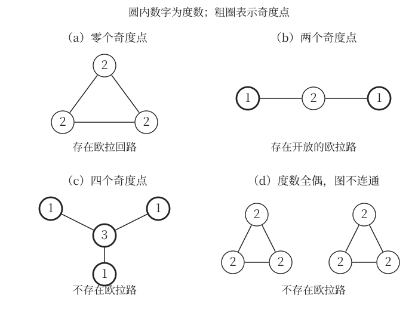
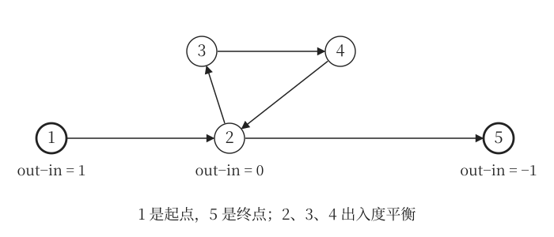
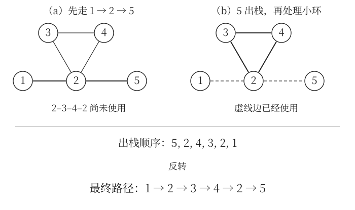

[[TOC]]

## 欧拉路

给定一张图，要求连续走过所有边，**每条边恰好使用一次，顶点可以重复经过**。这样的行走称为欧拉路；起点与终点相同时，称为欧拉回路。

这里沿用竞赛中的“欧拉路”称呼，不要求顶点互不重复。本篇把回路也包含在欧拉路之内；需要区分时，把起终点不同的情形称为开放的欧拉路。

与普通 [[[rbook: graph_traversal]]] 不同，访问对象是边。不能用 `visited[u]` 阻止再次进入顶点，否则会漏掉经过同一顶点的其他边。

先判断是否存在，再用 Hierholzer 算法构造。以下允许重边和自环，顶点编号为 $1\sim n$，且 $n\ge1$。

## 无向图判定

一次经过中间顶点，使用一条边进入，再使用一条边离开，所以边总是成对出现。只有起点与终点可以各剩下一条边。

因此，忽略孤立点后，所有有边的顶点必须连通，并满足下列一种情况：

| 奇度顶点数 | 结论 | 起点 |
| --- | --- | --- |
| $0$ | 存在欧拉回路 | 任意有边顶点 |
| $2$ | 存在开放的欧拉路 | 任意一个奇度顶点 |
| 其他 | 不存在欧拉路 | 无 |

**度数条件与连通性缺一不可。** 两个互不相连的三角形，所有顶点度数都是偶数，仍不可能连续走完全部边。

无向自环贡献两次度数；两点之间的平行边分别计数。孤立点没有边需要覆盖，不影响其他部分是否存在欧拉路。

## 有向图判定

有向边只能沿指定方向使用。记 $in[u]$ 为入度，$out[u]$ 为出度，中间顶点需要进入次数等于离开次数。

忽略入度与出度都为 $0$ 的顶点后，底图必须连通：把所有箭头视为无向边，得到的图连通，也称**弱连通**。

在此基础上，度数应满足：

| 情形 | 度数条件 | 起点 |
| --- | --- | --- |
| 欧拉回路 | 所有点 $out[u]=in[u]$ | 任意有出边顶点 |
| 开放的欧拉路 | 恰有一个点 $out-in=1$，恰有一个点 $out-in=-1$，其余点差值为 $0$ | 差值为 $1$ 的点 |

其他情况均无解。不能只检查每个差值属于 $\{-1,0,1\}$，还必须限制起终点的数量。

图中只能从 $1$ 出发，在 $5$ 结束。加入一条临时边 $5\to1$ 后，所有点出入度相等，就转成了回路问题。

不需要额外要求原图强连通。例如只有一条边 $1\to2$，已经是一条欧拉路，但原图并不强连通。

## Hierholzer 算法

### 拼接回路

先考虑回路。沿未使用的边一直走，度数平衡保证不会停在起点以外，最终回到起点，形成一条闭合行走。

若还有边没有使用，就从当前行走上仍有剩余边的顶点出发，再找一条闭合行走，插入原来的位置。反复拼接，直到覆盖全部边。

开放的欧拉路也可以这样理解：临时连接终点与起点，先求回路，再从临时边处断开。这个补边只用于解释和证明，后面的代码直接从合法起点构造。

### 逆序记录

显式维护拼接位置较繁琐。用栈保存当前行走，在无边可走时记录顶点，就能自动完成拼接：

1. 起点入栈。
2. 栈顶 $u$ 还有未使用的边 $(u,v)$，标记该边，将 $v$ 入栈。
3. 栈顶没有可用边，将它加入答案并弹栈。
4. 重复直到栈空，最后反转答案。

记录的是**出栈顺序**，不是第一次走到某点的顺序。

### 示例

考虑无向边 $(1,2),(2,5),(2,3),(3,4),(4,2)$。奇度点为 $1,5$，从 $1$ 开始，先走 $1\to2\to5$。

此时在 $5$ 无边可走，但小环 $2-3-4-2$ 尚未访问。若立即结束，就会漏边。算法先将 $5$ 记入答案，再退回 $2$，继续处理小环。

| 操作 | 栈（左为栈底） | 已记录的答案 |
| --- | --- | --- |
| 走到 $5$ | $1,2,5$ | 空 |
| 弹出 $5$ | $1,2$ | $5$ |
| 走完剩余小环 | $1,2,3,4,2$ | $5$ |
| 依次弹出剩余顶点 | 空 | $5,2,4,3,2,1$ |

反转得到 $1,2,3,4,2,5$。小环被插在 $2\to5$ 之前，顶点 $2$ 重复出现，但每条边只使用一次。

## 正确性

先证明平衡且连通的图存在欧拉回路。

从有边顶点出发，沿未使用边延长行走。若停在其他顶点，无向图中进入后还应剩下一条配对的边；有向图中则因进入次数比离开次数多一次，还应有一条出边。因此第一次停止只能回到起点。

取走一条闭合行走后，各顶点的剩余度数仍为偶数，或剩余入出度仍相等。若还有边，连通性保证当前行走中某点接触剩余边；有向图中，剩余入出度平衡也保证该点有剩余出边。从这里继续得到闭合行走，拼入后仍连续，且不重复使用边。反复执行，便覆盖全部边。

对于开放的欧拉路，在终点与起点之间补边后满足回路条件；求出回路并删去补边，就得到从起点到终点的欧拉路。结合前面的必要性分析，判定条件既必要又充分。

栈实现把已经无边可走的末尾先逆序保存，退回尚有剩余边的顶点后继续展开。新得到的回路在反转后位于已保存的后缀之前，等价于上述拼接。边号标记保证不重复走边，最终反转得到合法顺序。

## 实现要点

### 边号

一条无向边在邻接表中存两条记录，两条记录共用同一个 `id`。走过任意一个方向后，都将 `used[id]` 设为真。

重边的端点可能相同，边号必须不同。自环也保留：它在无向邻接表中出现两次，通过边号保证只走一次。

有向边只存一次。它可以仅依靠扫描位置避免重用；这里保留相同的边号与构造函数，便于对照两版代码。

### 扫描位置

`cur[u]` 表示顶点 $u$ 的邻接表已经检查到哪里。它只向后移动，每条邻接记录最多扫描一次。

如果每次回到顶点都从邻接表开头寻找可用边，重边多或度数大时，会反复检查同一批记录，不能保证线性复杂度。

### 连通性

代码不另建图检查连通性，而是在**度数条件通过、起点选择正确之后**，检查记录的顶点数是否为 $m+1$。

每使用一条边，就入栈一次；起点额外入栈一次。因此答案长度等于已使用边数加一。若少于 $m+1$，说明还有边位于其他部分，没有被覆盖。

不能省略度数判定。例如有向边 $1\to2,1\to3$，从 $1$ 运行相同的出栈过程，也能记录三个顶点，但反转后的序列不是合法行走。长度只验证边是否用完，不能单独保证拼接成立。

## 无向图代码

两份模板均输入 $n,m$，随后输入 $m$ 条边。存在时输出一条欧拉路的顶点序列，不存在时输出 `NO`，不保证字典序最小。

~~~cpp file=./euler_undirected.cpp
~~~

示例输入：

~~~text
5 5
1 2
2 5
2 3
3 4
4 2
~~~

本代码输出：

~~~text
1 2 3 4 2 5
~~~

## 有向图代码

度数判定改为检查入出度差，建图时只加入给定方向。无解仍输出 `NO`。

~~~cpp file=./euler_directed.cpp
~~~

将上面的输入视为五条有向边，本代码输出同样的序列，每一步也都符合箭头方向。

## 字典序

若题目要求顶点序列字典序最小，先选择最小的合法起点，再让每个点的邻接表按终点递增排列，仍用上述出栈后反转的构造：

~~~cpp
for (int u = 1; u <= n; ++u) {
    sort(g[u].begin(), g[u].end(),  {
        return a.to < b.to;
    });
}
~~~

把排序放在建图完成之后、调用 `hierholzer` 之前。两份模板已经选择最小的合法起点：开放路取最小奇度点或唯一的有向起点，回路取最小有边顶点。

排序控制尝试顺序，回溯负责把提前到达终点的分支放到后面。不能改成“每次选最小邻点，走不动就立即输出结束”。

若输出的是单词等**边的标签**，还需按题意比较边的标签，并记录进入各栈帧的边号。只有顶点序列，不能区分同端点的不同单词。

## 复杂度与边界

- 不排序时，建图、度数判定与构造的总时间为 $O(n+m)$，空间为 $O(n+m)$。
- 排序后，总时间为 $O(n+m\log(m+1))$，空间不变。
- 模板容量为 $n\le2\times10^5$、$m\le5\times10^5$。行走栈和答案最多保存 $m+1$ 个顶点，不能只按点数开空间。
- 当 $m=0$ 时，本篇约定单个顶点 `1` 表示长度为零的欧拉回路。具体题目若另有输出约定，应相应调整。
- 度数满足但有边部分不连通时，必须输出无解。不要从多个连通块分别构造后直接拼接。
- 每次构造都会消耗 `cur`、`used` 和栈状态；再次运行或处理多组数据前需要清空。

## 练习

### 手算

1. 两个三角形只共用一个顶点，能否存在欧拉回路？这与存在割点是否矛盾？
2. 无向图有边 $(1,1),(1,2)$，两个顶点的度数分别是多少？
3. 有向图有两条 $1\to2$ 和两条 $2\to1$，能否存在欧拉回路？

::: fold 参考结果
1. 存在。公共顶点度数为 $4$，其他点为 $2$，且图连通。欧拉回路允许顶点重复，存在割点不妨碍覆盖全部边。
2. 分别为 $3,1$，两个点均为奇度点。可走 $1\to1\to2$。
3. 存在。两点入出度均为 $2$，可走 $1\to2\to1\to2\to1$；平行边分别使用。
:::

### 推荐题目

| 层次 | 题目 | 训练内容 |
| --- | --- | --- |
| 有向图 | [[[p: luogu-P7771]]] | 有向欧拉路与最小字典序；需要排序，并将无解输出改为题目要求的 `No`。 |
| 无向图 | [[[p: luogu-P2731]]] | 无向图、重边与最小字典序；输入只给边数，答案每行输出一个顶点，需调整输入输出。 |
| 建模 | [[[p: luogu-P1127]]] | 单词首尾字母作顶点，单词作有向边；按单词排序并保存边号，输出单词序列。 |
