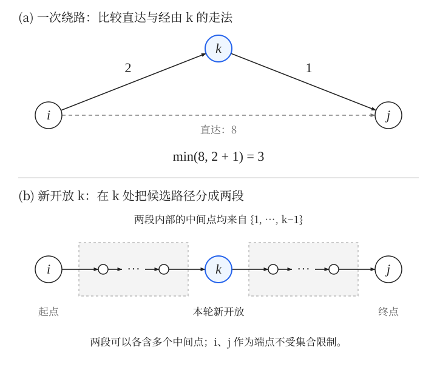
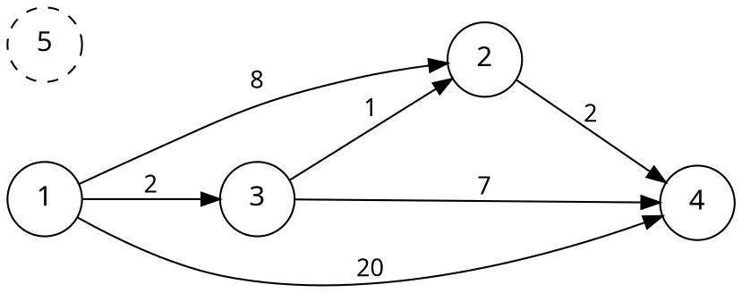

[[TOC]]

## 从单源最短路到全源最短路

在 [[[rbook: bellman-ford]]]、[[[rbook: dijkstra]]] 中，我们固定起点 $s$，求它到其余各点的最短距离。这叫**单源最短路**。

如果要回答许多次询问，每次起点、终点都可能不同，就可以预先求出**任意两点之间的最短距离**，存进矩阵 $d$：$d[i][j]$ 表示从 $i$ 到 $j$ 的最短距离。这叫**全源最短路**，也叫多源最短路。

逐个选择起点，运行单源最短路算法，也能解决这个问题。Floyd（Floyd–Warshall）则提供了一种只用三重循环的做法，时间复杂度为 $O(n^3)$，适合点数较少、需要大量点对距离的场景。本文先用三维数组完整保存各阶段，再推导如何把空间从 $O(n^3)$ 压缩到 $O(n^2)$。

本文先讨论**没有负环的有向图**。边权可以为负数；无向图只需把每条边按两个方向存入。

::: oneWordAlgo
逐步放开允许经过的中间点，把两段已经求好的最短路拼起来。
:::

## 从一次绕路想到分阶段求解

**从 $i$ 到 $j$，直接走一定最好吗？**

不一定。例如直达要花 $8$，先到 $k$ 花 $2$，再从 $k$ 到 $j$ 花 $1$，绕一下反而只需要 $3$。只要两段都可达，就可以尝试更新：

$$
d[i][j] = \min\bigl(d[i][j],\ d[i][k]+d[k][j]\bigr).
$$

这里的 $i\to k$、$k\to j$ 都可以是一整段路径，不一定是直接相连的一条边。

**把所有 $i,j,k$ 枚举一遍，就一定能得到答案吗？**

还不能这样下结论。更新 $d[i][j]$ 时，依赖的 $d[i][k]$、$d[k][j]$ 可能还没算好。我们需要安排一种顺序，保证用到的子问题已经解决。

可以先解决一个受限制的问题：不允许经过任何中间点时，只能直接走边，或者留在原地。然后允许经过点 $1$，再允许经过点 $2$，直到所有点都能作为中间点。

**新允许一个点作为中间点，会多出哪些走法？**

假设之前只允许用 $1,\ldots,k-1$ 作为中间点，现在再允许用 $k$。新增的候选路径一定经过 $k$，于是可以在 $k$ 处拆成 $i\to k$ 和 $k\to j$ 两段。这就找到了分阶段求解的依据。

把上面的两步思考放在一起看：图 (a) 比较一次绕路的费用，图 (b) 说明新开放 $k$ 时，两段距离应当来自已经完成的阶段。



图 (b) 中的省略号表示每段都可以是一整条路径。我们复用的是两段已经求好的距离，再与不经过 $k$ 的旧答案取最小值；并不是要求整条路径只走两条边。

## 动态规划的状态与转移

### 状态：限制中间点的编号

定义 $D_k(i,j)$ 表示：从 $i$ 到 $j$，**所有中间点都属于集合 $\{1,2,\ldots,k\}$** 时的最短距离；不可达时记为 $\infty$。

中间点指起点与终点之间的点，**起点 $i$ 和终点 $j$ 不受这个集合限制**。例如计算 $D_2(4,5)$ 时，可以从 $4$ 出发、到 $5$ 结束，只是途中不能经过点 $3$。

::: info
第 $k$ 个阶段限制的是“允许哪些点作为中间点”，不是“最多走 $k$ 条边”，也不要求路径上的编号递增。
:::

### 初始状态：没有中间点

$D_0(i,j)$ 只考虑直接走边与留在原地：

- $i=j$ 时为 $0$，表示一条边也不走。
- $i\ne j$ 且有边 $i\to j$ 时，为这些重边中的最小权值。
- 其余情况为 $\infty$。

实现时先把对角线设为 $0$，其余设为 `INF`，然后读边并取最小值。这样也能保留负权自环；不过负权自环本身就是负环，不符合本文主模板的前提。

### 转移：是否经过新开放的点

因为没有负环，路径中的环可以删去而不增加长度，所以对可达点对，总能选出一条简单最短路。按它是否把 $k$ 作为中间点分类：

1. **不经过 $k$**：所有中间点仍在 $1,\ldots,k-1$ 内，最优值为 $D_{k-1}(i,j)$。
2. **经过 $k$**：简单路径只经过 $k$ 一次，在这里切开后，两段的中间点都在 $1,\ldots,k-1$ 内，分别对应 $D_{k-1}(i,k)$ 与 $D_{k-1}(k,j)$。

因此：

$$
D_k(i,j)=\min\left(D_{k-1}(i,j),\ D_{k-1}(i,k)+D_{k-1}(k,j)\right).
$$

这个式子没有遗漏最优路径：它必然属于上面两类之一。反过来，两段可达路径拼接后也是一条合法走法；即使拼接产生重复点，也可以删去非负的环，使长度不增加。因此两段最短距离的和可以作为候选值。

起点或终点恰好是 $k$ 时，转移依然成立，因为 $D_{k-1}(k,k)=0$，相当于拼上一段长度为零的路径。

初始状态正确，每次转移又完整考虑了新增的走法，于是由归纳可知：处理完第 $k$ 个阶段，得到的正是 $D_k$。当 $k=n$ 时，所有点都允许作为中间点，$D_n$ 就是答案。

## 先把转移直接写成三维代码

### 三维数组与转移一一对应

先完整保留阶段这一维。用 `d[k][i][j]` 存储 $D_k(i,j)$，三个下标依次表示“开放到哪个中间点、起点、终点”。

第 $0$ 层按前面的方法初始化。之后，直接照着转移公式写：

```cpp
for (int k = 1; k <= n; k++) {
    for (int i = 1; i <= n; i++) {
        for (int j = 1; j <= n; j++) {
            // 不经过新开放的 k：继承上一层。
            d[k][i][j] = d[k - 1][i][j];

            // 经过 k：两段距离都从上一层读取。
            if (d[k - 1][i][k] != INF && d[k - 1][k][j] != INF) {
                d[k][i][j] = min(d[k][i][j],
                                d[k - 1][i][k] + d[k - 1][k][j]);
            }
        }
    }
}
```

这里读的是第 $k-1$ 层，写的是第 $k$ 层，两个阶段保存在不同位置。即使本轮没有找到更短的路径，也必须先继承旧答案，不能把当前状态留成默认的零。

按照这个转移计算时，先算完第 $k-1$ 层，才能算第 $k$ 层，所以把 $k$ 放在最外层；同一层的所有 $(i,j)$ 都只依赖上一层，因此内层 $i,j$ 可以交换。

完整保存第 $0$ 到第 $n$ 层，需要 $(n+1)$ 张距离矩阵，空间复杂度为 $O(n^3)$。每层计算 $n^2$ 个状态，共 $n$ 次转移，时间复杂度为 $O(n^3)$。

### 可以直接运行的三维版本

下面是包含初始化、读边、转移和输出的完整程序。它先打印 `D[0]`，之后每完成一整轮 $k$ 就打印 `D[k]`，让我们看清每一层的结果。最终答案在 `d[n][i][j]` 中。

教学版的数组按 $n\le50$ 的小图准备，输入有向图，要求没有负环，距离范围与后面的二维模板采用同样约定。先用小图观察状态，再考虑处理更大的数据。

```cpp file=./floyd_3d.cpp
```

## 运行三维版本，观察每一层

取 $5$ 个点，点 $5$ 孤立，其余有向边如下：

| 边 | 权值 |
| --- | --- |
| $1\to2$ | $8$ |
| $1\to3$ | $2$ |
| $1\to4$ | $20$ |
| $3\to2$ | $1$ |
| $2\to4$ | $2$ |
| $3\to4$ | $7$ |



### 输入、编译与完整输出

把上面的程序保存为 `floyd_3d.cpp`，把下面的输入保存为 `sample.in`：

```text
5 6
1 2 8
1 3 2
1 4 20
3 2 1
2 4 2
3 4 7
```

在这两个文件所在目录运行：

```bash
g++ -std=c++17 -O2 floyd_3d.cpp -o floyd_3d
./floyd_3d < sample.in
```

矩阵的行是起点，列是终点。程序的完整输出如下，`D[k]` 表示只允许 $1,\ldots,k$ 作为中间点时的距离矩阵：

```text
D[0]
0 8 2 20 INF
INF 0 INF 2 INF
INF 1 0 7 INF
INF INF INF 0 INF
INF INF INF INF 0

D[1]
0 8 2 20 INF
INF 0 INF 2 INF
INF 1 0 7 INF
INF INF INF 0 INF
INF INF INF INF 0

D[2]
0 8 2 10 INF
INF 0 INF 2 INF
INF 1 0 3 INF
INF INF INF 0 INF
INF INF INF INF 0

D[3]
0 3 2 5 INF
INF 0 INF 2 INF
INF 1 0 3 INF
INF INF INF 0 INF
INF INF INF INF 0

D[4]
0 3 2 5 INF
INF 0 INF 2 INF
INF 1 0 3 INF
INF INF INF 0 INF
INF INF INF INF 0

D[5]
0 3 2 5 INF
INF 0 INF 2 INF
INF 1 0 3 INF
INF INF INF 0 INF
INF INF INF INF 0
```

可以先在纸上写出第 $0$ 层，再逐层计算，最后与程序输出核对。`D[1]` 没有变化，`D[2]` 和 `D[3]` 有变化，后面几层又保持不变；没有变化的层同样是合法的阶段结果。

### 手动核对关键更新

下面只追踪会变化的三个位置，其余位置始终不变。表中的每一行来自相应的第 $k$ 层：

| 完成的阶段 | $D_k(1,2)$ | $D_k(1,4)$ | $D_k(3,4)$ | 本轮新增的更短走法 |
| --- | --- | --- | --- | --- |
| 初始化 | $8$ | $20$ | $7$ | 只走直接边 |
| $k=1$ | $8$ | $20$ | $7$ | 无更新 |
| $k=2$ | $8$ | $10$ | $3$ | $1\to2\to4$，$3\to2\to4$ |
| $k=3$ | $3$ | $5$ | $3$ | $1\to3\to2$，$1\to3\to2\to4$ |
| $k=4$ | $3$ | $5$ | $3$ | 无更新 |
| $k=5$ | $3$ | $5$ | $3$ | 无更新 |

先核对 $k=2$：新允许经过点 $2$ 后，`d[2][1][4]` 读取的三个数都来自第 $1$ 层：

$$
D_2(1,4)=\min\bigl(D_1(1,4),D_1(1,2)+D_1(2,4)\bigr)
=\min(20,8+2)=10.
$$

同一轮还得到 $D_2(3,4)=\min(7,1+2)=3$。接着计算 $k=3$，更新 `d[3][1][4]` 时，使用第 $2$ 层已经算好的结果：

$$
D_3(1,4)=\min\bigl(D_2(1,4),D_2(1,3)+D_2(3,4)\bigr)
=\min(10,2+3)=5.
$$

其中 $D_2(3,4)=3$ 对应整段路径 $3\to2\to4$。所以新开放中转点 $3$ 时，就能拼出 $1\to3\to2\to4$，并不要求路径上的编号递增。

可以先遮住输出，手动完成下面两次检查：

1. 求 `d[3][1][2]`：应从哪一层取数，为什么会从 $8$ 变成 $3$？
2. 把输入中 $3\to2$ 的边权从 $1$ 改成 $4$，重新手推 `d[3][1][4]`，再运行程序检查它是否变成 $8$。

点 $5$ 到自身的距离始终为 $0$，它与其他点之间始终不可达。观察这个孤立点，可以检查 `INF` 是否被正确保留。

下面的动画也可以配合手推使用。先关注三维分层状态，观察每次更新从上一层取了哪两段距离；二维原地更新的理由放在下一节推导。

[[[dsa: floyd]]]

## 从三维状态推导空间压缩

### 更早的层还有用吗？

观察三维转移：计算第 $k$ 层时，只读取第 $k-1$ 层，从不读取第 $k-2$ 层及更早的层。

因此，如果只需要最终最短距离，就不必保留全部历史。先做一步容易确认正确的压缩：用 `prev` 保存上一层，用 `cur` 保存当前层，算完一层后交换它们。

假设已经把初始矩阵 $D_0$ 存在 `vector<vector<long long>> prev` 中，转移核心可以写成：

```cpp
vector<vector<long long>> cur;
for (int k = 1; k <= n; k++) {
    cur = prev; // 当前层先完整继承上一层
    for (int i = 1; i <= n; i++) {
        for (int j = 1; j <= n; j++) {
            if (prev[i][k] != INF && prev[k][j] != INF) {
                cur[i][j] = min(cur[i][j], prev[i][k] + prev[k][j]);
            }
        }
    }
    prev.swap(cur); // 本轮结果成为下一轮的“上一层”
}
```

这时仍然严格区分读、写两个阶段，只是把 $n+1$ 张矩阵缩减成两张，空间已经降为 $O(n^2)$。循环结束后，`prev` 保存 $D_n$。

三维教学版为了观察过程而输出每一层；如果题目本身要求保留历史状态，就要按需求保存。下面讨论只需要最终矩阵的情形。

### 能不能连两张矩阵也合成一张？

如果直接在一张矩阵里修改，开始第 $k$ 轮时，它保存 $D_{k-1}$；结束这一轮后，它应该变成 $D_k$。真正要检查的是：**先更新的位置，会不会覆盖后续转移仍要读取的旧值？**

固定 $k$，更新 $(i,j)$ 时，需要的三项是：

- `d[i][j]`：这个位置在本轮尚未更新，仍是上一层的旧答案。
- `d[i][k]`：第 $k$ 列的值。
- `d[k][j]`：第 $k$ 行的值。

每个 $(i,j)$ 在本轮只更新一次，所以第一项没有问题。接下来只需检查第 $k$ 行、第 $k$ 列会不会改变。

无负环时，留在原地的最短距离为 $0$，即 $D_{k-1}(k,k)=0$。因此：

$$
\begin{aligned}
D_k(i,k)&=\min\bigl(D_{k-1}(i,k),D_{k-1}(i,k)+0\bigr)=D_{k-1}(i,k),\\
D_k(k,j)&=\min\bigl(D_{k-1}(k,j),0+D_{k-1}(k,j)\bigr)=D_{k-1}(k,j).
\end{aligned}
$$

不可达的位置也保持不可达。于是，第 $k$ 行、第 $k$ 列在这一轮中都不会变化：即使它们已经执行过更新，读到的数仍等于上一层的数。其他位置虽然可能变小，却不会被当前阶段用作拼接路径的两段距离。

这就证明了单张矩阵原地更新的安全性。**不是看到转移只依赖上一层，就能直接删掉一个下标；还需要确认覆盖旧值不会破坏后续读取。**

### 最后才得到二维核心

有了上面的证明，才可以把三维代码中的 `d[k][i][j]` 和 `d[k-1][i][j]` 合并成同一个 `d[i][j]`：

```cpp
for (int k = 1; k <= n; k++) {
    for (int i = 1; i <= n; i++) {
        for (int j = 1; j <= n; j++) {
            if (d[i][k] != INF && d[k][j] != INF) {
                d[i][j] = min(d[i][j], d[i][k] + d[k][j]);
            }
        }
    }
}
```

第 $k$ 轮开始前，矩阵表示 $D_{k-1}$；结束后，矩阵表示 $D_k$。省去的只是保存历史阶段的位置，阶段的推进顺序仍然存在。

| 实现 | 保存的内容 | 空间复杂度 |
| --- | --- | --- |
| 三维数组 | 第 $0$ 到第 $n$ 层 | $O(n^3)$ |
| 两层滚动 | 上一层与当前层 | $O(n^2)$ |
| 二维原地更新 | 一张逐轮覆盖的矩阵 | $O(n^2)$ |

两层滚动与原地更新的渐进空间复杂度相同；后者进一步减少了矩阵数量，也省去了每轮复制整张矩阵的操作。它们的核心计算时间仍然都是 $O(n^3)$。

## 压缩后，为什么 k 仍必须在最外层？

按阶段推进，才能保证开始第 $k$ 轮时，所有点对都已完成第 $k-1$ 阶段。内层 $i,j$ 可以交换，$k$ 这一阶段循环则应放在它们外面。

### 把 k 放在内层的反例

考虑只有三条边的有向图，边权都为 $1$：

```viz-dot
digraph G {
    rankdir=LR;
    node [shape=circle, width=0.5, fontsize=13];
    edge [arrowsize=0.7, fontsize=11];
    1 -> 3 [label="1"];
    3 -> 4 [label="1"];
    4 -> 2 [label="1"];
}
```

正确的 $d[1][2]$ 应为 $3$（路径 $1\to3\to4\to2$）。如果按 `i → j → k` 的顺序、每个循环都从 $1$ 枚举到 $n$，处理 $(i,j)=(1,2)$ 时：

- 枚举到 $k=3$，$d[3][2]$ 还是 `INF`，无法更新。
- 枚举到 $k=4$，$d[1][4]$ 还是 `INF`（$1\to4$ 要经过 $3$，而 $3$ 还没被算过），也无法更新。

稍后处理 $(1,4)$ 才得到 $d[1][4]=2$，但算法不会回头重算 $(1,2)$，最终漏掉这条路径。

所以“每个三元组都算过一次”并不足够，**依赖的距离必须在使用之前准备好**。

## 二维压缩版完整模板

现在再来看竞赛中常用的二维实现。输入与三维版本相同，输出时只保留最终矩阵，不再打印各层。**本模板同样要求图中没有负环**。

```cpp file=./floyd.cpp
```

使用前面的 `sample.in` 运行，输出为：

```text
0 3 2 5 INF
INF 0 INF 2 INF
INF 1 0 3 INF
INF INF INF 0 INF
INF INF INF INF 0
```

它应当与三维版本的 `D[5]` 完全一致。读懂三维状态、手推过层间转移之后，这段精简代码里的每一次读写就都有了依据。

## 实现时容易出错的地方

### 初始化、重边与无向边

全局数组默认全是零，不能直接拿来表示距离，否则会把所有点对都当作零距离可达。必须先设置对角线为零、其余为 `INF`，再读入边。

重边必须取最小值，不能让最后读到的一条较长边覆盖较短边。无向边需要同时更新两个方向：

```cpp
d[u][v] = min(d[u][v], w);
d[v][u] = min(d[v][u], w);
```

### 两段都可达，才能相加

数学中的 $\infty$ 与负数相加仍是 $\infty$，但代码中的 `INF` 只是一个有限整数。若直接计算 `INF + (-5)`，结果小于 `INF`，就可能把不可达误判为可达。

所以模板先判断 `d[i][k]`，不可达就跳过这一行；再判断 `d[k][j]`，不可达就跳过当前点对。两段都可达才执行加法。

此外还要按题目范围选择数值类型与 `INF`：所有存储的有限距离都应与 `INF` 区分开，相加的中间结果也必须落在 `long long` 范围内。对于模板中的 $10^{18}$，若有限值的绝对值都小于它，两数相加的绝对值小于 $2\times10^{18}$，仍在 `long long` 范围内。

在无负环的前提下，若边权绝对值至多为 $W$，最短简单路最多有 $n-1$ 条边，可用这个界估计距离范围；取 $nW<\mathrm{INF}$ 是一个方便的充分条件（这个乘积也要用足够宽的类型计算）。`INF` 不是越接近整数上限越好。

### 不要因为某一轮没有更新就提前退出

第 $k$ 轮没有更新，只说明新开放的点 $k$ 没有带来更短路径，后面的点仍可能带来改进。本例第 $1$ 轮没有更新，但第 $2$、第 $3$ 轮都有更新。

## 负权边与负环

Floyd 的转移不依赖边权非负，因此**可以处理负权边**。但如果能够从 $i$ 到达一个负环，再从这个负环到达 $j$，就可以反复绕环，使 $i\to j$ 的长度无限减小，此时不存在有限的最短距离。

在数值运算不溢出的前提下，Floyd 也可以用于检测负环：运行后，如果存在点 $v$ 满足

$$
d[v][v]<0,
$$

就说明图中存在负环。因为这代表从 $v$ 出发又回到 $v$ 的负权闭合走法，其中必然含有负环；反过来，负环也会使某个对角线元素变为负数。

但“检测出负环”不等于“已经给每个点对算出答案”。若存在这样的 $v$，并且 $i\to v$、$v\to j$ 均可达，则 $(i,j)$ 的距离无下界，应按题目要求另外标记。受影响的矩阵数值不能直接当作最短距离输出。

主模板按无负环的输入使用；处理负环检测时，还需要单独保证运算范围。更多负环的背景见 [[[rbook: negative_circle]]]。

## 复杂度与算法选择

- 二维模板初始化与输出需要 $O(n^2)$ 时间，读边需要 $O(m)$ 时间；核心计算为 $O(n^3)$，总时间为 $O(n^3+m)$。三维教学版打印全部 $n+1$ 层需要 $O(n^3)$ 输出时间，总时间仍为 $O(n^3+m)$。
- 三维教学版保存全部阶段，空间为 $O(n^3)$；两层滚动和二维原地更新均为 $O(n^2)$，不需要另外保存所有边。
- 预处理结束后，每次点对距离查询为 $O(1)$。

| 需求 | 可以考虑的算法 |
| --- | --- |
| 单源、所有边权非负 | [[[rbook: dijkstra]]] |
| 单源、有负权边，或需要检测从源点可达的负环 | [[[rbook: bellman-ford]]] |
| 点数较少，需要任意两点的距离 | Floyd |
| 点数较多的非负权稀疏图，需要多个起点的距离 | 按需从各起点运行 Dijkstra |

三维教学版只用于 $n\le50$ 的小图；二维模板的 `N = 410` 只是数组容量，不代表任意时限下都能通过。以 $n=400$ 为例，三重循环约有 $6.4\times10^7$ 次点对尝试，要结合时限判断。

## 两个延伸方向

**如果需要输出具体路径**，可以额外维护 `nxt[i][j]`，表示从 $i$ 前往 $j$ 的第一步到哪里。直接边初始化为 `j`；严格变短且改走 $i\to k\to j$ 时，令 `nxt[i][j] = nxt[i][k]`。查询时不断沿第一步前进，直到终点。不可达以及受负环影响的点对要先排除。

**如果只关心能否到达**，把“取最小值”换成逻辑或，把“两段长度相加”换成逻辑与，就得到传递闭包：

```cpp
// reach[i][j] 表示是否能从 i 到达 j；先初始化自身与直接边。
for (int k = 1; k <= n; k++)
    for (int i = 1; i <= n; i++)
        for (int j = 1; j <= n; j++)
            reach[i][j] = reach[i][j] || (reach[i][k] && reach[k][j]);
```

它沿用同一条推理：新允许经过 $k$ 后，只需考虑能否先到达 $k$，再从 $k$ 到达终点。

[[[include: ./practice.md]]]
