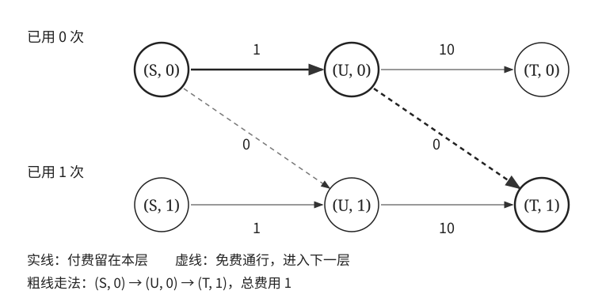

[[TOC]]

普通最短路用 `dis[u]` 保存到达顶点 $u$ 的最小费用。若剩余机会或当前模式会改变后续选择与费用，只记录顶点就不够。

分层图最短路的关键是：**把影响后续选择的信息并入状态，再在状态组成的新图上求最短路。**

本文以“至多 $k$ 次免费通行”为主例，需先掌握 [[[rbook: dijkstra]]] 的松弛、小根堆和过期条目处理。

## 位置与状态

下面的有向图允许至多一次免费通行：


从 $S$ 到 $U$，有两种选择：

| 到达 $U$ 的方式 | 到这里的费用 | 已用免费次数 | 继续到 $T$ 的最佳选择 | 总费用 |
| --- | --- | --- | --- | --- |
| 付费走第一条边 | $1$ | $0$ | 把第二条边免费 | $1$ |
| 免费走第一条边 | $0$ | $1$ | 第二条边付费 $10$ | $10$ |

第二条记录到达 $U$ 的费用更小，最终却更贵。若因此删除第一条记录，就会丢掉总费用为 $1$ 的最优解。

普通最短路可以丢弃较贵的记录，是因为到达同一顶点后，后续选择和代价相同。本题的免费机会改变了后续代价，必须区分已用次数。

需要区分的是：

$$
(U,0)\quad\text{和}\quad(U,1).
$$

两个分量分别表示顶点和已用次数，各状态独立保存最小费用。

::: note 适用线索 icon=bulb
遇到操作次数、边数余数或当前模式等限制时，检查位置是否足以决定下一步的合法选择与代价。

若不足，就将必要信息加入状态，并估算状态总数是否可控。
:::

## 状态定义

现在考虑一般模型：图有 $n$ 个顶点，边权非负，从 $s$ 到 $t$，最多可以让 $k$ 次通行免费。

定义状态 $(u,j)$：当前在顶点 $u$，**恰好已经使用 $j$ 次免费机会**。因此：

$$
0\le j\le k.
$$

已用次数相同的状态属于同一层。每个顶点对应 $k+1$ 个状态，共 $n(k+1)$ 个。

::: definition 状态距离
`dis[j][u]` 表示从 $(s,0)$ 出发，到达 $(u,j)$ 的最小费用，即到达 $u$ 时恰好使用了 $j$ 次免费机会的最小费用。

这里的层号是资源使用量，不是最短距离，也不是 BFS 的搜索深度。
:::

初始时只知道：

$$
dis[0][s]=0.
$$

其余状态初始化为无穷大。起点只有第 $0$ 层可达，不能把所有层都设为 $0$。

若改用“剩余次数”，状态定义、初值、转移方向和答案范围也要相应修改。

## 状态转移

设原图有一条有向边 $u\to v$，原价为 $w$。到达状态 $(u,j)$ 后，只有下面两类选择。

### 付费通行

$$
(u,j)\longrightarrow(v,j),\qquad\text{边权为 }w.
$$

对应松弛：

$$
dis[j][v]\gets\min\bigl(dis[j][v],\ dis[j][u]+w\bigr).
$$

### 免费通行

只有 $j<k$ 时可以这样走：

$$
(u,j)\longrightarrow(v,j+1),\qquad\text{边权为 }0.
$$

对应松弛：

$$
dis[j+1][v]\gets\min\bigl(dis[j+1][v],\ dis[j][u]\bigr).
$$

免费通行同时改变顶点、消耗机会。$(u,j)\to(u,j+1)$ 只改层号、不移动位置，不符合本题操作。

回到开头的有向图，把 $k=1$ 的两个状态层画出来：



两条到达 $U$ 的记录被保留在不同状态上；最优走法是 $(S,0)\to(U,0)\to(T,1)$。

如果原图是无向边 $\{u,v\}$，则把它看成 $u\to v$ 和 $v\to u$，分别应用上面的规则。免费跨层的方向分别是：

$$
(u,j)\to(v,j+1),\qquad(v,j)\to(u,j+1).
$$

两个方向的层号都加一。不能把跨层边反向连成 $(v,j+1)\to(u,j)$，否则会恢复已用机会。

## 正确性证明

### 路线映射

给定原图中一条路线，并指定每次通行是否免费。从 $(s,0)$ 出发：

- 付费时，走对应的同层边；
- 免费时，走对应的跨层边，已用次数加一。

至多免费 $k$ 次，就不会超过第 $k$ 层。每一步费用不变，总费用也不变。

### 路线还原

新图中的每条边都来自原图的一条真实边。去掉层号，就得到原图上的路线；跨层边表示使用一次免费机会，同层边表示照常付费。

层号从 $0$ 开始，仅在免费通行时加一，且不超过 $k$。还原后的路线满足次数限制，费用不变。

合法路线可以互相转换且费用不变，因此状态图中的最短路等价于原问题。

### 状态充分性

位置 $u$ 和已用次数 $j$ 相同时，可走的边、剩余机会与通行费用均相同。因此，同一状态只需保留最小费用，不必记录更早的历史。

若优惠不能连续使用，还需记录上次是否使用；若钥匙种类决定能走的边，仅保存钥匙数量也不够。附加状态必须由题目规则决定。

## 合法终点

状态中的 $j$ 定义为“恰好已用次数”，但题目要求的是“至多 $k$ 次”。到达 $t$ 时可以剩下机会不用，所以答案为：

$$
\boxed{\min_{0\le j\le k}dis[j][t]}.
$$

只有题目要求恰好使用 $k$ 次，而且当前转移确实表达了这个规则时，答案才是 `dis[k][t]`。

例如一张有向图只有一条 $s\to t$ 的边，允许至多免费 $2$ 次：免费通过这条边就能到终点，答案为 $0$；但不存在恰好经过两次免费通行后到达终点的走法，第 $2$ 层的终点不可达。

| 题目要求 | 当前状态定义下的合法终点 |
| --- | --- |
| 至多免费 $k$ 次 | $(t,0),(t,1),\ldots,(t,k)$ |
| 恰好免费 $k$ 次 | 仅 $(t,k)$ |
| 已走边数必须为偶数 | 记录奇偶后，仅接受 $(t,0)$ |
| 到终点时两种模式都允许 | 两种终点模式都要考虑 |

合法终点由题意决定，不能仅凭距离数组的最后一层取答案。

## 算法选择

根据**状态图的边权**选择算法：

| 状态图的边权情况 | 可用算法 |
| --- | --- |
| 所有转移代价都是 $1$ | [[[rbook: bfs]]] |
| 所有转移代价只能为 $0$ 或 $1$ | [[[rbook: zero_one_bfs]]] |
| 所有转移代价非负 | [[[rbook: dijkstra]]] |

主例中免费边权为 $0$，付费边权却可能是 $10$、$100$，所以使用 Dijkstra。只看见零权边，不能据此改用 0-1 BFS。

分层不会消除负权。若转移有负权，需要另选适用算法。

### 层号与计算顺序

免费次数只增不减，但同层边仍可能有环，状态图未必是 DAG。因此不能只按层号扫描一次，Dijkstra 仍须按费用顺序处理状态。

开头的反例会按下面的顺序发生更新：

| 弹出的有效状态 | 新得到或改进的距离 |
| --- | --- |
| $(S,0)$，费用 $0$ | $dis[0][U]=1$，$dis[1][U]=0$ |
| $(U,1)$，费用 $0$ | $dis[1][T]=10$ |
| $(U,0)$，费用 $1$ | $dis[0][T]=11$，将 $dis[1][T]$ 改为 $1$ |
| $(T,1)$，费用 $1$ | 已得到最小合法终点费用 |

费用为 $10$ 的终点虽先被发现，仍可被松弛改进，须按普通 Dijkstra 处理过期记录。

## 隐式建图

隐式建图只保存原图。处理 $(u,j)$ 时，根据 `g[u]` 临时生成付费、免费两种转移，无须存储完整状态图的边表。

和普通 Dijkstra 相比，只需要对应地改动三处：

| 普通 Dijkstra | 分层状态 Dijkstra |
| --- | --- |
| `dis[u]` | `dis[used][u]` |
| 堆中保存 `(费用, 顶点)` | 堆中保存 `(费用, 顶点, 已用次数)` |
| 沿原边正常付费 | 尝试付费通行和免费通行 |

过期判断也必须针对完整状态：

```cpp
if (du != dis[used][u]) {
    continue;
}
```

不能用 `vis[u]` 一并标记所有层，各层状态必须独立处理。

### 代码实现

下面采用 [[[p: luogu-P4568 | P4568「飞行路线」]]] 的输入形式：顶点编号为 $0\sim n-1$，航线是无向边，至多免费 $k$ 次。其约束为 $n\le10^4$、$m\le5\times10^4$、$k\le10$，价格非负。[原题面](https://www.luogu.com.cn/problem/P4568)

函数返回每个状态的距离，主程序按“至多”取终点各层的最小值；本实现约定不可达时输出 `-1`。

```cpp file=./layered_dijkstra.cpp
```

已有的 [[[p: luogu-P4568 | 飞行路线题解]]] 还提供了具体题目的讨论与演示，可以在理解本文的状态定义后对照阅读。

### 样例分析

```text
输入：
5 6 1
0 4
0 1 5
1 2 5
2 3 5
3 4 5
2 3 3
0 2 100

输出：
8
```

一条最优走法是先免费走 $0\to2$，再付费走 $2\to3\to4$，费用为 $0+3+5=8$。原图中的重边分别保留，状态转移会自动比较它们的费用。

### 边界处理

- $k=0$ 时只有一层，不产生免费转移，算法回到普通 Dijkstra。
- 只初始化 `dis[0][s]`；其他层要通过真实转移到达。
- 已用次数到 $k$ 以后仍能正常付费通行，只是不能再跨层免费。
- 起点等于终点时，零次通行、零费用已经是合法答案。
- 零权边与重边都按正常松弛处理；严格变小才入堆，不会因零权环反复加入相同距离。
- 费用使用 `long long`；输入编号从 $0$ 还是从 $1$ 开始，要与数组和编号映射一致。

若需提前结束，可在首次弹出有效的 `u == t` 状态时返回。堆按所有层的累计费用排序，该状态即为最小合法终点；不能在终点刚入堆时返回。

## 显式建图

隐式与显式表示的是同一张状态图。顶点从 $0$ 编号时，可以定义：

$$
id(u,j)=j\cdot n+u.
$$

状态编号范围为 $0\sim n(k+1)-1$。只看一条原图有向边 $u\to v$，显式连边可以写为：

```cpp
// new_graph 是分层后的邻接表；n 为原图顶点数。
auto id = [n](int u, int used) {
    return used * n + u;
};

for (int used = 0; used <= k; ++used) {
    new_graph[id(u, used)].push_back({id(v, used), w});
    if (used < k) {
        new_graph[id(u, used)].push_back({id(v, used + 1), 0});
    }
}
```

无向原图还要对 $v\to u$ 做同样的处理。随后在 `new_graph` 上直接使用普通 Dijkstra，源点为 `id(s,0)`，终点仍要在 `id(t,0)` 到 `id(t,k)` 中取最小距离。

显式写法便于核对连边，隐式写法节省边表空间；二者都在完整状态上求最短路。

## 复杂度

令 $N'$ 表示新图状态数，$M'$ 表示新图的有向边数。对于 $n$ 个顶点、$m$ 条无向边的主例：

$$
N'=n(k+1),\qquad M'=2m\bigl((k+1)+k\bigr)=2m(2k+1).
$$

每个原图方向在所有 $k+1$ 层都能正常通行，在前 $k$ 层还能免费进入下一层。

代码使用允许过期条目的二叉堆。距离数组初始化需要 $O(N')$；每条转移至多带来一次成功松弛，堆内条目数可按 $O(M'+1)$ 估计，因此时间可以写为：

$$
O\bigl(N'+(M'+1)\log(M'+2)\bigr).
$$

空间要分开看：

| 存储内容 | 显式建图 | 本文的隐式建图 |
| --- | --- | --- |
| 邻接表 | $O(N'+M')$ | 原图的 $O(n+m)$ |
| 距离表 | $O(N')$ | $O(N')$ |
| 惰性堆的最坏条目量 | $O(M'+1)$ | $O(M'+1)$ |

隐式建图节省的是边表空间；它不会让需要尝试的转移消失，堆的空间也不能在估算总内存时忽略。

P4568 上限对应 $110\,000$ 个状态、$2\,100\,000$ 条有向转移。即使次数较少，也须乘上原图规模估算成本。

## 模型扩展

### 折扣次数

若最多使用 $k$ 次半价优惠，状态仍然是 $(u,j)$，正常通行仍在本层，使用优惠则变为：

$$
(u,j)\to(v,j+1),\qquad\text{代价为折后价格}.
$$

若题目保证价格为偶数，折后价格就是 $w/2$；若出现奇数，就必须按题目规定处理，不能自行决定向下取整。

状态个数与主例相同，合法终点仍由“至多”或“恰好”的要求决定。若一次通行只能用一张卡，就只有加一层的转移，不能在同一条边上连续打折多次。

### 边数奇偶

若只接受经过偶数条边的走法，可以把状态定义为 $(u,p)$，其中 $p$ 是已走边数模 $2$：

$$
(u,p)\to(v,p\mathbin{\oplus}1).
$$

初始状态为 $(s,0)$，只接受终点 $(t,0)$。原图若每条边都计一步，新图边权也全为 $1$，可以用 BFS。

这里层号会从 $0$ 到 $1$，再从 $1$ 回到 $0$，不具有次数模型中的单向增长。若要求边数是 $q$ 的倍数，同样可以保存余数 $r$，每一步更新为 $(r+1)\bmod q$。

保存余数足够，是因为后续只关心最终的余数条件；如果要求恰好走 $L$ 条边，就不能把长度只压成奇偶而丢掉实际边数。

### 方向模式

考虑一张有向图：每走一条边费用为 $1$，还可以在当前位置花费 $X$，将全图边方向翻转。翻转两次回到原方向，因此只需记录当前模式 $b\in\{0,1\}$，不需要记录总共翻了多少次。

对于原图边 $u\to v$，新图包含：

$$
(u,0)\to(v,0),\qquad(v,1)\to(u,1),\qquad\text{代价均为 }1.
$$

翻转操作则对应：

$$
(u,0)\leftrightarrow(u,1),\qquad\text{每次代价为 }X.
$$

翻转不移动位置，所以跨层边连接同一顶点的两种模式。跨层方式取决于操作含义，不能照搬免费通行模型。

从 $(s,0)$ 出发，到终点时两种方向都允许，答案为 $\min(dis[0][t],dis[1][t])$。若 $X$ 为一般正数，使用 Dijkstra。这也是下方 ABC395 E 的模型。[原题面](https://atcoder.jp/contests/abc395/tasks/abc395_e)

## 推荐练习

建议先练次数，再练层号循环变化的模型。每道题都先写状态、转移和合法终点，再选择最短路算法。

| 顺序 | 题目 | 训练目标 |
| --- | --- | --- |
| 1 | [[[p: luogu-P4568 | P4568：飞行路线]]] | 免费次数进入状态；区分层内付费与跨层免费；终点多层取最小值 |
| 2 | [[[p: luogu-P4822 | P4822：冻结]]] | 把跨层代价从免费改为半价，保持“一条道路一次用卡”的规则 |
| 3 | [[[p: atcoder-abc132_e | ABC132 E：Hopscotch Addict]]] | 将已走边数模 $3$ 作为层号，用 BFS 求满足余数限制的最短走法 |
| 4 | [[[p: atcoder-abc395_e | ABC395 E：Flip Edge]]] | 正向、反向两种模式；当前位置付费换层；到终点的模式不限 |

**冻结**保证原始边权均为偶数，且不必用完所有卡，因此可以直接用整数半价，最后在合法层中取最小值。[P4822 题面](https://www.luogu.com.cn/problem/P4822)

**Hopscotch Addict**每次完整操作恰好连续走三条边，中途经过终点不算完成。应查询余数为 $0$ 的终点；若 BFS 距离记录的是原始边数，最后还要除以 $3$，才是题目要求的操作次数。[ABC132 E 题面](https://atcoder.jp/contests/abc132/tasks/abc132_e)

还可扩展到以下状态：

- **钥匙集合**：[[[p: roj-1495 | 拯救大兵瑞恩]]]。同一格子、持有不同钥匙集合时，可通过的门不同；可以结合 [[[rbook: binary_state]]] 了解集合的位掩码表示。状态量要按格子数乘 $2^p$ 估算，而不是只乘钥匙种类数 $p$。
- **剩余油量**：[[[p: roj-1502 | 汽车加油行驶]]]。位置与油量一起决定能否继续行驶，再按规则处理行驶、加油等转移。本文不展开这些额外的操作规则。
